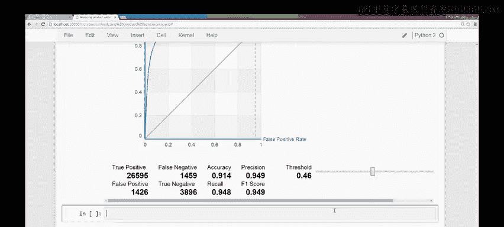

# 53：评估分类器：ROC曲线 📊

在本节课中，我们将学习如何评估已构建的情感分析模型。我们将重点介绍一种名为ROC曲线的评估方法，它帮助我们理解分类器在假阳性与真阳性之间的权衡。

---

## 模型评估概述

上一节我们讨论了分类错误率、精确度、假阳性和假阴性等概念。本节中，我们将通过实际演示来探索这些指标，并学习如何使用ROC曲线评估模型性能。

我们的情感模型提供了一个名为`evaluate`的函数，该函数允许我们在测试数据上评估模型质量，并使用特定的评估指标——ROC曲线。

## 理解ROC曲线

ROC曲线是一种可视化工具，用于探索假阳性和真阳性之间的关系，以及我们之前讨论的混淆矩阵。以下是ROC曲线的核心概念：

*   **真阳性（True Positives, TP）**：模型正确预测为正类的样本数量。
*   **假阳性（False Positives, FP）**：模型错误预测为正类的负类样本数量。
*   **真阳性率（True Positive Rate, TPR）**：在所有实际为正类的样本中，被模型正确预测的比例。计算公式为：`TPR = TP / (TP + FN)`。
*   **假阳性率（False Positive Rate, FPR）**：在所有实际为负类的样本中，被模型错误预测为正类的比例。计算公式为：`FPR = FP / (FP + TN)`。

ROC曲线描绘了在不同分类阈值下，TPR与FPR之间的关系。

## 可视化评估结果

文本形式的评估结果可能不够直观，因此我们使用可视化工具来展示。通过调用`sentiment_model.show()`并指定评估视图，我们可以清晰地看到ROC曲线和混淆矩阵。

以下是评估结果的关键数据点：

*   **真阳性数**：26455
*   **真阴性数**：4000（总负类样本为30965，这是一个高度不平衡的数据集）
*   **假阳性与假阴性数**：大致相同
*   **整体准确率**：91.1%（即0.911）

此外，我们还看到了一些其他指标，如精确度、召回率和F1分数，这些我们将在课程后续部分深入探讨。

## 探索分类阈值

关于假阳性和假阴性，一个关键点在于我们可以自然地调整分类阈值，即模型判定一个样本从负类转变为正类的临界点。

通过ROC曲线，我们可以直观地看到阈值变化的影响：

*   如果我们非常担心假阳性，可以设置一个非常保守的阈值。这样可以得到极低的假阳性率，但代价是只能捕获较少的真阳性（即真阳性率也较低）。
*   随着阈值逐渐放宽，我们沿着曲线移动，到达一个“拐点”。在这个点附近，我们可以用相对较少的假阳性增加，换取真阳性率的大幅提升。
*   如果我们设置一个非常宽松的阈值（例如，将所有样本都预测为正类），那么我们可以捕获所有的真阳性（真阳性率为1），但同时也引入了大量的假阳性。

你可以通过交互工具调整右侧的阈值滑块，并观察点在ROC曲线上移动，从而深刻理解这条曲线的含义。

## 课程总结

本节课中，我们一起学习了如何使用ROC曲线来评估分类器性能。我们了解到，ROC曲线通过描绘真阳性率与假阳性率在不同分类阈值下的变化，帮助我们直观地理解模型在识别正类样本时的能力与代价。通过调整阈值，我们可以在减少假阳性错误和捕获更多真阳性样本之间进行权衡，这对于实际应用中的模型调优至关重要。