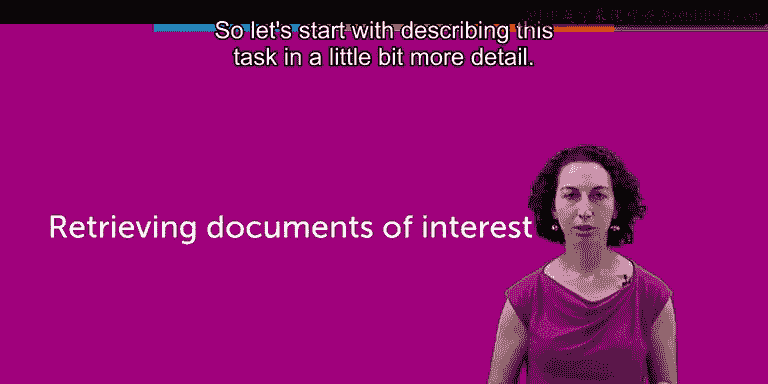
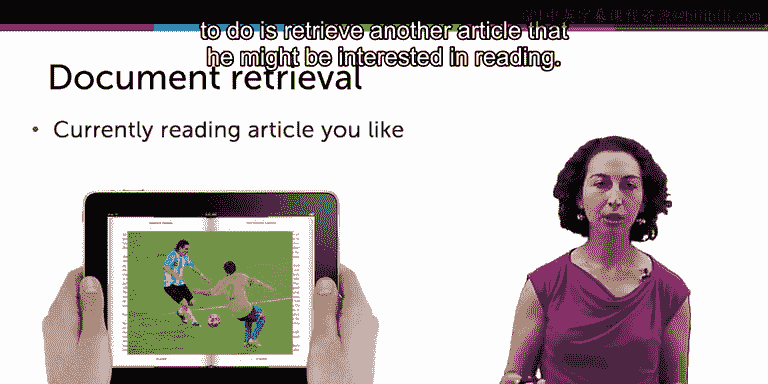
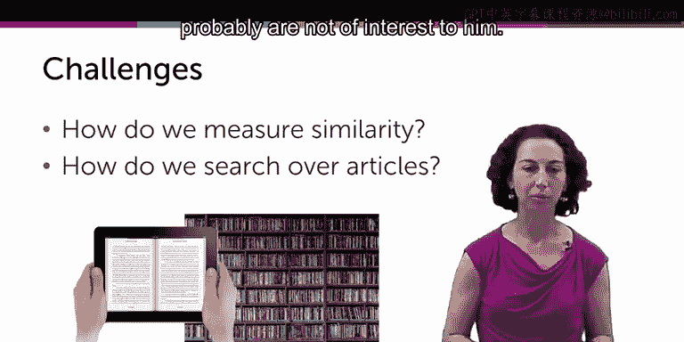

# 机器学习基础篇（第1课/共4课）｜第58讲：什么是文档检索任务 📄🔍

在本节课中，我们将详细探讨文档检索任务。我们将了解该任务的基本定义、核心挑战以及实现自动文档推荐所需考虑的关键问题。

---

## 任务描述

上一节我们介绍了机器学习的基本概念，本节中我们来看看一个具体的应用场景：文档检索任务。

让我们更详细地描述这个任务。

假设我们正在阅读一篇文章。

实际上是卡洛斯正在阅读这篇文章，因为这是一篇关于足球的文章。

或者，按照他的说法，是“football”。如果他穿着阿根廷球衣，或者“Fucci ball”，如果他穿着巴西球衣。显然这两个词的发音我都不准确，卡洛斯稍后可以纠正我。但重点是，他喜欢这篇文章，而我们想要做的是检索另一篇他可能感兴趣的文章。

---

## 核心挑战

然而，问题在于我们如何做到这一点？世界上有大量的文章，我们不能指望他去阅读每一篇并判断是否感兴趣。因此，我们需要找到一种方法来自动检索他可能感兴趣的文档。

以下是实现自动文档推荐需要解决的两个核心问题：

1.  **如何衡量文章之间的相似性？**
    我们需要这个标准，才能判断某篇文章与他正在阅读的文章相似，从而可能引起他的兴趣；或者判断一大批文章与他当前阅读的内容差异很大，可能不会引起他的兴趣。

2.  **如何在现有文章中搜索并检索出下一篇要推荐的文章？**

---

## 总结

本节课中，我们一起学习了文档检索任务的基本定义。我们了解到，该任务的核心目标是根据用户当前阅读的文档，自动推荐其可能感兴趣的其他文档。实现这一目标需要解决两个关键问题：**定义文档间的相似性度量方法**以及**设计高效的搜索与检索策略**。在接下来的课程中，我们将深入探讨解决这些问题的具体技术。