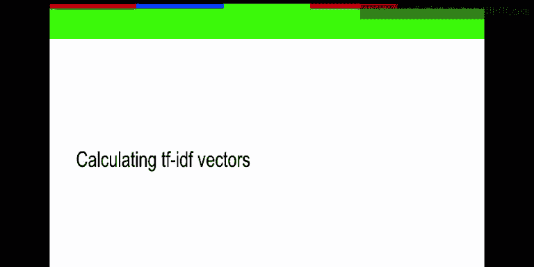
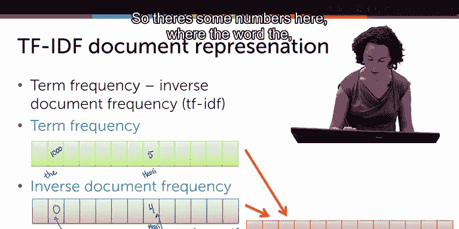

# 61：计算TF-IDF向量 📊

在本节课中，我们将学习一种在文本处理中常用的特征表示方法：TF-IDF（词频-逆文档频率）。这种方法能有效平衡词语在单个文档中的重要性与其在整个文档集合中的普遍性。

---

## 概述

上一节我们讨论了如何用词袋模型表示文本。本节中，我们来看看如何通过TF-IDF来改进这种表示，使其能更好地捕捉词语的重要性。

TF-IDF的核心思想是：**一个词语的重要性，随着它在单个文档中出现的次数（词频）增加而提高，但随着它在整个文档集合中出现的频率（文档频率）增加而下降**。这能帮助我们突出那些在特定文档中频繁出现，但在整个文档集合中却很少见的词语，这些词语往往具有更高的信息价值。

---

## 计算词频（Term Frequency）

首先，我们关注局部信息，即只查看用户当前正在阅读的单个文档。词频的计算很简单，就是统计目标词语在该文档中出现的次数。

**公式**：
`TF(词, 文档) = 词在文档中出现的次数`

这和我们之前做的词频统计是一样的，只是一个简单的计数因子。

---

## 计算逆文档频率（Inverse Document Frequency）

接下来，我们需要根据词语的全局稀有性来调整上述词频的权重。为此，我们要查看语料库中的所有文档，并计算逆文档频率。

**公式**：
`IDF(词) = log( 语料库中文档总数 / (1 + 包含该词的文档数量) )`

让我们分析一下这个公式的设计逻辑：

*   **对于非常常见的词**：假设一个词出现在几乎所有文档中。那么公式中的分子（文档总数）和分母（1 + 包含该词的文档数）会非常接近，结果近似于 `log(1)`，也就是 **0**。这意味着，我们会将那些在所有文档中都频繁出现的词语的权重**强烈下调至接近零**。
*   **对于非常罕见的词**：假设一个词只在极少数文档中出现。那么分子（文档总数，一个大数）除以分母（1 + 一个很小的数），结果会是一个较大的数。取对数后，仍会得到一个**非零且较大的数值**。
*   公式中分母加 **1** 的原因是为了避免除零错误，因为我们不能假设词汇表中的每个词都一定出现在语料库的某个文档里。

---

## TF-IDF向量的计算

现在，我们来看一个具体的例子，将词频和逆文档频率结合起来。

假设在某个文档中：
*   词语 **“the”** 出现了 **1000** 次。
*   词语 **“messy”** 出现了 **5** 次。

我们假设整个语料库共有 **64** 个文档。

**计算“the”的IDF**：
假设“the”这个词出现在除1个文档外的所有文档中（即出现在63个文档中）。那么其IDF为：
`IDF("the") = log(64 / (1 + 63)) = log(64/64) = log(1) = 0`

**计算“messy”的IDF**：
假设“messy”这个词只出现在 **3** 个文档中。那么其IDF为（以2为底的对数）：
`IDF("messy") = log(64 / (1 + 3)) = log(64/4) = log(16) = 4`

**计算TF-IDF**：
要得到该文档的TF-IDF向量表示，我们只需将每个词的词频（TF）乘以其逆文档频率（IDF）。

*   对于 **“the”**：`TF-IDF = 1000 * 0 = 0`
*   对于 **“messy”**：`TF-IDF = 5 * 4 = 20`

以下是计算过程的总结：

1.  **计算词频（TF）**：统计词语在单个文档中的出现次数。
2.  **计算逆文档频率（IDF）**：基于整个语料库，衡量词语的普遍性。
3.  **计算TF-IDF**：将TF与IDF相乘，得到最终的权重值。

如图所示，在最终的TF-IDF向量中，像 **“the”** 这样的常见词权重被下调至零，而像 **“messy”** 这样罕见且可能重要的词则被赋予了更高的权重。我们对词汇表中的所有其他词也进行同样的计算。

---

## 总结

本节课我们一起学习了TF-IDF向量的计算方法。我们了解到，TF-IDF通过结合词语的局部词频（TF）和全局逆文档频率（IDF），能够有效地对词语的重要性进行加权。这种方法可以抑制像“的”、“是”这类常见但信息量低的词语，同时提升那些在特定文档中关键且独特的词语的权重，从而为后续的机器学习任务（如文本分类、信息检索）提供更好的特征表示。