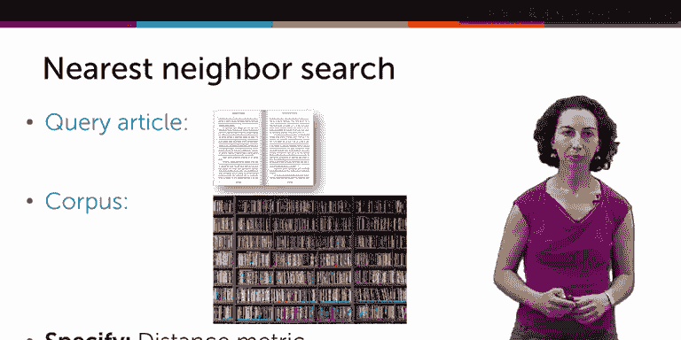
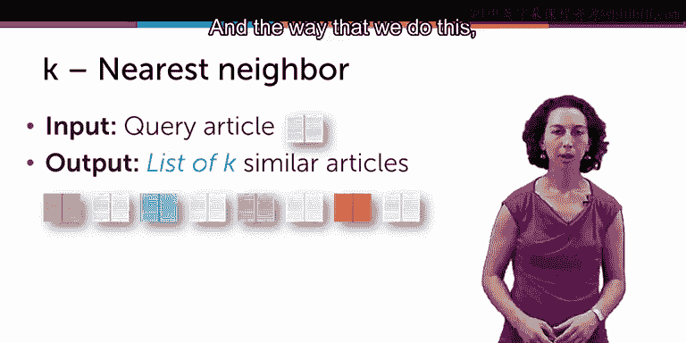

# 机器学习基础篇（第1课/共4课）｜P62：使用最近邻搜索检索相似文档 📄🔍

在本节课中，我们将学习如何利用最近邻搜索算法，根据用户正在阅读的文章，从文档库中检索并推荐相似的文章。我们已经介绍了文档的表示方法以及文档间相似度的度量方式，现在我们将转向实际的任务——文档检索。

---

## 从文档表示到检索

上一节我们讨论了如何表示文档以及如何度量文档间的相似性。本节中，我们来看看如何将这些概念应用于实际的文档检索任务。假设用户正在阅读一篇文章，并且喜欢它，我们的目标是向他们推荐另一篇相关的文章。

## 什么是最近邻搜索？

一种非常流行的推荐方法是**最近邻搜索**。在这个任务中，我们有一个**查询文章**（即用户正在阅读的文章）和一个**文档库**（即我们想要从中搜索并推荐新文章的所有文档集合）。最近邻搜索需要指定一个**距离度量**（即我们之前讨论过的相似性度量方法），该算法将输出一组相关的文章。

## 最近邻搜索的算法

以下是两种基本的最近邻搜索方法。

### 1-最近邻搜索

1-最近邻搜索是最简单的形式。给定查询文章，算法从文档库中返回**唯一一篇**与查询文章最相关的文章。

其算法非常直接：
1.  遍历文档库中的每一篇文章。
2.  使用之前描述的方法，计算查询文章与当前被考察文章之间的相似度。
3.  如果当前相似度高于迄今为止找到的最佳相似度，则将当前文章更新为最佳匹配文章。
4.  遍历完所有文章后，将找到的最佳匹配文章推荐给读者。

### K-最近邻搜索

K-最近邻搜索是1-最近邻搜索的一个直接变体。它不单单输出最相关的一篇文章，而是向读者推荐**K篇**最相关的文章。

其算法与1-最近邻搜索几乎相同，区别在于：
*   我们不再只保留最相关的一篇文章，而是维护一个**优先队列**，用于动态保存迄今为止找到的**前K篇**最相关文章。

---

## 总结

本节课中，我们一起学习了如何使用最近邻搜索进行文档检索。我们介绍了1-最近邻和K-最近邻两种基本算法，它们都基于文档的向量表示和相似度计算，从大型文档库中高效地找到与查询文章最相似的文档，从而实现个性化推荐。