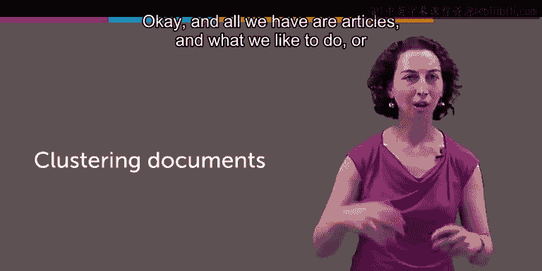
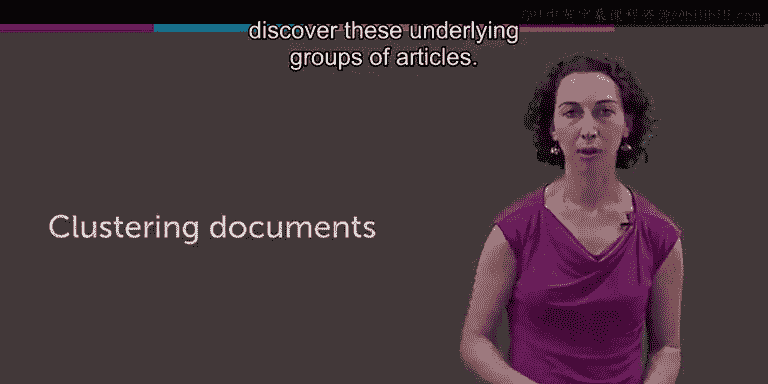
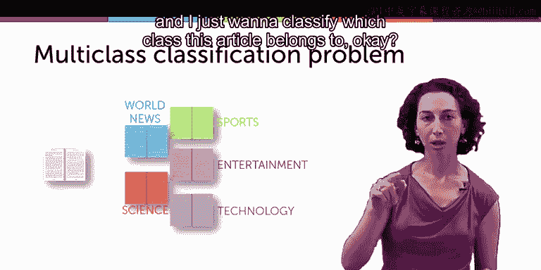

# 63：文档聚类任务概述 📄

在本节课中，我们将要学习文档聚类任务的基本概念。文档聚类是一种无监督学习方法，旨在将大量未标记的文档自动分组，使得同一组内的文档内容相似，不同组之间的文档内容差异较大。这种方法可以帮助我们组织和理解大规模文本数据。

---

上一节我们介绍了如何通过相似度度量来检索相关文档。本节中，我们来看看另一种处理文档集合的方法：文档聚类。

文档聚类的主要目标是将内容相关的文档自动分组。例如，我们可能有许多关于体育、国际新闻或其他主题的文章。如果我们能够以这种方式组织文档集合，当用户阅读一篇体育文章时，我们可以快速搜索所有其他体育类文章，而无需遍历整个文档库中的所有文章。

然而，这里的一个挑战是这些文章通常没有预定义的标签。不像《纽约时报》那样，每篇文章都有明确的分类标签（如“教育类文章”）。我们只有原始的文章文本，我们的目标是发现这些文章背后潜在的主题分组。

**目标**：发现相关文章的分组或聚类。例如，一个聚类可能代表所有关于体育的文章，另一个聚类则代表所有关于国际新闻的文章。

---

上一节我们讨论了无标签情况下的聚类挑战。现在，让我们暂时假设有人为我们提供了标签。

假设有人通读了我们文档库中的每篇文章（或至少大部分文章），并为它们添加了标签。例如，这些文章被标记为“体育”、“国际新闻”、“娱乐”和“科学”。这样，我们就拥有了一组带有标签的文章。

在这种情况下，当我们有一篇查询文章并希望将其分配到一个聚类时，问题就变成了一个**多类别分类问题**。因为核心问题是：这里有一篇查询文章，我不知道它的标签，但我有一批带有已知标签（如世界新闻、科学、体育、娱乐、技术）的文档。我只需要判断这篇文章属于哪个类别。

**核心问题**：这本质上是一个多类别分类问题。其形式化描述可以视为：
`给定带标签的训练集 D = {(x_i, y_i)}， 其中 y_i ∈ {C1, C2, ..., Ck}， 学习一个模型 f: X -> Y， 以对新的查询文档 x_q 预测其类别 y_q。`

---

如果情况如上所述，即我们拥有带标签的训练数据，那么这将是一个**监督学习问题**的典型例子。我们利用已知的输入（文档特征）和输出（类别标签）来训练一个分类器，然后用它来预测新文档的类别。

---

本节课中我们一起学习了文档聚类任务的基本概念。我们了解到，文档聚类的核心目标是在无标签的情况下发现文档的内在分组结构，这属于无监督学习。同时，我们也看到，如果拥有文档的预定义标签，那么同样的任务可以转化为一个监督式的多类别分类问题。理解这两种视角的差异，是掌握后续聚类算法和文本分类方法的基础。