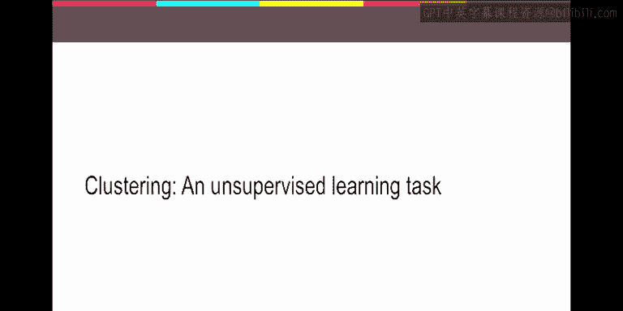
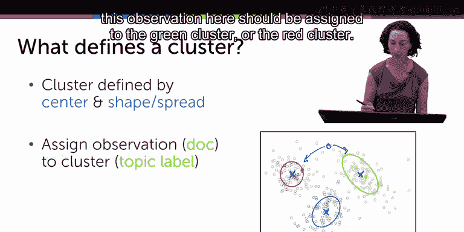
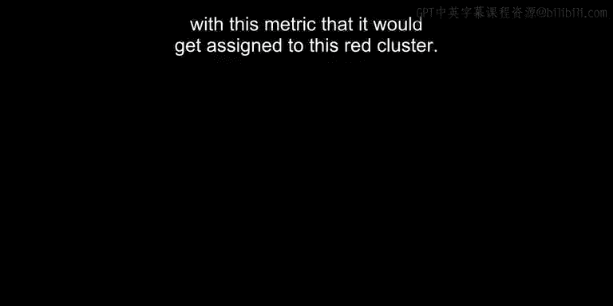

# 63讲：文档聚类：无监督学习任务 📚

在本节课中，我们将学习一种称为**文档聚类**的无监督学习任务。我们将了解其基本概念、输入输出形式，以及两种常见的聚类判定方法。

---

## 概述

文档聚类的目标是在没有预先提供标签的情况下，自动将相似的文档分组。输入是文档的词频向量，输出是为每个文档分配的聚类标签。

## 输入与输出

上一节我们介绍了无监督学习的基本概念，本节中我们来看看文档聚类的具体形式。

输入数据是文档的**词频向量**。每个观测点（即一篇文档）都由其在词汇表上各单词的计数向量表示。为便于可视化，我们假设词汇表仅包含两个单词，因此可以在二维平面上表示这些向量。横轴代表单词1的计数，纵轴代表单词2的计数。现实中，词汇表通常非常庞大，向量存在于高维空间。

以下是输入数据的图示说明：

算法的输出是**聚类标签**。每个文档都会被分配一个标签，表示其所属的组别。

以下是输出结果的图示说明：

例如，图中所有红色点被标记为“聚类1”，蓝色点被标记为“聚类2”，绿色点被标记为“聚类3”。这些标签是算法运行后自动生成的，属于无监督学习任务。我们可以在事后查看每个聚类中的文章，例如，可能发现“聚类1”中的文章都与体育相关。

## 聚类的定义

每个聚类由两个核心要素定义：**聚类中心**和**聚类形状**。

聚类中心通常可以视为该组数据的“平均”或“代表”点。聚类形状描述了组内数据点的分布情况，在图中常用椭圆来表示。

以下是聚类中心与形状的图示：

## 分配文档到聚类的方法

决定一个文档应属于哪个聚类，主要有两种思路。

### 方法一：基于聚类中心和形状

这种方法同时考虑文档到聚类中心的距离以及聚类的形状（即分布）。算法会为每个观测点基于目标聚类的中心和形状计算一个“得分”。

例如，在下图中，尽管粉色点距离红色聚类中心更近，但由于绿色聚类呈细长的椭圆形，该点最终被分配给了绿色聚类。

### 方法二：仅基于聚类中心

这是一种更常见且简单的方法。它只计算文档到各个聚类中心的距离，并将其分配给距离最近的中心。

以下是仅基于中心距离进行分配的图示：

在这种情况下，对于某些边界点（如图中粉色点），判断它属于红色还是绿色聚类会比较困难。但对于明显更靠近某一中心的点（如图中上方的点），分配则非常明确。

---

## 总结

本节课我们一起学习了**文档聚类**这一无监督学习任务。我们明确了其输入是文档的词频向量，输出是聚类标签。同时，我们探讨了聚类的两个定义要素——中心和形状，并介绍了两种将文档分配到聚类的方法：一种是综合考虑中心和形状，另一种是仅基于到聚类中心的距离。理解这些基础概念是掌握更复杂聚类算法的关键。