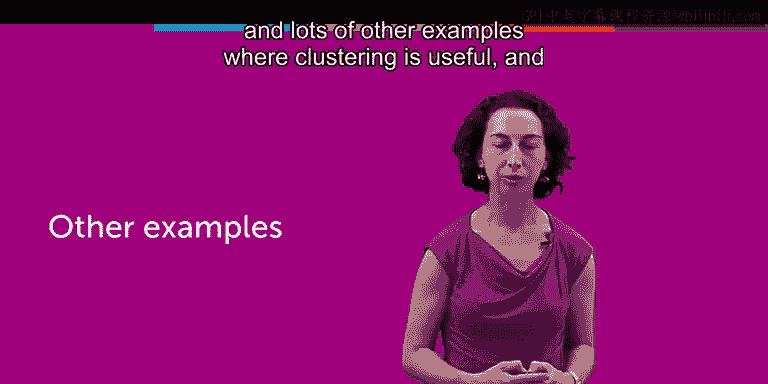
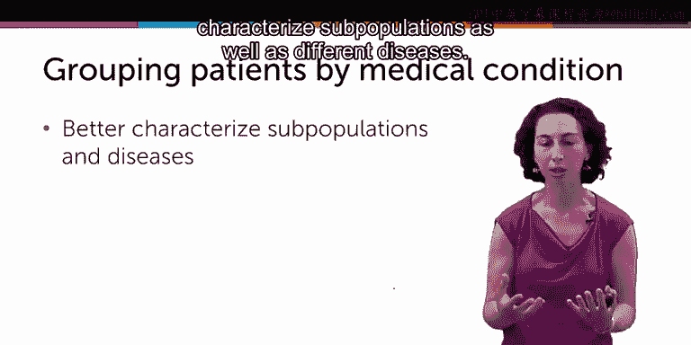
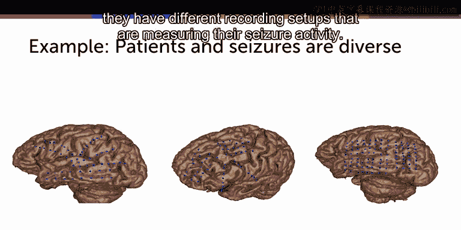
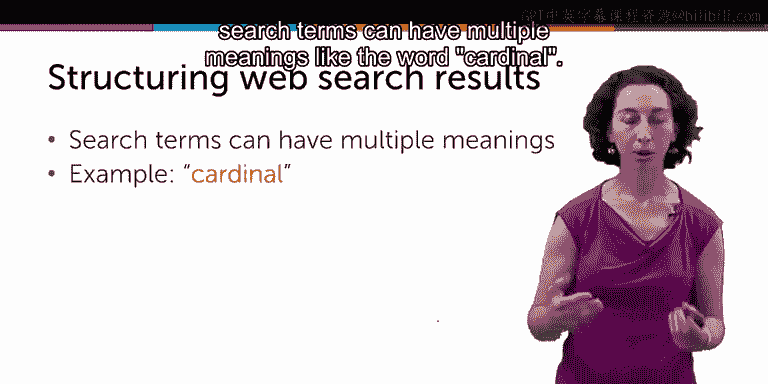
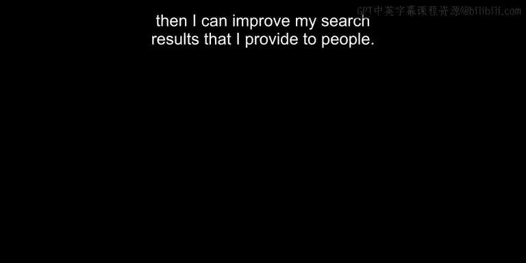
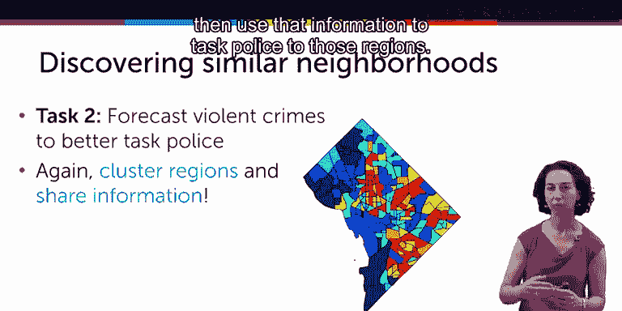

# 65：聚类的其他应用示例 🎯

在本节课中，我们将学习聚类算法在不同领域中的多种应用示例。通过了解这些实际案例，你将更深入地理解聚类技术的广泛用途和实际价值。

---

上一节我们详细讨论了聚类在文档检索中的应用。本节中，我们来看看聚类在其他领域的几个典型示例。

以下是聚类的一些重要应用场景：

*   **图像搜索**：例如，在谷歌图片搜索中，如果我们能根据“海洋”、“粉红色花朵”、“狗”、“日落云彩”等类别对所有图片进行聚类和结构化，将极大地提升搜索的效率和准确性。
*   **患者分组**：目标是根据患者的医疗状况进行分组，以更好地描述亚群和不同疾病。例如，我们可以研究一群癫痫患者。

上图展示了三位不同患者的大脑，他们有不同的记录装置来测量癫痫活动。

对于每位患者，我们获得了一系列他们随时间表现出的不同癫痫发作记录。每个彩色方块代表一次不同的癫痫发作记录。在这些不同患者之间，可能存在相似的癫痫发作类型。

我们可以收集所有三位患者的癫痫发作记录并进行聚类分析。通过这种方式识别出不同类型的癫痫，可以帮助我们根据患者表现出的癫痫类型来更好地进行治疗。

*   **产品推荐**：例如，在亚马逊上，许多第三方卖家会发布待售产品并为其提供标签。假设有人想出售一张婴儿床，并合理地将其标签为“家具”类。但如果我们查看购买此商品的用户及其购买历史，并对比具有相似购买历史的其他人，可能会发现购买此婴儿床的用户也购买了婴儿汽车座椅。那么，我们可以推断，这张被标记为“家具”的婴儿床，更好的标签应该是“婴儿产品”。

除了根据购买历史发现相关的产品组，我们还可以用此方法来发现亚马逊上相关的用户群组，并用于向这些用户定向推荐产品。

*   **结构化网络搜索结果**：例如，搜索词可能有多重含义，比如单词“cardinal”。在谷歌中搜索该词，用户可能想查找关于“红衣主教鸟”的文章，也可能是关于“棒球队”或“宗教人物红衣主教”的信息。

如果我们能基于文章内容，运用本模块讨论过的同类思想对其进行聚类和结构化，就可以为用户提供更精准的搜索结果。

应用列表还可以继续延伸。另一个非常有趣的应用是考虑**社区集合**。在多个场景中，我们都需要发现相似的社区。

*   **房价估算**：当我们想在非常局部的地域层面估算房屋价格时，面临的挑战是，在一个很小的社区内，我们通常只有很少甚至没有房屋销售观测数据。因此，要估算该社区在某个时间点的房屋价值非常困难，因为缺乏该社区内其他房屋数据作为估算基础。然而，如果我们能发现具有相似类型房屋动态（房价动态）的其他社区，就可以利用从这些被发现与当前社区相关的其他社区中获取的信息，来对销售数据稀少或没有销售的社区内的房屋进行良好估算。其核心思想是发现社区集群，然后在集群内共享信息（如房屋销售信息）以形成更好的估计。这里描述的解决方案是：**对具有相似趋势的区域进行聚类，然后在聚类内共享信息**。
*   **犯罪预测与警力部署**：同样的发现相关区域的思路，可用于帮助预测暴力犯罪，从而更好地向不同区域部署警力。同样，一旦我们发现具有非常相似犯罪动态的不同社区，就可以对这些社区的暴力犯罪率形成更好的预测，并利用该信息向这些区域分派警力。

---

本节课中，我们一起学习了聚类算法在图像搜索、医疗分组、产品推荐、搜索结果优化、社区分析与房价估算、犯罪预测等多个领域的实际应用。这些示例表明，聚类作为一种强大的无监督学习技术，能够帮助我们从数据中发现内在结构、识别相似群体，并为各种决策提供支持，其应用范围极为广泛。