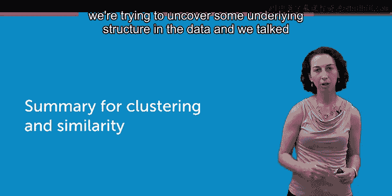
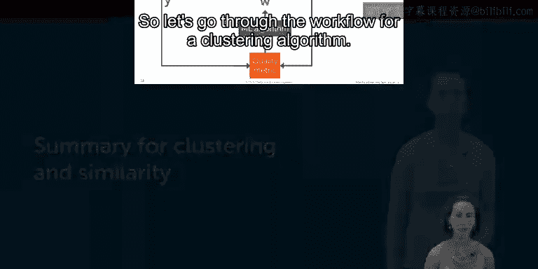
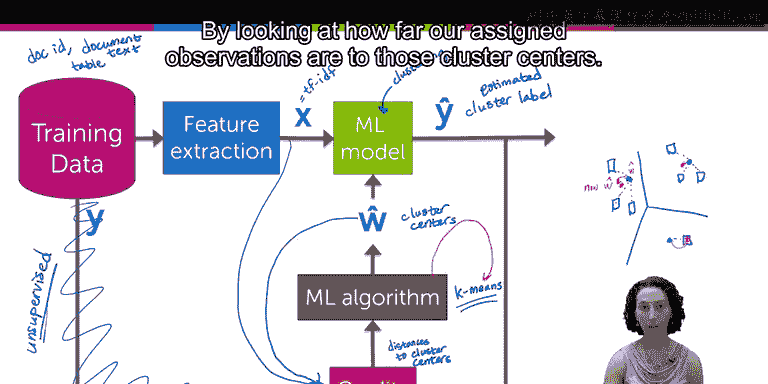
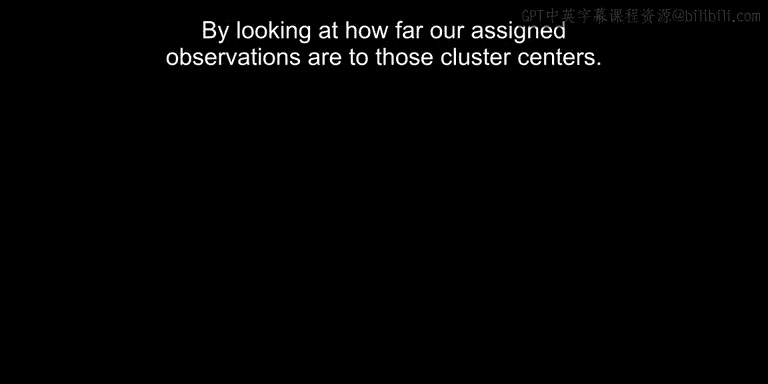

# 67：聚类与相似度 📊


在本节课中，我们将学习聚类算法的完整工作流程。我们将从文档聚类任务出发，探讨如何通过无监督学习发现数据中的潜在结构，并详细介绍K-means算法的核心机制。



---



## 概述：聚类算法工作流程

在本模块中，我们讨论了文档检索任务，并介绍了聚类的概念——即试图揭示数据中的潜在结构。我们探讨了聚类在许多不同领域中的广泛应用。现在，让我们深入理解聚类算法的工作流程。

如果你觉得已经掌握了这部分内容，因为你在其他模块中也见过类似的工作流程，那么请注意，本节内容将有所不同。

---

## 训练数据与特征提取

首先，我们来看聚类任务的训练数据。对于文档聚类任务，训练数据通常包括文档ID和文档文本。我们拥有大量文档，以及每篇文档对应的全部文本内容。

接下来，我们需要从文档中提取特征。我们讨论过多种文档表示方法，但这里我们以**TF-IDF（词频-逆文档频率）**表示法为例。其核心思想是衡量一个词在文档中的重要程度。

**TF-IDF公式**：
`TF-IDF(t, d) = TF(t, d) * IDF(t)`
其中：
- `TF(t, d)` 是词t在文档d中的词频。
- `IDF(t)` 是词t的逆文档频率，计算公式为 `log(N / (df(t) + 1))`，N是文档总数，`df(t)`是包含词t的文档数。

提取特征后，我们将基于这些特征表示对文档进行聚类。这意味着我们要将这些特征输入某个机器学习模型——在本例中是聚类模型。

---

## 模型输出与无监督学习挑战

模型的输出是为每篇文档分配一个**聚类标签**。这个输出，我们称之为预测的或估计的聚类标签。

然而，这里出现了一个关键问题：我们如何评估这些聚类标签的准确性？在聚类任务中，我们并没有真实的、已知的聚类标签可供比较。这是因为我们处于**无监督学习**的设置中。我们无法获得那个用于对比的“真实答案”。

---

## 评估聚类质量：内聚性度量

既然没有真实标签，我们如何评估聚类的质量呢？让我们通过K-means算法中的Voronoi图来理解。

假设我们有一些聚类中心和一些数据点。一个良好的聚类算法会使得每个数据点与其所属聚类中心之间的距离非常小。因此，我们的目标是**最小化这些距离**。

为了度量这个“准确性”或质量，我们需要两样东西：
1.  我们的数据，即TF-IDF向量。
2.  当前的聚类中心，这是K-means算法中的模型参数。

我们将文档表示和聚类中心代入一个**质量度量函数**，该函数计算所有数据点到其对应聚类中心的距离。这个距离总和（或平均距离）就是我们对聚类质量的度量。它并非传统意义上的“误差”，而是一种内聚性的衡量标准。

---

## K-means算法详解

我们讨论的算法是**K-means**，它是一种常用的聚类方法。K-means的目标正是最小化上述提到的距离总和。它是如何做到的呢？通过迭代优化。

算法流程如下：
1.  初始化聚类中心。
2.  **分配步骤**：将每个数据点分配给距离最近的聚类中心。
3.  **更新步骤**：重新计算每个簇中所有点的均值，并将该均值设为新的聚类中心。
4.  重复步骤2和3，直到聚类中心不再发生显著变化或达到预定迭代次数。

用伪代码描述核心更新过程：
```python
# 假设有数据点X和当前聚类中心centroids
# 分配步骤
labels = assign_each_point_to_nearest_centroid(X, centroids)
# 更新步骤
new_centroids = compute_mean_of_points_in_each_cluster(X, labels)
```



这个过程不断循环，通过观察数据点到当前聚类中心的距离来更新聚类中心（即模型参数），从而逐步提升聚类的内聚性。



---

## 总结与拓展

在本模块中，与之前一些模块不同，我们深入探讨了方法背后的算法细节。具体来说，对于聚类，我们详细讲解了K-means算法；对于文档检索任务，我们还讨论了最近邻搜索及其算法细节，并让你在IPython笔记本中具体探索了维基百科条目检索的实现。

至此，你应该能够着手构建一个非常酷的检索系统，用于新闻文章检索或任何其他你能想到的、有趣的应用场景。当然，现实中存在大量有趣的例子，期待你去探索那些我此刻尚未想到的创意。

本节课我们一起学习了聚类算法的工作流程，理解了在无监督设置下如何通过内聚性度量评估模型，并掌握了K-means算法的核心迭代机制。这些是构建更复杂数据理解系统的基础。