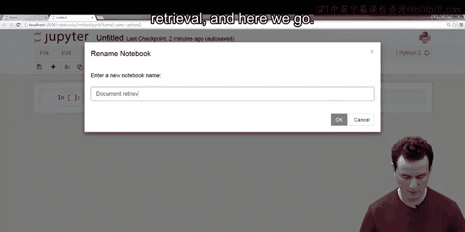
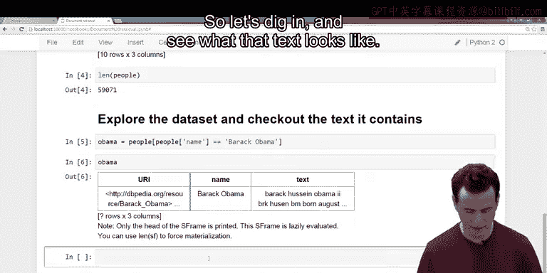

# 机器学习基础篇（第1课/共4课）📚：加载并探索维基百科数据


在本节课中，我们将学习如何加载一个维基百科人物数据集，并对其进行初步探索。我们将使用Python和GraphLab Create库来操作数据，并查看其中包含的具体内容。

---


上一节我们介绍了本课程的目标，本节中我们来看看如何实际操作数据。




首先，我们需要导入必要的库并加载数据。

```python
import graphlab
```

以下是加载数据的具体步骤：

```python
people = graphlab.SFrame('people_wiki.gl/')
```

数据加载完成后，我们可以先查看数据的前几行，以了解其结构。

```python
people.head()
```

你会看到数据包含三列：`URI`（维基百科页面链接）、`name`（人物姓名）和`text`（页面正文文本）。这个数据集包含了大约59,000个人物的信息。

---

现在我们已经加载了数据，接下来让我们更深入地探索其中的内容。

我们可以查看特定人物的页面信息。例如，让我们查看美国前总统巴拉克·奥巴马（Barack Obama）的页面。

以下是筛选并查看奥巴马页面的代码：

```python
obama = people[people['name'] == 'Barack Obama']
obama['text']
```

输出显示：“Barack Hussein Obama was born on August 4th, 1961 and is the 44th and current president of the United States.” 这正是我们期望看到的维基百科文本格式。

---



为了进一步理解数据集的多样性，我们可以再查看另一位人物的信息。

让我们查看演员乔治·克鲁尼（George Clooney）的页面。

以下是相应的代码：

```python
clooney = people[people['name'] == 'George Clooney']
clooney['text']
```

输出显示：“George Timothy Clooney was born in 1961... He is an American actor, writer, producer, director, and activist.” 通过对比，我们可以看到数据集包含了来自不同领域的人物信息。

---


本节课中我们一起学习了如何加载维基百科人物数据集，并使用简单的筛选操作来探索特定人物的页面内容。我们看到了数据的结构，并初步了解了文本信息的形式。在接下来的课程中，我们将基于这些数据构建更复杂的文档检索系统。