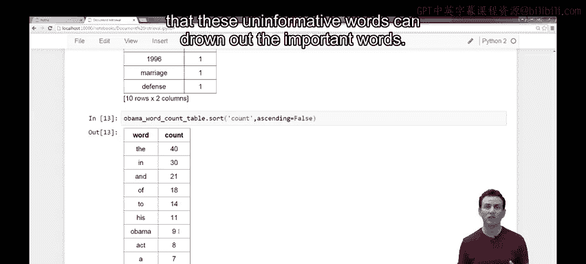

# 69：探索词频 📊


在本节课中，我们将学习如何探索文本数据中的词频。我们将使用维基百科上关于巴拉克·奥巴马的文章作为示例，通过计算和排序词频来理解文本内容。同时，我们还将介绍一个实用的数据处理技巧，帮助您更高效地处理字典类型的数据。

---

## 数据概览

我们正在处理一个相当整洁的数据集。在之前的讲座中，Emily 提到了构建词频计数及其面临的一些挑战。本节中，我们首先快速查看一下词频计数。

以下是我们要分析的维基百科文章数据示例。


---

## 计算奥巴马文章的词频

首先，我们以维基百科上关于巴拉克·奥巴马的文章为例，快速查看其词频计数。

我们创建一个名为 `Obama` 的变量，并为其添加一个名为 `word_count` 的新列。这个列将用于存储巴拉克·奥巴马文章的词频计数。

我们可以通过调用文本分析工具箱中现成的函数 `count_words` 来实现。虽然您也可以像在情感分析分类笔记中展示的那样，自己编写函数来计算词频，但为了快速开始，我们直接使用这个现成的函数。

```python
# 调用 count_words 函数计算词频
Obama['word_count'] = count_words(Obama['text'])
```

现在，我们已经计算了词频。让我们快速打印出来看看。

```python
print(Obama['word_count'])
```

执行后，您会看到类似“operations”出现1次、“represent”出现1次、“office”出现2次、“unemployed”出现1次等结果。目前，这些数据看起来并不直观。接下来，我们将进一步处理这些数据，并在此过程中展示一个在其他领域也可能有用的数据处理技巧。

---

## 排序词频数据

为了更好地理解词频数据，我们需要对其进行排序。请注意，`word_count` 是一个类似 Python 字典的结构，其中键是单词（例如“Honolulu”、“marriage”等），值是该单词出现的次数（例如1、2、3、5、30等）。

为了对这些单词进行排序，我们需要将其转换为一个表格，其中一列是单词（字典的键），另一列是计数。然后，我们将对这个表格进行排序。

有多种方法可以在 Python 中实现这一点。下面我将展示一个快速且实用的小技巧。

首先，我创建一个名为 `Obama_word_count_table` 的新表格。

```python
# 从 Obama 表中选择 word_count 列，并利用 stack 函数转换
Obama_word_count_table = Obama[['word_count']].stack(column_name='word_count', new_column_name=['word', 'count'])
```

`stack` 函数非常有用。它接受 SFrame 中包含字典的一列，并将其堆叠成多列（本例中是两列：`word` 和 `count`）。我们需要指定要堆叠的列名（这里是 `word_count`）以及新列的名称（`word` 和 `count`）。

执行后，我们查看这个新表的前几行。

```python
print(Obama_word_count_table.head())
```

您会看到单词如“normalize”、“sort”、“combat”等，但表格尚未排序。接下来，我们只需按 `count` 列对这个表格进行排序。

```python
# 按计数降序排序
Obama_word_count_table = Obama_word_count_table.sort('count', ascending=False)
```

我们之前已经见过排序操作，这很简单。我们调用 `sort` 函数，按 `count` 列排序，并设置 `ascending=False` 以实现降序排序（从高到低，例如3、2、1），而不是默认的升序排序（1、2、3）。

按下回车后，您会看到最常见的单词是“the”，其次是“in”、“and”、“of”、“to”、“his”，最后才是“Obama”等。这些单词信息量不大。在讲座中，Emily 曾提到，这些无信息的单词可能会淹没重要的单词，这正是我们引入 **TF-IDF** 概念的原因。

---

## 总结

本节课中，我们一起学习了如何探索文本数据的词频。我们从计算奥巴马文章的词频开始，然后通过一个实用的 `stack` 函数技巧将字典数据转换为表格格式并进行排序。最后，我们观察到简单词频计数的局限性，即常见但信息量少的单词（如“the”、“in”）会占据主导，从而引出了下一节将要深入学习的 **TF-IDF** 概念，该概念能更好地衡量单词在文档中的重要性。




