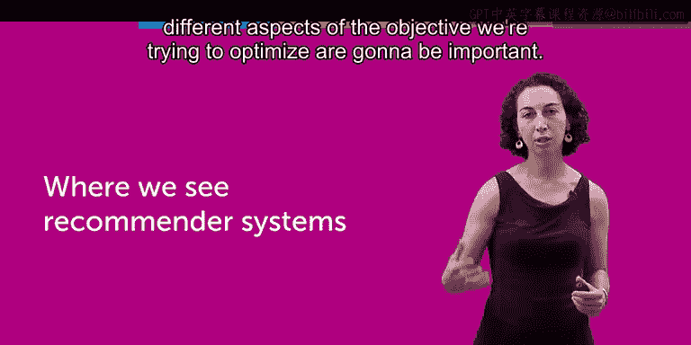
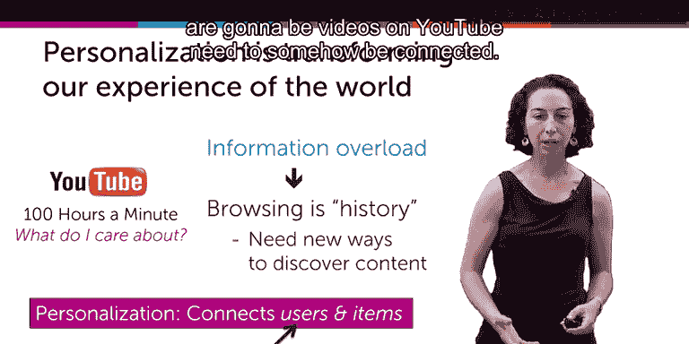
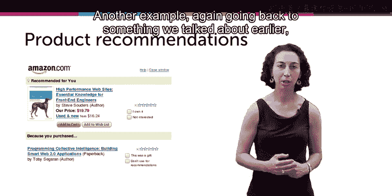
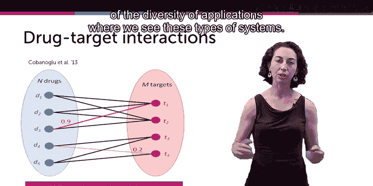

# 机器学习基础篇（第1课/共4课）｜推荐系统应用场景 🎯

在本节课中，我们将要学习推荐系统在现实世界中的多种应用场景。推荐系统通过个性化技术，帮助用户在海量信息中发现感兴趣的内容，其应用已深入我们生活的方方面面。

---

## 个性化：应对信息过载的关键 🔑

上一节我们介绍了推荐系统的核心目标，本节中我们来看看个性化技术为何如此重要。信息过载是当今数字时代的主要挑战，用户无法手动浏览所有可用内容。

例如，YouTube每分钟约有100小时的新视频上传。用户访问YouTube时，只希望观看自己感兴趣的视频。传统浏览方式已无法应对如此庞大的内容量。

因此，需要一种方法来自动发现与用户相关的内容。这就是个性化的核心理念：将用户（如访问YouTube的我）与项目（如YouTube上的视频）连接起来。

个性化将在推荐系统中扮演关键角色。

---

## 经典推荐系统应用实例 🛒

以下是推荐系统非常重要的几个经典例子。

*   **Netflix视频推荐**：用户观看视频，Netflix的目标是推荐可能感兴趣的电影或电视节目。关键问题是如何实现这些推荐。
*   **亚马逊产品推荐**：用户在亚马逊购买产品后，网站会推荐其他可能感兴趣的产品。但推荐时不仅要考虑用户单次会话的兴趣（例如，购买网站建设书籍的用户可能对Web应用书籍感兴趣），更要结合用户长期的购买历史。例如，我最近为儿子购买了鞋子，但这并非我唯一的兴趣。通过分析我的完整购买历史，可以做出比仅基于单次会话更好的推荐。
*   **推荐随时间变化**：推荐需要随时间适应。例如，一年前我购买了大量新生儿产品，但今天很可能不再需要。因此，亚马逊今天展示给我的推荐必须随之调整。

---

## 流媒体音频与社交网络中的推荐 🎵

除了点播视频，许多网站也提供带个性化推荐的流媒体音频服务。然而，与点播视频不同，流媒体音频希望一首歌接一首歌地连续播放。

我们需要一个连贯的歌曲流。我希望播放我喜欢的歌曲或类似歌曲，而不希望风格快速切换（例如，从独立咖啡馆音乐突然切换到重金属音乐）。同时，我也不想反复听到同一首歌。

因此，推荐需要具有连贯性，同时也需要提供多样化的歌曲序列供我聆听。

推荐系统发挥重要作用的另一个关键领域是社交网络。

例如，Facebook拥有海量用户，我们需要在这些用户之间建立连接。下图可能是Facebook用户间的连接图，假设我是这个粉色节点，Facebook希望推荐我可能感兴趣连接的其他用户。

在这个应用中，值得注意的是，用户和“项目”属于同一类型——都是人。当我是Facebook用户时，推荐给我的“项目”是其他人。因此，在这个应用中，用户和项目最终是完全相同的类型。

---

## 超越在线媒体：推荐系统的多样化应用 💊

我们讨论的推荐系统主要集中于在线媒体，但越来越多的人认识到推荐系统在其他领域也能发挥重要作用。

一个例子是所谓的“药物-靶点相互作用”。假设我们有一种已被充分研究的药物，例如阿司匹林，它作为头痛治疗药物已被熟知。但如果发现它可能具有其他用途呢？例如，用于心脏病患者的血液稀释。

如果我们能发现这类关系，将这种药物重新用于其他治疗，将非常有用。因为获得FDA对一种全新药物的批准是一个成本高昂且漫长的过程。但如果能利用一种副作用和潜在风险已得到充分研究和了解的药物，就更容易获得用于治疗其他病症的批准。

在这种情况下，我们或许可以说：如果你喜欢用阿司匹林治头痛，你可能也会喜欢用它治疗心脏问题。

这只是推荐系统应用多样性的一个例子，表明这类系统正在医疗等领域发挥着积极作用。

---

## 总结 📝

本节课中我们一起学习了推荐系统的广泛应用场景。我们从应对信息过载的个性化需求谈起，探讨了Netflix、亚马逊等经典案例，了解了推荐如何随时间变化。接着，我们分析了流媒体音频对推荐连贯性与多样性的特殊要求，以及社交网络中推荐“同类项”（用户推荐用户）的特点。最后，我们看到了推荐系统如何超越在线媒体，在药物重定位等医疗领域展现价值。这些例子共同说明了推荐系统技术的普适性与重要性。