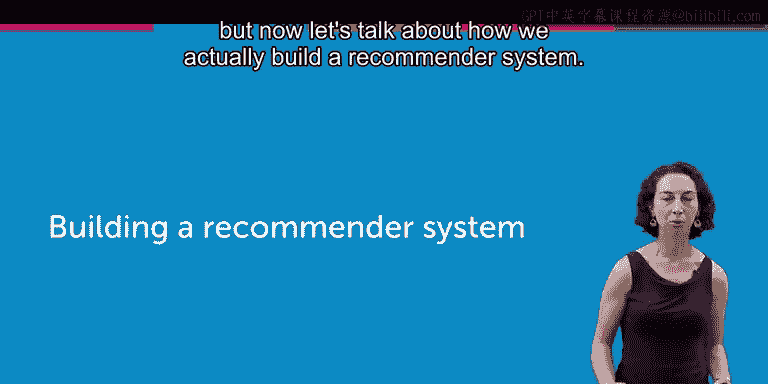
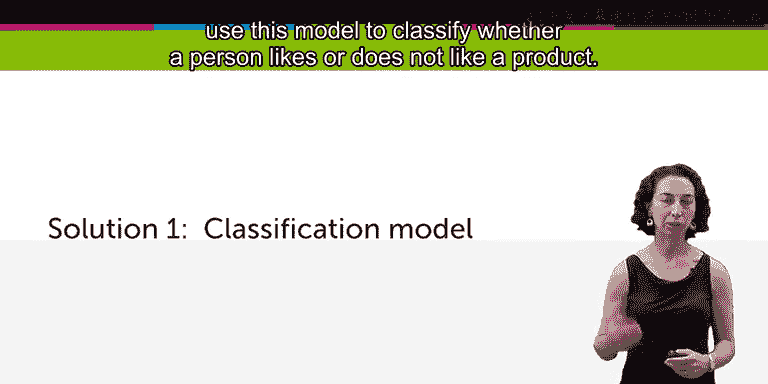
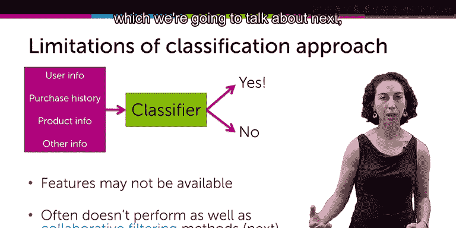
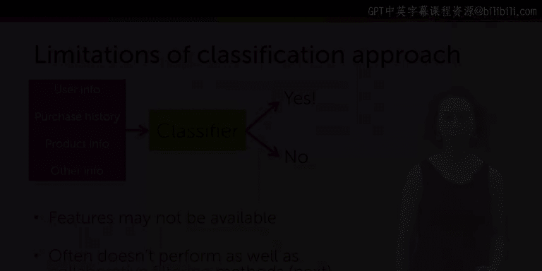

# 75：通过分类构建推荐系统 📚

在本节课中，我们将学习如何利用分类模型构建个性化推荐系统。我们将从最简单的基于流行度的推荐方法开始，逐步引入更复杂的分类模型，并探讨其优势与局限。

---

## 基于流行度的推荐方法 📊

上一节我们介绍了推荐系统的多种应用场景，本节中我们来看看如何实际构建一个推荐系统。构建推荐系统的方法多种多样，我们先从最基础的方法开始讨论。

第一种零级方法是根据产品的流行度进行推荐。这种方法在新闻网站等平台上非常常见。

以下是基于流行度推荐的具体做法：

*   例如，《纽约时报》网站上会列出“最受欢迎文章”列表，并按不同主题（如“最多邮件转发文章”）进行排序。
*   当我们考虑向其他读者推荐文章时，我们只是根据这些文章被《纽约时报》读者分享的频率进行排序。

这种方法效果尚可，用户可能确实会发现感兴趣的文章。但它的一个明显缺陷是完全缺乏个性化。因为所有推荐都基于整个《纽约时报》读者群体的行为，而读者群体本身非常多样化。因此，我们自然希望有一种能更了解我个人兴趣的推荐方法。

---

## 引入分类模型实现个性化推荐 🤖

为了增加个性化，我们可以尝试使用分类模型。该模型将同时利用产品和用户的特征来进行推荐。这个分类模型与你刚刚从卡洛斯那里学到的用于情感分析的分类模型完全一样，但在这里，我们将用它来分类判断一个人是否喜欢某个产品。

这个分类模型将接收关于用户的特征、该用户过去的购买记录特征、我们考虑推荐的产品特征，以及许多其他潜在特征。我们将所有这些特征输入分类模型，模型将输出“是”（我认为这个人会喜欢这个产品）或“否”（我认为他们不会喜欢）。

这种分类方法有很多优点。

以下是分类推荐方法的主要优势：

*   **高度个性化**：我们使用了用户特征及其购买历史。
*   **能捕捉上下文**：例如，我们可以考虑一天中的时间、用户刚刚浏览的内容。比如，我可能在白天更可能购买教科书，在晚上更可能购买家居产品。
*   **能处理有限的用户历史**：例如，假设我是亚马逊用户，过去购买物品不多。对于许多方法来说，很难确定我的兴趣。但如果你有我的年龄等信息，仅凭这一点就可能非常有助于预测我的喜好。

然而，这种方法也有局限性。其中一个重要的限制是，我们讨论的这些对预测喜好非常有用的特征，可能无法获得。

以下是分类推荐方法面临的主要挑战：

*   例如，你可能不知道我的年龄或性别，此类信息可能缺失。
*   同样，对于产品，你可能也缺少信息，或者产品描述质量很差（尤其是在亚马逊这类平台上，许多卖家销售不同产品，信息质量可能较低）。

因此，我们实际更常见的是使用一种称为“协同过滤”的方法，我们接下来会讨论，它通常比这种分类方法效果更好。

---

## 总结与展望 🎯

本节课中，我们一起学习了构建推荐系统的初步方法。我们从简单的基于流行度的非个性化推荐开始，然后引入了利用用户和产品特征的分类模型来实现个性化推荐，并分析了该模型的优势与数据依赖性强等局限。

这为我们理解更强大的协同过滤方法奠定了基础，我们将在下一节中进行探讨。