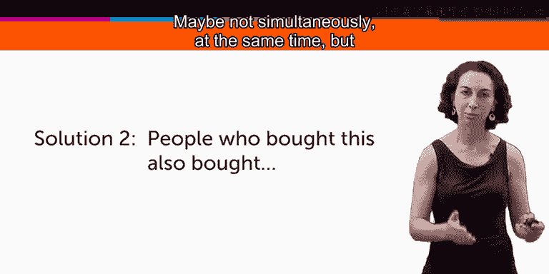
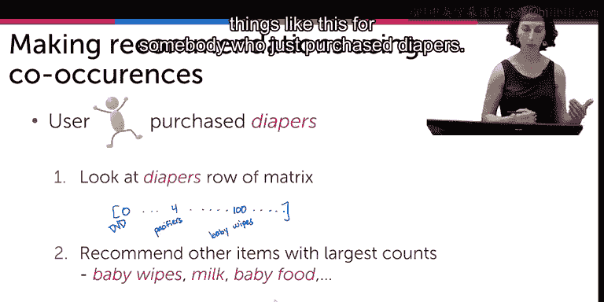

# 77：协同过滤：购买此商品的人也购买了 🛒

在本节课中，我们将要学习协同过滤的基本概念，特别是如何利用“购买此商品的人也购买了”这类信息来构建推荐系统。我们将从直观理解开始，逐步深入到如何构建和使用一个“共现矩阵”来生成推荐。

---

## 协同过滤的基本概念

协同过滤的核心思想是，通过利用其他用户在商品推荐（或更广义的用户与物品之间的关联）中的行为，来为当前用户生成推荐。

当我们考虑进行商品推荐时，一个非常直观的想法是：如果一个人购买了某件商品，那么他很可能也对其他某些商品感兴趣。这是因为我们过去观察到大量用户同时购买这些商品对的例子。这里的“同时”不一定指同一时刻，也可能是在他们的购买历史中先后发生。

上一节我们介绍了协同过滤的直观想法，本节中我们来看看如何具体实现它。

## 构建共现矩阵

为了利用这种购买共现关系，我们需要构建一个**共现矩阵**。这个矩阵将存储关于哪些商品被用户一起购买的所有信息。

这个矩阵 **C** 是一个“物品 × 物品”的矩阵。矩阵的行和列都代表所有不同的商品。

例如，矩阵的某一行可能对应“尿布”。如果这是矩阵的第三行，那么矩阵的第三列也同样对应“尿布”。

如果我们想说很多人同时购买了尿布和婴儿湿巾，我们就查看“尿布”所在的行，然后找到“婴儿湿巾”所在的列。这个交叉位置的条目会有一个数字，它代表**同时购买了尿布和婴儿湿巾的用户数量**。

这里有一个关键点：同时购买尿布和婴儿湿巾的用户数量，与同时购买婴儿湿巾和尿布的用户数量是相同的。这意味着这个矩阵是一个**对称矩阵**。如果我们沿着主对角线（从左上到右下的对角线）折叠这个矩阵，两边的数字会完全对应。

以下是构建这个矩阵的方法：
*   我们将遍历所有用户的购买历史。
*   每当看到一个用户购买了尿布，我们就检查他购买历史中的所有其他商品。
*   对于每一对（尿布，其他商品），我们在矩阵的对应位置计数加一。
*   在遍历所有用户的过程中，我们不断累加这个矩阵。

## 利用共现矩阵进行推荐

现在，让我们讨论如何利用这个共现矩阵来生成推荐。这个过程非常直接。

假设一个用户刚刚购买了“尿布”，我想为他推荐其他商品。我会执行以下操作：

1.  查看共现矩阵中“尿布”对应的那一行。
2.  这一行是一个向量，它包含了所有其他商品与尿布被一同购买的次数。
    *   例如，婴儿湿巾的计数可能是100。
    *   奶嘴的计数可能是4。
    *   某个DVD的计数可能是0。
3.  我们得到了一个包含所有商品共现次数的向量。

利用这个向量，我们可以非常直接地生成推荐：我们只需对这个向量进行**排序**，然后推荐那些**计数最高**的商品。

例如，对于刚刚购买尿布的用户，我们可能会推荐婴儿湿巾、牛奶、婴儿食品等商品。

---

本节课中我们一起学习了协同过滤中基于物品共现的推荐方法。我们首先理解了其核心是利用群体行为模式，然后详细介绍了如何构建一个对称的共现矩阵 **C** 来量化物品之间的关联强度，最后说明了如何通过查询矩阵的特定行并排序来为单个用户生成个性化推荐。这种方法简单有效，是许多推荐系统的基础。