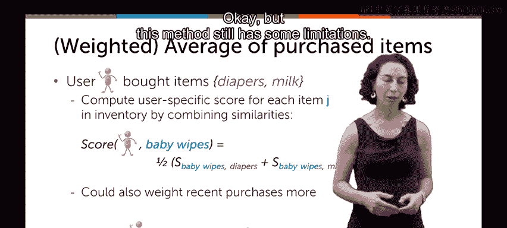
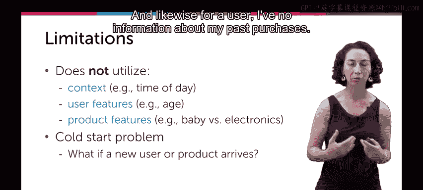

# 机器学习基础篇（第1课/共4课）｜第78讲：归一化共现矩阵与利用购买历史 📊


在本节课中，我们将学习如何处理推荐系统中“热门商品”带来的偏差，以及如何利用用户的完整购买历史来改进推荐。我们将介绍归一化共现矩阵的经典方法，并探讨如何通过加权平均来整合历史信息。

---

## 处理热门商品：归一化共现矩阵 🎯

上一节我们介绍了基于共现矩阵的简单推荐方法。本节中我们来看看，当某些商品非常热门时，如何通过归一化来修正共现矩阵的偏差。

一种常用的归一化方法是 **Jaccard相似度**。其核心思想与我们之前在聚类和相似性模块中讨论的 **TF-IDF（词频-逆文档频率）** 非常相似。在TF-IDF中，我们通过调整常见词的权重，避免它们淹没其他重要词汇。在这里，我们同样需要处理“热门商品”主导推荐结果的问题。

Jaccard相似度的计算方式非常直观。我们定义：

**Jaccard相似度(I, J) = 购买过商品I和J的用户数 / 购买过商品I或J的用户数**

用公式表示如下：

```
Jaccard(I, J) = |Users(I) ∩ Users(J)| / |Users(I) ∪ Users(J)|
```

我们可以通过一个简单的韦恩图来理解：

*   设圆圈A代表购买过商品I的所有用户。
*   设圆圈B代表购买过商品J的所有用户。
*   两个圆的重叠部分（A ∩ B）代表同时购买I和J的用户数，即我们之前共现矩阵中的原始计数，作为分子。
*   两个圆的整个覆盖区域（A ∪ B）代表购买过I或J中任意一个的所有独立用户数，作为分母。


这样，我们就用同时购买的比例，替代了原始的绝对购买次数，从而降低了热门商品的影响。当然，还有其他归一化方法，如余弦相似度，我们将在课程后续部分详细讨论。

---

## 整合用户历史：加权平均方法 📈


然而，仅基于当前页面或最后一次购买的方法有其局限性。它没有利用用户完整的购买历史来为推荐提供信息。

接下来，我们讨论一种改进方法，通过加权平均来整合用户的购买历史。

一个非常简单的方法是：对于待推荐的每一个商品，计算一个基于我历史购买记录的加权平均得分。

以下是具体步骤：

1.  **确定历史商品**：列出用户过去购买过的所有商品（例如：尿布和牛奶）。
2.  **计算单项得分**：对于待推荐商品（例如：婴儿湿巾），分别查看它与每个历史商品的共现关系。
    *   查看“尿布”对应的行，找到“婴儿湿巾”的共现计数（或Jaccard相似度）。
    *   查看“牛奶”对应的行，找到“婴儿湿巾”的共现计数（或Jaccard相似度）。
3.  **计算加权平均**：将上述两个得分进行平均，得到最终推荐分数。这个分数反映了基于我全部购买历史，我购买“婴儿湿巾”的可能性。

我们可以用伪代码描述这个过程：

```python
def weighted_average_score(user_history, target_item, cooccurrence_matrix):
    total_score = 0
    for historical_item in user_history:
        # 从共现矩阵中获取 historical_item 与 target_item 的相似度
        score = get_similarity(cooccurrence_matrix, historical_item, target_item)
        total_score += score
    average_score = total_score / len(user_history)
    return average_score
```

当然，我们可以对此方法进行变体改进，例如，为最近的购买记录赋予更高的权重，以考虑上下文变化。最终，我们根据这个加权平均分数对所有候选商品进行排序，并推荐得分最高的商品。

---

## 当前方法的局限性与冷启动问题 ⚠️

虽然加权平均方法结合了用户历史，但它仍然存在一些明显的局限性。

以下是该方法的主要问题：



*   **缺乏上下文信息**：它没有直接利用诸如一天中的时间、用户地理位置等上下文信息。
*   **忽略用户与商品特征**：该方法在构建共现矩阵时将所有用户和商品混在一起考虑，没有利用用户年龄、性别或商品类别、价格等特征信息来驱动推荐。
*   **冷启动问题**：这是推荐系统乃至许多其他领域面临的一个核心挑战。

**冷启动问题**具体指：
*   **新商品问题**：当一个全新商品上架时，没有任何购买记录，因此它在共现矩阵中与其他商品的关联度为零，系统无法有效地推荐它。
*   **新用户问题**：当一个新用户注册后，我们没有任何关于他/她的历史购买数据，因此无法基于历史为其提供个性化推荐。

---

## 总结 ✨

本节课中我们一起学习了：
1.  **归一化共现矩阵**：通过引入 **Jaccard相似度** 来降低热门商品在推荐中的过度影响，其核心是计算同时购买与总购买用户的比例。
2.  **利用购买历史**：通过**加权平均**的方法，整合用户所有的历史购买记录来计算对某个商品的推荐分数，使推荐更加个性化。
3.  **认识局限性**：我们指出了基于共现和历史的推荐方法在利用上下文信息、用户商品特征方面的不足，并重点介绍了推荐系统中至关重要的**冷启动问题**。



理解这些基础概念和方法，是构建更复杂、更智能推荐系统的重要第一步。