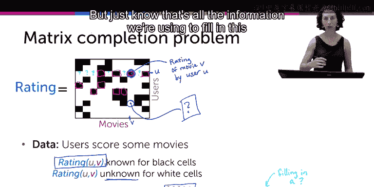
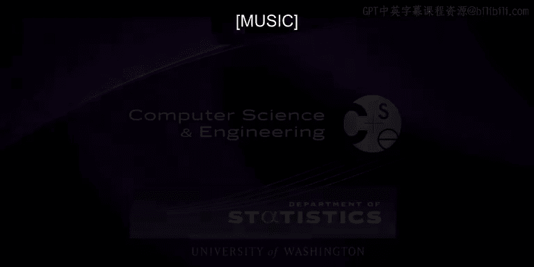

# 79：矩阵补全任务 🎬

在本节课中，我们将学习矩阵补全任务。我们将探讨如何利用用户和物品的特征来驱动推荐，而不仅仅是依赖购买和用户历史的共现关系。我们将通过电影推荐任务来具体说明这一方法，并学习如何填充一个稀疏的用户-电影评分矩阵。

---

## 从共现方法到特征学习 🔄

在之前讨论的共现方法中，我们并没有考虑用户的不同特征或产品的属性如何影响推荐。相反，我们只是简单地统计购买和用户历史的共现次数。

一个自然的问题是，我们是否可以利用“我是谁”以及“产品是什么”的某些方面来驱动推荐，就像在分类方法中讨论的那样。这样，我们就有了用户和产品的一组特征，但在这里，我们希望从数据中学习这些特征，以帮助我们应对可能没有可用特征的问题。

此外，我们希望考虑用户和物品之间的交互，就像在共现应用或共现方法中所做的那样。因此，我们将在电影推荐任务的背景下讨论这一点，因为对于我们将要描述的方法来说，这个应用非常直观。

---

## 电影推荐任务的数据结构 🎥

在这个应用中，我们的数据是一个大表格，其中有许多用户观看了一些电影并给出了评分。我们的表格看起来像这样：绿色用户观看了三部不同的电影，分别给出了三星、五星和两星的评分；蓝色用户观看了两部不同的电影；粉色用户观看了四部不同的电影。

我们有一个非常大的用户-电影评分组合表格。然而，每个用户只观看了可用电影中的一小部分。因此，我们将把这个数据表转换成一个非常大的用户×电影评分矩阵。

这个矩阵之所以非常大，是因为通常有很多用户和很多电影。但同时，这个矩阵非常稀疏，因为电影数量众多，而每个用户只观看了少数几部电影。

---

## 用户-电影评分矩阵的表示 📊

如果我们看这个矩阵，它是一个用户×电影的矩阵。例如，这一行代表用户U，这一列代表电影V。这里的黑色方块代表用户U给电影V的评分。所以，这是电影V由用户U给出的评分。

这些黑色方块只有少数，而白色方块非常多。白色方块代表一个问号，表示用户没有观看该电影，或者至少没有提供该电影的评分。

需要明确的是，所有白色方块代表未知评分，不代表评分为零。并不是用户不喜欢那部电影，只是我们不知道用户对那部电影的看法。

---

## 矩阵补全的目标 🎯

我们将评分U,V定义为用户U给电影V的评分。对于黑色方块，这些评分是已知的；对于白色单元格，这些评分是未知的。

我们的目标是填充所有这些问号，即所有白色单元格。我们将通过利用用户提供的所有评分（即该用户的所有黑色方块）来实现这一目标。我们将使用这些评分来预测这些问号的评分，实际上，我们将使用该用户的历史评分以及所有其他用户的历史评分来填充所有这些问号。

我们正在填充一个问号，并且要重申的是，我们不仅仅使用该用户的评分，而是使用所有这些评分来进行预测。虽然我不会为每个黑色单元格画上洋红色的框，但请知道，我们正在使用所有这些信息来填充这个非常大的稀疏矩阵。

---

## 总结 📝

在本节课中，我们一起学习了矩阵补全任务。我们探讨了如何从共现方法过渡到特征学习，以更有效地进行推荐。我们通过电影推荐任务具体说明了用户-电影评分矩阵的结构，并明确了矩阵补全的目标：利用已知评分预测未知评分，从而填充稀疏矩阵。这一方法不仅考虑了单个用户的历史，还整合了所有用户的信息，以提高预测的准确性。