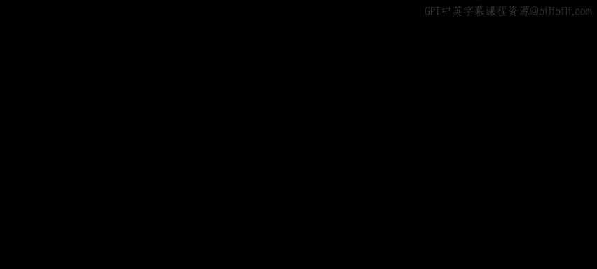
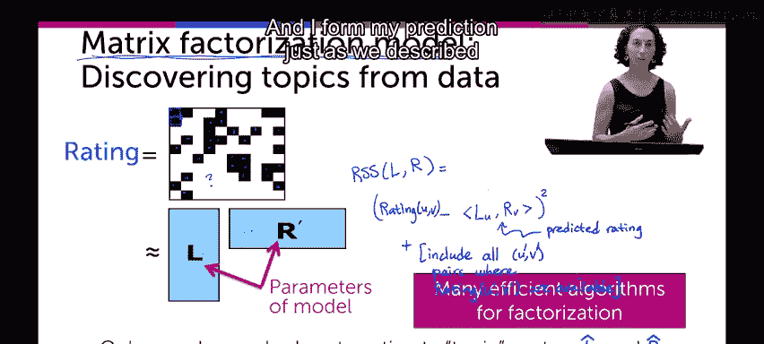
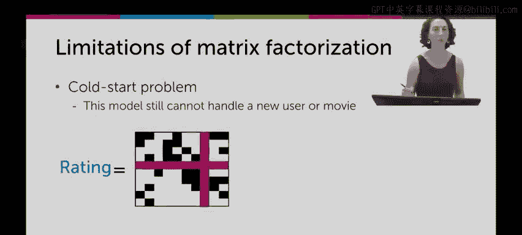
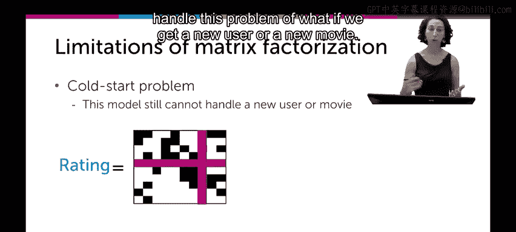
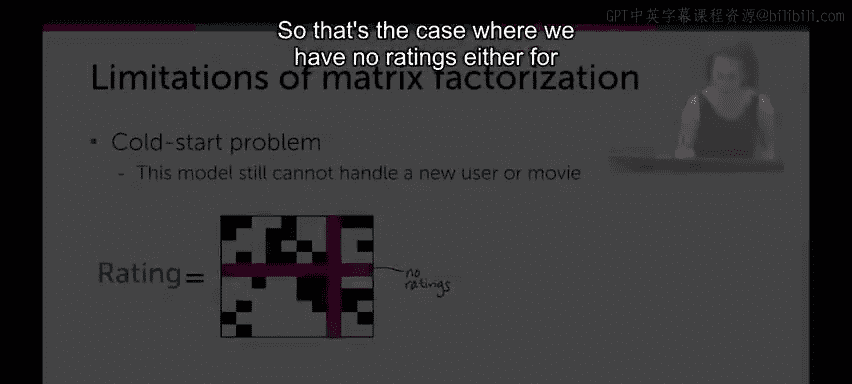
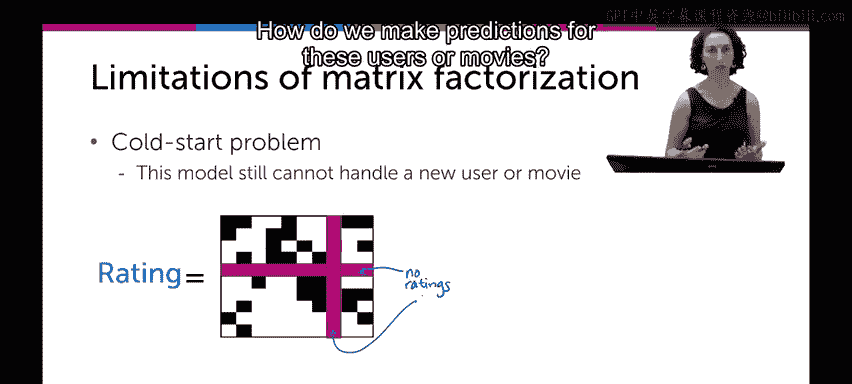

# 83：通过矩阵分解发现隐藏结构 🧩

在本节课中，我们将要学习如何通过矩阵分解模型，从用户对电影的评分数据中，自动发现用户和电影的隐藏特征（或称“主题向量”），并用这些特征来预测缺失的评分。

---

## 从已知特征到未知参数

上一节我们介绍了在已知用户和电影特征向量（即主题向量）的情况下，如何通过点积运算来预测评分。然而，关键问题在于，我们实际上**并不拥有**这些关于用户或电影的特征信息。

因此，我们需要将问题反过来思考。我们将尝试**估计**这些矩阵——用户特征矩阵 **L** 和电影特征矩阵 **R**。这等同于基于我们观测到的评分数据，为每一位用户和每一部电影估计其对应的特征向量。

这些矩阵（即特征向量的集合）就是我们模型的**参数**。回想我们在回归模型中学到的内容：模型有其关联的参数，我们需要从数据中估计这些参数。这里的思路非常相似。

*   **我们的数据**：观测到的评分（即下图中的黑色方格）。
*   **我们的参数**：所有用户的特征向量（构成矩阵 **L**）和所有电影的特征向量（构成矩阵 **R**）。

我们的目标是：**仅利用这些黑色方格的观测评分，来估计出矩阵 L 和 R**。

---

## 如何估计参数：定义拟合度量

那么，我们如何进行估计呢？和回归模块一样，我们需要一个衡量模型拟合好坏的度量标准。

在回归中，我们使用了**残差平方和**。在那个例子里，我们有房屋特征、特征权重（参数），我们预测房价，然后计算预测值与实际售价之差的平方，并对所有房屋求和。

在这个评分预测问题中：
*   模型参数是 **L** 和 **R**。
*   我们对用户 *u* 给电影 *v* 的评分预测是：`预测评分 = L_u · R_v`（即用户特征向量与电影特征向量的点积）。
*   观测到的实际评分是 `Y_{u,v}`。

因此，我们可以定义参数 **L** 和 **R** 的残差平方和 **RSS** 为：

**RSS(L, R) = Σ_{(u,v) ∈ 有评分的数据} (Y_{u,v} - L_u · R_v)²**

这个求和遍历所有拥有观测评分（即所有“黑色方格”）的用户-电影对。

这个公式的含义是：给定一组参数 **L** 和 **R**，我可以为所有已有评分的项目做出预测，然后计算这些预测值与真实值之间的总误差。

---

## 参数估计与矩阵分解

为了找到最佳的参数，我们需要在所有可能的用户特征向量和电影特征向量的组合空间中，搜索能使上述 **RSS** 最小化的那一组 **L** 和 **R**。这个过程与回归中寻找最优权重系数在本质上是相同的。

这种方法之所以被称为**矩阵分解模型**，是因为我们正在将庞大的评分矩阵（包含已知的黑色方格和待预测的白色方格）近似分解为两个更小矩阵的乘积：**评分矩阵 ≈ L × Rᵀ**。

模型的输出就是一组估计出的参数 **L_hat** 和 **R_hat**。

> 值得注意的是，存在许多高效的算法（例如交替最小二乘法、随机梯度下降法）来执行这种矩阵分解。我们将在后续关于推荐系统或矩阵分解的课程中详细讨论它们。

---

## 进行预测

一旦我们得到了估计的参数 **L_hat** 和 **R_hat**，我该如何填充所有初始目标中的“白色方格”（即进行预测）呢？

方法非常简单直接：使用我们估计出的特征向量，按照最初假设已知特征时的公式进行计算。

对于用户 *u* 对电影 *v* 的预测评分为：**预测评分 = L_hat_u · R_hat_v**

---

## 矩阵分解的局限性：冷启动问题 🥶

矩阵分解是一个非常强大的工具，已在众多应用中被证明有效。但它也存在一个局限，即我们之前略微提及的**冷启动问题**。

这个模型仍然无法很好地处理以下情况：当系统出现一个**新用户**或一部**新电影**时。

对于新用户或新电影，我们没有任何历史评分数据（上图中新增加的行或列全为白色）。因此，模型无法为他们/它们估计出有意义的特征向量，从而难以做出可靠的预测。这对于像 Netflix 这样的服务来说是一个持续面临的重要挑战。

---

## 总结

本节课中我们一起学习了：
1.  **问题转换**：将评分预测问题从“已知特征”转换为“从数据中估计特征（参数）”。
2.  **模型定义**：引入了矩阵分解模型，其目标是找到用户特征矩阵 **L** 和电影特征矩阵 **R**，使它们的乘积能最好地拟合观测到的评分。
3.  **损失函数**：使用**残差平方和**作为衡量预测评分与真实评分之间差异的度量标准，并以此指导参数估计。
4.  **预测方法**：在估计出参数后，通过简单的向量点积 `L_u · R_v` 即可对任意用户-电影对进行评分预测。
5.  **模型局限**：认识到矩阵分解模型仍受**冷启动问题**的困扰，无法有效处理完全没有评分记录的新用户或新项目。

通过矩阵分解，我们能够从稀疏的交互数据中自动发掘隐藏的潜在结构，这是构建现代推荐系统的核心思想之一。