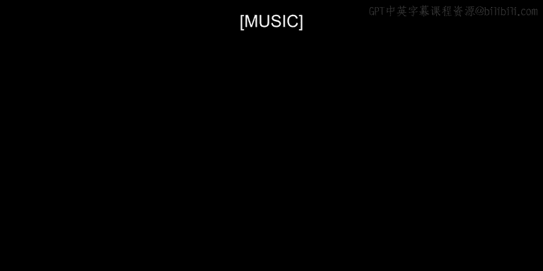
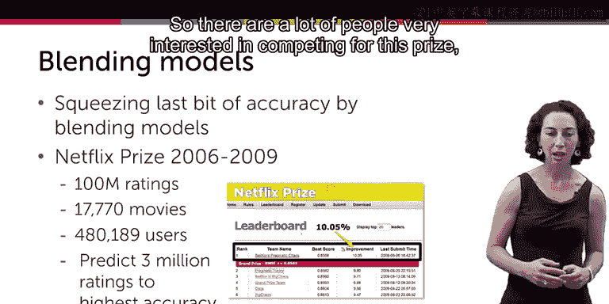

# 84：综合应用——特征化矩阵分解 🎯

在本节课中，我们将学习如何将基于特征的分类方法与矩阵分解方法相结合，以构建更强大的推荐系统。我们将探讨这种综合方法的优势、实现思路，并通过一个经典案例了解其实际应用价值。

---

## 概述：两种方法的优势与局限

上一节我们介绍了基于特征的分类方法和矩阵分解方法。基于特征的分类方法能够处理用户数据非常有限的情况，而矩阵分解方法则能捕捉用户与物品之间的关系，并学习用户和物品的潜在特征。

基于特征的分类方法可以捕捉诸如**上下文**、**时间**、**用户近期行为**和**历史购买记录**等信息。其核心公式可表示为：

**预测评分 = 基于用户特征和物品特征的函数**

而矩阵分解方法发现的潜在特征，能够捕捉行为相似的用户群体，例如“来自西雅图、从事教育工作的母亲们”。其核心模型通常表示为：

**评分矩阵 R ≈ 用户特征矩阵 U × 物品特征矩阵 V^T**

一个自然的问题是：我们能否将这两种方法结合起来，从而兼得两者的优势？

---

## 综合方法：结合用户指定特征与学习特征

结合这两种方法非常直观。我们可以根据用户数据的丰富程度，动态调整两种方法的权重。

以下是具体的实现思路：

*   **对于新用户**：由于没有历史购买信息，我们可以主要依赖用户指定的特征（如年龄、性别等）来预测其可能的评分。
*   **随着数据积累**：当我们从该用户那里获得越来越多的数据时，可以逐渐增加矩阵分解方法的权重，在形成推荐时更强调那些学习到的潜在特征。

简而言之，就是将基于用户指定特征的模型与从矩阵分解中学习到的特征模型相结合，并根据每个用户或每个产品的可用数据量，在两者之间进行平滑过渡。

这种模型融合的思想在实践中非常流行。

---

## 经典案例：Netflix 大奖赛

这种混合模型的思想在推荐系统中被证明极具影响力，一个经典的例子就是我们在本模块开头提到的 **Netflix 大奖赛**。

这项竞赛的目标是为 Netflix 用户提供最准确的电影评分预测。数据集包含：
*   **1亿条** 不同的用户电影评分
*   近 **18,000部** 不同电影
*   近 **50万名** 独立用户

竞赛目标是最高精度地预测 **300万条** 评分，优胜奖金高达 **100万美元**，因此吸引了众多团队参与。

最终，领先团队的成绩是通过**融合超过100个不同的模型**而取得的。下表展示了这一结果：

这种**集成方法**我们将在分类模块中进一步讨论。但核心思想是：通过组合多个模型，获得的性能往往能超过其中任何一个单一模型的性能。这是一种非常常见且强大的技术。

---

## 总结

本节课中，我们一起学习了如何构建一个综合的推荐系统。我们探讨了将基于明确特征的分类模型与从数据中学习潜在特征的矩阵分解模型相结合的方法。这种混合策略允许我们在用户数据稀缺时依赖已知属性，在数据丰富时利用复杂的交互模式。最后，通过 Netflix 大奖赛的实例，我们看到了模型融合在实际竞赛中取得的巨大成功，这证明了集成学习在提升预测性能方面的强大能力。