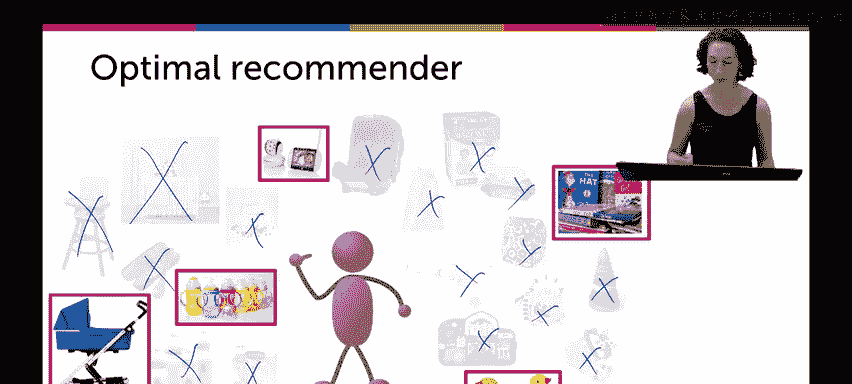

# 85讲：最优推荐器 📈

在本节课中，我们将探讨如何构建一个最优的推荐系统。我们将回顾召回率（Recall）和精确率（Precision）这两个核心概念，并分析两种极端情况下的推荐策略。通过对比，我们将理解为什么单纯追求高召回率或高精确率都不是最佳策略，并最终揭示最优推荐器的特征。

---

## 如何最大化召回率？ 🤔

上一节我们介绍了召回率的概念，它衡量的是在所有用户喜欢的物品中，有多少被成功推荐。本节中我们来看看，如何最大化召回率。

最大化召回率有一个非常简单的方法：**推荐所有物品**。如果你推荐所有物品，那么你一定能推荐到用户喜欢的产品。

以下是这种策略下的结果分析：

*   **召回率**：为 **1**。因为用户喜欢的全部五个产品都被推荐了。
*   **精确率**：可能**非常小**。因为如果平台上有海量产品，而用户只喜欢其中极少一部分，那么推荐所有物品会导致绝大多数推荐都是用户不感兴趣的，从而使得精确率极低。

因此，虽然这种策略能获得完美的召回率，但其极低的精确率使其并非一个理想的策略。

---

## 什么是最优推荐器？ 🏆

既然推荐所有物品不是好办法，那么什么才是我们能想象到的最佳推荐器呢？

最优的推荐器应该做到：**推荐所有用户喜欢的物品，并且只推荐用户喜欢的物品**。这意味着，所有用户不喜欢的物品都不会出现在推荐列表中。

以下是这种理想策略的结果分析：

*   **精确率**：为 **1**。因为推荐列表中的物品都是用户喜欢的。
*   **召回率**：为 **1**。因为用户喜欢的所有物品都被推荐了。

你可以使用前面幻灯片中的公式来验证这一点。这样的推荐器不会浪费任何展示机会，能完全捕捉用户的喜好，无疑是一个能创造巨大价值的系统。

---

## 总结 📝

本节课中我们一起学习了推荐系统评估的两个关键指标——召回率与精确率。我们分析了两种极端策略：通过“推荐一切”来最大化召回率，会导致精确率暴跌；而理想的“最优推荐器”则能同时实现精确率和召回率均为1。这为我们后续设计更平衡、更实用的推荐算法提供了重要的思考基础。