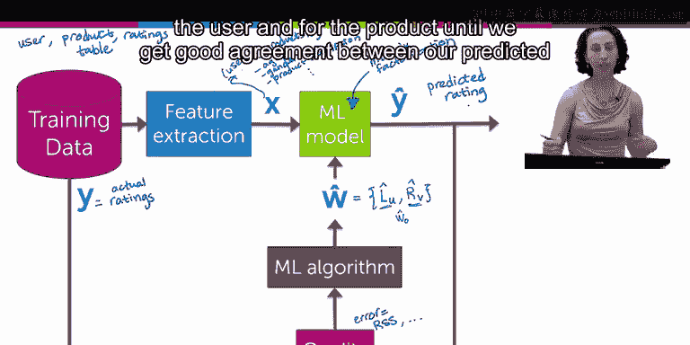
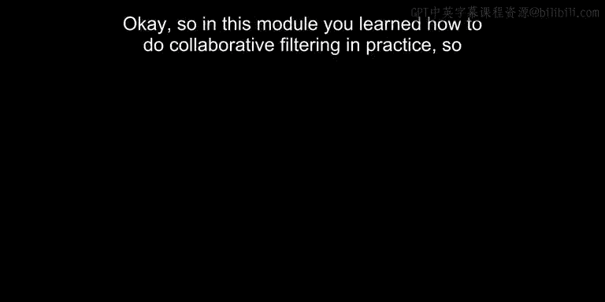

# 88：推荐系统模块图解析 🧠

在本节课中，我们将学习推荐系统的核心概念，特别是协同过滤的基本思想及其在机器学习工作流中的位置。我们将通过一个具体的例子——电影和歌曲推荐系统——来理解如何利用用户与产品的交互数据来预测评分。

---

## 机器学习工作流在推荐系统中的体现 🔄

上一节我们介绍了协同过滤的基本概念，本节中我们来看看推荐系统如何融入标准的机器学习工作流。

在推荐系统的场景下，我们的训练数据是用户-产品评分表。

我们的目标是提取一组特征，这里具体是用户ID和产品ID的组合对。模型的任务是预测某个用户对某个产品的评分。

**公式表示**：
`预测评分 = 模型(用户ID, 产品ID)`

---

## 推荐系统模型与参数 ⚙️

我们讨论过多种模型，其中将在矩阵分解课程中深入探讨的一个模型是**矩阵分解**。

矩阵分解模型有一组参数 **Ŵ**（代表估计参数）。这些参数具体包括：
*   每个用户的一组特征向量。
*   每个产品的一组特征向量。

此外，我们还讨论过矩阵分解的**特征化版本**。在这种情况下，除了用户ID和产品ID，我们还可以考虑其他特征。

以下是可能纳入模型的其他特征示例：
*   用户的年龄
*   用户的性别
*   产品的描述文本

对于这些附加特征，模型还需要另一组权重参数，我们可以称之为 **W₀**。这些权重也是模型参数的一部分。

---

## 模型评估与优化 📊

得到预测评分后，我们需要评估模型对数据的拟合程度。评估方法是比较预测评分与训练数据集中的实际观测评分。

我们使用一个误差度量来衡量预测值与观测值之间的差异。一个常用的度量是**残差平方和**，这与回归分析中的概念类似。

**公式表示**：
`误差 = Σ(实际评分 - 预测评分)²`

当然，也存在其他评估指标，我们可以在后续课程中讨论。

核心思想是：基于预测值与观测值之间的某种误差定义，机器学习算法会迭代地更新用户和产品的特征向量。

**算法目标**：
`迭代更新用户/产品特征，直至预测评分与实际评分达成良好一致。`

---

## 总结与展望 🎯

本节课中我们一起学习了如何在实践中实现协同过滤。现在，你已经可以着手构建自己的推荐系统了。

你可以为家人创建一个礼物推荐系统，让节日购物变得轻松；也可以开发一个比课程演示更出色的歌曲推荐器。协同过滤技术为实现这些酷炫的应用提供了强大的支持。

