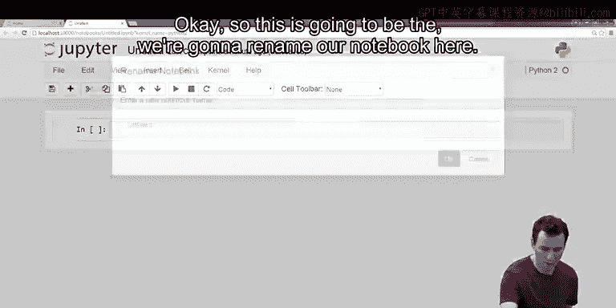
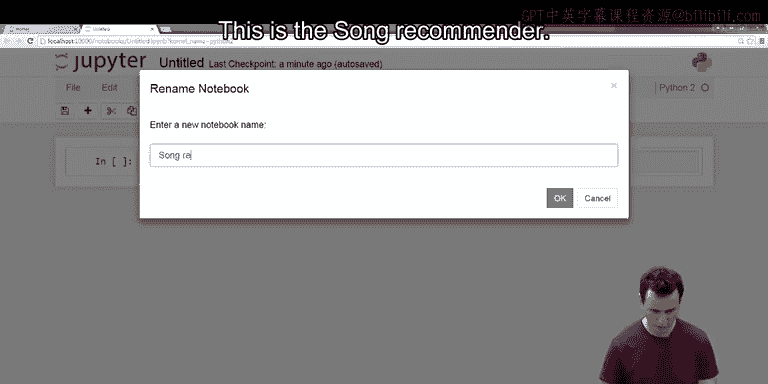
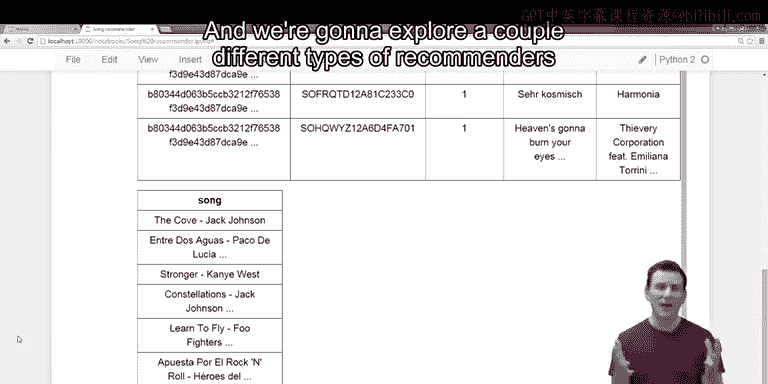
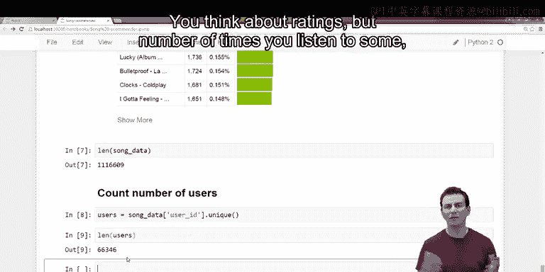

# 课程名称：机器学习（基础篇）第1课 - 构建歌曲推荐器 🎵


## 概述


在本节课中，我们将学习如何构建一个歌曲推荐系统。我们将从加载和探索一个真实的音乐数据集开始，为后续构建推荐算法打下基础。


---





## 加载音乐数据 🎶

上一节我们介绍了推荐系统的概念，本节中我们来看看如何获取和处理数据。

首先，我们需要导入必要的库并加载数据。

```python
import graphlab
song_data = graphlab.SFrame('song_data.csv')
```

我们加载的数据集名为“百万歌曲数据集”。变量`song_data`是一个GraphLab SFrame对象，用于存储数据。

---

## 探索数据 🔍

数据加载完成后，我们需要对其进行初步探索，以了解其结构和内容。

以下是查看数据前几行的步骤：

```python
song_data.head()
```

执行上述代码后，我们可以看到数据表包含以下列：`user_id`（用户ID）、`song_id`（歌曲ID）、`title`（歌曲标题）、`artist`（艺术家）和`listen_count`（收听次数）。该表格记录了每位用户收听不同歌曲的频率。



---


## 分析歌曲流行度

为了更直观地了解数据，我们可以查看歌曲的收听分布情况。

以下是生成歌曲收听次数直方图的步骤：

```python
graphlab.canvas.set_target('ipynb')
song_data['song'].show()
```

直方图显示了不同歌曲的播放次数。例如，某些歌曲被播放了数千次，这表明数据集中包含了一些非常受欢迎的歌曲。

---

## 探索用户数据 👥

除了歌曲，了解数据集中用户的数量和分布也同样重要。

以下是计算数据集中唯一用户数量的方法：

```python
users = song_data['user_id'].unique()
len(users)
```

`unique()`命令用于提取所有不重复的用户ID。通过计算其长度，我们得知该数据集包含**66,346**位独立用户，对应着约一百万条收听记录。

---

## 总结

本节课中我们一起学习了如何为歌曲推荐系统准备数据。我们完成了数据加载，并通过对歌曲流行度和用户基数的探索，对数据集有了初步了解。在接下来的课程中，我们将利用这些数据构建不同类型的推荐算法。




---