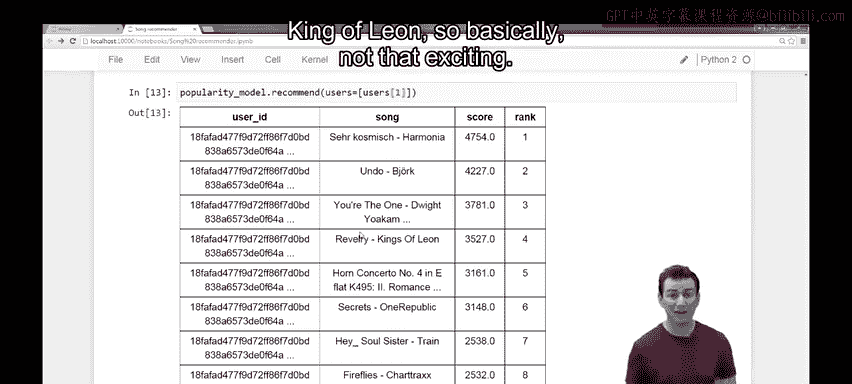
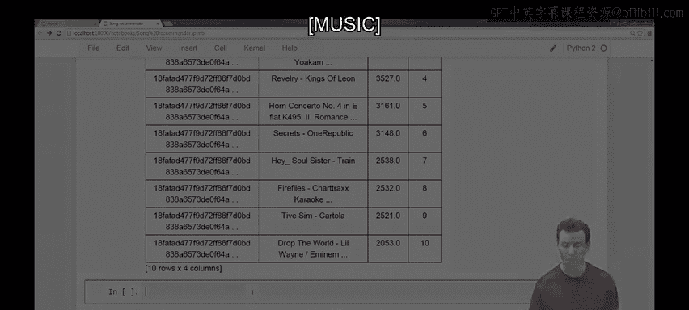

# 机器学习基础篇（第1课/共4课）🎵 第90讲：创建并评估基于流行度的歌曲推荐器


在本节课中，我们将学习如何创建一个简单的基于流行度的推荐系统，并使用训练集和测试集对其进行评估。我们将使用一个歌曲数据集，通过分析最受欢迎的歌曲来为用户提供推荐。

---

## 数据准备与分割

首先，我们拥有一个数据集。下一步是创建一个推荐系统。

我们首先进行训练集和测试集的分割。我们将对歌曲数据执行随机分割，其中80%用于训练，20%用于测试。设置随机种子为0，以确保结果可复现。

```python
train_data, test_data = song_data.random_split(0.8, seed=0)
```

完成分割后，我们准备开始训练推荐模型。

---

## 创建基于流行度的推荐器

上一节我们介绍了数据分割，本节中我们来看看如何构建一个简单的基于流行度的推荐模型。这种模型在许多网站上都很常见，例如展示“最热门故事”或“今日最常用标签”。

以下是创建该模型的步骤：

1.  导入必要的库并初始化推荐器。
2.  指定数据集中代表用户ID和物品ID的列名。
3.  使用训练数据来拟合模型。

```python
popularity_model = graphlab.popularity_recommender.create(train_data,
                                                          user_id='user_id',
                                                          item_id='song')
```

这个模型创建得非常快，它是一个简单的基于流行度的推荐系统。

---

## 使用模型进行推荐

现在，让我们使用这个模型为特定用户进行推荐。

首先，我们为用户0推荐歌曲：

```python
recommendations_user0 = popularity_model.recommend(users=[users_array[0]])
```

模型为用户0推荐了来自Harmonia、Bjork、King of Leon等艺术家的歌曲。

接下来，我们为用户1进行推荐：

```python
recommendations_user1 = popularity_model.recommend(users=[users_array[1]])
```

在执行前，我们可以思考一下：基于流行度的模型会返回什么结果？答案是，所有用户都会获得完全相同的推荐列表，因为模型只是推荐最受欢迎的物品。

结果显示，用户1同样被推荐了Harmonia、Bjork、Dwightcom、King of Leon的歌曲。这揭示了该模型的主要问题：它缺乏个性化，为所有用户提供相同的推荐。

---

## 总结





本节课中我们一起学习了如何构建和评估一个基于流行度的推荐器。我们首先将数据分割为训练集和测试集，然后使用`graphlab.popularity_recommender.create`函数训练模型。最后，我们通过为不同用户生成推荐结果，观察并理解了这种简单模型的核心局限性——它无法提供个性化的推荐，所有用户收到的都是基于全局流行度的相同物品列表。