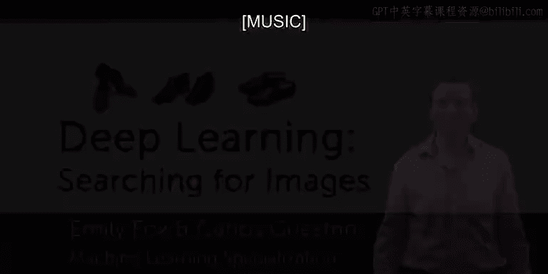

# 93讲：图像搜索：深度学习案例研究 🖼️🔍

在本节课中，我们将要学习一个近年来机器学习领域最令人兴奋的新方向——深度学习。我们将通过一个具体的应用案例来理解其原理：如何仅基于图像相似性来搜索和推荐产品。

---

## 什么是深度学习？🧠

上一节我们介绍了本节课的主题。本节中，我们来看看深度学习的核心概念。

深度学习是机器学习的一个分支。它使用被称为“神经网络”的模型，这种模型的结构受到人脑的启发。与传统的机器学习方法相比，深度学习模型能够自动从原始数据（如图像像素）中学习到复杂的特征和模式，而无需过多的人工特征工程。

其核心思想可以用一个简化的神经网络公式表示：

**`输出 = 激活函数(权重 * 输入 + 偏置)`**

这个公式在网络的每一层中重复计算，通过多层“深度”的非线性变换，模型能够学习到数据中高度抽象的表示。

---

## 基于图像的购物搜索案例 🛒

理解了深度学习的基本概念后，我们来看一个具体的应用：基于图像的产品搜索。

想象一下，你看到一件喜欢的衣服或家具，但不知道它叫什么或在哪里购买。你可以拍下它的照片，然后使用一个应用程序来搜索外观相似的产品。这个功能背后的核心技术就是深度学习。

以下是实现这一功能通常涉及的几个关键步骤：

1.  **图像特征提取**：使用一个预先训练好的深度卷积神经网络（CNN）模型来处理输入图片。这个网络会将图片转换成一个高维度的数值向量，这个向量被称为“特征向量”或“嵌入”，它编码了图像的核心视觉信息。
2.  **构建产品图像库**：商家需要提前用同样的CNN模型处理所有商品图片，为每张商品图生成对应的特征向量，并存入数据库。
3.  **相似度计算与搜索**：当用户上传一张查询图片时，系统会计算其特征向量与数据库中所有商品特征向量之间的“距离”（例如，使用余弦相似度公式）。距离越近，表示图像越相似。
4.  **返回结果**：系统将距离最近（即最相似）的几个商品图片和链接返回给用户。

---

## 为什么深度学习在此表现出色？🌟

传统的图像搜索方法可能依赖于颜色直方图或手工设计的纹理特征。这些方法在复杂场景下往往效果不佳。

深度学习，特别是卷积神经网络，能够自动学习到图像的层次化特征。浅层网络可能识别边缘和角落，中层网络组合成纹理和部件，而深层网络则能理解整个物体或场景。这种自动学习强大特征的能力，使得它在图像相似性匹配任务上取得了革命性的成功。

---

## 总结 📚

本节课中，我们一起学习了深度学习在图像搜索中的一个精彩案例。

我们首先介绍了深度学习是使用深层神经网络来自动学习数据特征的机器学习方法。接着，我们详细探讨了如何利用这项技术实现“以图搜物”的产品搜索功能，其核心流程包括提取图像特征、构建特征库以及计算相似度。最后，我们分析了深度学习在此类任务上超越传统方法的原因在于其强大的特征自动学习能力。

通过这个案例，我们可以看到深度学习如何将看似复杂的视觉问题，转化为可计算、可搜索的数学问题，从而创造出实用的智能应用。