# 机器学习基础篇（第1课/共4课）：什么是视觉产品推荐器 👟👗

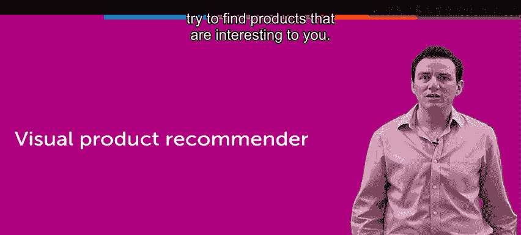

在本节课中，我们将学习一种新的购物方式——视觉产品推荐器。它利用图像相似性搜索技术，帮助用户找到符合个人风格和喜好的商品，而无需依赖传统的关键词搜索。

---

如今购物方式多种多样，但通常需要使用关键词搜索。用户在搜索引擎中输入查询，试图找到感兴趣的商品。

但让我们看看新的购物方式。例如，假设我想买一双鞋。有些人非常在意鞋子。我有很多鞋，比如一双酷炫的黑色鞋子，很有风格。另一双黑色鞋子，在你看来可能几乎一样，但风格完全不同。我还有一双看似透明、实则是很酷的蓝色调的礼服鞋。一双我喜爱的双色运动鞋，以及一双在香港买的很有趣的运动鞋。大家都知道我喜欢紫色，所以我甚至有一双紫色靴子。我有很多鞋，但我需要更多。

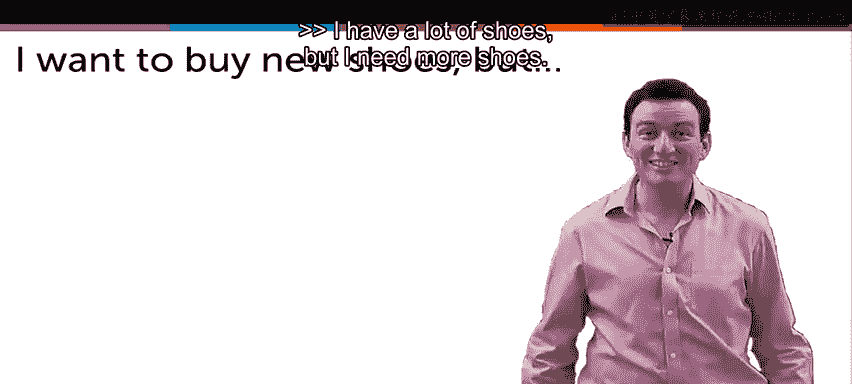

网上有大量鞋子，很难找到那些有趣、时尚、与众不同且符合我风格的款式。

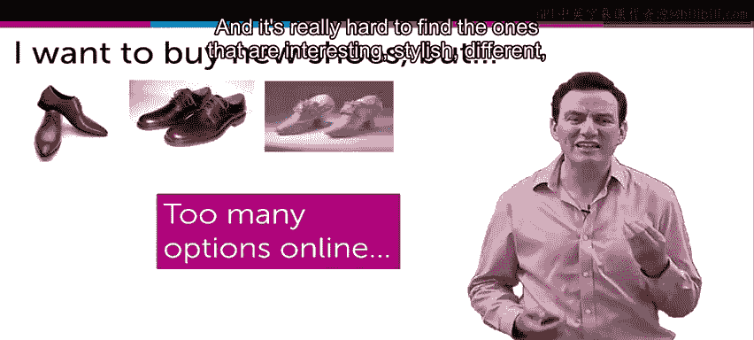

如果我使用关键词搜索，输入“礼服鞋”，帮助不大，只会找到一堆普通常见的鞋子。尽管左上角那双有点意思和时尚感，但我想要找些不同的东西，却不知道输入什么关键词或如何搜索。

那么我该怎么办？

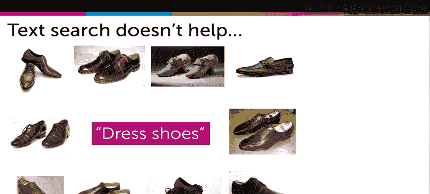

让我先展示一个基于相似性搜索的新购物方式的酷炫演示。

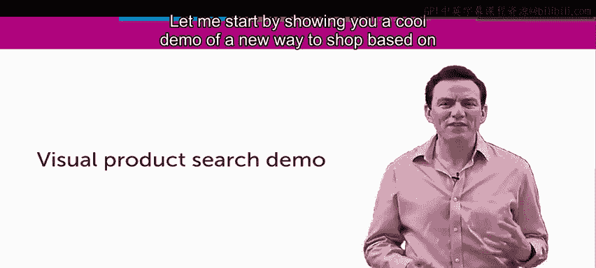

让我们讨论比买鞋更复杂的事情。

我姐姐是时装设计师，她的生日快到了，我想给她买一件她可能会喜欢的、非常有趣又酷的礼物。

也许我想给她买一条裙子。如果我仅仅使用传统的关键词搜索，尝试寻找裙子。

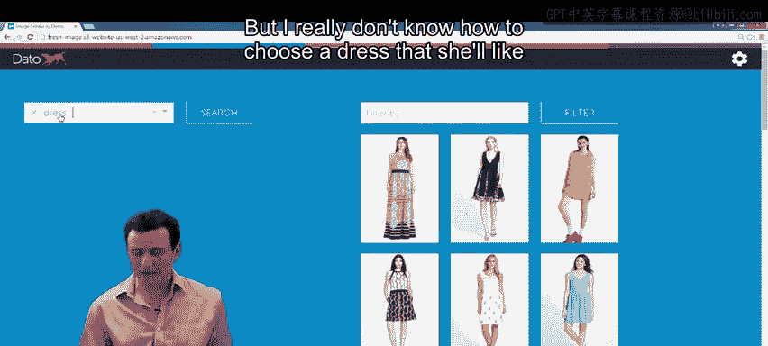

我会找到很多裙子，但我真的不知道如何仅根据这里展示的属性来选择一条她喜欢的裙子。

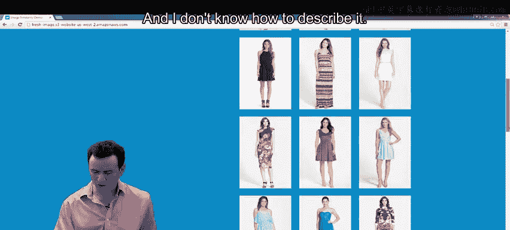

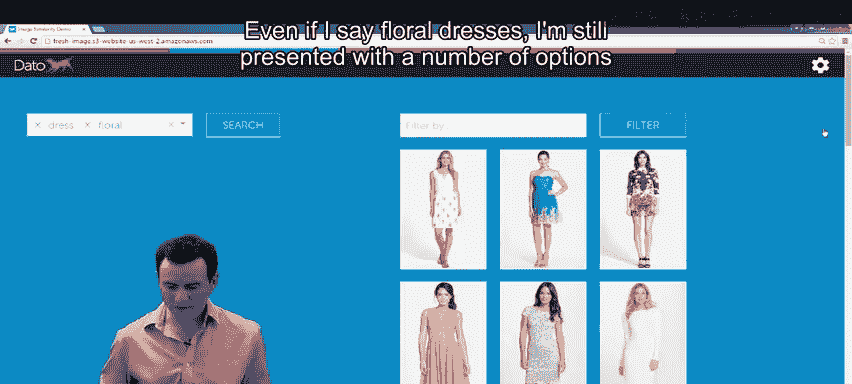

我不知道如何描述它。我该如何描述我姐姐喜欢的裙子风格？

现在，我可以说也许她喜欢碎花裙。即使我说“碎花裙”。

我仍然会面对许多选项和不同种类的碎花裙，而她的风格相当独特，我该如何找到一条她真正会喜欢的裙子呢？

如果我向下滚动这个列表，也许我会看到一些吸引眼球的东西。

哦，这里有一条碎花裙看起来很不错。我要点击它。接下来，我将不再仅仅基于关键词搜索寻找裙子，而是使用**图像相似性**来寻找相似的裙子。这些裙子仅基于图像特征，看起来与这条相似。现在，我们得到的裙子确实具有相似的属性，这让我更容易找到她可能喜欢的东西。当然，其中许多裙子有点太普通，她可能想要更有趣一点的。例如，这条裙子有多个图案。

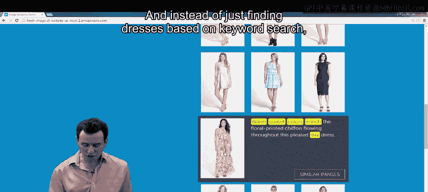

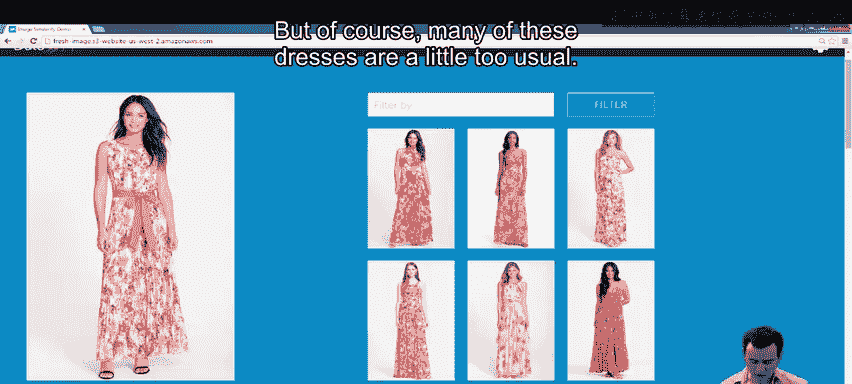

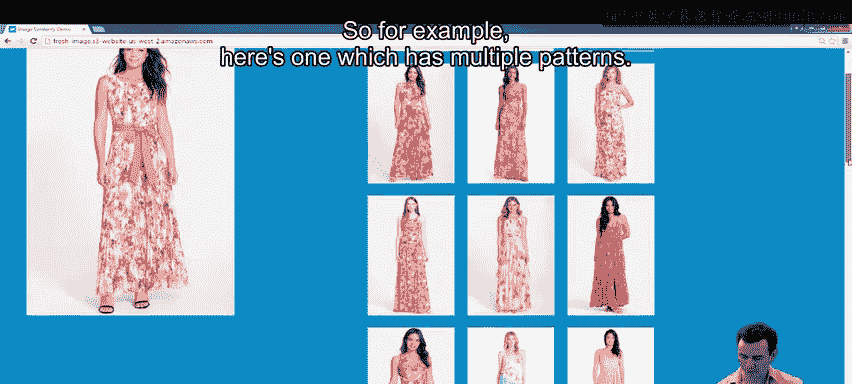

现在我们找到了相似的裙子，可以看到它们在一条裙子内融合了多种风格。我原本不知道如何描述这种风格。让我在这个集合中继续搜索，看，这条看起来很不错。

如果我点击它，你会看到其他与这条在视觉上相似的裙子。但这条看起来特别好，而且模特也有点像我姐姐，所以是送给她的完美礼物。

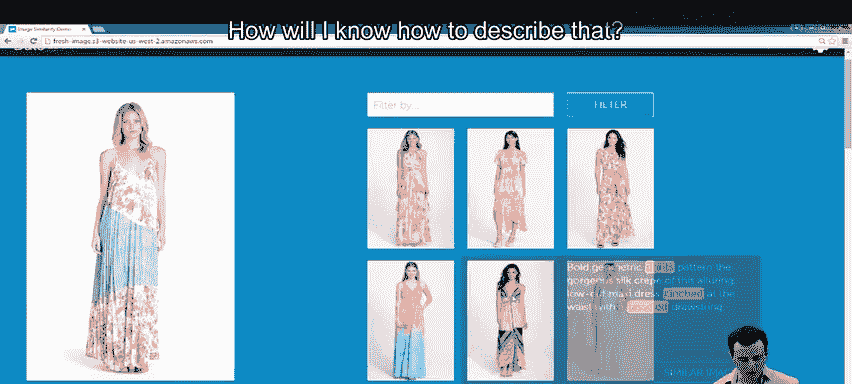

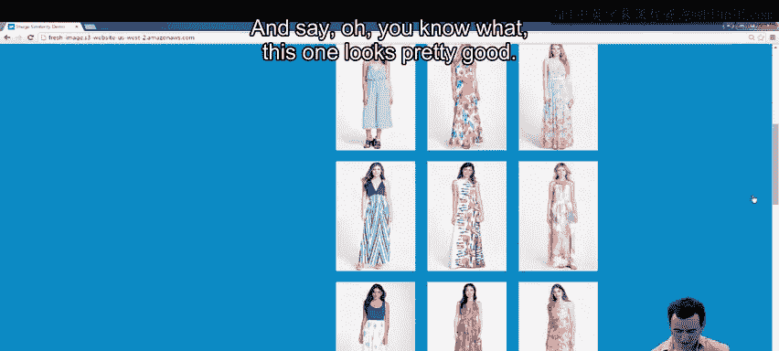

---

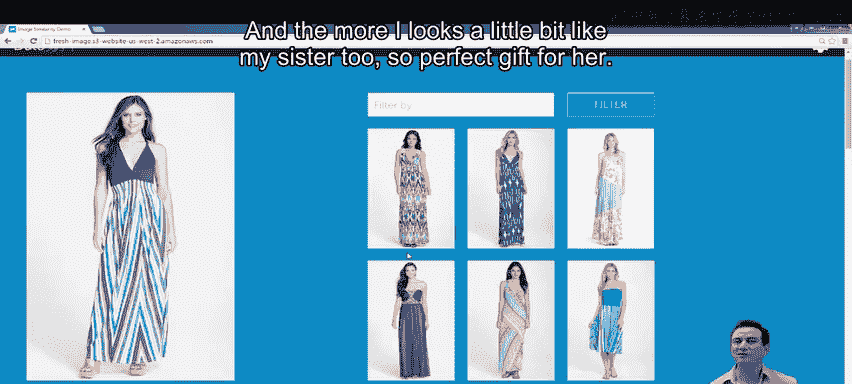

本节课中，我们一起学习了视觉产品推荐器的基本概念。它通过分析商品图片的视觉特征，计算相似度，帮助用户发现符合个人偏好的商品，解决了传统关键词搜索在表达抽象风格或视觉偏好时的局限性。这种技术为个性化购物体验开辟了新的可能性。