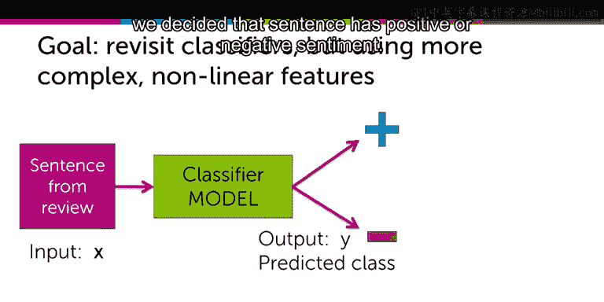
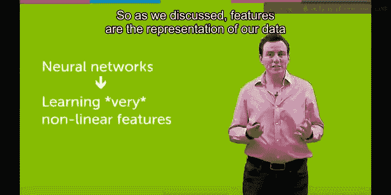
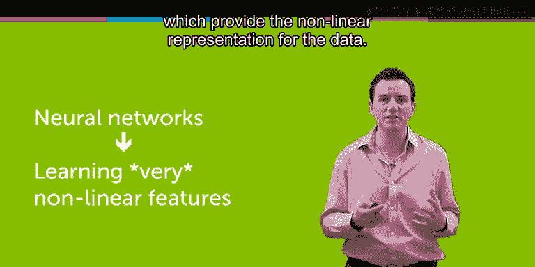
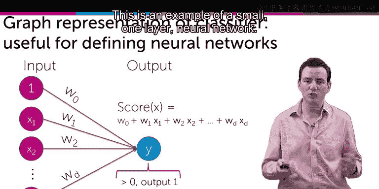
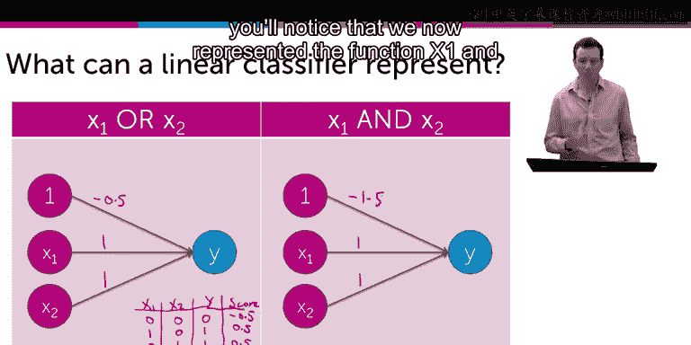
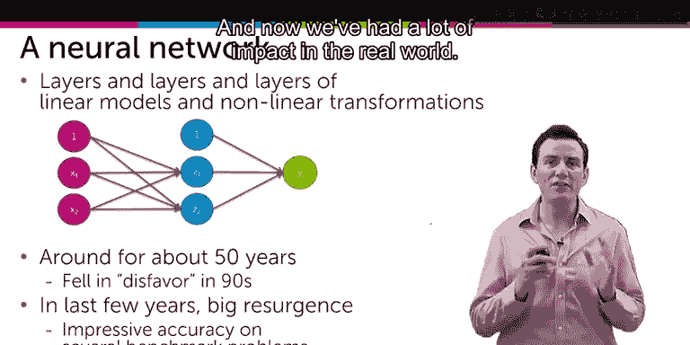

# 95：使用神经网络学习高度非线性特征 🧠

在本节课中，我们将学习如何利用神经网络来学习高度非线性的特征表示。我们将从数据表示的基础概念开始，逐步深入到神经网络的构建与应用，特别是如何通过多层网络结构解决线性分类器无法处理的复杂问题。

---

## 数据表示与特征

在机器学习中，特征是我们用来描述数据的表示方式。这些特征被输入到分类器中，用于进行预测或分类。

例如，在文本分析中，我们使用词袋模型或TF-IDF来表示文本数据。在图像分类中，特征可以是像素值或其他更复杂的表示。

---

## 线性分类器回顾

上一节我们介绍了数据表示的基本概念，本节中我们来看看线性分类器的工作原理。线性分类器通过一个线性决策边界来区分不同的类别。

决策边界由以下**公式**定义：

**score = w₀ + w₁ × x₁ + w₂ × x₂ + ... + w_D × x_D**

当得分大于0时，我们预测为正类；当得分小于0时，预测为负类。

在神经网络中，我们可以用图的形式来表示这样的分类器。每个特征对应一个节点，输出节点表示预测结果。权重被放置在连接特征节点和输出节点的边上。

---

## 单层神经网络

单层神经网络本质上等同于我们之前讨论的线性分类器。它可以表示一些简单的逻辑函数。

以下是单层神经网络可以表示的两个基本逻辑函数：

*   **逻辑或 (x₁ OR x₂)**：通过设置权重（例如，w₁=1, w₂=1, w₀=-0.5）可以实现。
*   **逻辑与 (x₁ AND x₂)**：通过设置权重（例如，w₁=1, w₂=1, w₀=-1.5）可以实现。

---

## 线性分类器的局限性

虽然单层神经网络可以表示“与”和“或”函数，但它无法表示某些简单的非线性关系。

一个经典的例子是**异或 (XOR)** 函数。异或函数的真值表显示，不存在一条直线能够完美地将正例（输出为1）和负例（输出为0）分开。这表明线性特征对于此类问题是不够的。

---

## 构建多层神经网络

为了解决异或问题，我们需要引入非线性特征。这可以通过构建多层神经网络来实现。

我们不是直接从输入x₁和x₂预测输出y，而是引入中间层节点z₁和z₂。

以下是构建一个能够表示异或函数的两层神经网络的步骤：

1.  **定义中间变量**：令 z₁ = x₁ AND (NOT x₂)，令 z₂ = (NOT x₁) AND x₂。
2.  **构建第一层网络**：设计两个单层神经网络，分别计算z₁和z₂。这需要为每个网络设置特定的权重，以表示“与”和“非”的组合逻辑。
3.  **构建第二层网络**：将z₁和z₂作为新的输入特征，构建另一个单层神经网络来计算 y = z₁ OR z₂。

通过这种分层结构，我们成功构建了一个能够解决异或问题的**深度神经网络**（虽然只有两层）。神经网络的核心思想正是通过多层变换，逐步从原始数据中学习并构建出强大的非线性特征。

---

## 深度学习的复兴

神经网络的概念已经存在了大约50年。然而，在20世纪90年代，由于难以获得高精度，它们一度失宠。

大约10年前，两个关键因素推动了深度神经网络的复兴：

1.  **海量数据**：深度网络拥有大量参数（例如，一个网络可能有6000万个参数），需要海量数据进行训练。互联网的普及提供了这样的数据源。
2.  **强大的计算资源**：图形处理器（GPU）最初为加速游戏图形而设计，但其并行计算能力恰好非常适合训练大规模神经网络和处理海量数据。

得益于GPU和数据的增长，深度神经网络取得了突破性进展，并对现实世界产生了巨大影响。

---

## 总结

本节课中，我们一起学习了：
1.  特征在机器学习中的核心作用。
2.  线性分类器与单层神经网络的等价关系及其局限性。
3.  通过构建包含中间层的**深度神经网络**，我们可以学习高度非线性的特征，从而解决像异或这样的复杂问题。
4.  海量数据和GPU计算能力的提升是推动现代深度学习成功的关键因素。

在接下来的课程中，我们将看到神经网络在计算机视觉等领域的实际应用示例。