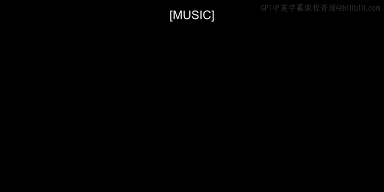
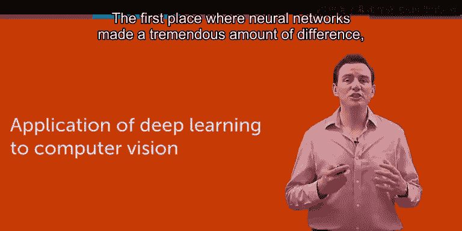
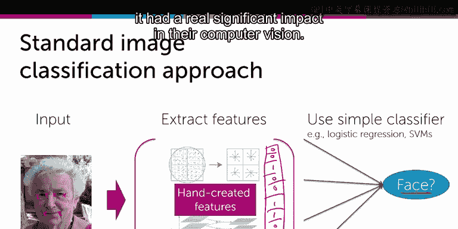
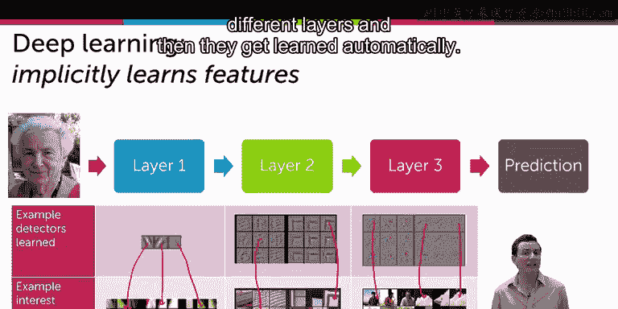

# 机器学习基础篇（第1课/共4课）｜P96：深度学习在计算机视觉中的应用 🖼️

在本节课中，我们将要学习深度学习，特别是神经网络，如何在计算机视觉领域产生巨大影响。我们将从图像特征的基本概念开始，逐步了解传统方法与深度学习方法之间的区别，并最终理解神经网络如何自动学习复杂的图像特征。

---

## 图像特征是什么？🔍

上一节我们介绍了神经网络在计算机视觉中的重要性，本节中我们来看看图像特征的基本概念。

在计算机视觉中，图像特征类似于局部检测器，它们被组合起来以进行预测。

假设我们有一张特定图像，我们想预测它是否是一张人脸图像。我们可以运行一些小的检测器，例如鼻子检测器、眼睛检测器、嘴巴检测器。如果所有这些检测器都被激活，我们可以通过一个小型神经网络判断这是一张人脸。这就是我们的预测。

这是一个构建图像分类器的简单示例。但在现实中，我们并没有显式的鼻子检测器或眼睛检测器。实际使用的是被称为图像特征或兴趣点的东西。它们有各种名称，但本质上都是试图找到局部图像片段或小块，这些部分非常独特，例如可能找到一个角落。

眼睛周围可能有角落，鼻子周围也可能有角落。如果你有许多这样的角落检测器，一张人脸就是由许多角落组成的。如果足够多的检测器以特定模式被激活，你就会发现这是一张人脸。这就是计算机视觉通常的工作方式，也是分类的基本原理。当然，还有更通用和更复杂的模型，但这是基本思想。

多年来，这些类型的检测器或局部特征都是手工构建的。一个非常流行的方法叫做SIFT特征，它彻底改变了计算机视觉领域，因为它们非常实用且效果出色。后来还有许多其他方法提高了其准确性。

---

## 传统特征的使用方法 📊

上一节我们了解了图像特征的概念，本节中我们来看看这些手工创建的特征（如SIFT特征）通常如何用于分类。

以下是使用SIFT特征进行分类的典型步骤：

1.  我们在图像上运行SIFT检测器，它会在不同位置被激活。例如，在眼睛和嘴巴的角落。
2.  然后，我们根据这些激活的位置创建一个描述图像的向量。这个向量可能在某些位置有激活，在其他位置没有激活。
3.  这可以类比于文档中的词语。就像“messy”或“football”这些词是否出现一样，图像中特定位置是否出现一个角落。
4.  一旦我们有了这个图像描述，就将其输入到一个分类器中。例如，一个简单的线性分类器，就像我们在本模块早些时候讨论过的那样。这些分类器有诸如逻辑回归、支持向量机等名称。
5.  最终，我们得到一个检测结果，判断这张图像是否是人脸。

这听起来相当令人兴奋，并且确实对计算机视觉领域产生了重大影响。

---

## 手工构建特征的挑战与神经网络的解决方案 🤖

上一节我们介绍了传统特征的使用流程，本节中我们来看看其面临的挑战以及神经网络如何提供解决方案。

然而，挑战在于，创建这些手工构建的图像特征是一个非常复杂的过程，需要多篇博士论文才能做好。

神经网络将自动发现和学习这些特征。

让我给你一个例子。假设你输入一张图像，我将其通过一个三层神经网络进行预测。通常发生的情况是，网络会学习到局部特征检测器。这些检测器类似于SIFT，但在不同层、不同级别上学习，它们检测图像的不同属性。

*   在第一层，你可能会学习到看起来像小块的检测器，它们对对角线边缘等特征反应强烈。例如，这里的第一个检测器主要捕捉对角线边缘，中间那个捕捉另一个方向的对角线边缘，最后一个捕捉从暗色到绿色的颜色过渡。
*   在下一层，你将结合这些对角线边缘检测，形成更复杂的检测器。例如，在这一层中，我们发现了波浪线和图案检测器，也发现了对角落反应强烈的检测器，它们倾向于检测图像中的角落。
*   在最后的层，你会得到更复杂的检测器。对于各种图像，你最终可能会得到对树木和面孔有反应的检测器，或者如果你有一个更大的数据集，甚至可能对珊瑚图像有反应的检测器。

因此，神经网络在不同层捕获不同类型的图像特征，并且这些特征是自动学习得到的。

---

## 总结 📝

本节课中我们一起学习了深度学习在计算机视觉中的应用。我们从图像特征的基本概念入手，了解了传统手工特征（如SIFT）如何用于图像分类。随后，我们探讨了手工构建特征的复杂性挑战，并重点学习了神经网络如何通过其分层结构，自动从数据中学习从简单边缘到复杂物体（如人脸、树木）的各级特征。这体现了深度学习在特征学习方面的强大自动化和表达能力。