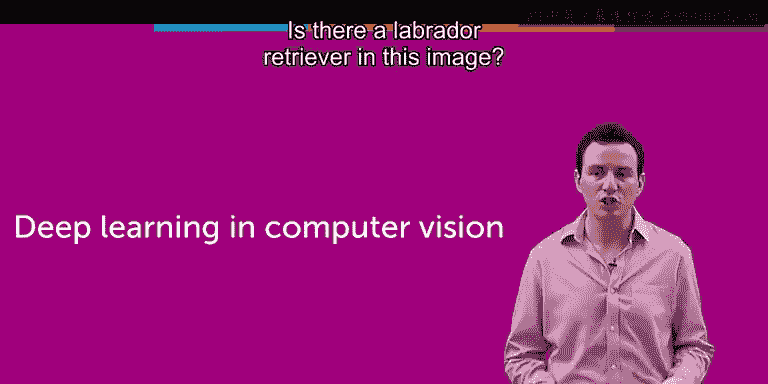
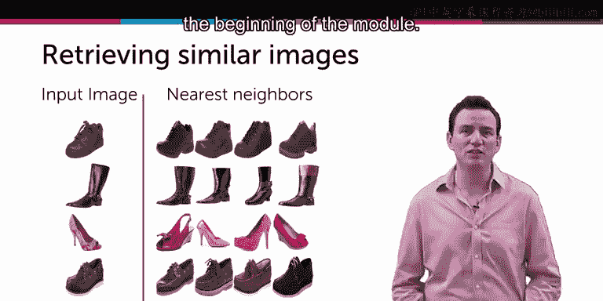

# 99：深度学习在计算机视觉中的其他应用示例 🖼️

在本节课中，我们将探讨深度学习在计算机视觉领域，除了图像分类之外的几种其他强大应用。我们将了解神经网络如何解析图像内容、理解场景，以及实现基于内容的图像检索。

---

上一节我们介绍了神经网络在图像分类任务中的应用。本节中，我们来看看它在计算机视觉中的其他创造性用途。

## 图像解析与场景理解 🧩

神经网络不仅能识别图像中的物体，还能对图像的每一个像素进行分类，从而实现更精细的**图像解析**。

在下面展示的示例中，系统试图为图像中的每个像素分类，并识别出不同的区域。

例如，在中间靠上的图像里，你可以看到一片被标记为“天空”的区域，另一片是“草地”，等等。

这种为图像生成详细描述的技术，也被称为**场景理解**，它非常酷。神经网络在此类任务上再次带来了显著的性能提升。

## 图像检索：寻找相似物品 👟

现在，让我们回到本模块开始时讨论的那个场景：一种新的购物方式。其核心功能其实是**检索相似图像**。

以下是实现此功能的核心概念：系统学习将图像转换为一个数字向量（称为“嵌入”），相似物品的向量在数学空间中也彼此接近。计算相似度通常使用余弦相似度公式：

**相似度 = (A·B) / (||A|| ||B||)**

其中 A 和 B 是两个图像的向量表示。

具体来说，如果我输入一张模糊的黑色鞋子图片，经过训练的深度神经网络能够输出一系列与之相似的鞋子图片，如下方所示，结果是一堆各式各样的黑色鞋子。

如果输入一张更时尚的靴子图片，它会给出各种有趣的长靴。同理，对于高跟鞋、棕色鞋子或运动鞋也是如此。

这正是我们在模块开头演示中使用的核心概念。

---

本节课中我们一起学习了深度学习在计算机视觉中的两个扩展应用：精细到像素的**图像解析**与**场景理解**，以及基于向量相似度的**图像检索**技术。这些应用展示了神经网络如何超越简单分类，实现对图像内容更深层次的理解和利用。