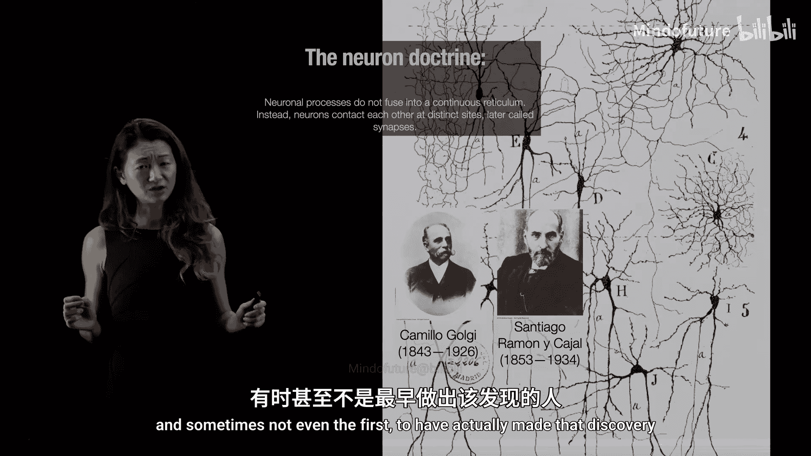
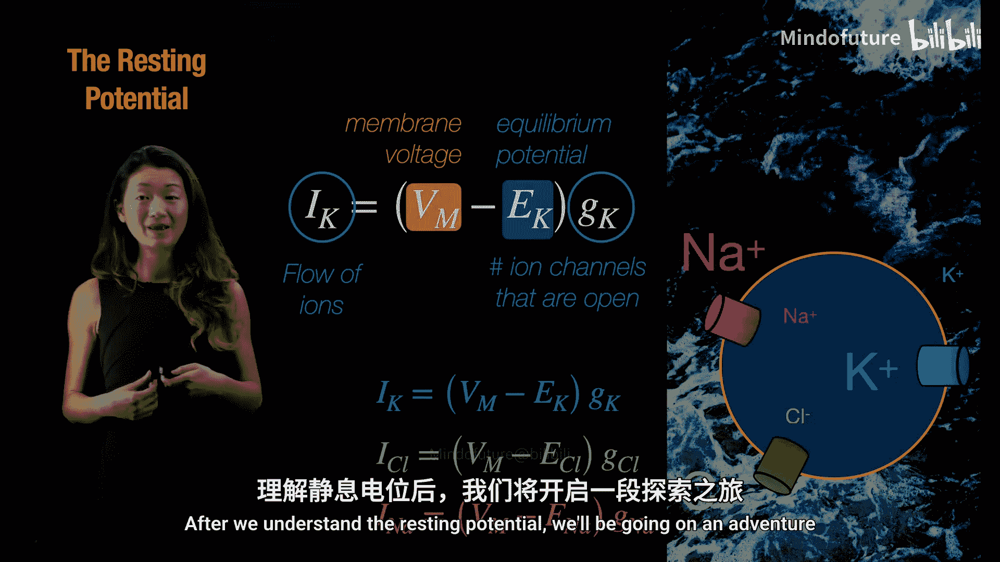
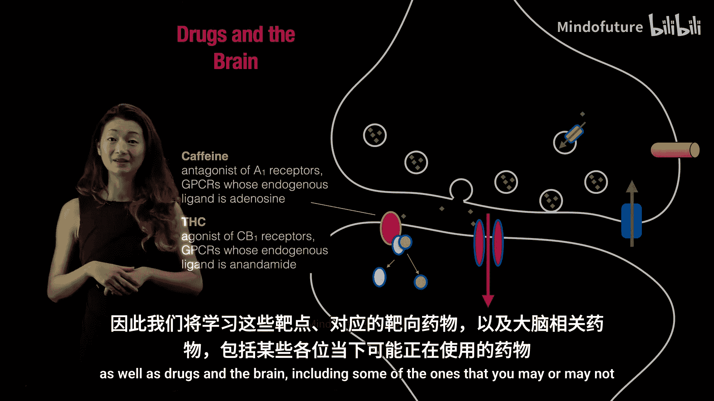

神经科学入门：01：大脑的电语言与神经元学说

在本节课中，我们将学习神经科学的基础，特别是大脑如何利用电信号作为其核心通信语言，以及构成大脑的基本单元——神经元。

大脑的功能与电信号密不可分。当我们思考、感知或行动时，大脑内部都在进行着复杂的电活动。这种电活动是信息传递和处理的基础。为了理解这一点，我们需要从最基本的单元——神经元开始探索。

上一节我们介绍了大脑与电信号的紧密联系，本节中我们来看看神经元是什么，以及为什么它如此特殊。

神经元是神经系统中的特化细胞。它们之所以特殊，一个核心原因是它们利用电活动来传递信息。但大脑中为何会存在电信号？这似乎将生物学与物理学联系了起来。实际上，驱动你观看此视频的电子设备的电力，与在你体内处理和传递信息的电力，在本质上是相同的。我们将首先探讨大脑中存在电信号的根本原因。

理解了大脑中电信号的来源后，我们将探究当神经元所处的环境发生变化时，其电活动如何响应。

神经元对变化的响应至关重要，因为我们对世界的体验正是基于变化，而非静态事物。我们将讨论单个神经元如何响应变化，无论这些变化是来自外部物理世界，还是来自与之交流的其他神经元。

最后，我们将探讨神经元之间如何进行交流。

人脑中有约860亿个神经元，它们并非孤立工作，而是协同运作，产生复杂的整体特性。我们将从单个神经元开始，逐步构建到两个神经元之间的交流，理解信息传递的基本单元和方式。

以下是本系列课程将要涵盖的核心问题列表：
*   **神经元是什么？** 它有何特殊之处？
*   **大脑中为何存在电信号？** 其根本原因是什么？
*   **神经元如何响应环境变化？**
*   **神经元之间如何相互交流？**

有趣的是，对这些问题的分子和细胞机制理解得越深入，你就会发现，每一个答案同时也是药物作用的靶点。这里的“药物”是广义的，包括：
*   针对这些系统的多种医用药物。
*   娱乐性药物。
*   天然毒素。
*   用于科学研究、以解析复杂系统的实验性药物。

为了回答这些问题，我们将学习神经科学的基础。神经科学本质上是跨学科的，因此在接下来的课程中，我假设你已经具备大学初级水平的以下知识：

**生物学基础**
*   了解细胞的组成部分（如细胞核、细胞膜）。
*   知道细胞膜由**脂质双分子层**构成。
*   了解基因如何指导蛋白质合成，以及蛋白质是执行细胞功能的分子机器。

**物理学基础**
*   熟悉电学基本概念，如**电压 (V)**、**电流 (I)**、**电阻 (R)**、**电导 (G)**。
*   了解**欧姆定律**：`V = I * R`。

**数学基础**
*   会使用微积分和微分方程的符号（例如 `dx/dt` 表示对时间 `t` 的导数），但不要求会解方程。

**化学基础**
*   了解离子（带电粒子）的基础知识。
*   知道有机分子的基本表示法（例如，结构式顶点通常代表碳原子）。

如果你对某些主题不完全熟悉，这没关系。我们会放慢节奏，并希望你能以学习大脑如何工作为动力，去回顾或学习这些相关领域的知识。你可以随时暂停，查阅资料。

关于大脑以电信号作为基本通信单元这一点，我们目前是将其作为一个事实来接受。但在科学史上，我们并非一直如此认为。动物电现象的历史可以追溯到17-18世纪，当时电学和磁学的基础正在建立。

以下是当时一个著名的实验，旨在证明“动物电”与普通电本质相同：
1.  将一只死青蛙放在桌上。
2.  用导线将避雷针与青蛙的肌肉两端连接并接地。
3.  等待闪电发生。
4.  当闪电击中时，死青蛙的肌肉会收缩抽动。

这个实验表明，闪电可以“激活”死去的组织。这一发现统一了当时对生物学运动与电学规律的理解，并极大地激发了大众的想象力，甚至直接启发了玛丽·雪莱创作《弗兰肯斯坦》。

自18世纪以来，我们对基础神经科学的认识已取得了长足进步。现代神经科学史的第一个重要里程碑是认识到大脑由神经元构成，且神经元是彼此独立、通过特定结构进行交流的实体。这就是**神经元学说**。

这如今听起来显而易见，但在当时并非如此。大脑结构极其复杂盘绕，很难判断其内部的众多突起是彼此分离的还是连成一体的。这就像观察一碗煮好的意大利面，很难一眼看出它们是一根根独立的面条，还是一整根缠绕在一起的大面条。

20世纪初，两位有影响力的科学家高尔基和圣地亚哥·拉蒙-卡哈尔对此进行了激烈辩论。
*   **高尔基** 支持**网状理论**，认为神经元是连续融合的网络。
*   **拉蒙-卡哈尔** 则正确指出，神经元是彼此独立的细胞，它们仅在后来被称为**突触**的部位进行交流。

拉蒙-卡哈尔通过细致的显微镜观察和精美的手绘神经元图确立了这一学说。他使用的**高尔基染色法**非常神奇：它只随机染色一小部分神经元，从而能在复杂的神经组织中清晰显示出单个神经元的完整形态，证明它们是独立的实体。

历史的一个有趣转折是，最先做出发现的人有时并非获得最多荣誉的人。一位名叫弗里乔夫·南森的挪威科学家，使用相同的高尔基染色法得出了与拉蒙-卡哈尔相同的神经元学说，并发表了著作。但拉蒙-卡哈尔通过全球巡讲确保了自己获得主要声誉，而南森后来成为著名的北极探险家、外交官和人道主义者，并因创立“南森护照”帮助一战难民而获得了诺贝尔和平奖。

神经元学说为我们奠定了坚实的基础。在过去的一百年里，我们在理解电信号如何作为大脑基本语言方面取得了巨大进展。

在接下来的第一组课程中，我们将展开一场关于“神经元电生命”的宏大冒险。以下是内容预览：

**静息电位**
我们将首先探讨神经元在“无事发生”时在做什么。它如何维持一个基本的**跨膜电位**？简单来说，这是通过**钠离子 (Na⁺)**、**钾离子 (K⁺)** 和**氯离子 (Cl⁻)** 等带电粒子实现的。

**动作电位**
理解了静息状态后，我们将进入动态部分。**动作电位**是神经元进行长距离通信（例如从脚趾到大脑）的基本单元。

**突触与通信**
之后，我们将讨论神经元如何通过**突触**彼此交流，了解信息从一个神经元传递到下一个神经元的各个步骤。掌握了突触的分子机制，我们就能理解为何这些部位是多种药物（包括医用药物、娱乐性药物和毒素）的作用靶点。

本节课中，我们一起学习了神经科学的起点：大脑依赖电信号运作，而神经元是产生和传递这些信号的基本独立单元。我们从历史实验和神经元学说的确立过程中，看到了科学认识的演进。在接下来的课程中，我们将深入神经元内部，探索其产生电信号的静息与活动状态，以及它们彼此沟通的奥秘。