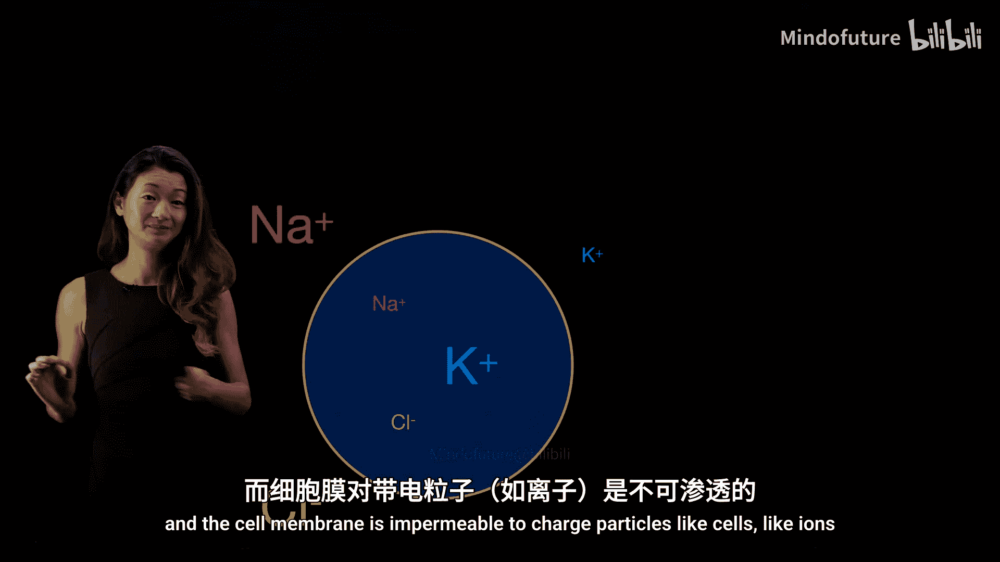
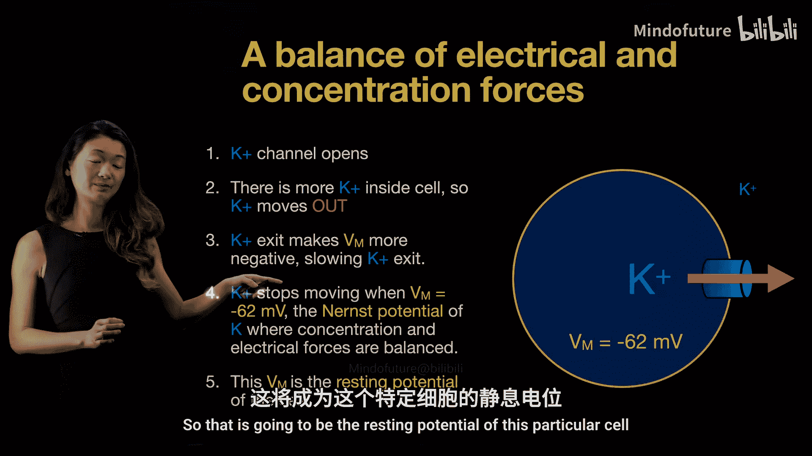
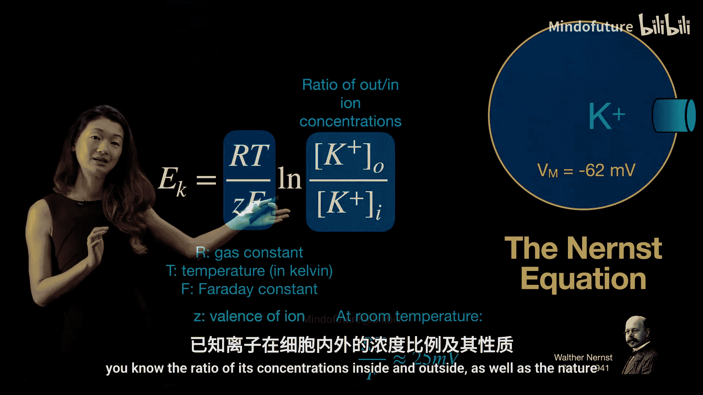
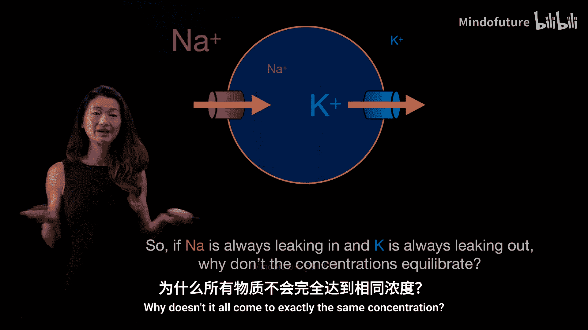
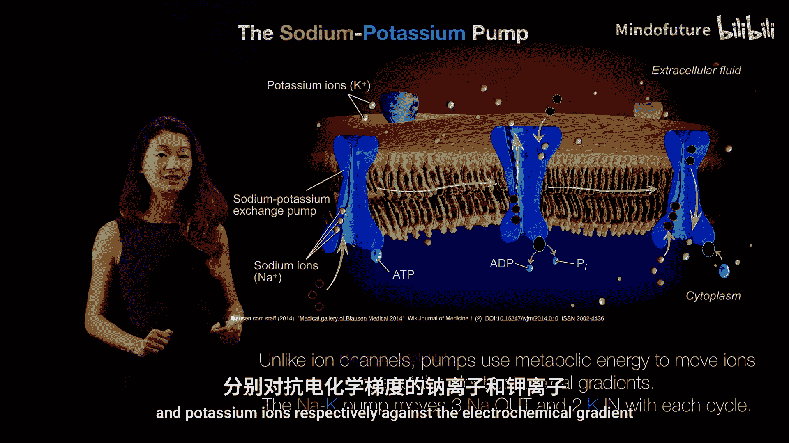
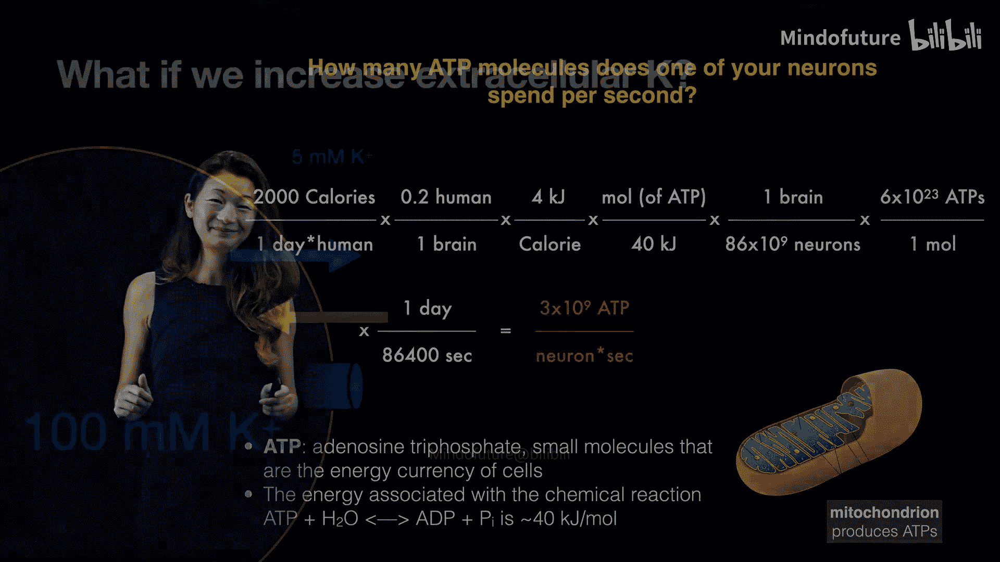
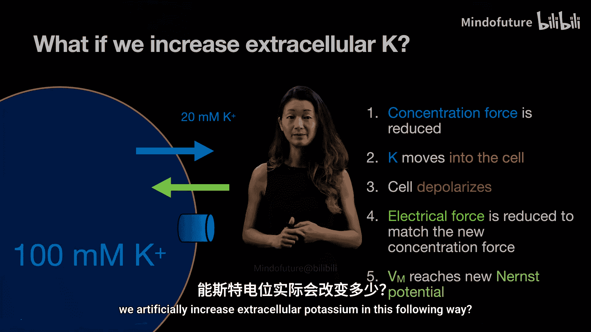
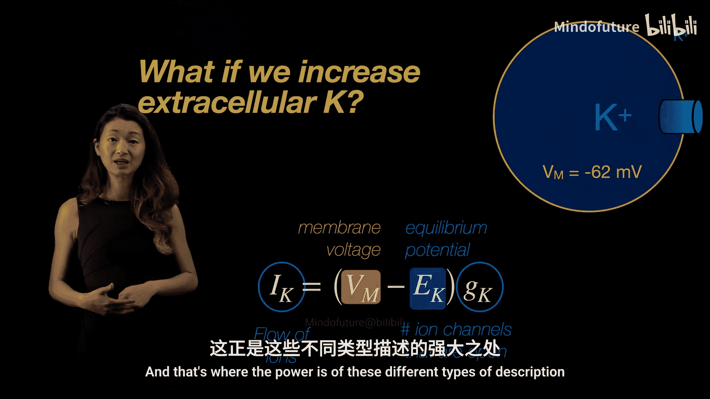
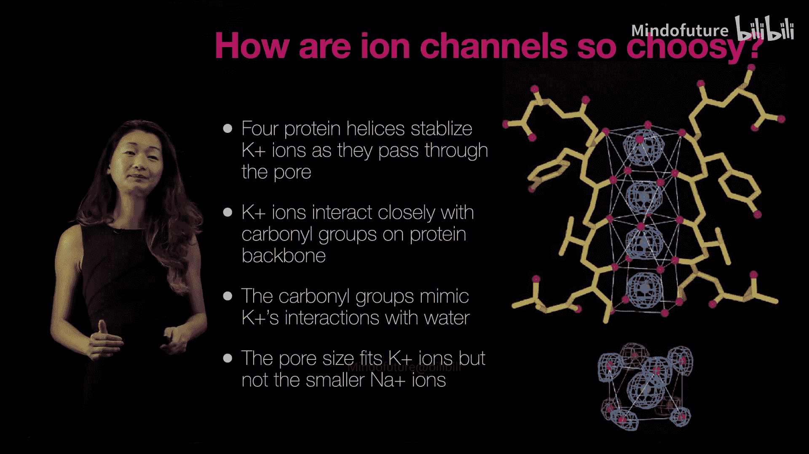

# 003：神经元为何带电-能斯特电位与静息电位

在本节课中，我们将从最基础的概念开始，探讨神经元为何带有电荷，即神经元的静息电位。我们将从细胞的通用特性出发，逐步构建对神经元电学特性的理解。

## 细胞的内外之别

首先，我们来思考一个基本的细胞。细胞的基本功能是区分其内部与外部环境。脂质膜的存在使得细胞能够控制并维持一个与外部不同的内部环境。

这里有一些术语需要明确：
*   **细胞内**：指细胞内部的一切。
*   **细胞外**：指细胞外部的一切。

神经元与其他细胞一样，能够维持一个与外部不同的内部环境。具体来说，它能够维持带电粒子（离子）的浓度差。在本节中，我们将从最简单的几种离子开始讨论。

以下是几种关键离子的浓度分布：
*   **钾离子**：细胞内浓度高，细胞外浓度低。
*   **钠离子和氯离子**：细胞外浓度高，细胞内浓度低。

这种浓度差非常重要，因为它为离子提供了向低浓度区域移动的动力。然而，细胞膜对带电离子是不通透的，这阻止了离子的自由扩散。

> 一个帮助记忆的方法是：细胞在海洋中进化，海水富含钠和氯。因此，细胞外环境类似海洋，富含钠和氯；而细胞内环境则相反，钠和氯较少，但钾离子较多。

## 静息电位的基础

神经元的静息电位大约在 **-60 到 -80 毫伏** 之间。如果用电池来类比，这是一个相当大的电压。如果按比例放大到一个普通电池的大小，这相当于一个30万伏的电池。如此大的电荷差被维持在一层薄薄的脂质膜两侧。

此外，大多数神经元在静息状态下对钾离子具有**高通透性**。虽然细胞膜通常对离子不通透，但神经元可以通过表达特定的蛋白质（离子通道）来控制特定离子的通透性。在静息状态下，神经元表达对钾离子有选择性的离子通道，允许钾离子自由进出。

这些是已知的事实，但如何理解它们呢？接下来，我们将结合电学和离子电位的知识来解释其原理。

首先明确一些术语：
*   **膜电位**：用 **VM** 表示，指细胞膜两侧的电压差。
*   **静息电位**：指没有特殊活动时的膜电位。
*   **去极化**：膜电位变得更正（更接近零）。
*   **超极化**：膜电位变得更负（更远离零）。

## 钾离子的平衡：能斯特电位

为了简化，我们先忽略其他离子，只关注钾离子。假设一个细胞，内部钾离子浓度高，外部浓度低，并且存在允许钾离子自由进出的通道。

根据化学原理，钾离子会顺着浓度梯度**离开细胞**。然而，钾离子带正电。当正离子离开细胞时，会使膜电位变得更负（内部更负）。随着膜电位变负，会产生一个将外部正离子拉回细胞内部的**电场力**。

于是，这里存在一个平衡：**浓度梯度**促使钾离子外流，而**电场力**又吸引钾离子内流。最终，这两种力量会达到平衡。当电化学驱动力为零，钾离子没有净流动时，对应的膜电位就称为钾离子的**能斯特电位**。

能斯特电位非常重要，它告诉我们，即使所有通道都开放，当膜电位达到此值时，钾离子也将停止净移动，细胞膜电位达到稳定。在这个只考虑钾离子的简化模型中，能斯特电位就是细胞的静息电位。

## 计算能斯特电位

能斯特电位可以通过以下公式计算，该公式描述了单一离子的平衡电位（E离子）：

**E离子 = (RT / zF) * ln( [离子]外 / [离子]内 )**

其中：
*   **R** 是气体常数，**T** 是开尔文温度，**F** 是法拉第常数。在生理温度下，RT/F 约等于 **25 毫伏**。
*   **z** 是离子价态（如 K⁺ 为 +1，Na⁺ 为 +1，Cl⁻ 为 -1）。
*   **[离子]外** 和 **[离子]内** 分别是细胞外和细胞内的离子浓度。

这个公式表明，平衡电位只取决于**内外浓度比**和**离子价态**，而非绝对浓度。

## 现实情况：多种离子与钠钾泵

在更真实的场景中，细胞内外存在多种离子。例如，典型的动物细胞中：
*   钾离子的能斯特电位约为 **-80 mV**（内高外低）。
*   钠离子的能斯特电位约为 **+60 mV**（外高内低）。

如果细胞膜对两者都有通透性，钠离子会倾向于内流，钾离子会倾向于外流。那么，浓度为何不会最终完全均衡呢？答案是 **钠钾泵**。

钠钾泵是一种主动转运蛋白，它利用ATP水解提供的能量，逆着电化学梯度工作：
*   每循环一次，泵出 **3 个 Na⁺**，泵入 **2 个 K⁺**。
*   消耗 **1 个 ATP** 分子。

这个泵不断工作，以维持细胞内高钾、低钠，细胞外高钠、低钾的浓度差。正是这种浓度差，使得神经元能够维持一个负的静息电位，处于“待命”状态。

维持这种“待命”状态消耗巨大能量。尽管大脑只占体重的约2%，但在静息时消耗了全身约20%的能量。计算表明，即使你坐着不动，你大脑中的**每个神经元每秒也要消耗约10亿个ATP分子**，主要就用于驱动钠钾泵。

## 改变细胞外钾浓度的影响

我们可以用能斯特电位的概念进行一个思想实验：如果人为增加细胞外钾离子浓度会发生什么？

推理过程如下：
1.  细胞外钾浓度增加，降低了钾离子外流的浓度梯度驱动力。
2.  因此，钾离子会开始**净流入**细胞。
3.  正离子流入使膜电位**去极化**（变得更正）。
4.  膜电位变正会削弱吸引钾离子内流的电场力。
5.  最终，电化学力量在新的膜电位下达到平衡，这个新的平衡电位就是新的能斯特电位，其具体数值可以通过能斯特方程计算。

## 静息钾通道的重要性：昏厥山羊的例子

静息电位依赖于持续开放的钾离子通道（静息钾通道）。如果这些通道不足，细胞维持静息电位的能力就会下降，并且兴奋后难以恢复正常状态。

这并非纯理论设想，现实中存在一种称为“**先天性肌强直**”的疾病，患者（如昏厥山羊）就因静息离子通道不足，在受惊时肌肉持续收缩无法放松而倒地。这生动说明了静息离子通道对维持正常神经肌肉功能的重要性。

## 整合多种离子：戈德曼-霍奇金-卡茨方程

当细胞膜对多种离子都有通透性时，静息电位是所有离子共同作用的结果。直观上，这可以理解为对各离子能斯特电位的**加权平均**，权重就是膜对该离子的**相对通透性**。

戈德曼-霍奇金-卡茨方程正是描述了这一点：

**VM = (RT/F) * ln( ( Σ P阳离子[阳离子]外 + Σ P阴离子[阴离子]内 ) / ( Σ P阳离子[阳离子]内 + Σ P阴离子[阴离子]外 ) )**

其中 **P** 代表膜对某种离子的通透性。这个方程更全面地描述了在多种离子存在下的膜静息电位。

## 欧姆定律与离子流动

我们可以用电路来类比和理解离子的流动。欧姆定律 **V = IR** 在这里同样适用，但需要转换视角：
*   **电压**：驱动离子流动的电化学驱动力，即 **(VM - E离子)**。
*   **电流**：离子跨膜流动的速率。
*   **电阻**：离子通过膜的难易程度。其倒数 **电导** 更常用，用 **G** 表示。

在神经元中，**电导直接对应于开放的离子通道数量**。因此，对于钾离子，其电流可表示为：

**IK = GK * (VM - EK)**

这个公式很直观：
*   如果电导 **GK** 为零（通道全关闭），则无电流。
*   如果膜电位 **VM** 等于平衡电位 **EK**，则驱动力为零，也无净电流。

## 神经元的RC电路模型

上述描述恰好对应一个经典的 **RC电路模型**：
*   **电容**：代表脂质膜储存电荷的能力。
*   **电阻与电池并联**：代表离子通道（电阻）及其平衡电位（电池）。
    *   对于钾离子通路，电阻值为 1/GK，电池电压为 EK。

这个电路模型与生物物理方程是等价的，它为我们提供了另一种强大的工具，来定量分析和预测神经元电学特性，例如精确计算改变细胞外钾浓度对膜电位的影响。

对于多种离子，只需在模型中添加更多的独立并联通路即可，每条通路对应一种离子及其特定的通道和平衡电位。

## 离子通道的选择性机制

离子通道如何能如此精确地只允许特定离子通过？以钾离子通道为例，其分子结构非常精巧：
*   它由四个亚基组成，中央形成一个孔道。
*   孔道内壁的**羰基氧原子**可以模拟水分子与钾离子的相互作用，为钾离子提供一个友好的通过环境。
*   孔道大小经过精确设计，恰好能稳定容纳**钾离子**的水合壳层，但**钠离子**较小，无法与所有结合位点有效作用，因此难以通过。

需要强调的是，离子通道**只选择离子种类，不选择流动方向**。离子流动的方向完全由当时的电化学梯度决定。这与主动运输的钠钾泵有本质区别，泵是消耗能量定向运输的。

## 本节总结

本节课我们一起学习了神经元静息电位的核心原理：

1.  **电荷来源**：神经元的电荷源于细胞内外**离子浓度差**，主要是钠、钾、氯离子。
2.  **膜电位**：用 **VM** 表示细胞膜两侧的电压差，静息时约为-60至-80 mV。
3.  **平衡原理**：静息电位是**电化学驱动力**平衡的结果。浓度梯度与电场力相互对抗，达到平衡。
4.  **能斯特方程**：用于计算**单一离子**的平衡电位。公式为 **E = (RT/zF) ln([外]/[内])**。
5.  **GHK方程**：用于计算**多种离子**共同作用下的膜静息电位，考虑了各离子的相对通透性。
6.  **欧姆定律应用**：离子电流 **I = G * (VM - E)**，其中电导 **G** 反映开放通道数量。
7.  **主动维持**：**钠钾泵**消耗ATP，主动逆浓度梯度运输离子，是维持静息电位和神经元“待命”状态的关键，也是大脑高耗能的主要原因。
8.  **通道选择性**：离子通道通过精确的**孔道结构和化学环境**实现离子选择性，如钾通道能区分大小相近的 Na⁺ 和 K⁺。

理解静息电位是理解神经元一切电活动（如动作电位）的基石。下节课，我们将探讨当神经元不再“静息”时，会发生什么更激动人心的事情。