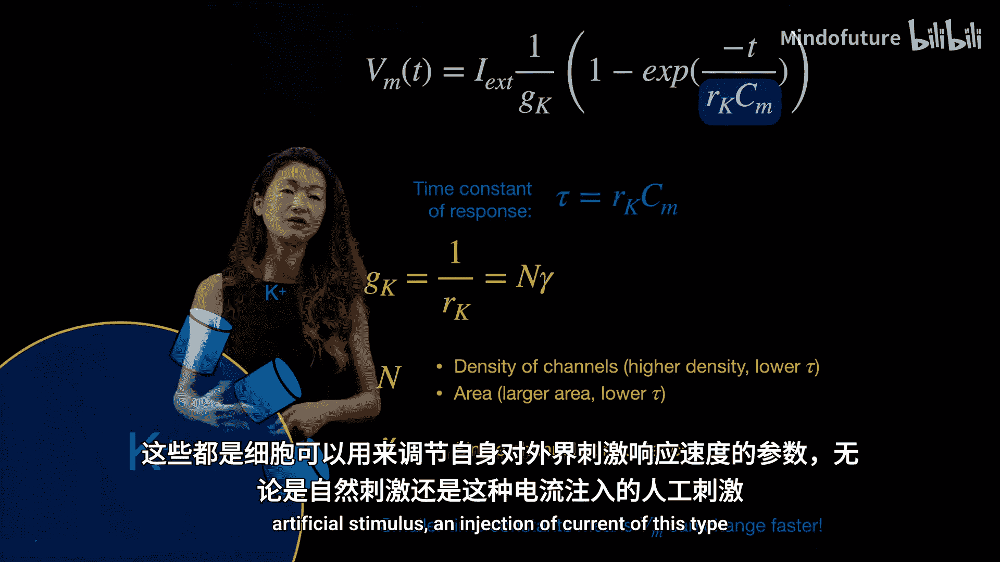
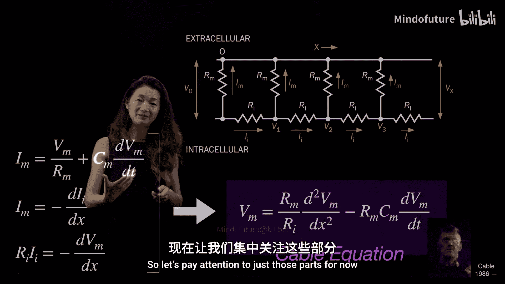
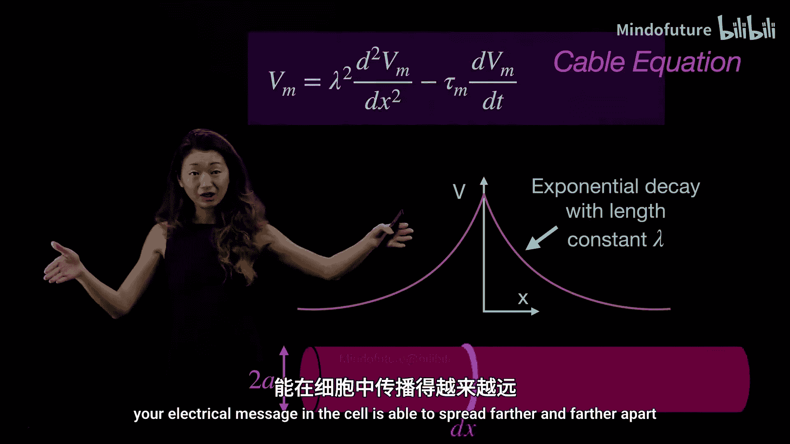

# 004：神经元的主动特性 - 电流响应与轴突传导的电缆方程 🧠

在本节课中，我们将要学习神经元的主动特性。上一节我们介绍了神经元在静息状态下的被动特性。本节中，我们来看看当有外部刺激（如电流注入）时，神经元会发生什么变化。这些变化是神经元处理信息、让我们能够感知和响应世界的基础。

## 从被动到主动：电流注入的影响

上一节我们学习了欧姆定律和RC电路模型，它们描述了离子如何维持和流动，从而形成静息电位。这种静息电位是神经元随时准备响应变化的基础。

现在，我们将使用同一个方程，观察当我们人为地向电路中注入一点电流时会发生什么。这相当于在细胞内外之间增加一个“夹子”，施加一个电流刺激。这种电流注入可以类比为自然的感觉刺激，例如光线照射到感光细胞上，最终被转化为注入感光细胞的电流。

那么，在这种场景下，细胞的膜电压会发生什么变化呢？我们将从上一讲推导出的欧姆定律出发，来推导这个变化过程。

## 膜电流方程：电阻与电容通路

我们首先写出膜电流方程。通过膜的总净电流 **I_m** 必须是流经所有并联通路的电流之和。在我们的模型中，有两个并联通路：电阻通路和电容通路。

以下是电流的组成：
*   **电阻通路电流 (I_R)**：遵循欧姆定律，**I_R = g * V**，其中 **g** 是膜电导，**V** 是膜电位。
*   **电容通路电流 (I_C)**：流经电容器的电流由膜电容 **C_m** 和膜电位变化率 **dV/dt** 决定，即 **I_C = C_m * dV/dt**。膜电位变化越快，流经电容的电流就越大。

因此，总膜电流方程为：
**I_m = g * V + C_m * dV/dt**

这个方程结合了欧姆定律和电容的特性，描述了当有外部电流 **I_ext** 注入时（**I_m = I_ext**），膜电位 **V** 如何随时间 **t** 变化。

## 求解膜电位响应

上述方程是一个标准形式的一阶微分方程。我们可以求解出膜电位 **V** 随时间 **t** 变化的函数。

方程的解具有以下形式：
**V(t) = (I_ext / g) * [1 - exp(-t / τ)]**

其中 **τ** 是时间常数，**τ = R_m * C_m**（**R_m** 是膜电阻，等于 **1/g**）。

不要被这个公式吓到，我们可以分部分理解它：
*   **I_ext / g**：这部分决定了电压响应的最终幅度。注入电流 **I_ext** 越大，或膜电导 **g** 越小（电阻越大），电压上升的幅度就越大。
*   **[1 - exp(-t / τ)]**：这部分描述了电压随时间上升的曲线形状。它是一个指数增长函数，其增长的速度由时间常数 **τ** 决定。

对于大多数神经元，**τ** 大约在1到100毫秒之间。这决定了细胞对电流注入的响应速度。**τ** 越小，细胞响应速度越快。

当注入正电流时，细胞会发生**指数去极化**。当电流关闭后，膜电位会以指数形式**复极化**，回到静息水平附近。

## 调节响应速度：细胞的“旋钮”

从时间常数 **τ = R_m * C_m** 的公式中，我们可以理解细胞如何调节其响应速度。

**τ** 主要受膜电阻 **R_m** 影响，而 **R_m** 又取决于离子通道的密度和单通道电导。以下是细胞可以调节的“旋钮”：
*   **离子通道密度**：细胞可以通过表达更多或更少的通道蛋白来改变单位面积上的通道数量。
*   **离子通道类型**：细胞可以选择表达具有较高单通道电导的离子通道类型，而不是较低电导的类型。

通过调节这些“旋钮”，细胞可以调整其对外部刺激（无论是自然感觉刺激还是人为电流注入）的响应速度。

## 从球体到圆柱体：空间传导的挑战

到目前为止，我们所有的讨论都基于一个近似：神经元是一个球体。这个近似对于描述局部电压随时间变化是有效的。

但神经元最酷的特点之一就是它们绝对不是球体。它们通常又长又细，其重要职能之一就是将信息快速地从身体一端传递到另一端。例如，鹰眼发现兔子时，信息必须飞速传到尾部肌肉以调整俯冲姿态。

因此，我们需要将神经元近似为**圆柱体**，特别是其长长的输出部分——**轴突**。这引入了空间维度：电压不仅随时间变化，也随沿着轴突的位置变化。

## 电缆方程：描述空间传导

当我们考虑圆柱形轴突时，电流不仅可以通过膜流动，也可以沿着轴突内部（胞内）纵向流动。我们可以将轴突分成许多小段，每一段都有膜电阻、膜电容和轴向电阻。

由此推导出的控制方程称为**电缆方程**。它是一个偏微分方程，同时包含了电压随时间的变化 (**dV/dt**) 和随空间的变化 (**d²V/dx²**)。

电缆方程可以简化为以下形式，它将空间变化项和时间变化项分离开：
**λ² * (d²V/dx²) - τ * (dV/dt) = V**

其中：
*   **τ** 是我们熟悉的时间常数。
*   **λ** 是**长度常数**，它决定了电压信号在空间中衰减（传播）的距离。

## 长度常数与轴突直径

长度常数 **λ** 的公式揭示了关键信息：
**λ ∝ √(a)**

其中 **a** 是轴突圆柱体的半径。

这意味着：**轴突直径越大，长度常数 λ 就越大**。

用物理图像来理解：如果在轴突某一点产生一个电压变化，离子会向左右两侧流动，导致邻近区域的电压也发生变化。轴突直径越大，内部轴向电阻越小，电压信号就能传播得更远、衰减得更慢。

因此，拥有更粗的轴突是一种有效的策略，可以使电信号传播得更快、更远。然而，这并非没有代价。维持更粗的轴突需要更多的能量和代谢成本。这是在信号传导效率与代谢负担之间的一个权衡。

---

本节课中我们一起学习了神经元的主动特性。我们了解到，神经元通过改变膜电位来响应注入的电流，这种变化在时间上呈指数形式（去极化或复极化）。离子通道的密度决定了神经元对变化的响应速度。接着，我们探讨了电特性在空间中的传播，这由电缆方程描述。电缆方程预测，在圆柱近似下，轴突的直径决定了膜电位能够传播的速度和范围。

在下一节视频中，我们将为神经元的特性增加更多的“活性”和“兴奋性”，最终抵达核心内容——动作电位。