# 005：动作电位与有髓鞘轴突 🧠⚡

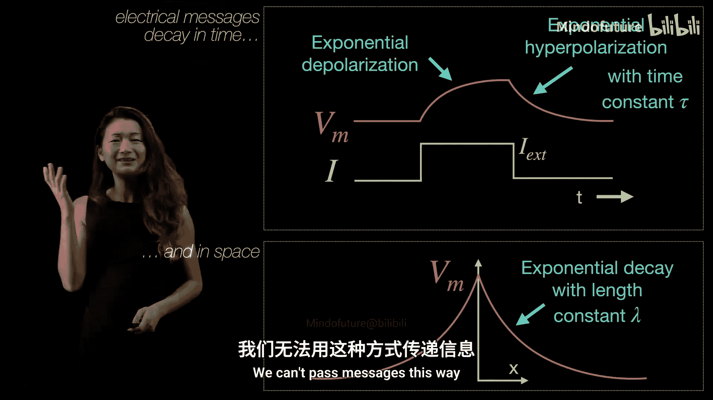

在本节课中，我们将学习神经元如何通过一种称为“动作电位”的自我强化电信号，可靠地将信息传递到长距离。我们将探讨其产生机制、传播方式，以及有髓鞘轴突如何显著提升信号传导速度。

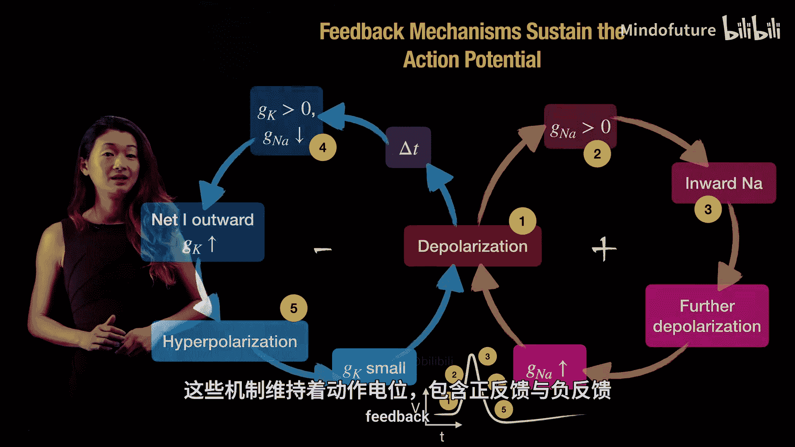

## 动作电位：问题的解决方案

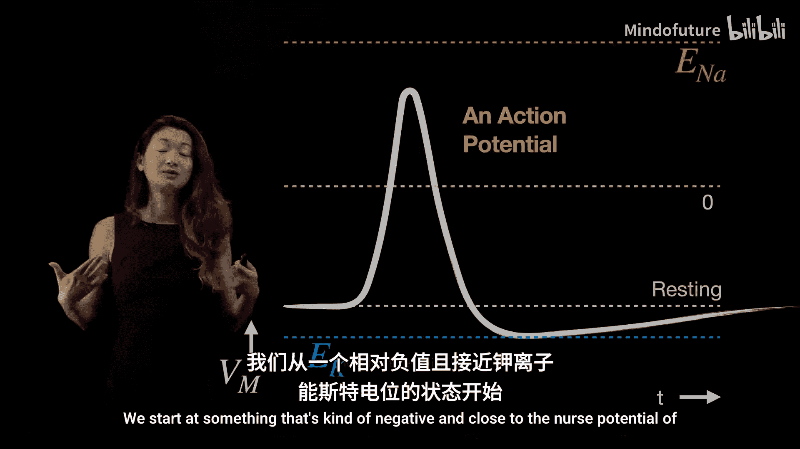

上一节我们介绍了神经元的被动和主动电学特性。我们了解到，当有电流注入时，细胞膜电位会发生指数式的去极化和超极化，并且这种反应在时间和空间上都会指数衰减。这种方式无法可靠地传递长距离信息。

神经元的解决方案是发明一种全新的编码方式，即动作电位。它像一个自我强化的“波包”，在细胞中传播时形状保持不变，并能自我增强。

## 动作电位的机制与形状

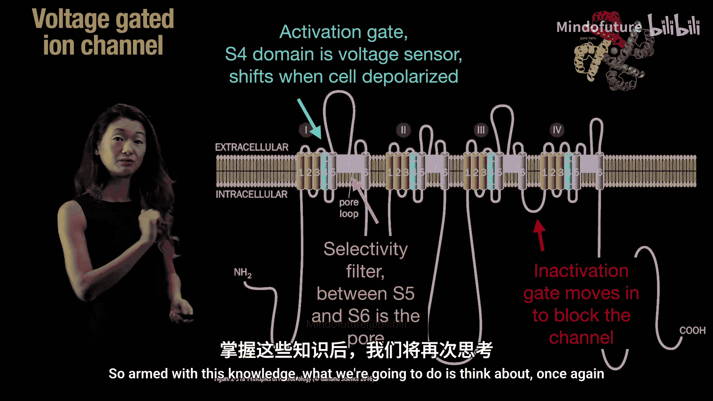

动作电位具有非常特征性的形状。它从静息电位开始，快速上升（去极化），然后下降（复极化），通常会轻微超调（后超极化），最后缓慢回到静息电位。

其核心机制依赖于两种新的离子通道：**电压门控钠通道**和**电压门控钾通道**。它们与之前讨论的“渗漏”通道不同，其电导（G）会随膜电位（V）和时间变化。

### 电压门控钠通道的特性

电压门控钠通道具有三个关键部分：
1.  **选择性过滤器**：只允许钠离子通过。
2.  **激活门（电压传感器）**：当细胞膜去极化时，通道打开。
3.  **失活门**：通道打开一段时间后，会自动关闭，即使膜仍处于去极化状态。

其行为可概括为：去极化时快速激活（打开），随后因失活而关闭。

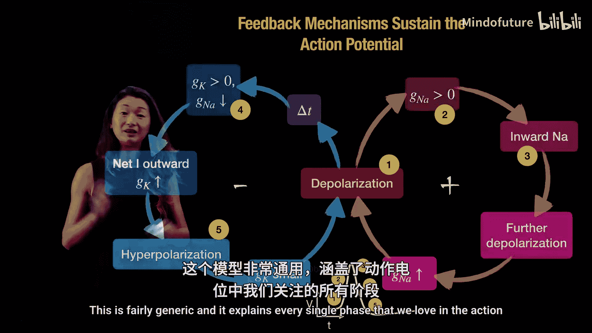

## 动作电位的分步解析

以下是动作电位每个阶段发生的事件：

**1. 静息期**
*   膜电位接近钾离子平衡电位（E_K，约-80mV）。
*   电压门控钠通道和钾通道都处于关闭状态。

**2. 上升支（去极化期）**
*   少量去极化（如来自相邻细胞区域）使部分电压门控钠通道打开。
*   钠离子在巨大电化学驱动力（V_m - E_Na）下涌入细胞，导致进一步去极化。
*   进一步去极化打开更多钠通道，形成**正反馈循环**，膜电位迅速上升。

**3. 峰值与下降支（复极化期）**
*   膜电位接近钠离子平衡电位（E_Na，约+55mV），钠离子流入的驱动力减小。
*   电压门控钠通道开始失活而关闭。
*   与此同时，延迟打开的**电压门控钾通道**开始开放。
*   钾离子在驱动力（V_m - E_K）作用下大量外流，使膜电位快速下降，形成**负反馈循环**。

**4. 后超极化期**
*   膜电位短暂低于静息电位。
*   所有电压门控通道均已关闭。
*   主要由始终开放的渗漏钾通道将膜电位缓慢拉回静息水平。

整个动作电位的主要部分（上升和下降）大约持续1毫秒。正反馈（钠通道）和延迟的负反馈（钾通道）共同塑造了这一过程。

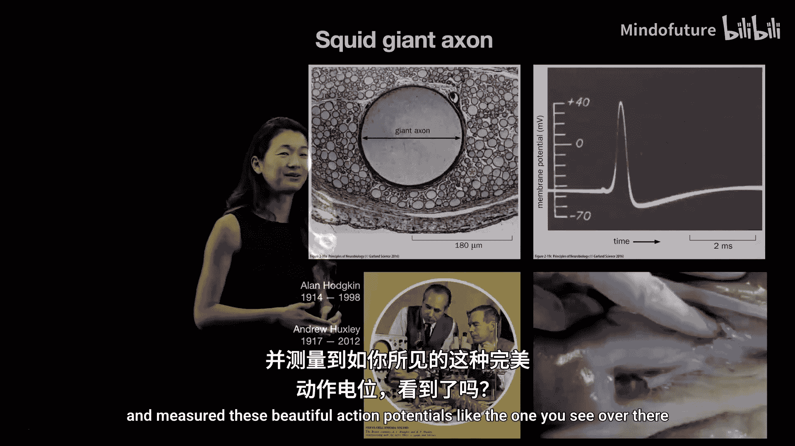

## 理解动作电位的关键概念

在深入细节后，有几个核心概念对于理解动作电位至关重要：

1.  **动作电位由电导的瞬时变化引起**。公式 `I_ion = G_ion * (V_m - E_ion)` 中的电导G（G_Na, G_K）不再是常数，而是随时间快速变化的变量。
2.  **动作电位期间跨膜的离子数量极少**。局部离子浓度的微小瞬变不会改变细胞内外的整体离子浓度。
3.  **因此，钠和钾的平衡电位（E_Na, E_K）在动作电位期间保持不变**。
4.  **离子梯度由钠钾泵主动维持**。该泵持续工作，利用ATP水解产生的能量，将流入的钠泵出，将流出的钾泵入，恢复静息时的离子分布。

## 霍奇金-赫胥黎模型

科学家并非一开始就了解动作电位。霍奇金和赫胥黎在20世纪40-50年代，利用枪乌贼的巨大轴突进行开创性实验，首次记录并建模了动作电位。

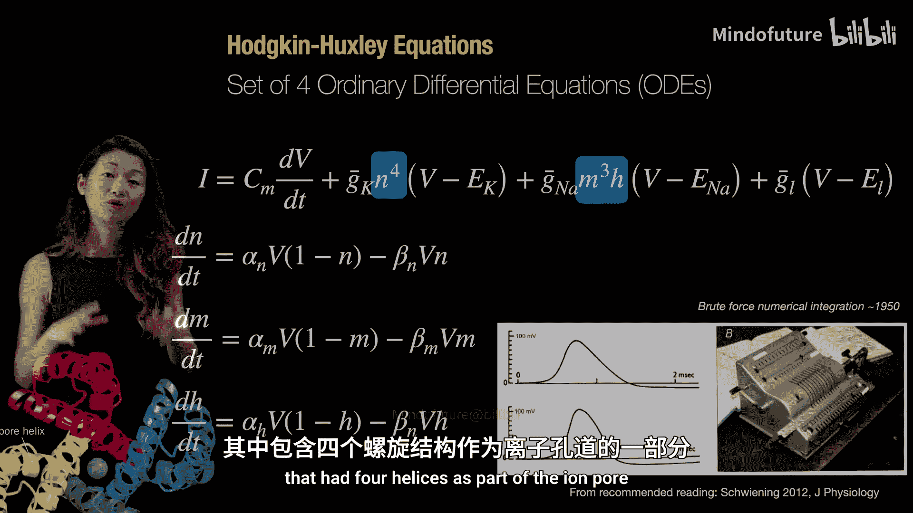

他们需要巨大轴突，是因为当时的技术需要将电极插入轴突内部，以测量膜内外的电位差。基于实验数据，他们提出了著名的**霍奇金-赫胥黎方程**，用一组微分方程成功地定量描述了动作电位。

该方程的核心部分与我们之前推导的电缆方程相似：
`C_m * dV/dt = -G_K * n^4 * (V - E_K) - G_Na * m^3 * h * (V - E_Na) - G_L * (V - E_L)`
其中 `n`, `m`, `h` 是描述通道门控动力学的时间依赖变量。有趣的是，拟合数据要求钾电流项包含 `n^4`，钠电流项包含 `m^3 * h`，这后来被证实与电压门控通道由四个亚基构成的物理结构相符。

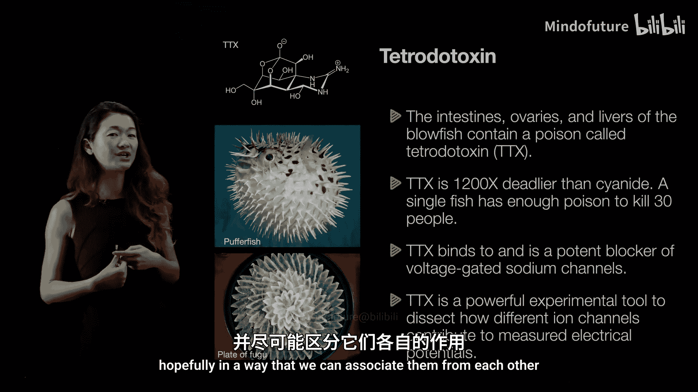

## 当电压门控钠通道出错时

电压门控钠通道至关重要，因此其功能障碍会导致严重后果：

*   **河豚毒素**：一种由河豚产生的强效神经毒素，能特异性阻断电压门控钠通道，导致瘫痪和死亡。它也是神经科学中分离钠、钾电流的重要实验工具。
*   **高钾性周期性麻痹**：马的一种遗传病，源于骨骼肌电压门控钠通道（SCN4A基因）突变，导致周期性肌肉震颤和瘫痪。所有患病马匹都是一匹名为“Impressive”的冠军种马的后代。
*   **进化军备竞赛**：某些蝾螈分泌河豚毒素作为防御。而捕食它们的蛇类，则进化出了对河豚毒素不敏感的SCN4A钠通道变体，形成了有趣的协同进化。

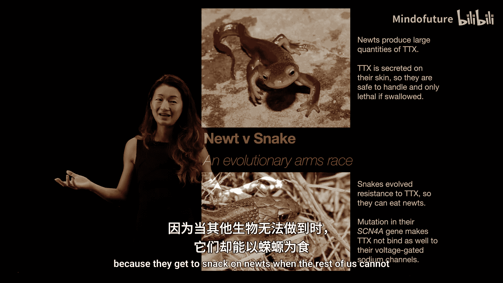

## 动作电位在空间中的传播

动作电位不仅在时间上自我再生，在空间上也像波一样传播。它沿着轴突前进，形状基本保持不变。

传播机制如下：
1.  区域A处于动作电位峰值（钠离子大量内流）。
2.  流入的钠离子轴向扩散，去极化相邻的静息区域B。
3.  区域B的电压门控钠通道被激活，产生新的动作电位。
4.  同时，区域A的钠通道已失活，并进入钾离子外流的复极化阶段，因此信号只能向前（向B方向）传播。

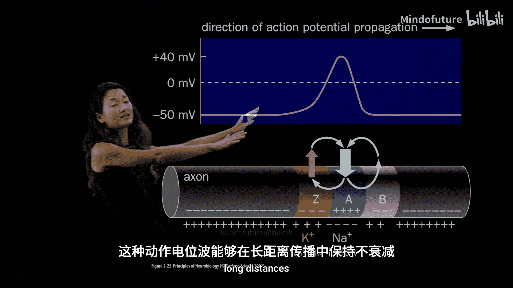

这样，动作电位就像“接力赛”一样，沿轴突不断被再生和传递。

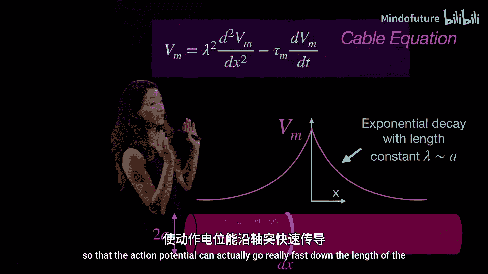

## 提高传导速度：髓鞘化

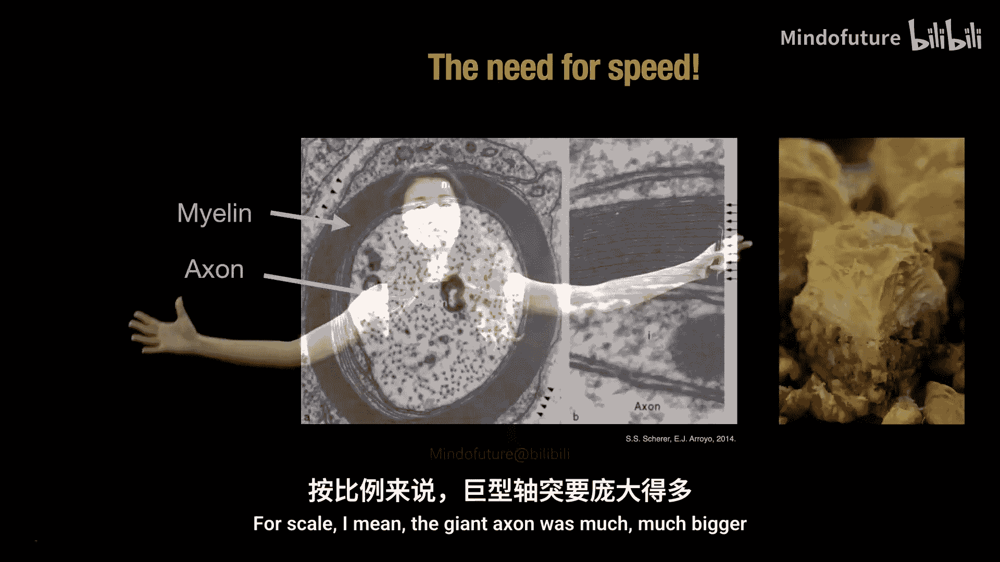

然而，传导速度仍受物理限制。根据电缆方程，空间常数 λ ∝ √(a)，其中a是轴突半径。提高速度有两种主要策略：

1.  **增大轴突直径**：如枪乌贼的巨大轴突。
2.  **髓鞘化**：哺乳动物等采用的主要策略。

髓鞘是由**胶质细胞**反复包裹轴突形成的绝缘层。这极大地增加了膜的有效电阻（R_m * n），并减少了有效电容（C_m / n）。

其结果是：
*   **时间常数τ ≈ R_m * C_m 基本不变**：细胞对刺激的响应速度不变。
*   **空间常数λ 显著增加**：电信号衰减更慢，传播更远。

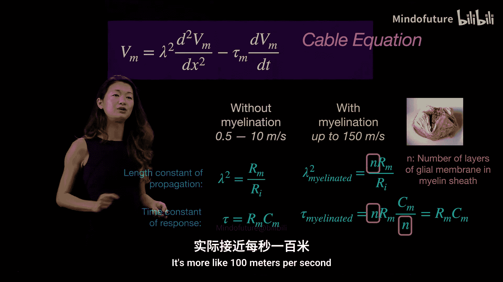

在有髓鞘轴突上，电压门控钠通道高度集中在髓鞘之间的**郎飞结**上。动作电位在郎飞结处被再生，然后在髓鞘覆盖的结间区进行快速的“被动式”电紧张性扩布，这种跳跃式的传导称为**跳跃传导**。这能将传导速度从约1米/秒提升至约100米/秒。

髓鞘化也有代价：需要大量额外的胶质细胞。因此，体内只有需要快速传递关键信号（如痛觉、运动指令）的轴突才会被髓鞘化。

## 髓鞘相关疾病

髓鞘至关重要，其病变会导致严重疾病：

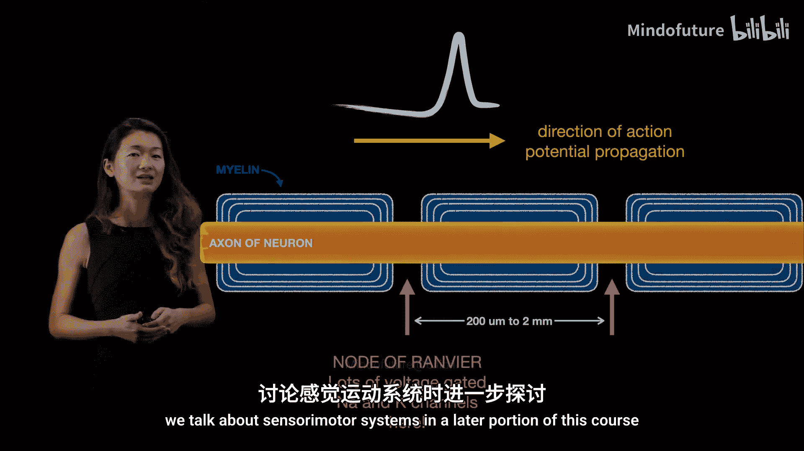

*   **多发性硬化症**：一种中枢神经系统的脱髓鞘性疾病，症状多样且呈进展性，诊断和治疗困难。
*   **腓骨肌萎缩症**：一种周围神经的脱髓鞘性疾病。由于远端神经（如脚趾）的轴突更长，脱髓鞘的影响更严重，导致症状呈“长度依赖性”，即离躯体越远的部分症状越重。

## 总结

本节课我们一起学习了动作电位与有髓鞘轴突：

1.  **动作电位**是一个自我强化的电压波包，其产生依赖于**电压门控钠通道和钾通道**构成的正、负反馈循环。
2.  动作电位在**时间和空间上都能自我再生**，像波一样沿轴突传播。
3.  其传导速度受电缆方程物理限制，可通过**增大轴突直径**或**髓鞘化**来提高。
4.  **髓鞘**由胶质细胞形成，通过增加膜电阻、减少电容来增大空间常数，实现快速的**跳跃传导**。
5.  电压门控通道功能障碍（如中毒、突变）或髓鞘损伤（如多发性硬化症）都会导致严重的神经系统疾病。

下一节，我们将探讨动作电位到达轴突末梢后会发生什么，即神经元之间的信息传递。