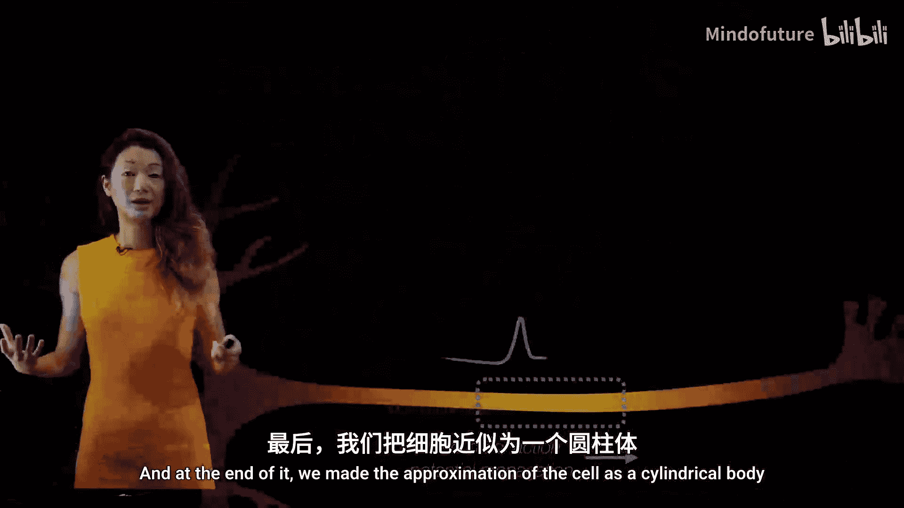
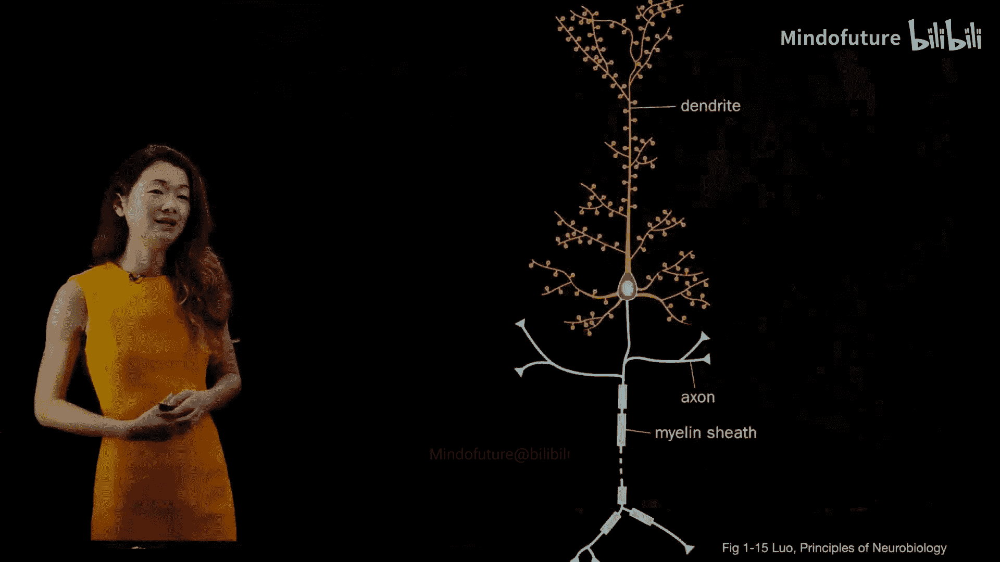
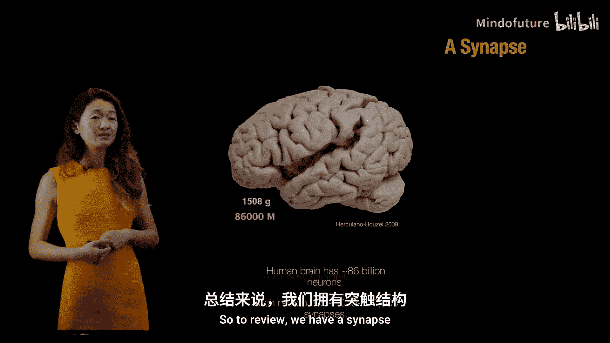
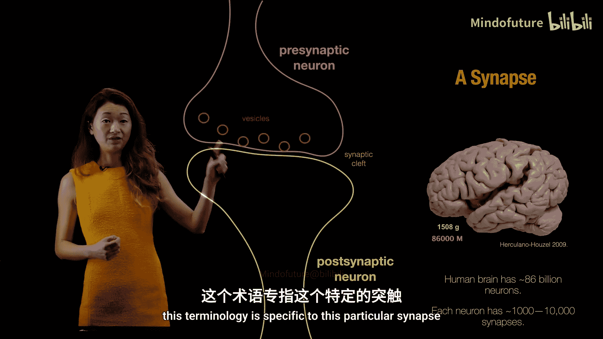
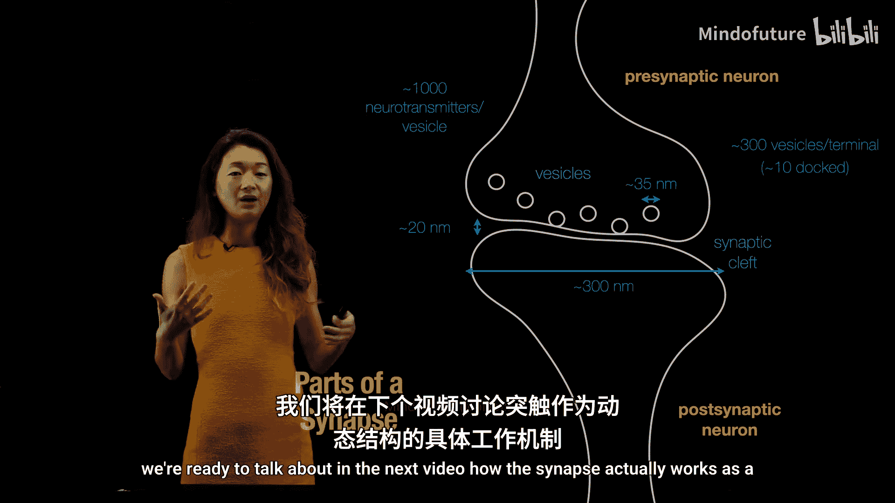
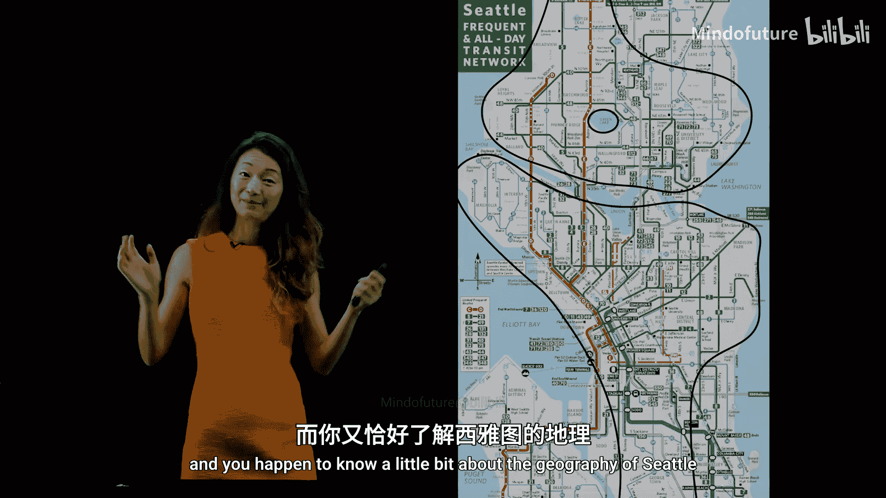

# 006：神经元解剖与突触结构 🧠

在本节课中，我们将继续探索大脑细胞——神经元——如何处理和传递信息，使你能够完成日常生活中的各种活动。上一节我们推导了神经元的被动和主动电学特性，并将细胞近似为圆柱体，从而理解了动作电位——一种“全或无”的自我增强电波——如何沿着轴突无损耗地传播。

这引出了两个新问题：动作电位是如何被**启动**的？以及当动作电位到达细胞末端时会发生什么？答案是：神经元通过称为**突触**的结构与其他神经元连接。突触是细胞间通信的基本单元，其强度的可塑性正是大脑能够随时间改变和学习的基础。

如果你准备好了，我们的学习路线图如下：本节视频将从神经元和突触的解剖基础开始。接下来，我们将探讨动作电位到达末端时，突触间的**神经传递**过程。然后，我们会学习不同类型的突触和受体。这些知识将引向一些相关话题，如作用于突触传递的**娱乐性药物**，以及**药物成瘾**和**学习**的机制。

现在，让我们回到细胞本身，开始学习。

## 神经元的组成部分 🧩

一个典型的哺乳动物神经元（例如在本入门课程中常见的）包含以下部分：

*   **胞体**：细胞中间膨大的部分。神经元是代谢非常活跃的细胞，因此胞体相对较大。细胞核位于此处。
*   **树突**：从胞体一端延伸出的分支状突起。它们通常是细胞的**输入**端，负责接收来自其他神经元的信息。
*   **轴突**：从胞体另一端延伸出的单一长突起。它是细胞的**输出**端，负责将信息传递给其他细胞。

这些细胞区室不仅在解剖结构上不同，在生理功能上也不同。它们表达特定的蛋白质以支持各自的功能。我们在之前的视频中讨论过**髓鞘**，它包裹在某些轴突上，能使动作电位的传导速度更快。

以上是细胞的基本部分。但我想展示一些你体内真实细胞的例子，因为示意图毕竟只是简化。

## 真实神经元示例 🔬

以下是几种真实神经元：

1.  **大脑皮层锥体神经元**：这是大脑皮层中主要的兴奋性细胞。它有一个胞体和大量树突。这些树突可以非常庞大，其分支范围可以延伸到离胞体很远的地方。我们有时会区分**顶树突**和**基树突**，因为它们的位置和几何形状对计算有影响。此外，它还有轴突，有些与邻近细胞形成突触，有些则延伸到大脑的遥远区域。
2.  **脊髓运动神经元**：这种神经元支配你四肢的肌肉。如图所示，树突（橙色）和轴突（蓝色）在染色后有时难以区分。在这个例子中，大多数从胞体伸出的突起是树突，只有一个是轴突。
3.  **感觉神经元（背根神经节细胞）**：这种神经元具有特殊的几何结构。胞体位于脊柱内，轴突一端通向中枢神经系统（大脑），另一端通向周围神经系统，末端是感受神经末梢，从身体远端（如指尖）接收感觉信息。这是你体内最长的细胞。例如，支配脚趾的感觉神经元，其胞体位于脊柱底部，轴突一端延伸到脚趾，另一端延伸到脑干。从神经解剖学推断，已灭绝的大型恐龙（如阿根廷龙）体内可能曾存在过有史以来最长的细胞。
4.  **无脊椎动物神经元示例（果蝇腹神经索运动神经元）**：它看起来与哺乳动物脊髓运动神经元有些不同。它有一个胞体，但只伸出一个主要突起，该突起的一些分支是树突，而主干的延续部分是轴突，末端终止于肌肉。尽管存在差异，其信息流的基本原理与我们相似。

## 信息流与动作电位生成 ⚡

现在，让我们回到神经元的示意图，思考信息流动的一般过程。

在大多数情况下，信息流的方向是：从树突末端 → 胞体 → 沿轴突向下。这是主要的信息流向，我们稍后再讨论例外情况。

大多数时候，细胞从神经系统其他部分接收输入信息。例如，在树突的一个末端，你可能从另一个细胞接收到一个**兴奋性输入**，导致局部**去极化**（膜电位变得更正）。或者，你可能接收到一个**抑制性输入**，导致**超极化**（膜电位变得更负）。细胞树突上可以有大量这样的输入。

正如我们在早期视频中学到的，神经元的被动和主动特性决定了当膜电位发生去极化或超极化时的变化。这些电位变化会以指数形式随时间衰减（遵循欧姆定律），并沿着树突分支向外传播（遵循电缆方程）。当它们在树突中相遇时，会进行**加和**：两个正电位相加变得更正，一个正电位和一个负电位则可能相互抵消一部分。

当所有这些电位变化沿着成千上万的树突分支传播下来，到达胞体时，会在一个特殊位置汇合——**轴丘**。轴丘是轴突从胞体（胞体）起始的基部区域。这个位置很特殊，因为它是决定是否**生成动作电位**的“全或无”事件发生点。

你可以想象，如果一个小的去极化电位发生在树突的遥远末端，当它沿着电缆方程一路传播到胞体时，可能已经变得非常微弱。如果它没有达到某个**阈值**，就不会触发动作电位。但是，如果一个很大的去极化电位发生的位置离胞体较近，或者多个电位同时发生并加和，使得传播到轴丘的电位足够大，超过了阈值，就会触发轴丘上的**电压门控钠通道**，从而启动反馈循环，**生成动作电位**。

一旦动作电位生成，它就会保持其形状，作为一波电活动沿着轴突一直传播下去，到达细胞想要与之通信的其他部分。如果你想复习动作电位如何生成和再生为自我增强的反馈循环的细节，请观看关于动作电位的视频。

总结一下：输入到达树突，树突遵循神经元的被动和主动特性（但通常没有电压门控钠/钾通道，因此树突一般没有动作电位）。动作电位在称为轴丘的胞体基部生成，那里有高浓度的电压门控钠通道。一旦超过阈值，就会产生自我增强的动作电位波，然后沿轴突传播。这是通常发生的情况（例外确实存在）。

正如我们在动作电位视频中学到的，由于电压门控钠通道会失活，这些动作电位不能反向传播。因此，一旦在轴丘生成，它只会向前（向轴突末端）传播，而不会反向朝胞体传播。

这个信息流示意图和概念，我们将在接下来的几个视频中多次回顾，并在此基础上建立生物学、生物化学、蛋白质化学以及神经元计算方式之间的数学类比。

## 突触的结构与功能 🔗

我们已经了解了细胞接收输入、决定是否生成动作电位以及动作电位传播到轴突末端的过程。那么，在末端会发生什么？我已经给出了预告：末端发生的一切都在大脑中称为**突触**的特殊结构中进行。

人脑大约有860亿个神经元，每个神经元平均形成约1000到10000个突触。这是一个极其庞大的数量。我们不会讨论所有突触，而是聚焦于几个关键概念。首先，让我展示一张单个突触的电子显微照片。

如图所示，突触是两个细胞彼此非常接近、几乎接触的地方。它们通过类似蛋白质“魔术贴”的结构结合在一起，但它们仍然是具有独立细胞质的**不同细胞**。

通过这张电子显微照片，我们已经可以看到突触的一些有趣特征：

1.  **线粒体**：突触处有线粒体。这很合理，因为突触处的活动是极其耗能的。如果需要大量能量，把“发电厂”带到附近是有意义的。线粒体在轴突和树突中也很常见，因为细胞核待在胞体不动，但许多其他细胞器（包括线粒体）会被运送到遥远的突起中。
2.  **充满物质的空间**：与我们接下来要画的示意图不同，真实的突触充满了各种物质，并非空荡荡的。细胞不浪费空间，突触作为活跃区域，含有**大量蛋白质**。这些蛋白质的种类和功能是神经科学中一个非常活跃的研究领域。

接下来，我们介绍一些术语，以便我们在讨论时保持一致。

*   **突触**：指一个神经元与另一个神经元连接的整体结构。
*   **突触前神经元**：信息发出的神经元（如图中信息向下流动，黄色神经元）。
*   **突触后神经元**：信息接收的神经元（如图中粉色神经元）。
*   **突触间隙**：突触前神经元和突触后神经元之间的狭窄空间。它非常薄，其间距由一组蛋白质主动维持，原因稍后会变得清晰。
*   **囊泡**：在突触前神经元内，有一组**囊泡**。囊泡是细胞内膜包裹的小隔室的通用术语。在接下来的视频中，我们将看到这些囊泡的功能至关重要，它们介导了电活动从突触前细胞到突触后细胞的传递。预览一下：囊泡内充满了**化学物质**。因此，在纯粹的“电-电”传递中，我们实际上有一个**化学传递**作为中间步骤，这就是为什么这类突触被称为**化学突触**。

关于突触各部分的尺寸，以下是一些参考数字，帮助你建立概念：

*   哺乳动物中枢神经系统的突触宽度约为**几百纳米**（有更大或更小的）。
*   突触间隙非常薄，大约**20纳米**。
*   每个囊泡直径约**35纳米**，在突触前神经元中随时有数百个准备就绪。
*   每个囊泡可能包裹着大约**100个神经递质分子**。

现在，我们已经为在下一个视频中讨论突触如何作为动态结构工作做好了准备。

## 总结与核心概念 📝

本节课我们一起学习了神经元的解剖结构以及突触的组成部分。

**核心概念总结：**

1.  **神经元具有多个功能不同的区室**：主要包括树突（输入）、胞体（整合）、轴丘（动作电位触发区）和轴突（输出）。它们在解剖和功能上均不同，表达不同的蛋白质。
2.  **信息流的一般方向**：树突接收输入（被动传播）→ 胞体整合 → 轴丘决定是否触发动作电位（“全或无”）→ 动作电位沿轴突主动传播。
3.  **动作电位生成于轴丘**：此处电压门控钠通道密集，是达到阈值后启动动作电位反馈循环的关键位置。
4.  **突触是神经元间的通信接口**：包含突触前神经元（发送方）、突触后神经元（接收方）和突触间隙。信息通过化学递质从囊泡中释放来传递。
5.  **关键尺寸**：突触约几百纳米宽，突触间隙约20纳米，囊泡约35纳米，内含约100个神经递质分子。

为了帮助记忆，可以想象西雅图的地图（如果熟悉的话）：突触前终端在北边（如北西雅图），突触后终端在南边（如市中心），中间的水体（如运河）就像突触间隙，而湖（如绿湖）就像一个囊泡。

现在，我们已经搭建好了舞台，掌握了术语和解剖知识。在下一个视频中，我们将深入探讨当动作电位到达轴突末端时，突触处具体会发生什么。