神经科学入门：P08：神经递质-突触的离子型与代谢型受体

在本节课中，我们将要学习突触后膜上不同类型的受体。我们将探讨它们的功能、举例说明，并了解当它们被各种毒素或突变靶向时会发生什么。

上一节我们介绍了突触前神经元如何释放神经递质，本节中我们来看看突触后细胞如何“倾听”这些信号。这完全取决于突触后膜上受体的类型。

### 离子型受体

第一种类型的受体被称为**离子型受体**。它之所以得名，是因为它本身就是一个离子通道，类似于我们之前讨论过的漏通道和电压门控通道。不同之处在于，这种通道的门控机制不是由电压变化控制，而是由细胞外神经递质的结合来控制。因此，它们是**神经递质门控离子通道**。

除此之外，它的功能与我们讨论过的其他离子通道几乎完全相同。其电导随时间变化，取决于神经递质的存在。当通道打开时，离子可以双向流动。对突触后细胞的净效应取决于通道的离子通透性以及由离子种类和该特定系统下的神经元膜电位所决定的驱动力。

### 代谢型受体

第二种类型是**代谢型受体**。这些受体本身不是离子通道，其过程更像是一个两步走的过程。

首先，有一个被称为**G蛋白偶联受体** 的主要蛋白质。G蛋白偶联受体在生物学中非常重要，遍布全身。目前，你只需要知道是G蛋白偶联受体本身与神经递质结合，而不是离子通道。

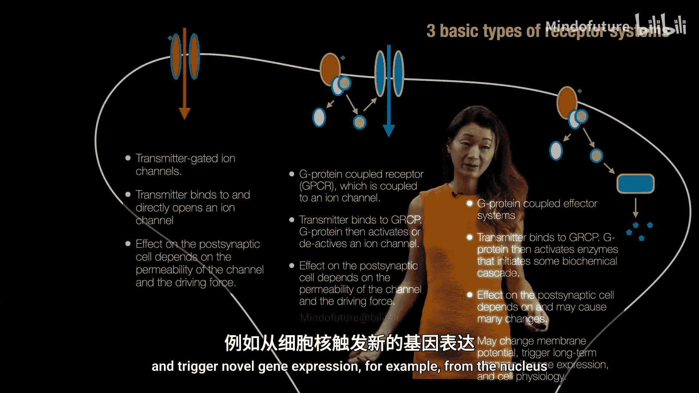

一旦被激活，G蛋白偶联受体会释放一部分G蛋白，进而激活或失活一个离子通道。同样，对突触后细胞的影响取决于能够通过该通道的离子种类、驱动力以及该离子在特定时刻的能斯特电位。

因此，我们有两种情况：一种是离子型受体直接打开离子通道；另一种是代谢型受体通过G蛋白偶联受体间接打开离子通道。

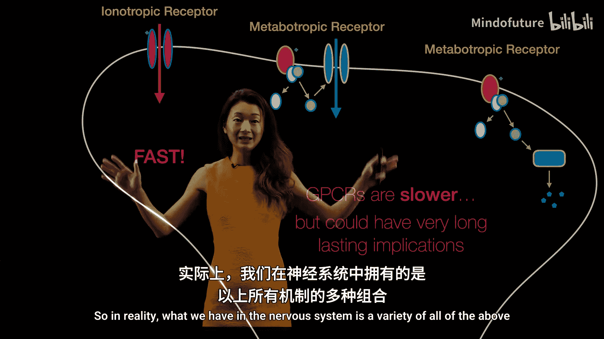

但是，代谢型受体的作用并不一定局限于去极化细胞或类似效应。其下游效应系统甚至可以不直接涉及任何离子通道。

当G蛋白偶联受体与神经递质结合时，它可以触发一系列生化过程，范围从生化反应到蛋白质表达，再到将蛋白质插入质膜。许多事情都可能发生。这可能是我们讨论的突触后受体系统中最为灵活的一种，部分原因是能够结合神经递质的G蛋白偶联受体种类繁多，其下游伙伴也可以影响细胞的各个部分。

这种影响不仅可以改变这个特定突触的突触后终端，还可能影响邻近的突触，甚至传递整个细胞。记住，细胞可能相当大，信号可以一直传递到细胞体并触发新的基因表达。

### 总结与比较

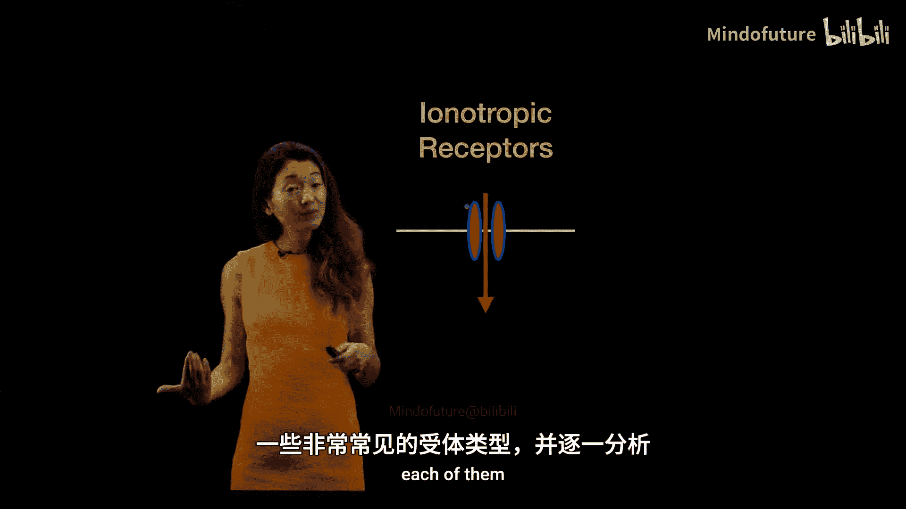

总结一下，我们有离子型受体和两种不同类型的代谢型受体。

*   **离子型受体**：你可以立即想到这是一个离子通道，一个直接由神经递质结合的离子通道。其效应非常快，根据是兴奋性还是抑制性效应，会导致去极化或超极化。
*   **代谢型受体**：都属于G蛋白偶联受体。G蛋白偶联受体可以直接打开某种离子通道，也可以进行更复杂、持续时间更长的操作。

与离子型受体不同，代谢型受体的缺点是速度较慢。但也正因其速度慢且涉及蛋白质级联反应的不同部分，它们可以产生非常持久的影响。这也是放大信号的一种好方法，使得结合在突触后侧少数几个G蛋白偶联受体上的少量神经递质，能够被放大成遍及整个细胞并具有持久影响的大得多信号。

实际上，我们的神经系统同时拥有以上所有类型的受体。

接下来，我们将通过几个例子来具体了解。

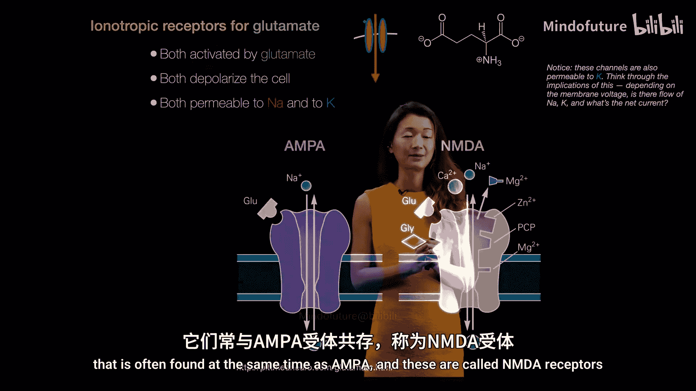

### 关键氨基酸神经递质：谷氨酸与GABA

首先，我们来看几个关键的氨基酸神经递质。正如上一讲所讨论的，在哺乳动物中枢神经系统中，两个关键的是**GABA**和**谷氨酸**。通常，GABA是抑制性的，谷氨酸是兴奋性的。

这里需要小心，我说“通常”是因为GABA或谷氨酸本身并没有固有的兴奋或抑制特性。它们只是由突触前终端释放的小分子，会漂过突触间隙。根据突触后侧受体的特性，它们可以产生抑制性或兴奋性效应，这取决于你是让钠离子还是氯离子等流入。

“通常抑制”和“通常兴奋”意味着在哺乳动物中枢神经系统中，GABA的受体往往具有抑制效应，导致超极化；而谷氨酸的受体通常是兴奋性的，导致去极化。这是一个很好的参考，但我们稍后也会看一些例外。

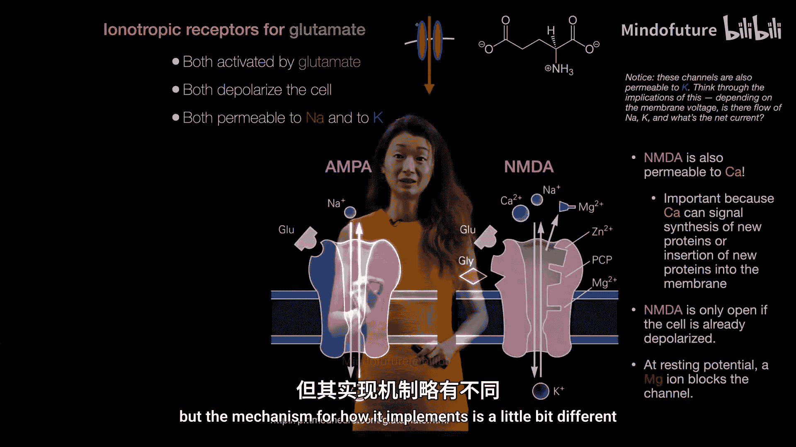

现在，我们回顾一下树突接收输入的过程。我们关注的是这个神经元的突触后侧。我们将浏览一组在哺乳动物神经系统中非常常见的离子型受体。

#### 谷氨酸的离子型受体：AMPA与NMDA

谷氨酸有两种主要的离子型受体，在哺乳动物神经系统中都非常常见。

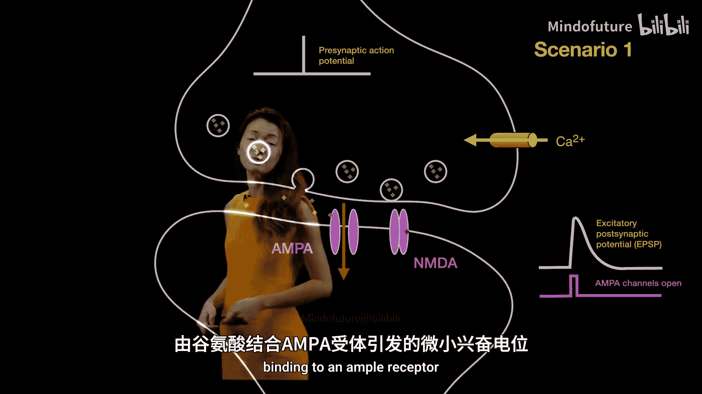

第一种是**AMPA受体**。这是一种相对简单的谷氨酸激活通道。它是一个允许钠离子流动的离子通道。当它开放时，并不决定流动的方向性。实际上，这个通道对钠和钾都开放。

因此，打开一个谷氨酸激活的AMPA通道的净效应，取决于当时的膜电位以及细胞该部位钾和钠的能斯特电位。在静息状态下，由于细胞静息电位非常负，如果谷氨酸到来并结合AMPA受体，通道会打开。由于我们离钠的平衡电位很远，钠离子涌入细胞的速度会超过钾离子流出的速度，从而导致细胞去极化。

但AMPA并非唯一的参与者。另一组常与AMPA共存的谷氨酸离子型受体被称为**NMDA受体**。NMDA受体要复杂得多。

NMDA受体一个很酷的特性是，它有一个镁离子阻塞通道，使得这些NMDA通道只有在细胞已经去极化时才能打开。换句话说，NMDA通道有点像**重合探测器**：细胞必须已经去极化，并且谷氨酸必须到来，它才能被激活。

除了对钠和钾通透，NMDA受体还对**钙离子**通透。钙离子很重要，因为正如前面提到的，正常情况下细胞内钙离子浓度非常低，因此常被用作信号分子。钙离子通过NMDA通道流入，可以作为下游信号装置，引发各种变化，包括将更多的AMPA受体插入细胞膜。

这种反馈循环是几乎所有生物系统的关键特征。NMDA受体因其分子特性而成为重合探测器。当谷氨酸存在和细胞已去极化这两个条件同时满足时，钙离子进入细胞。除了导致突触后终端去极化，我们还可以启动其他分子过程级联反应，从而引起更持久的变化。

#### 思维实验：AMPA与NMDA的相互作用

即使只考虑AMPA和NMDA受体，我们也可以开始思考在这个终端上行为复杂性是如何产生的。

**场景一：单个动作电位**
钙离子进入，突触小泡释放，谷氨酸释放到间隙，结合AMPA受体，导致兴奋性突触后电位。因为钠的平衡电位使得钠离子流入细胞多于钾离子流出，产生净去极化。

**场景二：一连串快速动作电位**
每个动作电位都会导致AMPA受体打开。但在第一个之后，突触后细胞已经去极化，这意味着NMDA通道中的镁离子被移开，NMDA受体也开始对后续动作电位做出反应。这形成了一个正反馈循环：这些通道打开得越多，兴奋性突触后电位就变得越大。这样，四个突触前动作电位的总和对突触后细胞的去极化作用，远大于四个独立动作电位单独作用的总和。根据突触前动作电位的相对时间，你可以得到比各部分简单相加大得多的反应。

**场景三：多个突触的相互作用**
假设现在有两个不同的突触（A-C和B-C）。在假设场景中，A-C突触只有NMDA受体，B-C突触只有AMPA受体。
*   如果只有A单独发放一个动作电位，A-C突触不会发生任何事，因为NMDA受体需要去极化才能激活。
*   如果A和B同时反复发放，并且这两个突触在树突上位置很近，那么来自B突触的去极化会沿着突触后神经元传播到A-C突触。即使A-C突触本身没有活动，来自B-C突触的去极化也能激活那里的NMDA受体。
*   NMDA受体激活除了引发去极化，还会触发钙离子内流。钙离子可以引发一系列变化，例如，在我们的假设中，它触发了在A-C突触处插入AMPA受体。
*   之后，即使B不发放，因为A-C突触现在有了AMPA受体，仅凭A发放就能触发C。

这种突触的修饰是一种**突触可塑性**。突触可塑性是一个通用术语，指突触的性质、其权重、与其他事物的关联可以发生改变。通过这个简单的思维实验，我们可以看到，即使只有AMPA和NMDA两种受体可用，A和B同时发放的重合也能导致这种类型的突触可塑性。AC突触学会了A和B与C之间的关联。这类似于巴甫洛夫条件反射中，铃声（A）与食物（B）导致唾液分泌（C）的关联学习。

突触可塑性是一个庞大而迷人的话题，我们将在以后的视频中详细讨论。

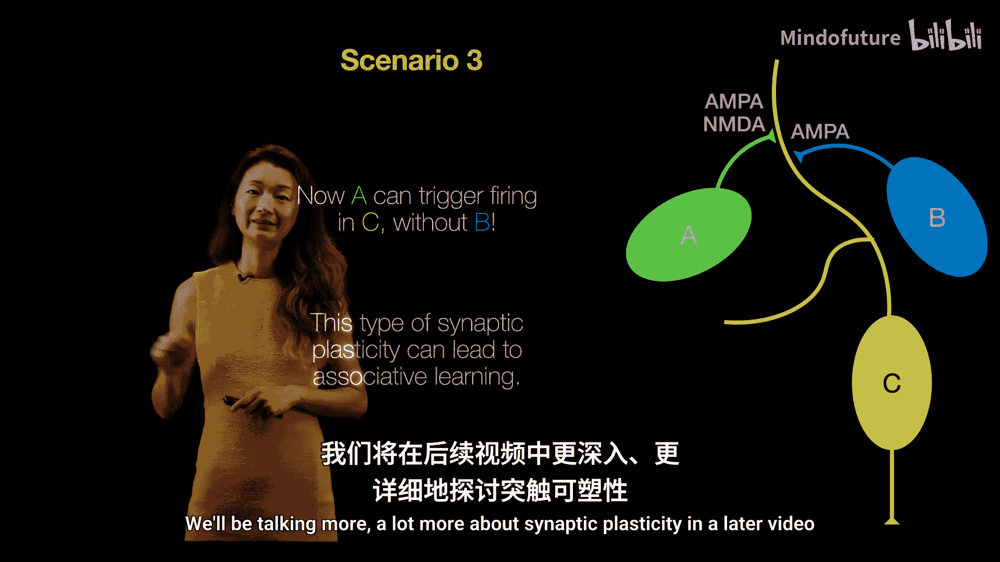

### GABA的离子型受体

现在让我们回到神经递质GABA。GABA在中枢神经系统中主要是一种抑制性神经递质。它打开的不是钠通道，而是**氯离子通道**。

氯离子通常与钠离子伴行，细胞外氯离子浓度高于细胞内。当氯通道打开时，氯离子涌入细胞。但由于氯离子带负电，而钠离子带正电，氯离子的内流会产生净抑制效应，即导致细胞超极化而不是去极化。

这种GABA受体被称为**GABA_A受体**，它是GABA的离子型受体，也是氯离子通道。
*   **阻断剂**包括苦毒宁。
*   **激动剂**（即激活剂）包括巴比妥类药物和苯二氮卓类药物。

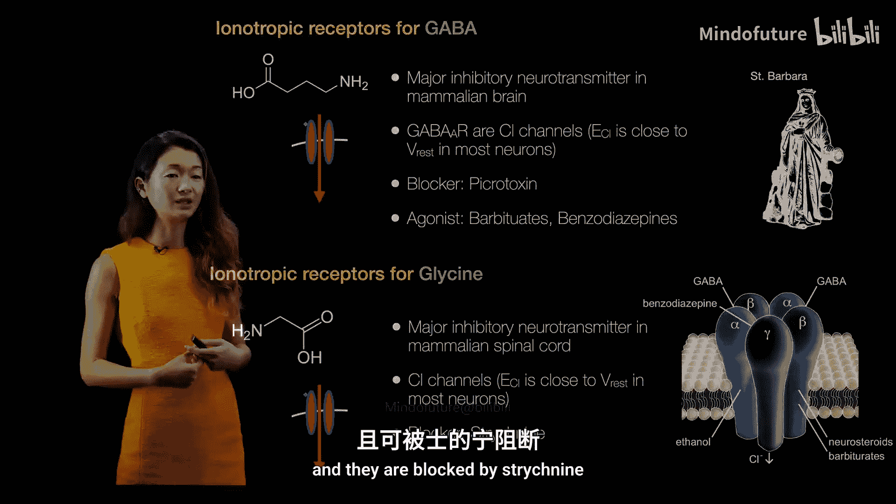

逻辑要理清：激动剂意味着激活。如果巴比妥类药物激活GABA_A通道，意味着有更多的氯通道被激活，也就意味着有更多的抑制。所以，尽管它是激动剂，但因为它激活的是抑制性通道，净效应是更多的抑制。

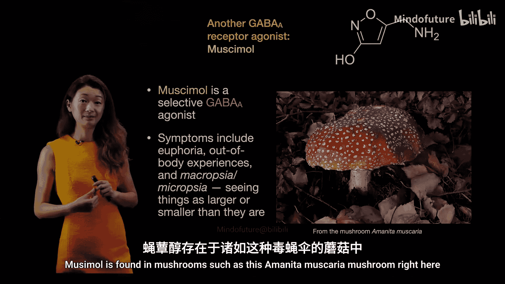

**甘氨酸** 是另一种主要的抑制性神经递质，主要存在于脊髓而非大脑。与GABA_A氯通道类似，甘氨酸通道也通常是氯通道，其阻断剂是土的宁。

还有一些GABA激动剂很有趣。例如，**蝇蕈醇**是一种选择性GABA_A激动剂，会引起一系列症状，包括欣快感、灵魂出窍体验，以及一种很酷的症状——**视物显大症和视物显小症**，即看东西比实际更大或更小。蝇蕈醇存在于如毒蝇伞等蘑菇中。这很可能是《爱丽丝梦游仙境》中，爱丽丝能够进入奇幻世界的一个合理解释：毛毛虫告诉爱丽丝吃蘑菇，一边能让她长高，另一边能让她变矮。换句话说，如果蘑菇中含有蝇蕈醇，可能会给爱丽丝带来视物显大或显小症的体验，让她感觉自己比实际更大或更小。

### 神经肌肉接头：外周离子型受体

我们讨论了中枢神经系统和脊髓的离子型受体，现在来到外周，讨论神经肌肉接头的支配。这些是运动神经元和肌肉之间的突触。

神经肌肉接头的主要神经递质是**乙酰胆碱**。肌肉侧接收运动神经元乙酰胆碱信号的主要受体叫做**烟碱型乙酰胆碱受体**。它之所以如此命名，是因为尼古丁是该受体的主要激动剂。重申一下，尼古丁是受体的激动剂，意味着尼古丁会激活烟碱型乙酰胆碱受体。其阻断剂是**箭毒**。

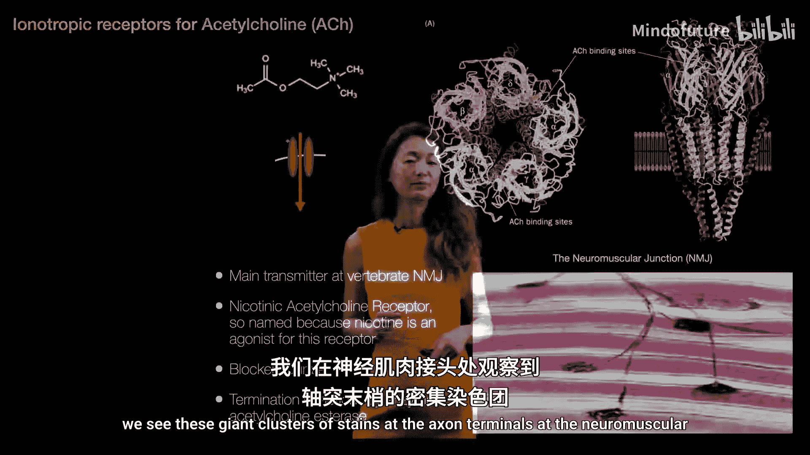

可以想象，如果你阻断了肌肉上乙酰胆碱的作用，就意味着你无法移动肌肉，会瘫痪，这很糟糕。由于这是一个快速反应的突触，它有两个特殊属性：
1.  结构上，你可以看到来自同一运动神经元的巨大轴突束支配不同的肌纤维，每个突触实际上都有大量终末聚集在一起。因为突触小泡融合过程是随机的，如果你想确保发生，方法之一就是拥有很多个。如果每个发生的概率很小，乘以100后，许多个同时发生的几率就大得多。
2.  乙酰胆碱作用的终止方式不同。在中枢神经系统，许多神经递质通过再摄取被突触前细胞回收。对于肌肉，这个过程太慢了，它们需要一个更主动的过程，因为它们不希望乙酰胆碱停留并持续激活肌纤维。神经肌肉接头处作用的终止是由一种叫做**乙酰胆碱酯酶**的活性酶完成的。这种酶能主动分解乙酰胆碱，从而停止激活神经肌肉接头，而不需要等待被邻近细胞再摄取。

我们提到了箭毒及其致命性。箭毒如果进入血液是致命的，因为它能到达你的神经肌肉接头。但如果你摄入它，则不会致命，因为它实际上无法通过胃血屏障进入血液。小剂量的箭毒也可在外科手术中用作肌肉松弛剂。

### 兴奋与抑制的平衡

实际上，并非每个突触都单独是兴奋性或抑制性的。你大脑中的每个神经元在任何特定时刻都接收着大量的突触输入。据估计，每个神经元接收大约1000到10000个突触。其中一些是兴奋性的，一些是抑制性的。

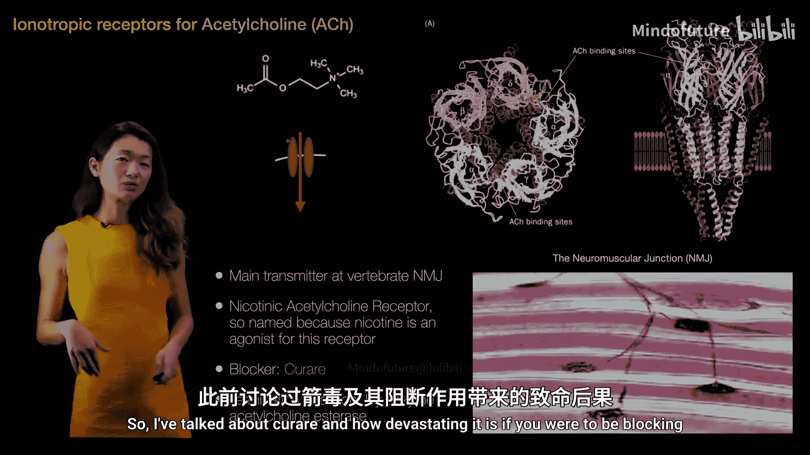

目前最好的估计是，哺乳动物皮层中大约**20%** 的神经元是抑制性的，这意味着大约**80%** 是兴奋性的。换句话说，大脑中兴奋性神经元数量远远超过抑制性神经元。

这是一个问题。如果你没有接收到足够的抑制，你就会被兴奋所淹没，而当一个人被兴奋淹没时，就会发生**癫痫发作**。除非有其他事情发生。

这个问题的解决方案被称为**兴奋与抑制的平衡**。事实证明，有一系列不同的过程在调节兴奋性突触和抑制性突触的相对权重，使得在任何给定时间，它们总是大致平衡。因此，即使你接收了1000个输入，其中800个兴奋性的，200个抑制性的，净效应实际上接近于零。这种主动维持的平衡是神经活动调节的基础。

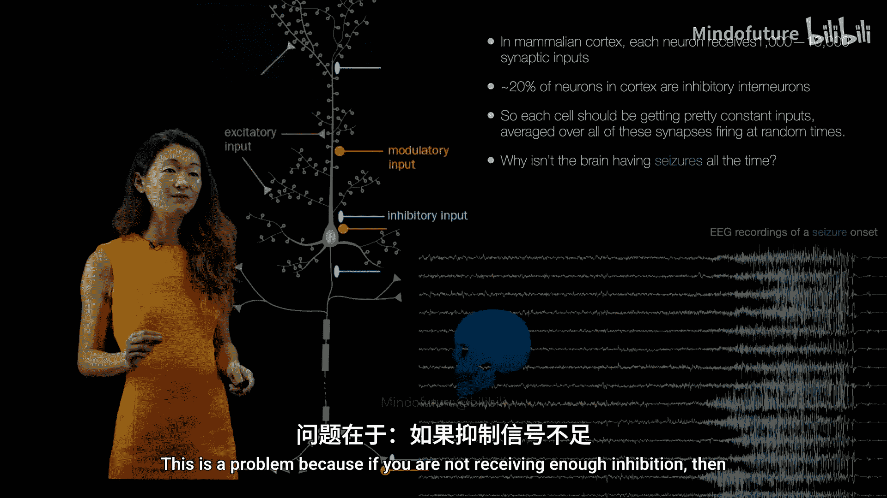

### 重要提醒：神经递质无固有性质

关于兴奋性和抑制性神经递质，我想再次强调：**任何神经递质本身都没有固有的兴奋或抑制特性**。它只是信息。如何解读这个信息取决于多种因素。

这显然取决于神经递质的身份，但除此之外，还取决于突触后侧存在的**特定神经递质受体**及其具体效应。并且，由于许多效应涉及离子通道的打开，而离子通道不选择方向性，因此在去极化或超极化方面的净效应，也取决于相关离子的能斯特电位。

让我们看一个特别令人惊讶的例子。我提到过，在哺乳动物中枢神经系统中，GABA通常是一种抑制性神经递质，因为它倾向于引起超极化，并且是氯通道。这是对的。

**例外**出现在未成熟的发育中哺乳动物神经元中。在未成熟的哺乳动物神经元中，有一个活跃的基因叫做**NKCC1泵**。这个泵将钠、钾和氯离子泵入细胞，导致在未成熟的哺乳动物神经元内部，氯离子浓度实际上高于外部，这与成年细胞的情况相反。换句话说，在这种特定配置下，氯的能斯特电位实际上是正的。

因此，当GABA结合GABA_A受体，氯通道打开时，**氯离子实际上会流出细胞**。在这种配置下，由于氯离子的局部浓度，GABA可以被视为未成熟哺乳动物神经元中的一种**兴奋性**神经递质。

在发育过程中，NKCC1泵停止表达，取而代之的是**KCC2泵**的表达，这就是成年期发生的情况。在成年期，氯通道的打开导致氯离子流入细胞，并产生超极化。因此，我们必须非常仔细地思考，不仅要考虑神经递质的身份和接收信号的受体性质，还要特别注意离子泵等情况下的离子能斯特电位，因为当环境改变时，不同受体的净效应也可能发生改变，这对发育和神经系统在发育过程中的组织有重要影响。

### 代谢型受体详解

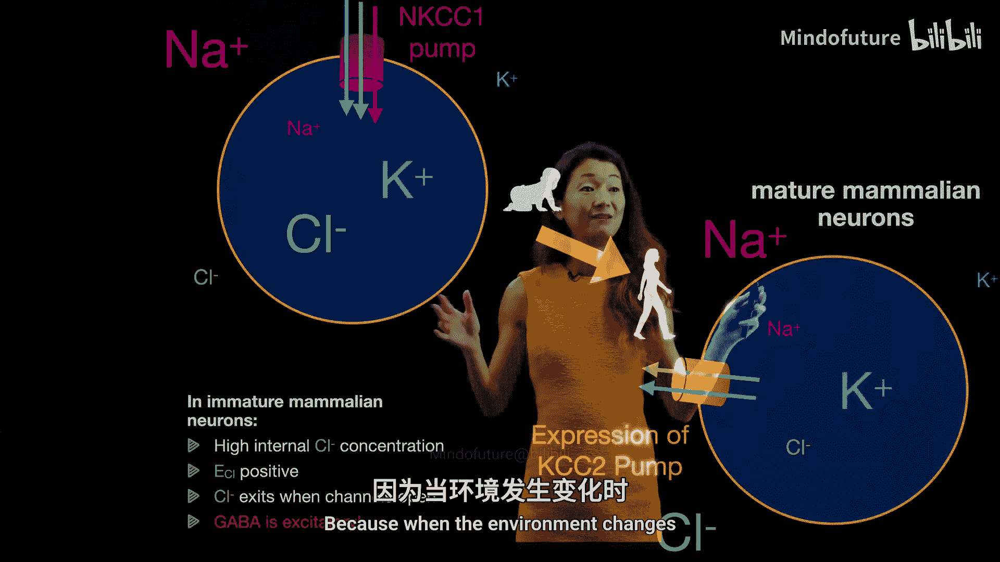

前面我们快速浏览了多种离子型受体，现在我们来详细讨论代谢型受体。

代谢型受体很特殊，因为它们是**G蛋白偶联受体**。G蛋白偶联受体是分子和细胞生物学中最酷的事物之一。它们是存在于真核细胞中的一类古老的跨膜蛋白，是膜受体，具有七个跨膜结构域。

有大量不同种类的G蛋白偶联受体活跃在各种系统中。这些蛋白质不仅是我们拥有突触传递的原因，也是视觉、嗅觉的基础，我们将在课程剩余部分讨论更多。人类基因组中大约有**1000个**G蛋白偶联受体基因，每个都结合非常特定的配体和靶标，并产生不同的下游效应。这类蛋白质负责你身体的许多功能，不仅在大脑和神经系统，也在其他部分。据估计，当今正在使用的药物中，约有三分之一甚至一半实际上靶向不同G蛋白偶联受体的各个部分。

#### G蛋白偶联受体如何工作？

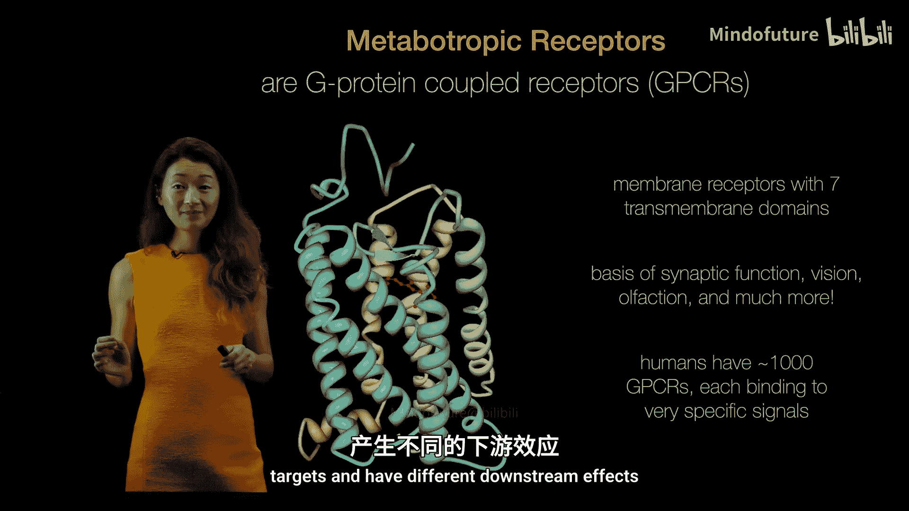

G蛋白偶联受体之所以如此命名，是因为它们与所谓的**G蛋白**偶联。G蛋白有三个亚基：α、β和γ。它们被称为G蛋白，是因为它们与GDP或GTP结合。

静息时，G蛋白偶联受体与其非活性状态的G蛋白结合。当G蛋白偶联受体接收到其配体时，它能够释放与之结合的G蛋白。α亚基失去其GDP并换为GTP。β和γ亚基与膜结合，因此会留在膜上，但可以自由地从G蛋白偶联受体扩散开。这两组分子都是下游效应的潜在信号。α亚基可以在细胞质中扩散并做许多其他事情，βγ亚基也可以用于向下游发出不同信号。

特定G蛋白偶联受体的具体作用取决于它结合什么，以及系统中还有什么在“倾听”来自不同G蛋白激活组件的信号。

#### 代谢型受体实例

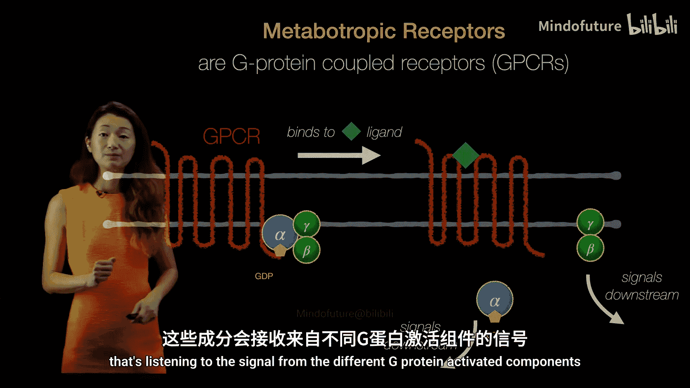

以下是代谢型受体的一些例子。记住，代谢型受体就是指这种受体是G蛋白偶联受体。

**实例一：β肾上腺素能受体**
其配体是肾上腺素。肾上腺素结合G蛋白偶联受体并激活腺苷酸环化酶。腺苷酸环化酶制造环磷酸腺苷，环磷酸腺苷激活蛋白激酶A。经过几级级联反应后，心肌中的电压门控钙通道被磷酸化，这使其对去极化更敏感，因为电压门控钙通道的浓度更高。这个蛋白质级联信号通路的净效应是：心率加快，并且由于每个动作电位有更多的钙进入，心脏收缩力也增加。这就是肾上腺素使你心率加快、心收缩力增强的原因。

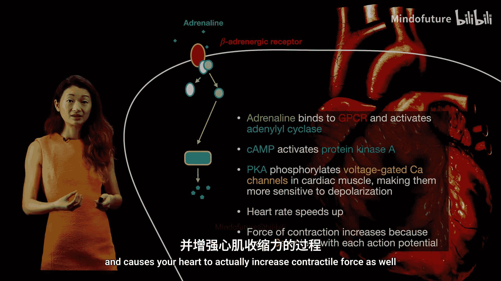

**实例二：迷走神经与毒蕈碱型乙酰胆碱受体**
迷走神经使用神经递质乙酰胆碱。但与神经肌肉接头使用烟碱型（离子型）乙酰胆碱受体不同，在迷走神经中，相同的分子乙酰胆碱被**代谢型毒蕈碱型乙酰胆碱受体** “倾听”。

当乙酰胆碱结合毒蕈碱型乙酰胆碱受体时，G蛋白释放βγ亚基，然后βγ亚基扩散出去并激活心肌细胞中的静息钾通道。通过增加心肌细胞对钾的通透性，你使细胞更接近静息钾平衡电位，从而兴奋性降低，心率减慢。

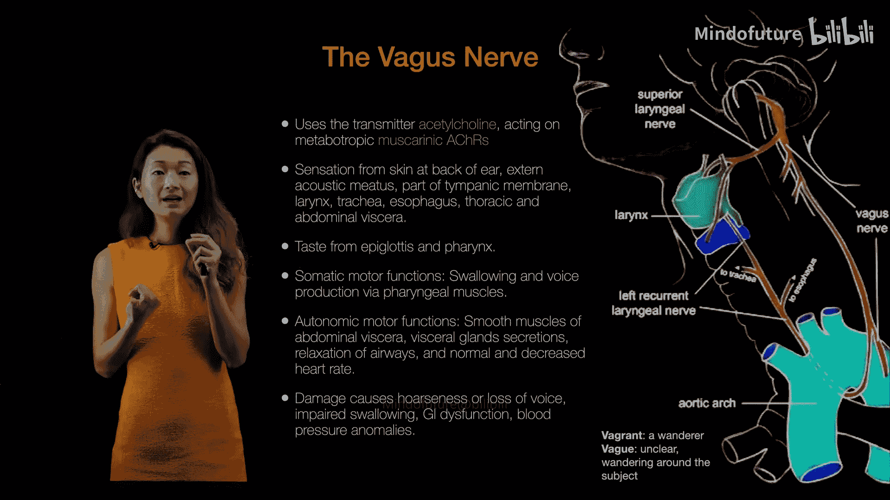

这是我们在心肌中拥有两种不同代谢型受体的机制之一，它们分别对肾上腺素或乙酰胆碱做出反应，并产生增加心率或降低心率的净效应。

**阿托品**是毒蕈碱型乙酰胆碱受体的阻断剂。阿托品来自植物颠茄。大剂量时，它极具毒性，因为摄入它会使你的心脏停止。小剂量下，阿托品可用于治疗心动过缓，因为它阻断了减慢心率的毒蕈碱型乙酰胆碱受体。

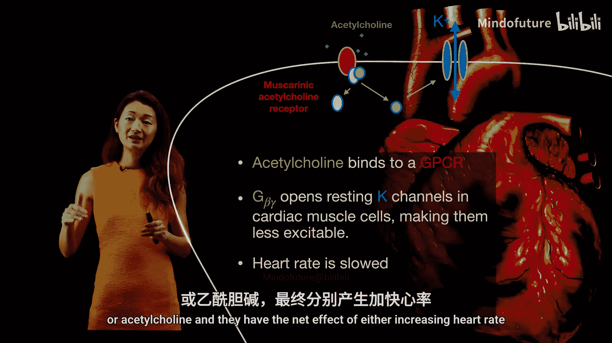

### 神经递质与受体系统的多样性

以上是对一些有趣的神经递质和受体系统的快速浏览，但你的神经系统使用许多不同的神经递质，其中一些我们甚至还没有提到。我们将在接下来的讲座中介绍。甚至有更多我们尚未提及的受体类型。

作为预览，这是一个非常不完整的列表。人类基因组编码了许多神经递质受体。许多神经递质既有离子型受体，也有代谢型受体。它们有不同的离子型受体类型，比如谷氨酸就有。即使在谷氨酸的AMPA受体和NMDA受体中，也有多个基因编码它们，可以根据这些细胞表达每种不同类型神经递质受体的具体后果和背景进行差异调节。

正是通过差异调节这些神经递质受体系统的定位、数量和身份，我们才能非常精细地调节神经系统的功能。

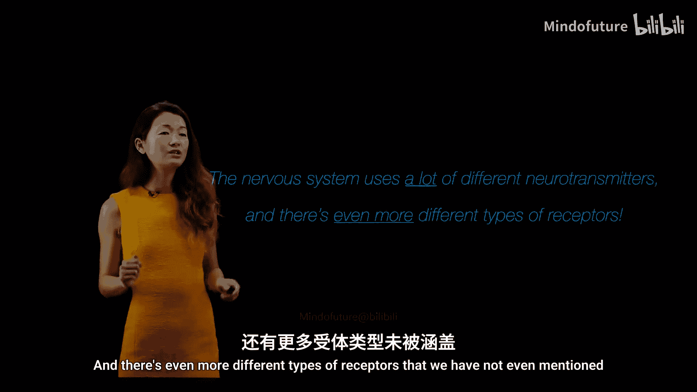

### 课程总结

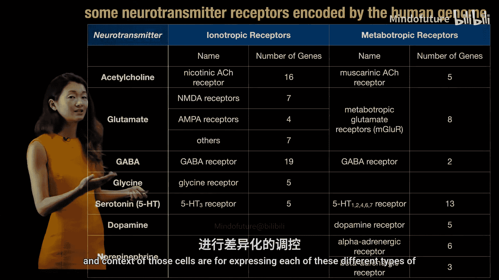

本节课中我们一起学习了不同类型的突触后受体。关键概念如下：

*   神经递质的受体可以是**离子型**或**代谢型**。
*   **离子型受体**是配体门控离子通道，因此作用非常快。
*   相比之下，**代谢型受体**是配体门控的G蛋白偶联受体，它们要么与离子通道偶联，要么与许多其他东西偶联。它们速度较慢，不如离子型受体快，但可以导致更持久的影响。
*   存在大量不同的受体和不同的常见神经递质（甚至不常见的），思考它们非常有趣。
*   **任何神经递质本身都没有固有的抑制或兴奋特性**。突触的整体功能要求我们注意神经递质是什么、哪些受体系统在接收这些信号，以及相关离子的平衡电位。

如果你能理清这些并记住术语，你实际上可以通过了解在你神经系统不同部分可能活跃或不活跃的不同类型效应系统，来理解细胞和分子层面上非常广泛的神经生物学基础知识。