# 010：娱乐性药物与大脑 🧠💊

在本节课中，我们将探讨娱乐性药物如何作用于大脑。我们已经学习了神经生物学和突触传递的基础知识，现在可以讨论如何“干预”这个系统。我们将了解不同药物的分子靶点，以及它们如何影响大脑的奖赏系统和神经递质功能。

---

上一节我们介绍了课程的主题，本节中我们来看看药物进入大脑前需要克服的障碍。

药物要进入血液，必须穿过所谓的“胃血屏障”。这层屏障与身体内的其他屏障一样，是一层脂质膜。这里涉及一个化学故事：可卡因的天然形式实际上是盐酸可卡因盐。由于它是带电粒子，难以穿过脂质膜进入血液。因此，咀嚼古柯叶时加入石灰，可以将盐酸可卡因转化为可卡因碱（即快克可卡因）。这种形式更容易穿过胃血屏障进入血液。这解释了为什么快克可卡因比单纯咀嚼古柯叶效果更强。

---

了解了药物如何进入体内后，我们来看看它们在大脑中的具体作用靶点。

以下是娱乐性药物的主要分子靶点示意图。图中的化学突触结构您在前面的视频中已多次见到。如果您想复习化学突触传递的步骤，请回顾之前的视频。

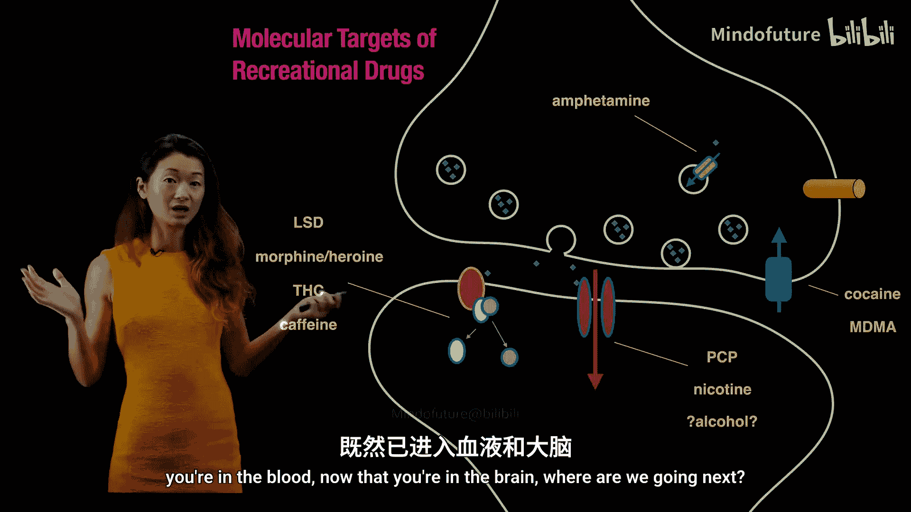

一旦您了解了这些分子，或许不会惊讶地发现，它们每一个都是娱乐性药物的分子靶点。在深入探讨之前，需要郑重声明：**请勿根据本视频内容改变您的处方药使用模式或依从性**。我们讨论的是有趣的神经生物学知识，请不要据此做出任何决定。关于处方药，请务必咨询医疗保健专业人士以获取指导。

明确了这一点后，让我们开始讨论药物。

---

我们将要讨论的药物包括：
*   吗啡
*   四氢大麻酚
*   乙醇（我们饮用的酒精）
*   咖啡因（我目前正受其影响，所以语速很快）
*   苯环己哌啶
*   麦角酸二乙酰胺（一种致幻剂）
*   尼古丁（存在于香烟中）
*   可卡因
*   安非他明（一类也被称为“速度”的分子）

以上是我们今天将要讨论的所有药物。

---

在讨论具体药物之前，我们需要先了解大脑的“快乐奖赏系统”。在之前的讲座中，我们并未过多讨论大脑不同区域的功能，这将是下一系列视频的重点。但这里先做一个预告，因为它非常有趣，能让您不仅了解涉及的分子，还能了解大脑不同区域涉及的分子系统。

奖赏系统是大脑中一个非常强大的系统。这是一张**矢状切面**图，展示的是大鼠大脑（人脑有非常相似的结构）。矢状切面是一种侧视图，相当于将头部从中间切成两半，因此您看到的是大脑的左半部分或右半部分。

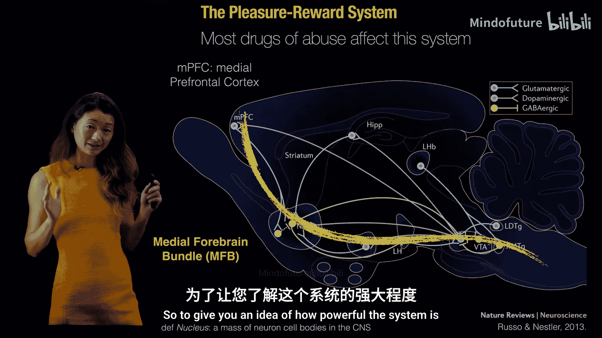

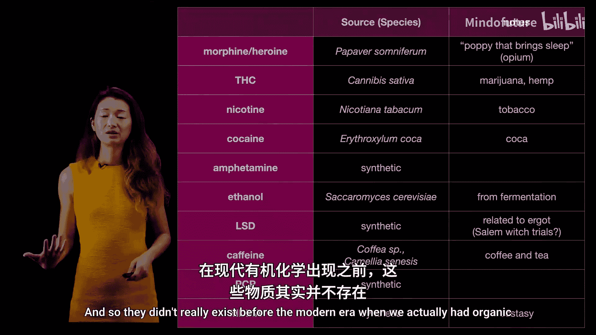

图中左侧是前端，右侧是后端。奖赏系统涉及几个关键区域：
*   **伏隔核**
*   **杏仁核**
*   **腹侧被盖区**

这是一个庞大的系统，用于告诉您何时做了正确的事并给予奖励，也会在您做了不想做的事时产生厌恶和不快感。具体来说，关于愉悦和奖赏的信息通过一个巨大的神经束传递，该神经束穿过**内侧前额叶皮层**、**伏隔核**和**腹侧被盖区**，这个神经束被称为**内侧前脑束**。这基本上是您大脑中传递所有愉悦感的“线路”。

---

为了说明这个系统的强大，我将展示几个涉及内侧前脑束的例子。

如果您能接入内侧前脑束（这是一个由电活性轴突组成的神经束），您可以制造一只“机器鼠”。在一篇论文中，研究人员植入了一个电刺激装置，直接通过电流刺激大鼠的内侧前脑束。这只大鼠背着一个装有电池的背包。

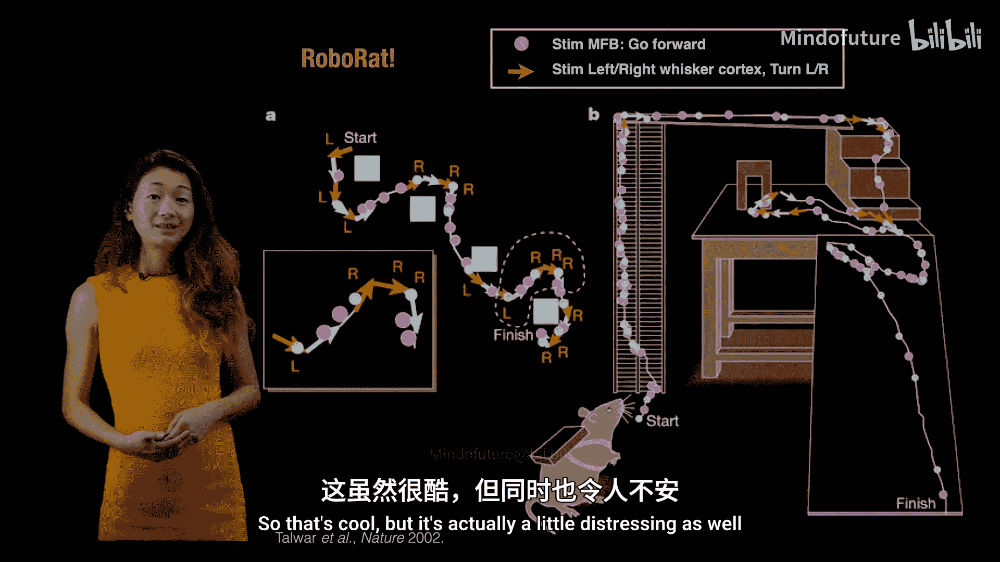

当刺激内侧前脑束时，大鼠会感觉“有好事发生”，从而向前移动。他们还植入了另外两根导线，一根对应左侧胡须的大脑区域，一根对应右侧胡须的大脑区域。这样，您就拥有了三个按钮：一个让大鼠前进，一个让它左转，一个让它右转。以下演示表明，无需训练，只需通过刺激内侧前脑束、左胡须皮层或右胡须皮层，大鼠就能在没有训练的情况下，导航通过相对复杂的迷宫。

但这实际上也令人有些不安。有一系列被称为“自我给药”的实验也在大鼠身上进行。实验中，大鼠可以选择获取食物，或直接接受对其内侧前脑束的电刺激。

令人不安的是，在大多数实验中，由于刺激内侧前脑束带来的愉悦感极其强烈，大鼠往往会不断按压按钮来刺激自己，直至饿死。这足以说明该系统的强大。

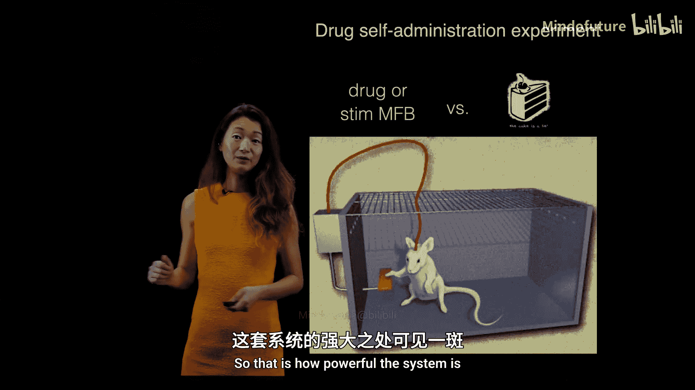

---

这个系统如此强大的原因在于它反映了**意外奖赏**。换句话说，当发生好事且您没有预料到时，大脑的这个部分就会被激活。这就像是意外惊喜带来的愉悦。

不仅被称为**腹侧被盖区**的大脑区域反映这种意外奖赏，**单个多巴胺细胞**也能反映意外奖赏。

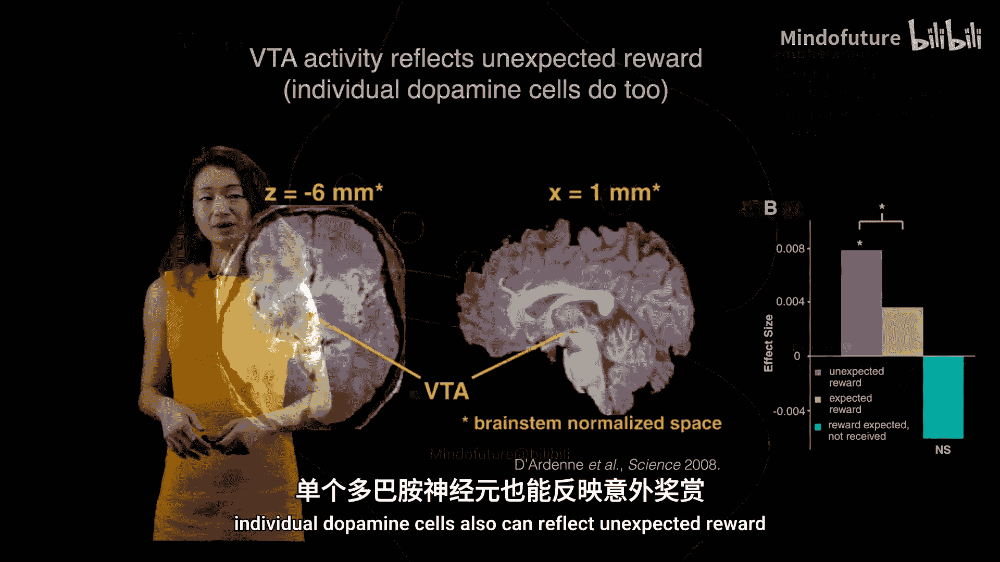

---

这正是**安非他明**和**可卡因**的作用基础。多巴胺系统是可卡因的靶点，可卡因是**多巴胺再摄取转运蛋白的拮抗剂**。

我们来详细解释一下。当多巴胺细胞释放多巴胺时，这是身体编码“存在愉悦和意外奖赏”的方式之一。

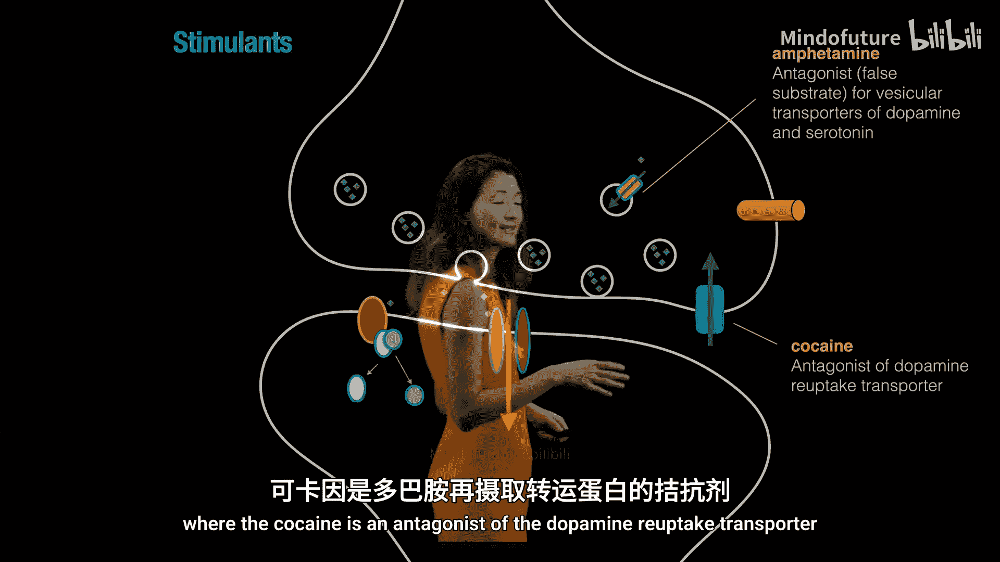

可卡因作为拮抗剂，会**关闭多巴胺再摄取转运蛋白**。这意味着可卡因使得多巴胺无法离开突触间隙。正常情况下，多巴胺会被这些转运蛋白回收并从突触间隙移除。但由于可卡因的存在，它阻断了多巴胺再摄取转运蛋白，导致多巴胺细胞释放的每一个多巴胺分子在突触间隙停留的时间更长，从而增加了多巴胺的效应。这解释了可卡因如此令人愉悦且容易上瘾的原因之一。

类似地，**安非他明**靶向不同的转运系统。它不是靶向多巴胺再摄取转运系统，而是靶向多巴胺和血清素的**囊泡转运系统**。

这意味着它实际上是一种“假底物”拮抗剂。安非他明使得囊泡不再包装更多的多巴胺和血清素，而是将安非他明自身包装进去。当释放时，安非他明本身并不起作用，但这增加了这些细胞局部突触前末梢的多巴胺和血清素浓度。关于这为何会导致安非他明的兴奋效应，有更复杂的解释，但已知这是安非他明的分子靶点之一。

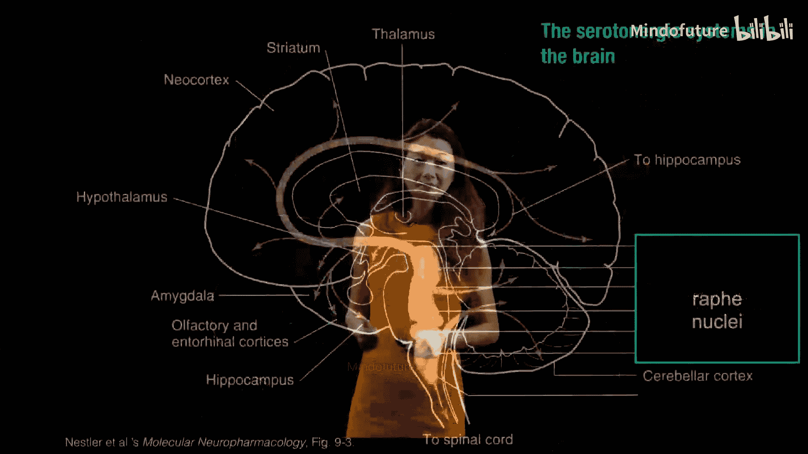

---

我们不仅讨论了多巴胺系统，还提到了**血清素系统**。血清素系统与多巴胺系统相关，但在解剖结构上略有不同。

现在，我们讨论的是一系列统称为**中缝核**的大脑结构。我们再次观察大脑的矢状切面图，这次是人脑而非鼠脑，因此更接近你我大脑的样子。

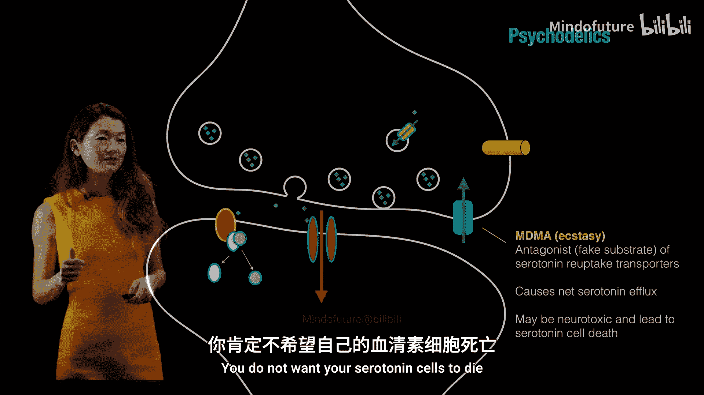

血清素细胞的胞体位于中缝核，但它们的轴突投射到整个大脑。它不像多巴胺系统那样只去一个地方，而是遍布各处。一个描述大脑血清素系统的类比是：它更像一个**洒水系统**，这些血清素“洒水器”遍布各处。因此，它的作用更像一种**神经调质**，效果较慢，而不是像谷氨酸或GABA那样快速开启或关闭神经元。这就是血清素的大致作用。

---

血清素系统是**致幻剂**的靶点，包括**PCP**和**LSD**以及**裸盖菇素**。

*   **PCP**是血清素系统中**NMDA谷氨酸受体**的拮抗剂。
*   **LSD**和**裸盖菇素**则靶向**5-HT受体**的代谢型受体。5-HT是血清素的另一种说法，因此它们是血清素受体的**激动剂**。

我们来分析一下这意味着什么。血清素受体能引起愉悦感、关联感等。LSD和裸盖菇素激活这些相同的血清素受体，从而模拟了血清素的作用。

因此，我们有两种不同类型的致幻剂例子，它们分别靶向血清素系统的代谢型受体和离子型受体。

---

我们还可以看看其他类型的致幻剂。娱乐性药物的靶点不仅仅是突触后受体。

像**MDMA**这样的致幻剂，是**血清素再摄取转运蛋白的拮抗剂或假底物**。正如可卡因阻断多巴胺再摄取一样，MDMA阻断血清素的再摄取。这导致血清素净流出增加，更高浓度的血清素被释放。

但请注意，已有文献记载MDMA可能具有神经毒性，导致血清素细胞死亡。您绝对不希望您的血清素细胞死亡。

---

在宏观层面，我们讨论了许多娱乐性药物的分子靶点。实际上，现在有一个非常活跃的神经科学领域，在整体系统水平上研究大脑在服用各种致幻剂时会发生什么。

这是一项较早的研究，比较了未服用LSD和服用LSD时的大脑激活情况。我在此引用其中一位作者的话：“正常情况下，我们的大脑由执行独立专门功能的独立网络组成”，例如视觉系统、听觉系统和运动系统彼此相对独立。

“但在LSD影响下，这些网络的分离性被打破，取而代之的是看到一个更加整合或统一的大脑。”因此，从脑成像水平来看，这就是我们在更宏观的系统层面（而非分子层面）可能看到的、在LSD影响下发生的变化。

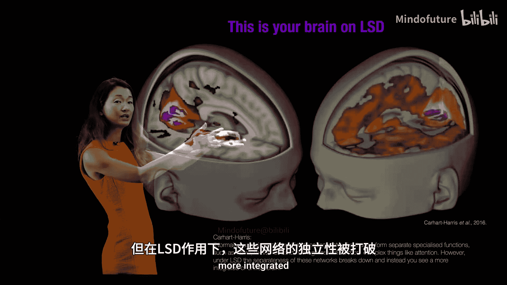

---

我们主要讨论了血清素、多巴胺和谷氨酸，这些是常见的神经递质。还有一些不太常见的神经递质也是娱乐性药物的靶点。

*   **咖啡因**再次靶向代谢型受体，在这种情况下，它是**GPCRs的拮抗剂**，其内源性配体是**腺苷**。腺苷是一种我们之前未讨论过的神经递质，但它是咖啡因的靶点。
*   **THC**是**CB1受体**的激动剂，不出所料，CB1受体也是GPCRs，其内源性配体是**内源性大麻素**。

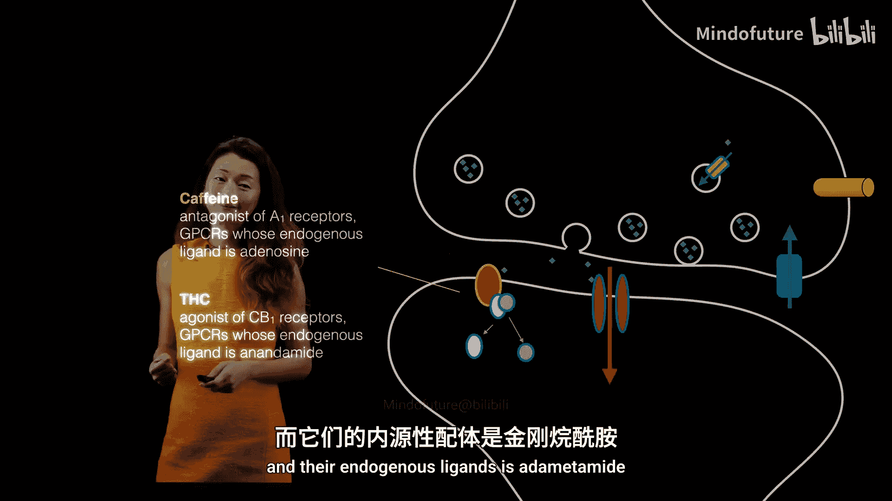

---

THC只是**大麻素类分子**大家族中的一个例子。您可能听说过的包括**四氢大麻酚**以及**大麻二酚**。但实际上，在不同的大麻植物中天然存在数百种大麻素家族化合物，它们对应着大脑中相应复杂的一系列大麻素受体。

因此，根据摄入神经系统的具体化合物混合物以及“聆听”这些化合物的受体混合物的具体情况，您可能会产生多种不同的效果。

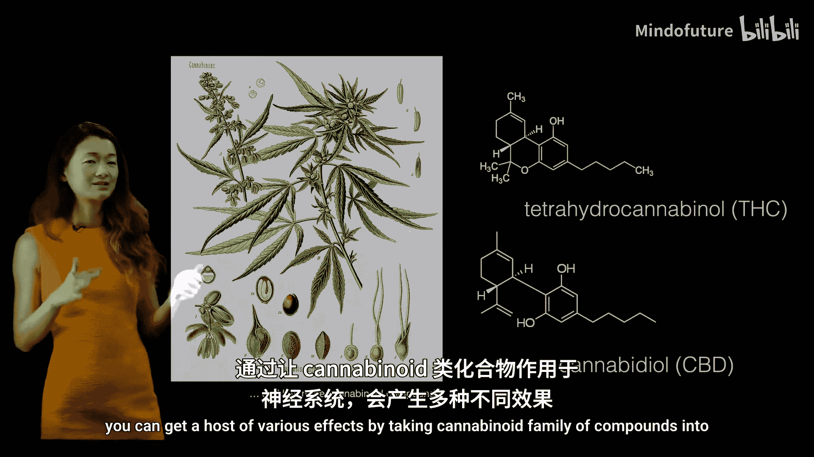

---

最后，做一个简短的总结。请注意，这过于简化了非常复杂的事物。

以下是我们讨论过的一些娱乐性药物及其影响的系统概览：
*   **多巴胺愉悦系统**（强调这里的“愉悦”是比喻）
*   **去甲肾上腺素准备状态系统**
*   **感知关联系统**（这个说法更模糊一些）
*   **普遍降低神经元活动**的药物

**乙醇**实际上属于最后一类。它是一个非常小的分子（两个碳原子、一个OH基团和几个氢原子），因此与所有其他分子不同，它的作用并不特异，对神经系统有**普遍性效应**。它做的事情之一就是普遍降低神经元活动。

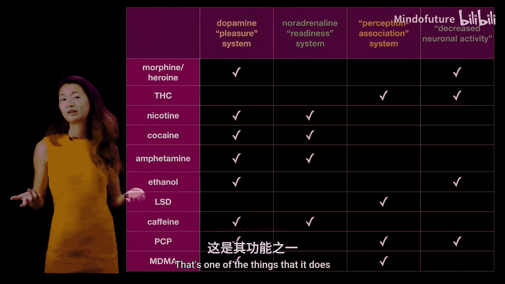

---

以上就是我们对娱乐性药物分子靶点的快速巡览。

我希望这能让您深入了解突触传递的不同步骤，以及它们如何被调节以产生非常复杂的效果，这些效果有时会以有趣的方式在您的神经系统中表现出来。

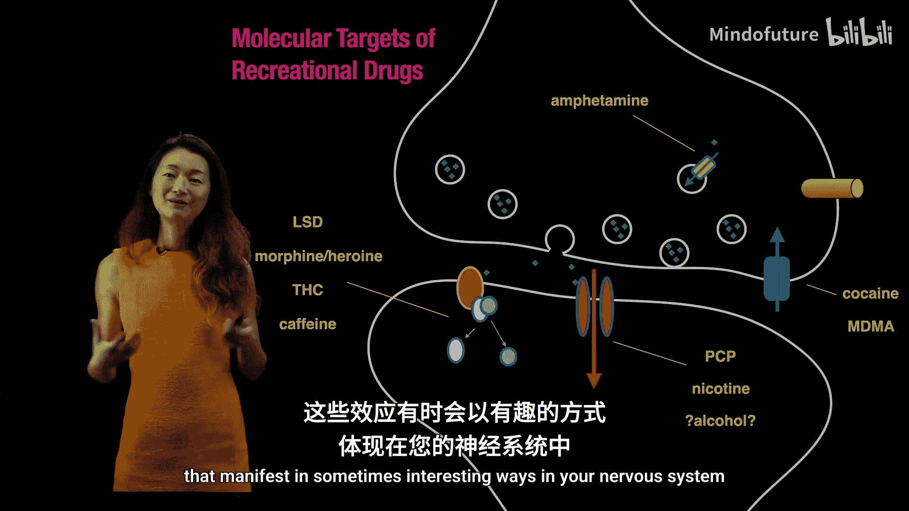

---

**本节课总结**

在本节课中，我们一起学习了：
1.  药物如何通过化学转化（如可卡因转化为快克）以更有效地进入大脑。
2.  大脑的“快乐奖赏系统”，特别是内侧前脑束、伏隔核和腹侧被盖区的关键作用，以及该系统在奖赏和成瘾中的强大影响力。
3.  可卡因和安非他明等多巴胺系统药物的作用机制，即可卡因阻断多巴胺再摄取，安非他明干扰囊泡转运。
4.  致幻剂如LSD、PCP和MDMA如何作用于血清素系统，分别作为受体激动剂、拮抗剂或再摄取抑制剂，从而改变感知和情绪。
5.  其他药物如咖啡因（拮抗腺苷受体）和THC（激动内源性大麻素受体）的特异性靶点。
6.  从分子到系统层面，药物如何通过干预突触传递的不同环节，产生复杂多样的生理和心理效应。

请注意，所有内容仅为神经科学原理介绍，不构成任何用药建议。药物使用涉及严重的健康和法律风险，务必谨慎并遵循专业医疗指导。