神经科学入门：P11：药物成瘾与学习 🧠💊

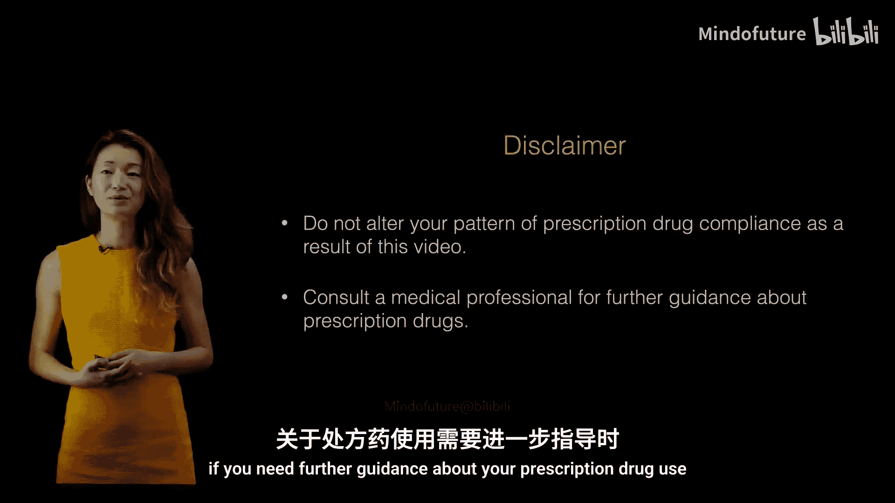

在本节课中，我们将探讨药物成瘾现象，并特别关注其与学习机制之间的深刻联系。我们将从神经科学的角度，理解成瘾行为如何“劫持”大脑的自然学习系统。

***

首先，我们需要明确药物成瘾的定义。根据美国政府的定义，**成瘾是一种慢性、复发性的脑部疾病**，其特征是**不顾对健康、社交或法律造成的负面影响，仍强迫性地摄取药物**。

这个定义有几个关键点需要理解：
1.  **它是一种脑部疾病**：这意味着成瘾并非个人品格或道德上的失败，而是一种生理上的病理状态，与多发性硬化症等脑部疾病性质类似。
2.  **核心症状是强迫性用药**：这种行为的关键在于“不顾负面后果”。即使当事人清楚知道药物会损害健康、破坏人际关系或带来法律风险，仍无法控制自己的用药行为。

那么，从分子层面看，像可卡因、海洛因这样的药物是如何影响神经系统，最终导致这种不顾后果的强迫性行为的呢？我们将从一个抽象但有力的视角——**强化学习理论**——来探讨这个问题。

***

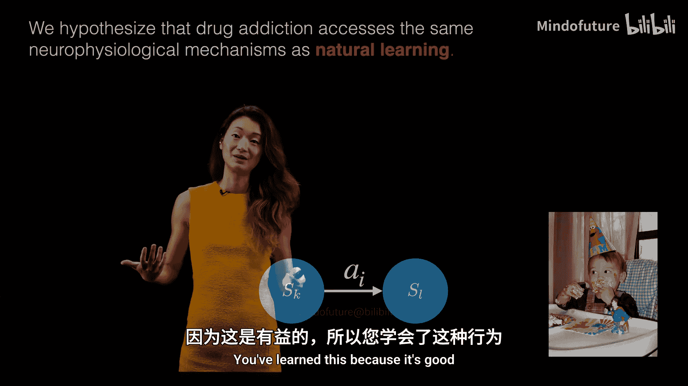

上一节我们明确了成瘾的定义，本节中我们来看看一个核心假说：**药物成瘾利用了与自然学习相同的神经生理机制**。正是因为它“入侵”并“劫持”了我们赖以生存的有用学习系统，才使得成瘾如此顽固和危险。

那么，什么是自然学习？让我们看两个简单的例子：
*   **吃蛋糕**：你吃了蛋糕，觉得味道很好。你学会了“吃蛋糕是件好事”。下次看到蛋糕，你可能就会产生寻找蛋糕的行为。
*   **摸热炉子**：你第一次摸热炉子，手被烫伤了。这很痛苦，是件坏事。通过自然学习，你学会了“下次不应该再把 hand 放在发红发热的炉子上”。

这种学习让我们能够根据环境变化来调整行为，获得更多“好事”，避免“坏事”。一种理解自然学习的理论框架是**强化学习**。它在神经科学、控制论和人工智能等领域都非常成功。

以下是强化学习中一个称为**时序差分学习**的核心公式，它描述了如何评估一个行动的价值：

`V(A) = Σ [γ^t * E(R_t)]`

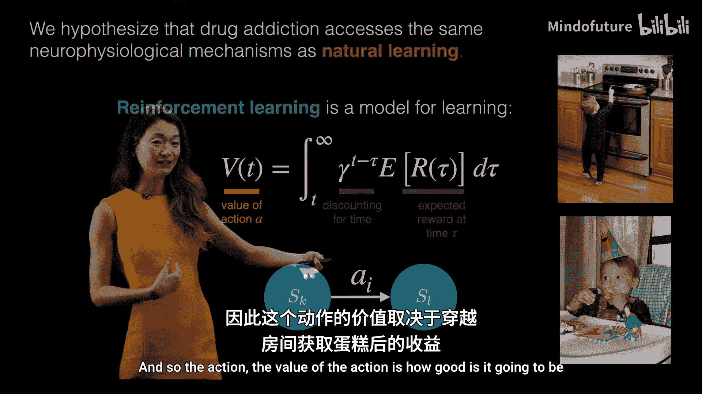

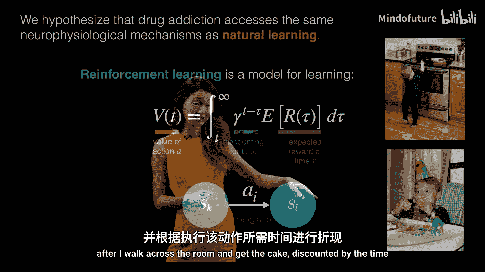

对这个公式的解读是：**一个行动A的价值（V(A)），等于采取该行动后所能获得的预期奖励（E(R_t)）的总和，但每个未来的奖励都需要根据获得它所需要的时间进行折扣（γ^t）**。

让我再解释一下：假设你处在状态K（比如坐在房间里），而蛋糕在房间另一头。行动A是“走过去拿蛋糕”。这个行动的价值，并不是蛋糕本身的美味程度，而是“当你走完这段路拿到蛋糕后所获得的满足感”，并且这个满足感会因为你需要花费时间走过去而打折扣。蛋糕就在手边和需要穿过整个城镇去蛋糕店买，前者的行动价值更高。

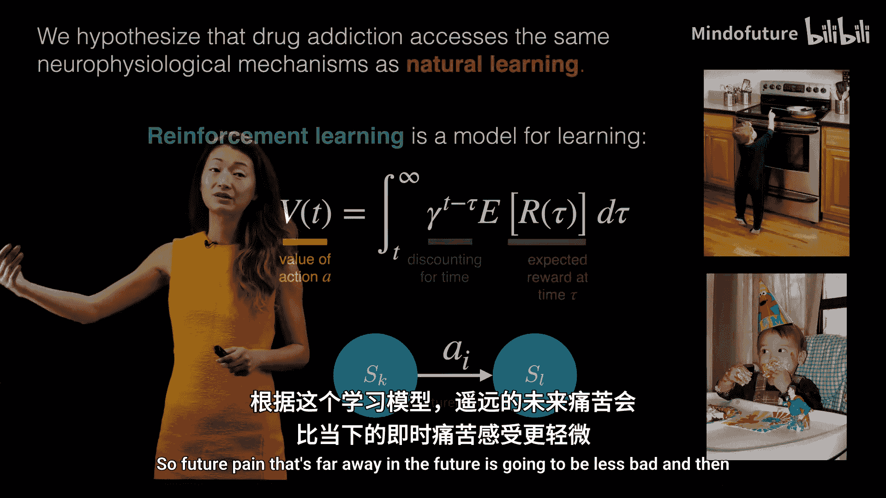

这个模型同样适用于负面奖励（惩罚）。例如，未来才会发生的疼痛，根据这个模型，其负面影响会比立即发生的疼痛要小。

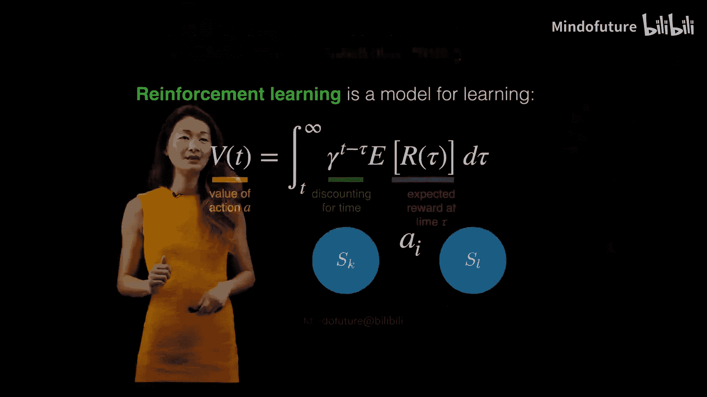

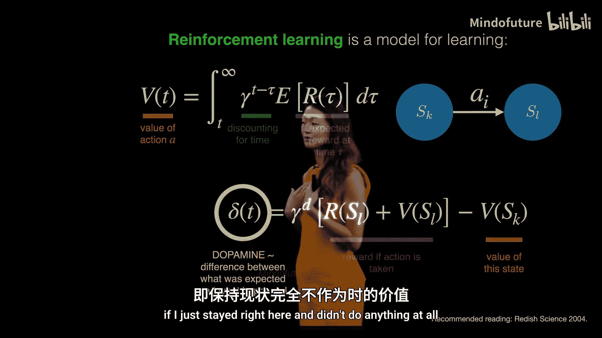

***

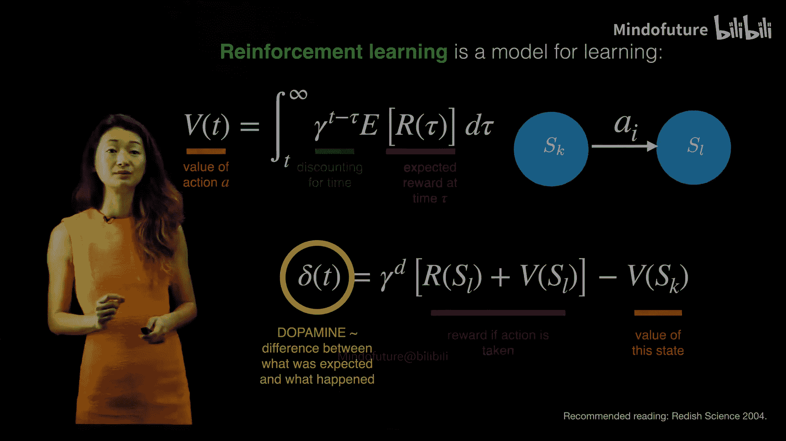

我们之所以能用这个模型来解释学习，是因为它内置了一个更新行动价值的机制，这正是我们学习某个行动该做还是不该做的途径。更新公式如下：

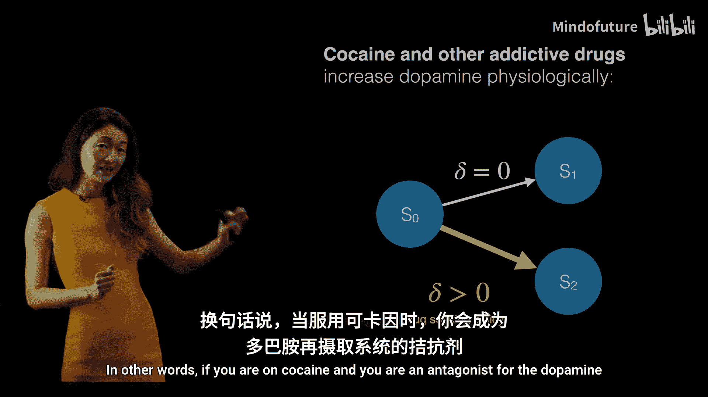

`ΔV(A) = [实际发生的结果] - [未采取行动时的预期结果]`

这个差值，即“实际回报与预期回报之差”，是学习的关键。在上一讲关于娱乐性药物与大脑的课程中我们提到，大脑中的**多巴胺系统**正是编码这个“意外奖励”差值的系统之一。

请记住，像**可卡因**这样的药物，其作用靶点正是多巴胺系统。具体来说，它是多巴胺再摄取抑制剂，能让多巴胺在突触间隙停留更长时间，从而人为地、强烈地激活奖赏通路。

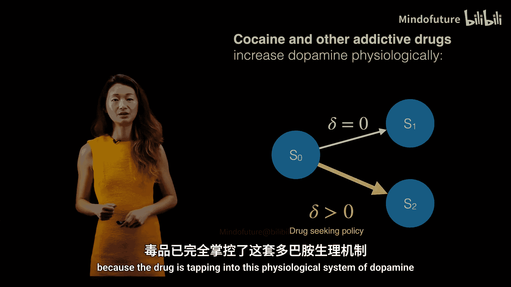

在正常的自然学习中，如果你的某个行为导致了糟糕的结果（负面奖励），多巴胺信号会告诉你“这是个错误预测，下次别这么做了”。然而，当药物劫持了这个系统后，**寻求药物的策略**会持续获得强烈的正性多巴胺信号，始终被预测为有高回报。这就解释了为什么即使成瘾者在意识层面知道吸毒有各种负面影响（损害健康、失去朋友和工作，甚至吸毒时并不真正感到快乐），但每次吸毒行为都会从生理上强化这条路径，导致强迫性的寻药行为持续发生。这使得成瘾成为一种极具破坏性的疾病，因为即使当事人主观上想停止，生理上的成瘾机制也使其极为困难。

***

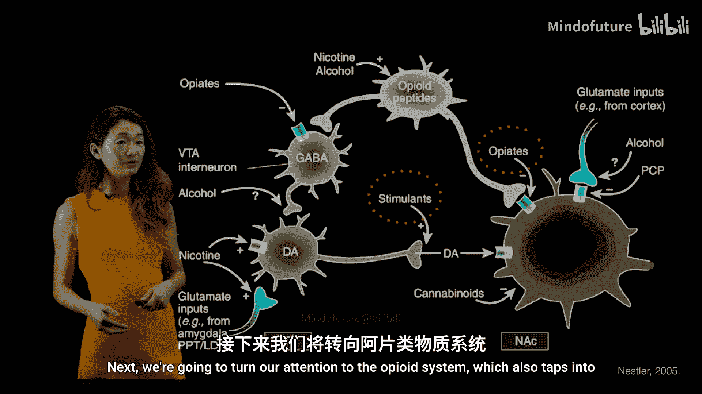

接下来，我们将把注意力转向**阿片类系统**，它以一种略有不同的方式影响着学习与奖赏系统。这里涉及一段历史，更多是关于制药行业的故事。

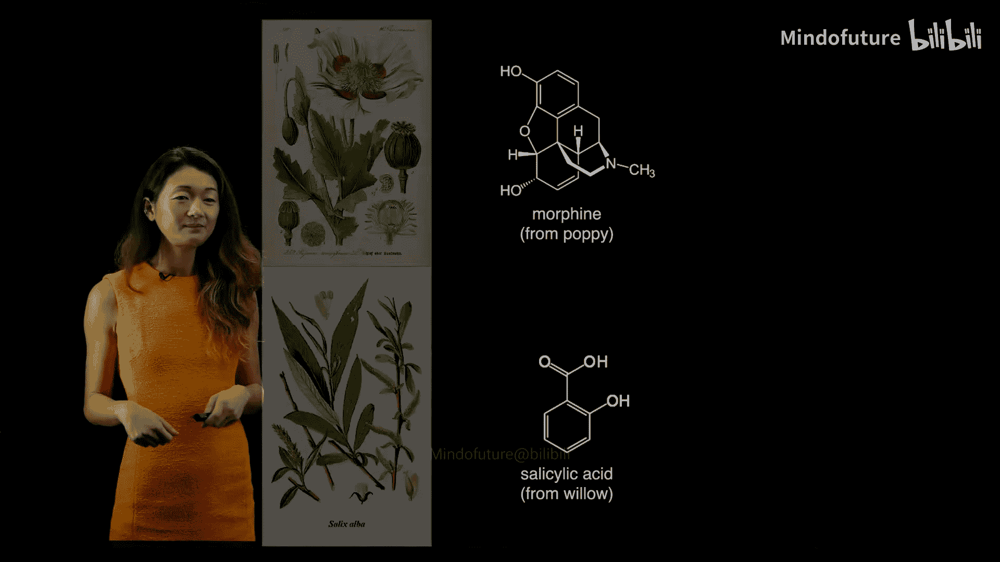

阿片类药物源自罂粟，其药用历史几乎与人类文明一样悠久。在现代化之前，其镇痛属性就已广为人知。问题出在近代。这里有两种已知具有镇痛麻醉属性的分子：从罂粟中提取的**吗啡**，和从柳树中提炼的**水杨酸**。两者在全球民间医学中都用于镇痛，但也都有缺点：水杨酸容易刺激胃部。

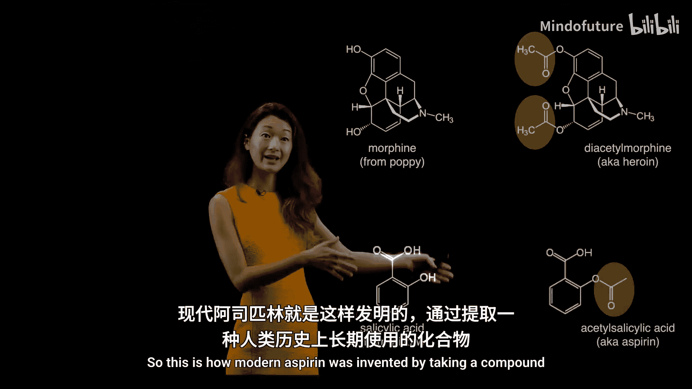

随着现代化学的发展，一家名为**拜耳**的德国公司乙酰化了柳树中的水杨酸，得到了**乙酰水杨酸**，也就是**阿司匹林**。这是一个成功的发明，它保留了镇痛特性，但减少了对胃部的刺激。

这个成功让拜耳公司将目光投向了吗啡。吗啡镇痛效果极强，但众所周知容易成瘾。当时的逻辑是：乙酰化水杨酸效果很好，那我们也乙酰化吗啡试试。于是，他们合成了二乙酰吗啡，也就是**海洛因**。海洛因就是这样被发明出来的——因为阿司匹林太成功了，所以他们以为对吗啡如法炮制也能成功。它于1874年首次被合成，在没有充分测试的情况下，被作为“不易上瘾的吗啡替代品”推向市场。这是一段关于化学和制药行业的引人深思的历史。

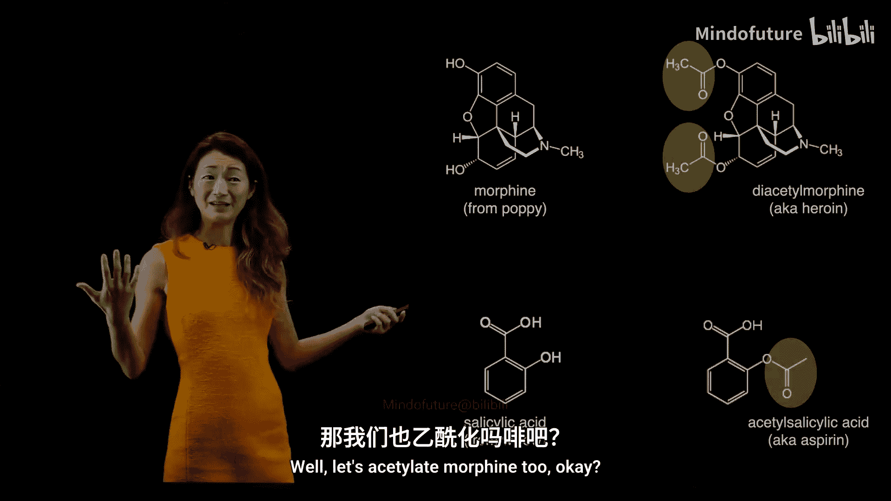

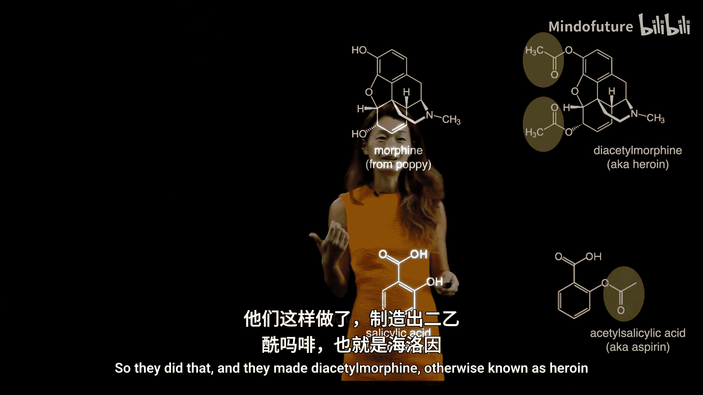

***

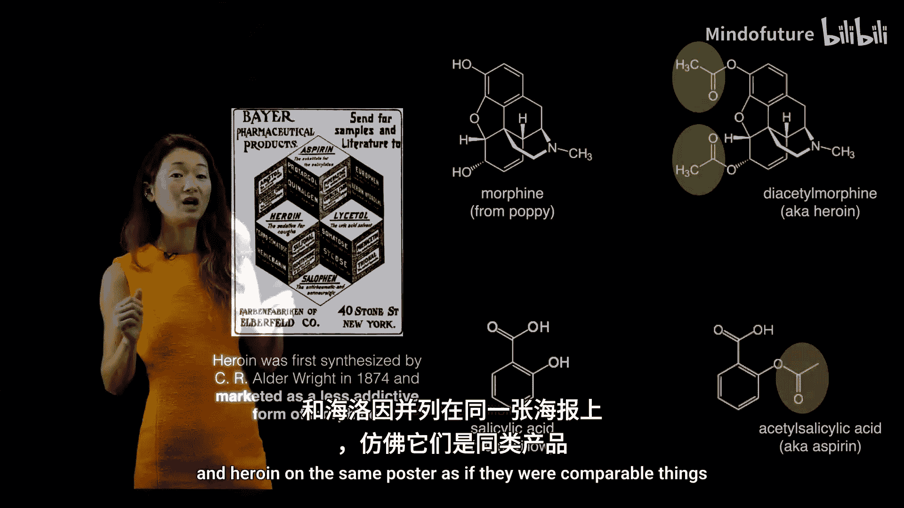

吗啡是一种阿片类药物，市场上还有其他阿片类药物，例如**芬太尼**。阿片类药物导致的致命过量，已成为美国乃至世界其他地区的流行病，其破坏性极大。

阿片类药物过量致死在一定程度上可以通过一种名为**纳洛酮**的药物来预防。纳洛酮是阿片受体的一种极其有效的**竞争性拮抗剂**。当有人面临阿片类药物过量风险时，快速施用纳洛酮，它会与阿片类药物竞争结合相同的受体位点（阿片受体是GPCRs）。纳洛酮会快速、紧密地结合到受体上，从而将阿片类药物“踢出去”，中和其作用，挽救生命。纳洛酮有注射剂型，也有非常易于施用的鼻喷雾剂型。

美国前卫生局局长杰罗姆·亚当斯曾倡导，公众应将纳洛酮（常以品牌名Narcan流通）视为像肾上腺素笔（EpiPen）和心肺复苏术（CPR）一样的一线干预措施，因为它确实能挽救许多生命。如果你有意了解，可以查阅当地的法律法规和药房信息，了解如何获得并携带纳洛酮。

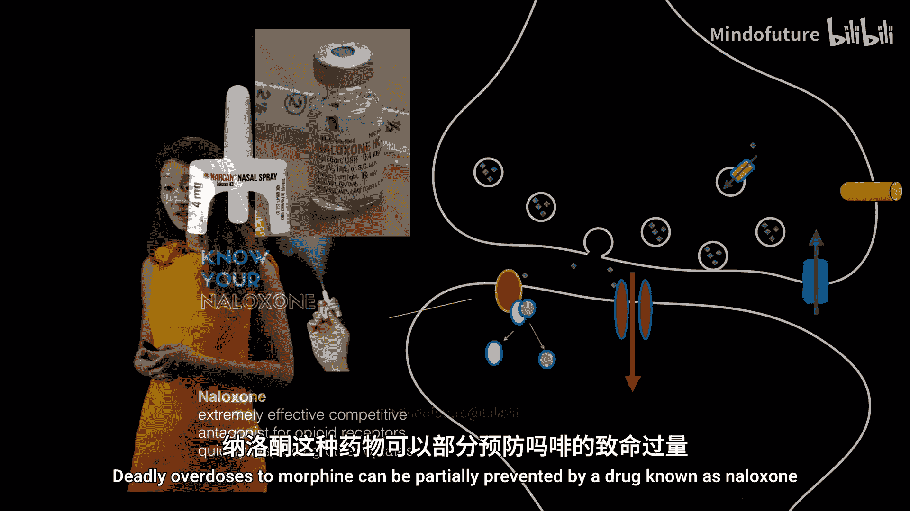

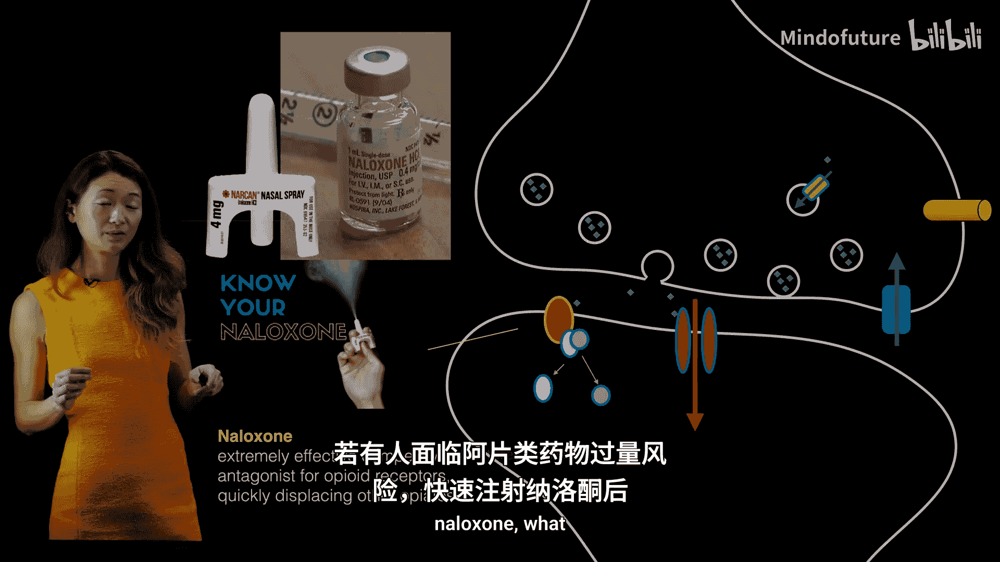

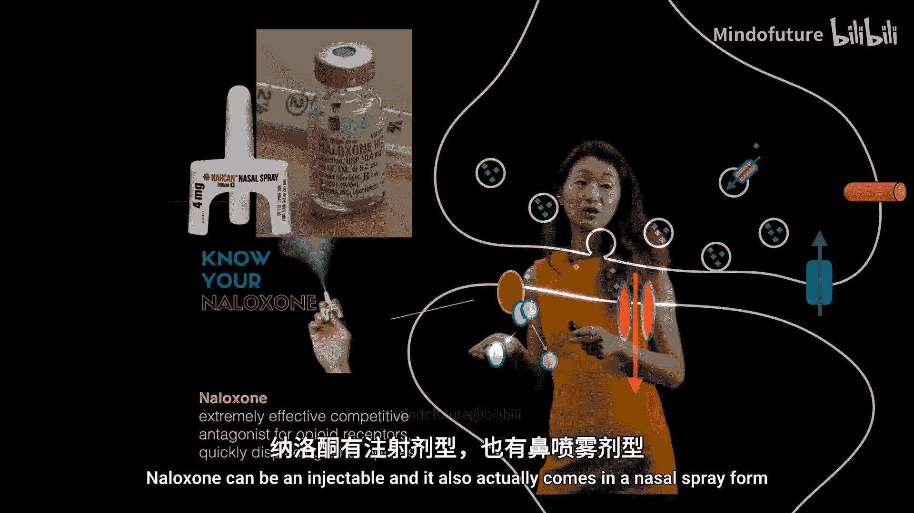

***

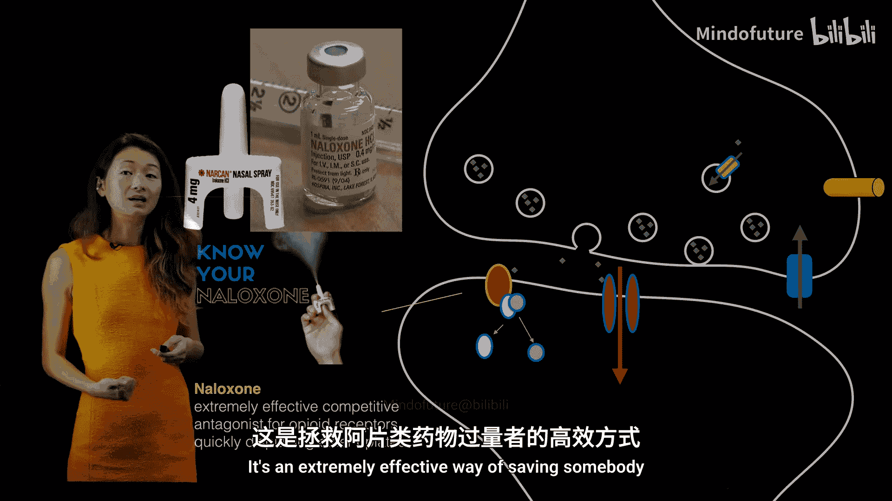

在本节课中，我们一起学习了药物成瘾的定义及其与大脑学习机制的深刻联系。我们了解到，成瘾是一种慢性脑部疾病，其特征是不顾负面后果的强迫性用药行为。通过强化学习理论，我们解释了药物如何劫持大脑的多巴胺奖赏系统，使寻药行为持续获得正反馈，从而难以戒断。我们还回顾了阿片类药物（如海洛因）的发明历史，并认识了挽救生命的药物纳洛酮。理解成瘾的神经生物学基础，有助于我们以更科学、更富同理心的视角看待这一复杂的疾病。