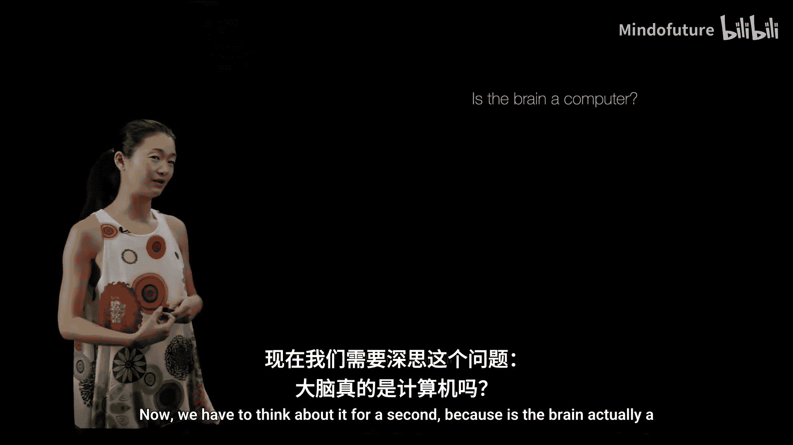
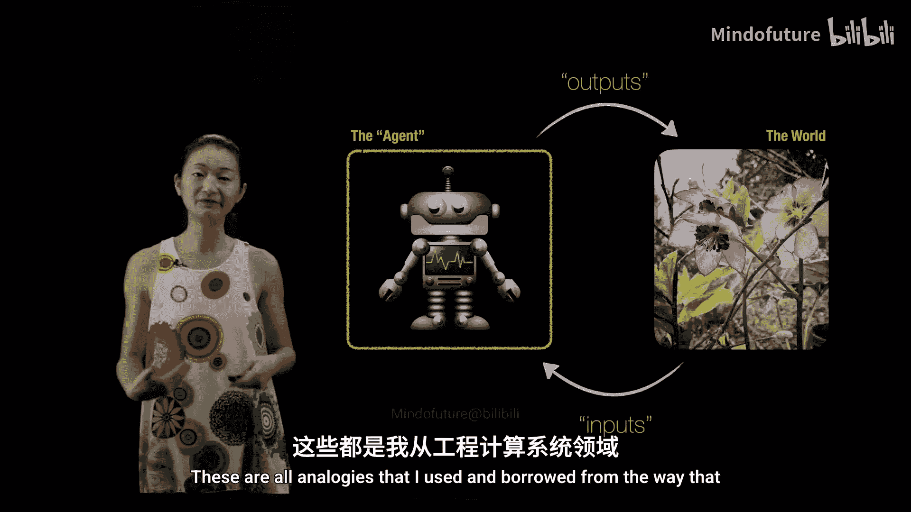
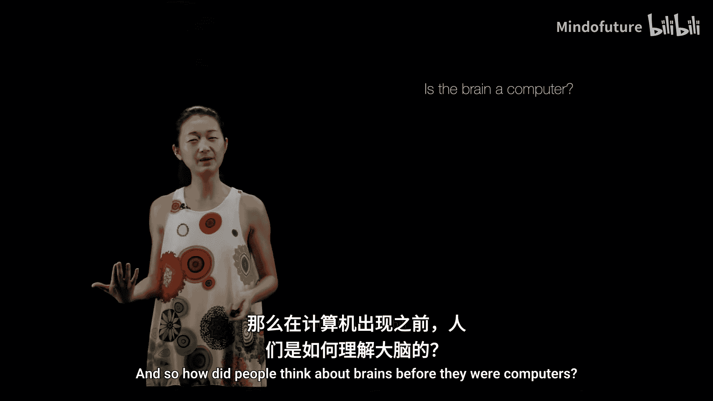
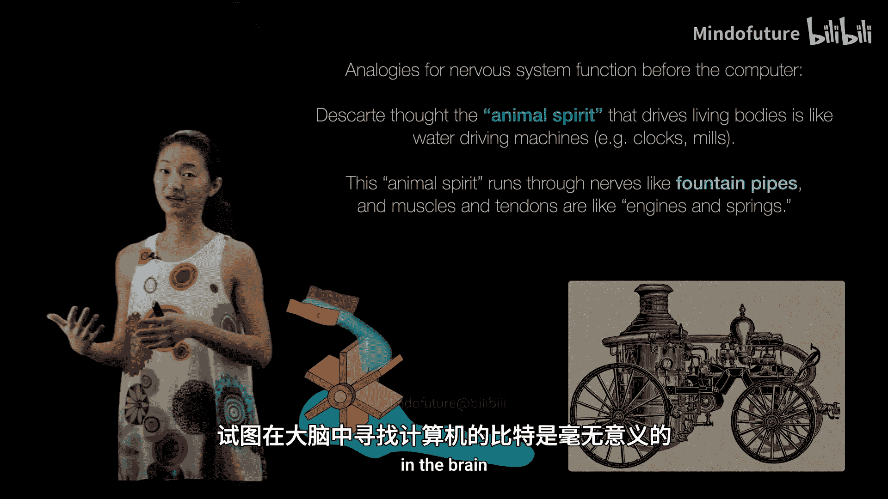
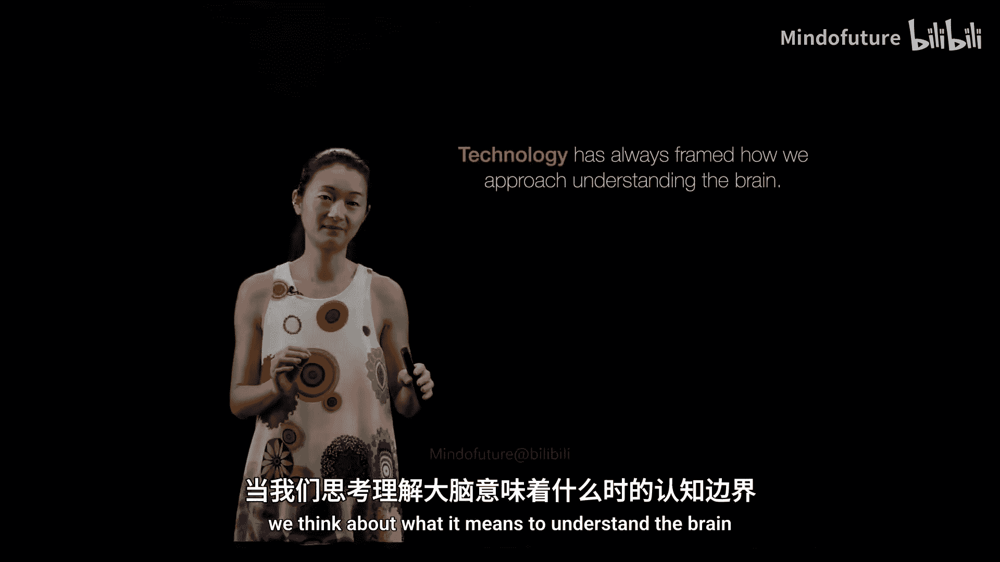
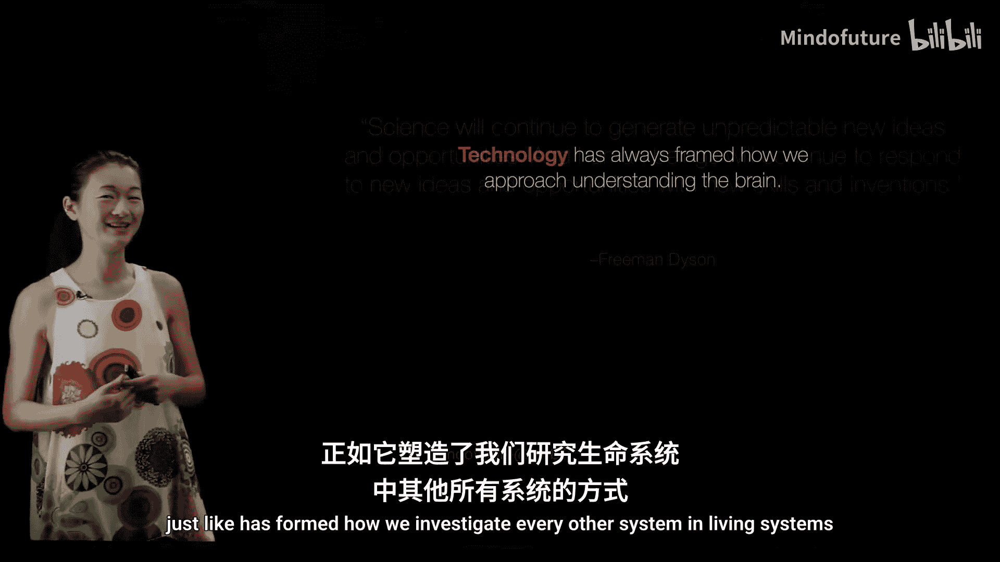
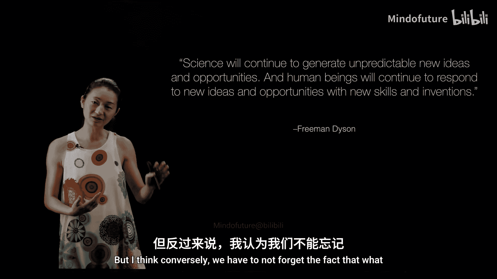
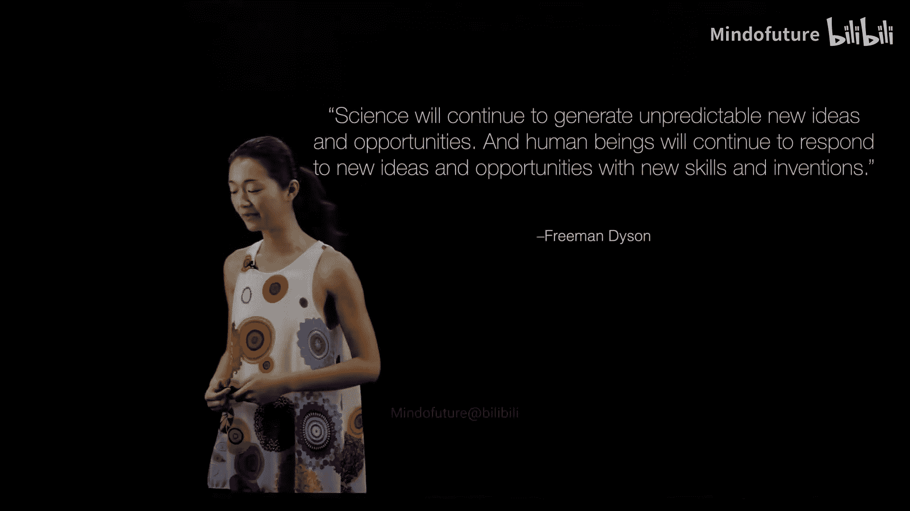
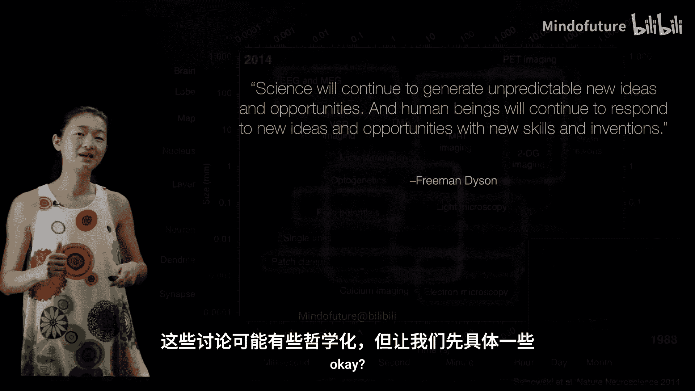
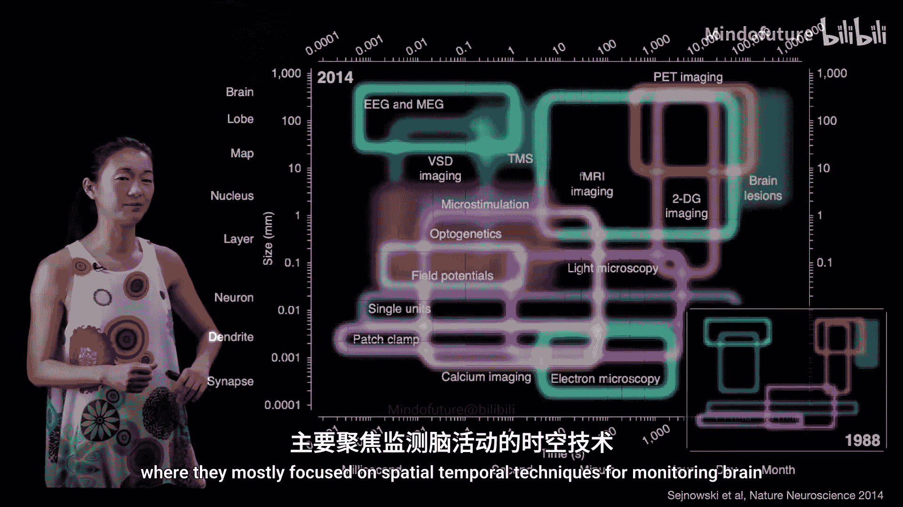

神经科学入门：P12：大脑是计算机吗-大脑的感知与行动

## 概述
在本节课中，我们将探讨大脑与计算机的类比，并介绍研究感知与行动系统所需的工具和技术框架。我们将从系统的整体视角出发，理解神经系统如何整合不同感官信息以产生行动。

## 从神经元到系统
上一节我们详细讨论了神经元的主动与被动特性、动作电位、轴突传导以及突触和神经递质系统。如果孤立地看待这些内容，可能会觉得系统极其复杂。因此，在本节课程中，我们将尝试从整体系统的角度来理解，关注各个子系统如何协同工作，整合不同的感官知觉，以生成我们与外部世界互动的一系列行动。

这里的“世界”不仅指可以操纵的物理对象，也包括其他动物和生物。这个视角并不具有争议性，研究动物的人都会同意，动物的行动与世界互动，世界又通过感官知觉反馈回来。

我绘制的这张图类似于工程系统图，它强调了感知与行动本质上是一个**反馈循环系统**。将单个行动与感官知觉分离是困难的，反之亦然。毕竟，感知世界的意义就在于指导我们当前或未来的行动。

## 课程计划
接下来，我们将首先探讨神经系统的组织方式，从单个细胞和突触层面上升到细胞群层面，理解其整体架构。神经系统并非一团乱麻，而是具有精密的组织结构。

在此过程中，我们将介绍更多测量和操纵神经系统的研究方法，这些是神经科学家用来探究神经系统工作原理的工具。我们既会讨论如何改变其功能，也会探讨如何通过操纵功能来研究系统。

掌握了这些工具后，我们将运用它们来理解不同的感官知觉和运动控制。虽然我们会逐一讨论各个系统，但重点将放在它们如何相互作用以及共同点上，而非差异上。

## 行动者与世界的互动
回到动物作用于世界、世界通过感官测量反馈给我们的图示。我将进行一个概念转换：将“动物”替换为“行动者”，将“行动”视为**输出**，将“感官输入”视为**测量**或**输入**。

这样，图示就更像一个工程框图。这里的“行动者”不一定非要是动物，也可以是一台内部有计算机、能接收输入、进行计算并对外部世界产生输出的机器人。

事实上，将动物类比为小型机器或机器人是一个非常流行的观点，我在之前的课程中也隐含地使用了这个类比，比如将神经元比作进行计算的单元，将轴突比作导线。这些都是从我们已构建的计算系统中借用的类比。

## 大脑是计算机吗？
现在我们需要思考：大脑真的是一台计算机吗？这个问题为什么重要？

这个问题没有绝对正确的答案。在社交媒体上，神经科学家们大约每年都会就此争论一番。双方都有充分的论据。

关键在于，我们用来理解大脑的心理框架和类比，深刻影响着我们寻找和理解的内容。如果我们认为大脑是计算机，我们就会试图像理解计算机一样去理解它。

具体来说，计算机用**比特**表示信息，并对这些比特进行算术运算（如加法）。如果我们认为大脑是计算机，我们就会深入大脑的神经生物学，寻找神经元如何表示一个比特的信息，以及它如何对这些信息进行类似加法的操作。这正是人们已经做过的事情。

然而，计算机的历史并不长，神经科学早于现代计算机出现。那么在此之前，人们如何理解大脑呢？

## 历史上的类比
不出所料，人们曾使用各种类比来理解大脑。笛卡尔曾提出一种“水力蒸汽机”的类比，他认为有一种“动物精神”像水力驱动机械一样驱动生命体。在他的想象中，神经像喷泉管道，肌肉和肌腱像引擎和弹簧。

这个类比运用了当时最先进的技术。关于大脑的一个有趣之处在于，它如此难以捉摸，以至于我们总是用当时能建造出的最复杂的事物来类比它——过去是风车、水车和蒸汽机，现在是计算机。

回顾历史上我们用来理解大脑的类比，很可能没有一个特别准确。

## 技术、类比与理解
因此，我想将大脑视为计算机，但我们必须记住不能过于字面化地理解，因为大脑并非字面意义上的计算机。我们不应在大脑中寻找计算机的所有部件，因为两者是通过非常不同的过程产生的。

我们可以思考当时的技术——无论是蒸汽机还是计算机的类比——如何塑造了我们理解大脑的方式。技术始终框定着我们理解大脑的方法，我们所借用的类比决定了我们认为“理解大脑”意味着什么。

技术也是我们研究大脑所有方法的核心。科学不断产生不可预测的新想法和机遇，我们作为科学家和人类，将继续用新的技能和发明来回应这些新想法。我特别喜欢这里的反馈循环：许多技术是由理解事物的需求驱动的，但反之，我们也不能忘记，我们“理解”某事物的含义也受当时技术的驱动。

## 系统神经科学的工具
以上内容有些哲学意味，让我们更具体一些。在进入下一部分视频时，我们需要密切关注技术，因为我们需要了解我们拥有哪些技术和工具。这在很大程度上限制、框定并启发了我们关于系统神经科学所能理解的内容。

这是一张来自特廖夫斯基及其同事的综述论文中的图表。坐标轴希望你们熟悉，因为在介绍视频中展示过：横轴是时间尺度（对数坐标），纵轴是空间尺度（对数坐标）。

在这张图表中，作者重点标注了在特定时空尺度上可用于监测和操纵神经活动的技术。他们比较了2014年与1988年的技术水平。即使不关注细节，也能看出我们在2014年操纵和记录神经活动的能力比1988年有了显著提升。可以想象，如果制作2023年的版本，这张图会更加充实。

特廖夫斯基及其同事主要关注监测大脑活动的时空技术。我尝试列出一个更全面（但仍不完整）的现代神经科学所用工具清单。如果你参加神经科学学会会议，可能会听到人们使用所有这些技术进行报告。

以下是主要的技术类别：

*   **细胞与分子技术**：包括基因组学技术。
*   **结构技术**：用于观察不同脑区神经元连接的结构与架构。
*   **动态活动与神经网络技术**：用于研究神经网络的动态活动。
*   **系统水平操纵技术**：在更整体的系统水平上操纵神经系统。
*   **动物行为技术**：用于观察和分析动物行为。
*   **计算技术**：这是我最喜欢的一类，它与所有上述描述层面都密切相关。

## 总结
本节课中，我们一起探讨了大脑与计算机的类比及其重要性，回顾了历史上理解大脑的不同方式，并强调了技术工具在框定和推动我们理解神经系统方面的核心作用。我们还预览了研究感知与行动系统所需的各种现代神经科学技术。

在下一个视频中，我们将更详细地深入探讨这些技术中的一个子集，以便大家对这些与系统神经科学最相关的技术有一个基本了解，为学习感知、行动以及它们如何协同工作做好准备。