# 017：视觉感知 - 视网膜与光感受器

在本节课中，我们将要学习视觉感知的神经生物学基础，特别是视觉系统的起点——视网膜。我们将探讨光如何被检测，以及视网膜中的光感受器如何将光子转化为神经信号。

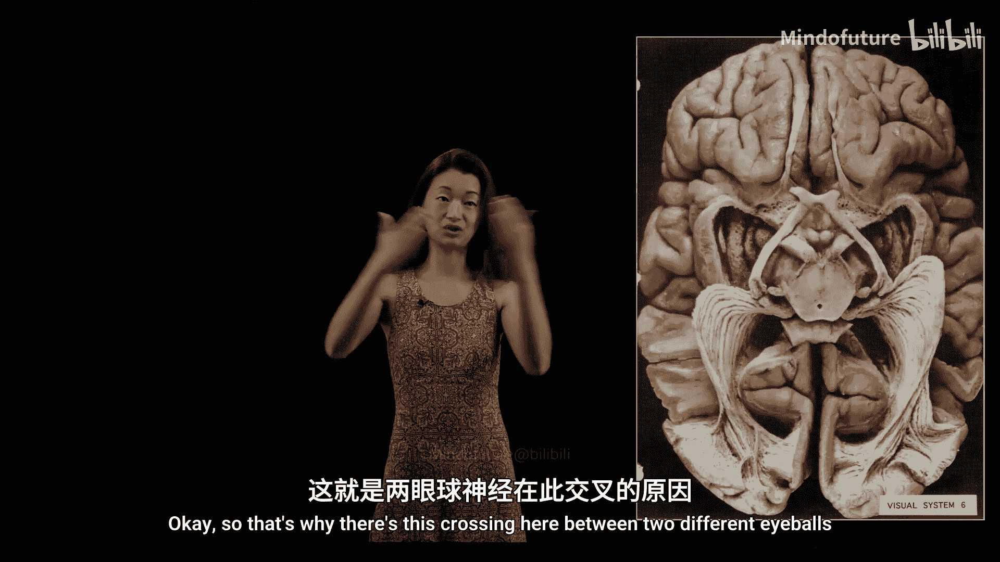

## 视觉系统概览

上一节我们介绍了视觉感知的主题，本节中我们来看看整个视觉系统的宏观结构。视觉信息始于眼球，通过视神经传递到大脑。

你的眼球通过视神经连接到神经系统的其余部分。视神经在视交叉处交叉，使得左侧视野的信息传递到右脑，右侧视野的信息传递到左脑。下图展示了这一通路：


信息从视网膜出发，经过丘脑的外侧膝状体，最终到达位于枕叶的初级视觉皮层。我们将用以下简化流程图来概括这一信息处理路径：

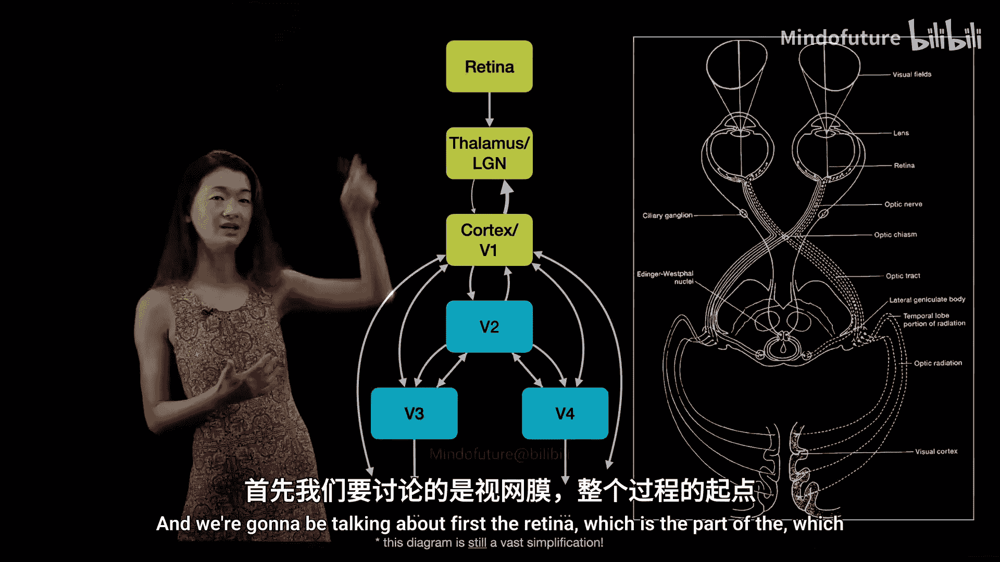

```
视网膜 -> 外侧膝状体 -> 初级视觉皮层 -> 高级视觉皮层
```

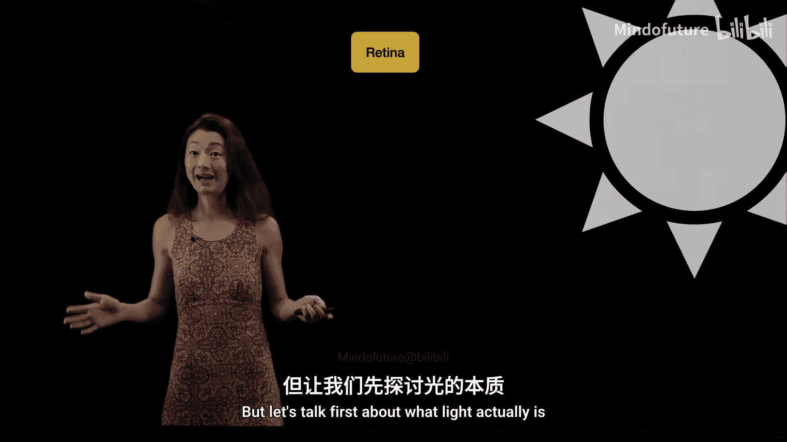

需要指出的是，这个简化模型忽略了大量的反馈连接，例如从皮层回到丘脑的投射，这些反馈回路是神经系统信息处理的普遍特征。

## 光的本质

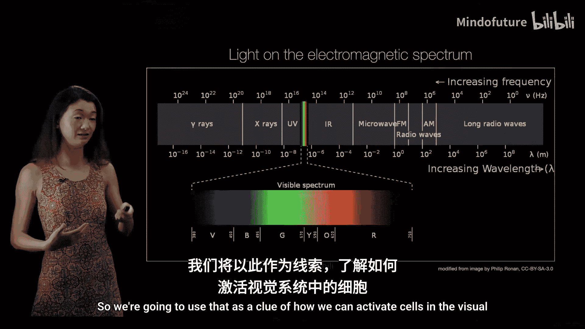

在深入视网膜之前，我们需要了解光是什么。光是一种电磁辐射，具有不同的波长。

人类可见的光谱范围非常狭窄，波长大约在 **380 到 715 纳米** 之间。波长与频率成反比，与光子能量成正比。公式表示为：

```
能量 (E) = 普朗克常数 (h) × 频率 (ν)
```

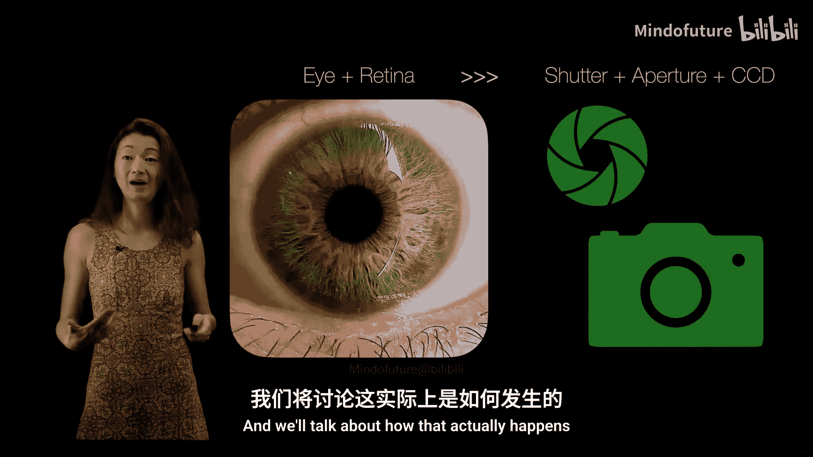

因此，短波长（高频率）的光子携带更高的能量，这是我们将其转化为电信号的关键。

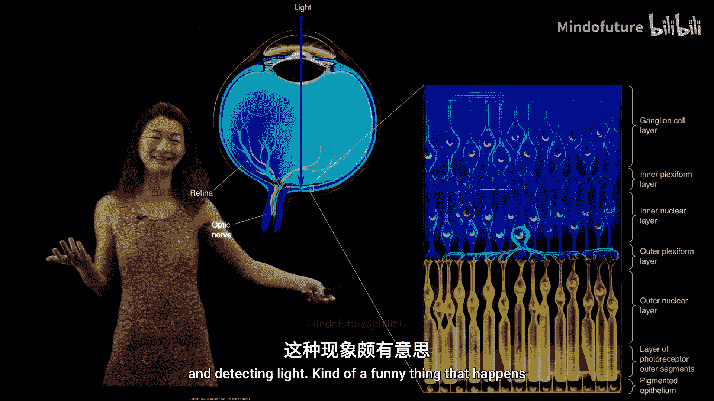

## 视网膜的结构与功能

现在，让我们聚焦于视觉的起点——视网膜。视网膜是位于眼球后部的一层神经组织，负责检测光线。

眼球的结构常被比作相机：瞳孔是光圈，晶状体负责对焦，而视网膜则相当于感光元件。然而，人眼的性能远超任何相机。

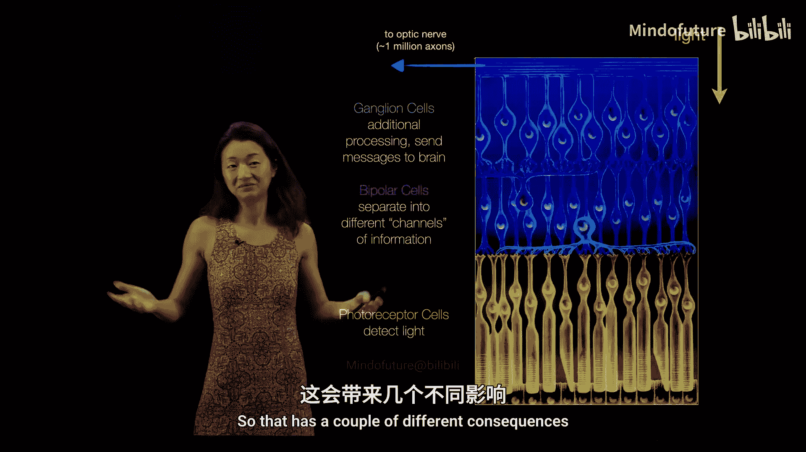

以下是视网膜的横截面示意图，显示了光线穿过各层细胞到达位于最底层的感光细胞的过程：

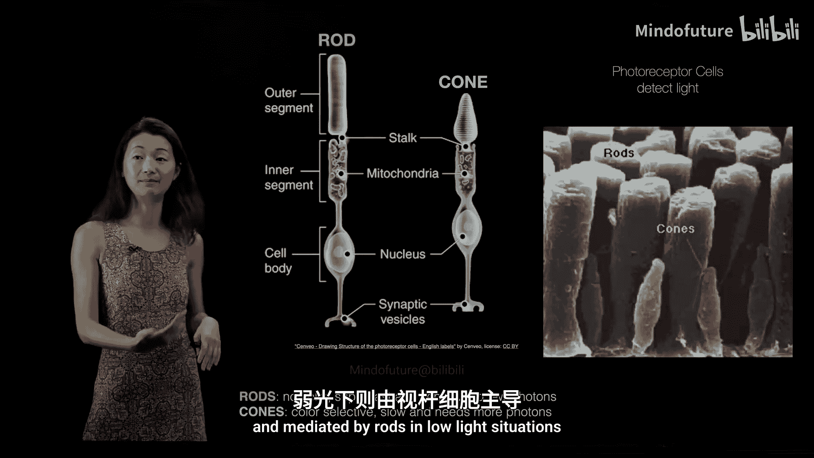


视网膜包含多种细胞，但主要可分为三大类：
1.  **光感受器细胞**：负责检测光子。
2.  **双极细胞**：接收光感受器的信号并进行初步处理。
3.  **神经节细胞**：整合信息并将其通过视神经发送到大脑。

值得注意的是，只有神经节细胞的轴突会离开眼球，形成视神经。由于这些轴突需要从光感受器层前方穿过并汇集成束，它们在视网膜上形成了一个没有感光细胞的区域，即**盲点**。

## 光感受器：视杆细胞与视锥细胞

人类有两种主要的光感受器：视杆细胞和视锥细胞。

以下是它们的关键区别：
*   **视杆细胞**：对光极度敏感，能在昏暗光线下工作，但**不参与色觉**，反应速度快。
*   **视锥细胞**：需要较强的光线才能激活，负责**色觉**和**高视觉锐度**，反应速度较慢。

在明亮环境下，我们主要依赖视锥细胞；在昏暗环境下，则切换到视杆细胞主导的视觉。视锥细胞高度集中在视网膜中央的**中央凹**区域，这是产生高清晰度视觉的关键。而视杆细胞则主要分布在视网膜周边。

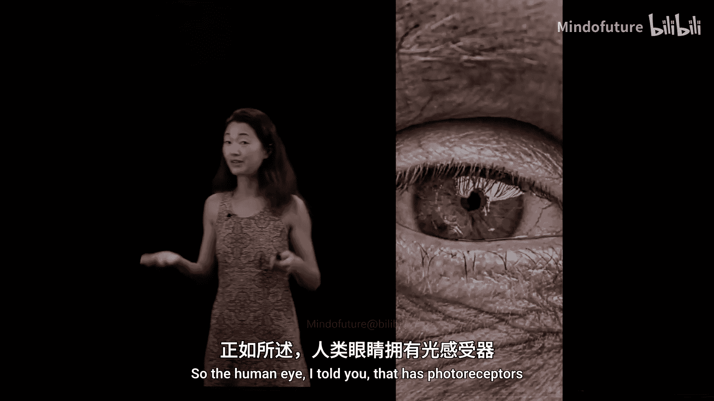

## 光转导的分子机制：视紫红质

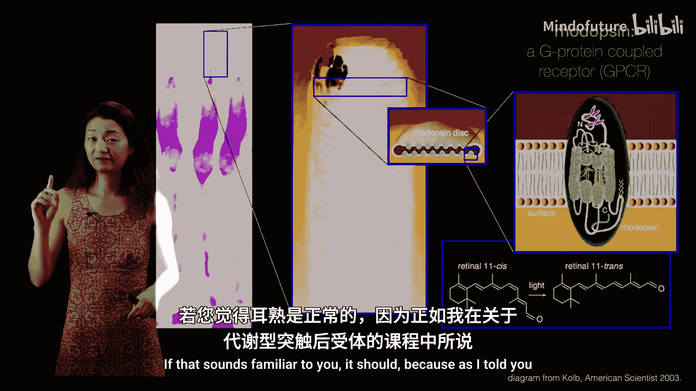

光感受器如何将光能转化为电信号？核心是一种叫做**视紫红质**的蛋白质。

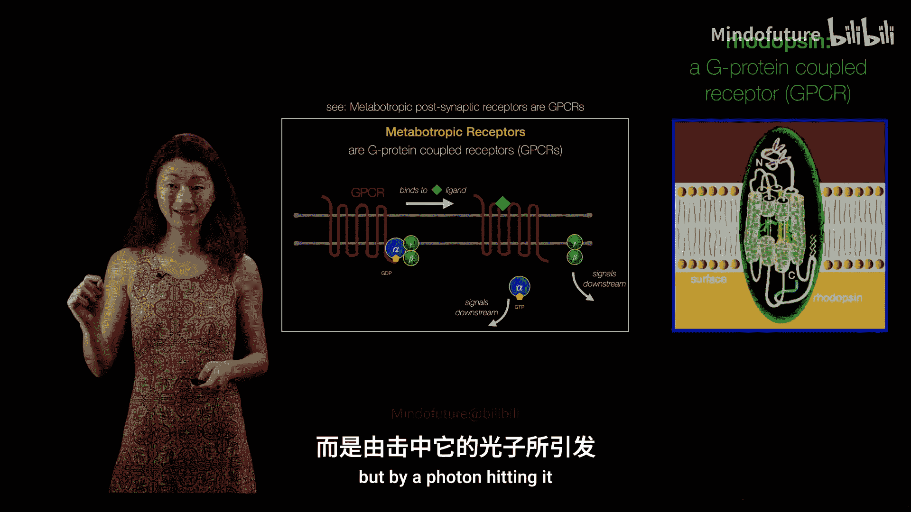

视紫红质是一种**G蛋白偶联受体**。它包含一个吸光分子——**视黄醛**。在黑暗中，视黄醛呈 **11-顺式** 构型。当光子击中时，其能量被视黄醛吸收，导致其构型转变为**全反式**。

```
11-顺式视黄醛 + 光子 -> 全反式视黄醛
```

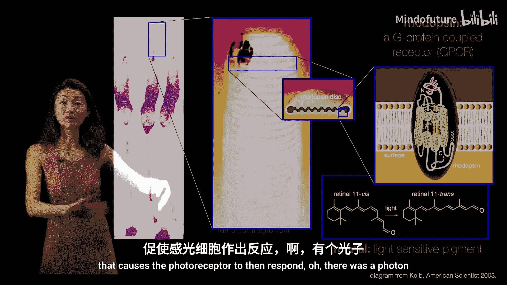

这一构型变化会触发视紫红质蛋白自身的构象改变，从而启动细胞内的信号级联反应。

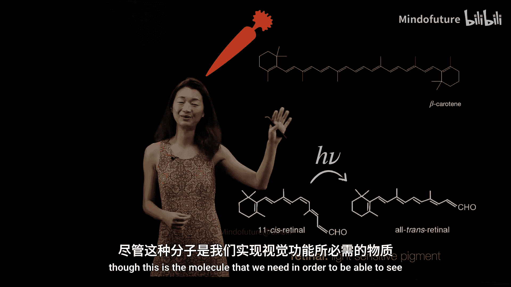

有趣的是，视黄醛由食物中的β-胡萝卜素代谢而来，这就是“胡萝卜对眼睛好”说法的来源。但对于饮食均衡的人来说，额外摄入并不会提升视力。

## 光感受器的电信号特性

光感受器的信号产生方式与典型的神经元不同。

在黑暗中，光感受器细胞膜上的某些离子通道保持开放，使其处于相对去极化状态（静息电位约 **-30 mV**）。当光信号被检测到时，级联反应的结果是**关闭这些离子通道**，导致细胞**超极化**。

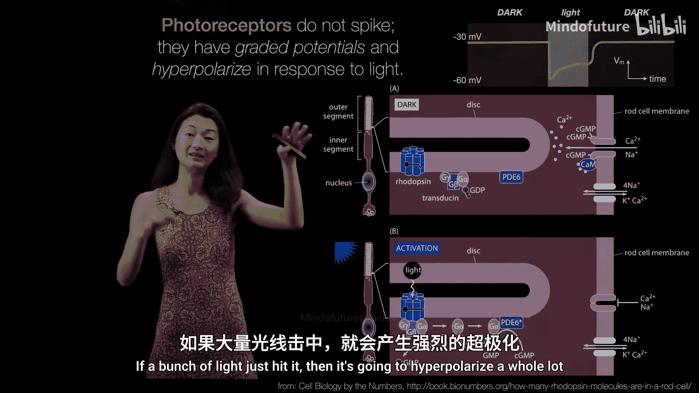

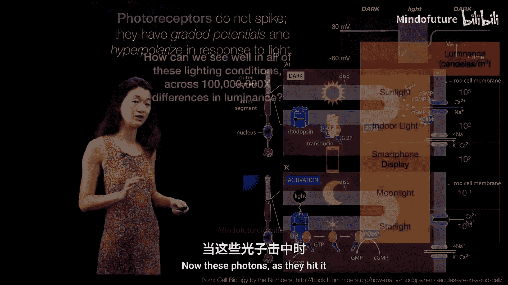

```
光照 -> 离子通道关闭 -> 细胞内正离子减少 -> 膜电位变得更负（超极化）
```

因此，光感受器通过**超极化的程度**来编码光线的强度，它们不产生动作电位，只有分级电位。这种超极化会减少神经递质谷氨酸的释放，从而将信号传递给下一级的双极细胞。

## 视觉的动态范围与暗适应

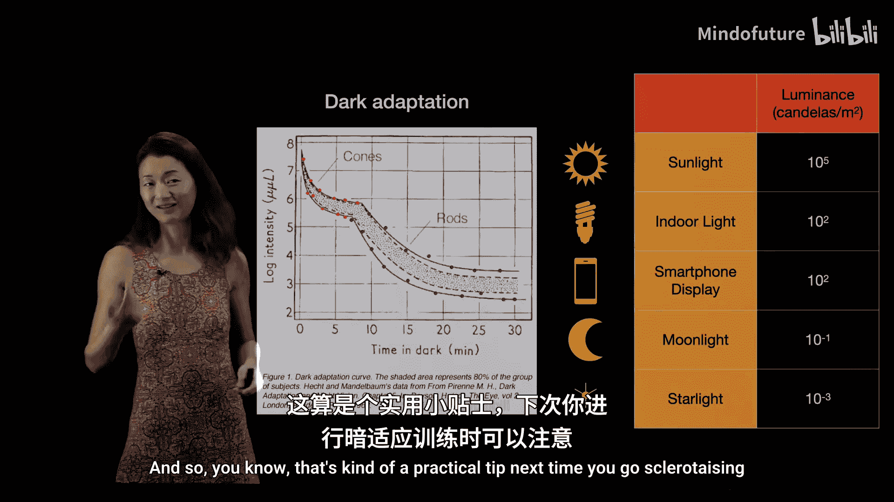

人眼能够适应极其宽广的光照范围，从正午阳光到星光，跨越约 **8 个数量级**。

这种卓越的适应性通过四种机制实现：
1.  **瞳孔调节**：在暗光下放大，增加进光量（约10倍调节）。
2.  **感光细胞切换**：从视锥细胞切换到更敏感的视杆细胞（约100倍调节）。
3.  **光色素调节**：在视网膜水平调整感光色素的浓度（约10倍调节）。
4.  **神经适应性**：神经系统对信号增益的整体调整。

完全的暗适应大约需要 **30 分钟**，这是因为视杆细胞需要时间重新合成足量的视紫红质。一个实用技巧是：在极暗环境下想看清某个物体，不要直视它（因为中央凹视杆细胞少），而是稍微看向它的旁边，利用视杆细胞密度最高的区域。

## 动物视觉的多样性

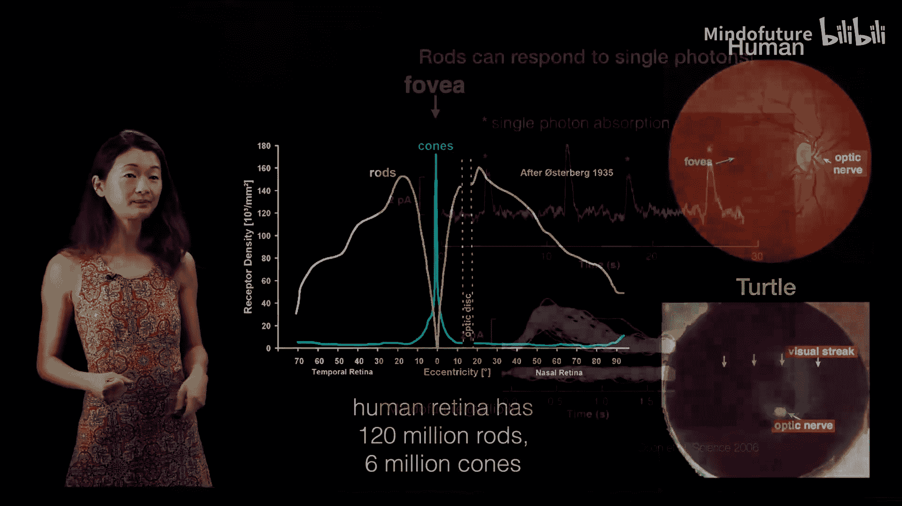

人类的视觉系统只是众多解决方案之一。自然界存在丰富的视觉系统变体：
*   **章鱼**：视网膜结构是“正”的，光感受器在最外层，因此没有盲点。
*   **昆虫**：拥有复眼，由许多独立的小眼面组成。
*   **扇贝**：拥有数百个带晶状体的简单眼睛。
*   **螳螂虾**：能感知人类看不见的偏振光，并拥有更丰富的色觉。

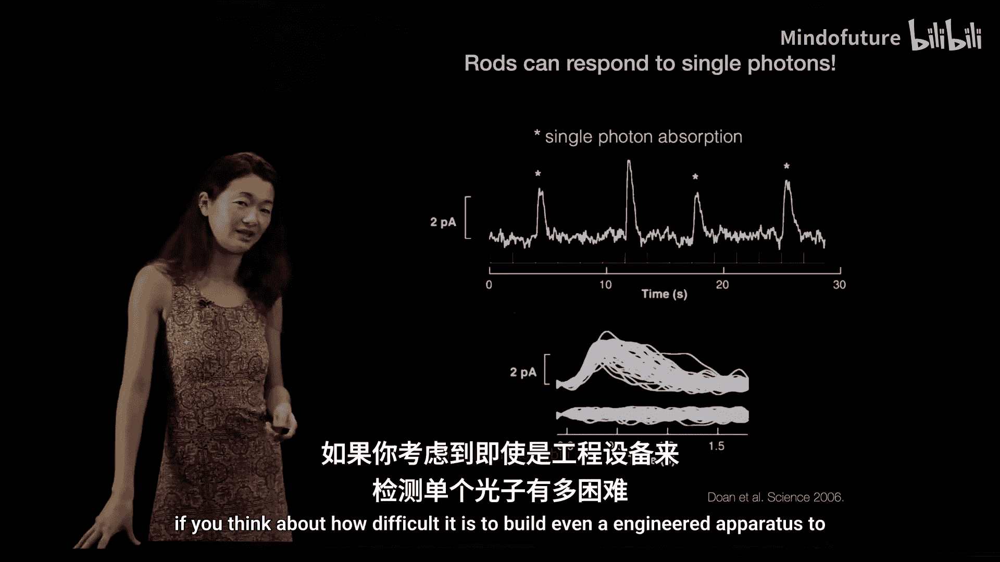


这些多样性反映了不同生物为适应其特定生态位而演化出的独特解决方案。

---

本节课中我们一起学习了视觉感知的起点。我们了解了视觉信息从眼球经视神经到大脑的通路，重点探讨了视网膜的结构。我们认识到视网膜包含视杆和视锥两种光感受器，它们通过视紫红质分子将光子转化为电信号。关键点在于，光感受器通过超极化来响应光线，且人眼能通过多种机制适应巨大的光照变化。最后，我们看到了动物界视觉系统的多样性，意识到人类的视觉方式并非唯一。在下一讲中，我们将深入探讨颜色视觉和视网膜内更复杂的信号处理过程。