# 018：色觉 - 视网膜视杆细胞与视锥细胞 👁️

在本节课中，我们将要学习色觉的神经生物学基础。我们将探讨视网膜中的视杆细胞和视锥细胞如何工作，特别是视锥细胞如何让我们感知颜色，以及我们的大脑如何整合这些信息来构建多彩的视觉世界。

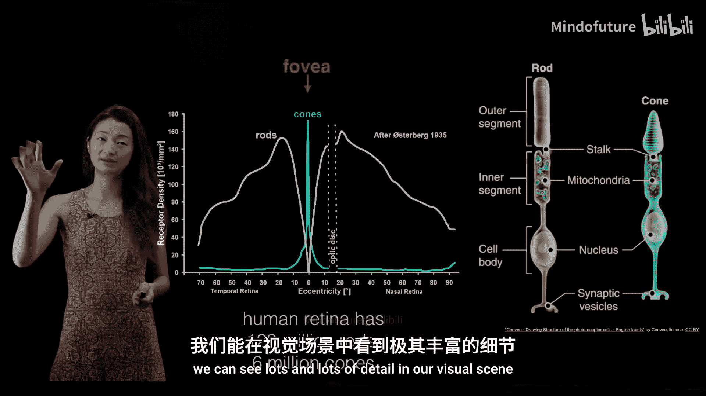

上一讲我们主要讨论了视网膜中光感受器的神经生物学基础，特别是这些光感受器细胞如何使用视紫红质——一种G蛋白偶联受体——以及视黄醛分子。我们解释了视黄醛分子在响应光子时，如何从顺式构象转变为反式构象，从而将光子转化为视觉系统中的分级电信号。我们主要讨论了吸收任何光子，但并未深入探讨我们如何拥有色觉，以及我们如何实际分辨不同类型的光子，并利用这种能力来感知不同事物具有不同颜色。这正是本讲的主题。

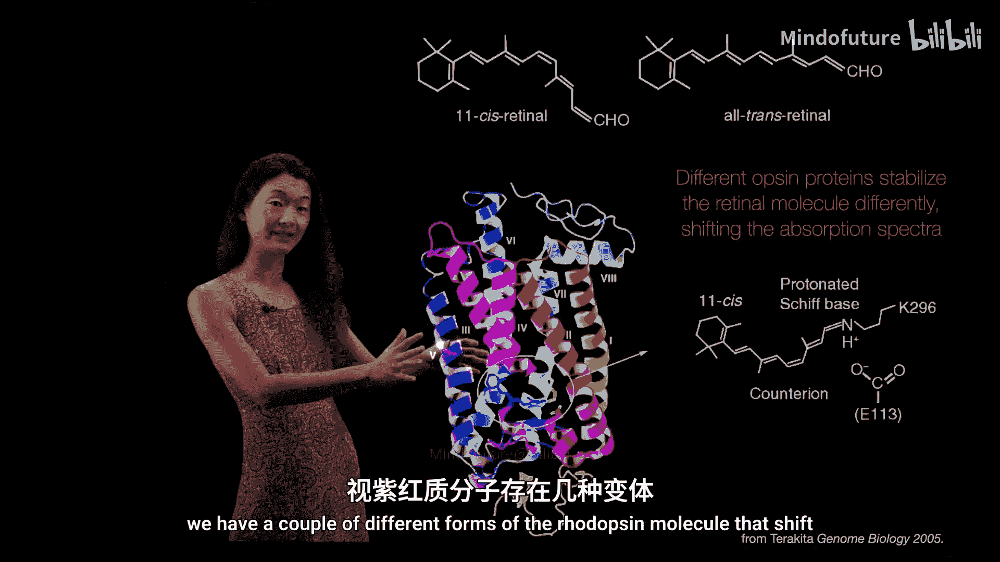

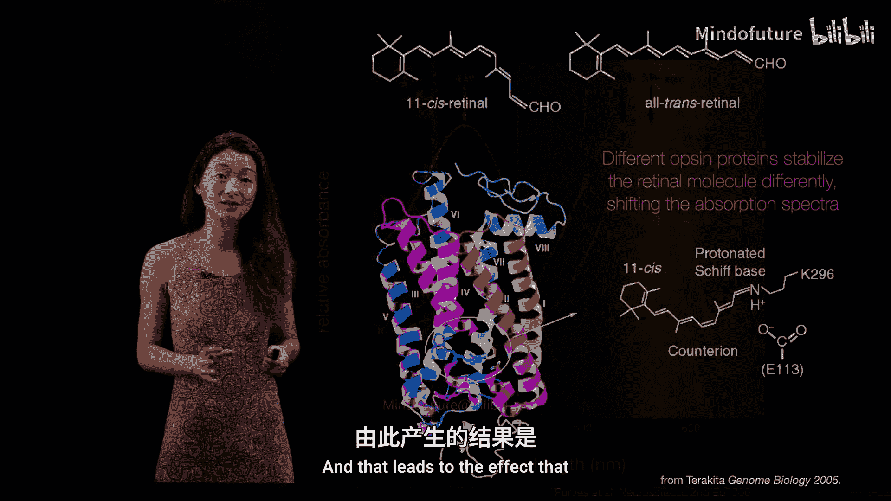

我们讨论过两种不同类型的光感受器：视杆细胞和视锥细胞。上一讲我们主要讨论了视杆细胞及其工作原理。这次我们将更侧重于不同的视锥细胞。正如上次所讲，视锥细胞主要分布在视网膜的黄斑区，即视网膜正后方的中心区域，大约占我们中心视敏度的一度范围。视锥细胞是我们拥有色觉以及极高视觉敏锐度的原因，使我们能看到视觉场景中大量的细节。

当然，这些视锥细胞也含有G蛋白偶联受体，特别是它们拥有几种略有不同的视紫红质变体，使它们彼此不同。视锥细胞中的视紫红质具有略微不同的特性，因为它们实际上以略有不同的方式改变了视黄醛的吸收光谱。

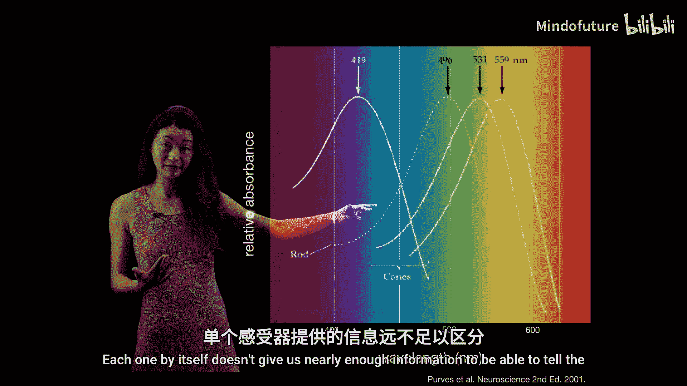

上次我向你们介绍了11-顺式视黄醛，以及它如何发生构象变化。在视锥细胞和视杆细胞中，这部分是相同的：它们通常拥有相同类型的视紫红质，并且都使用视黄醛作为实际吸收光子的分子。我没有告诉你们的是吸收光谱的工作原理。事实证明，如果你单独考虑视紫红质和视黄醛分子，视黄醛分子本身的峰值吸收光谱实际上在紫外线区域稍偏一点，而我们无法看到紫外线。视紫红质蛋白所做的是形成几个不同的α螺旋来稳定视黄醛分子，并且在视黄醛结合位点附近有几个不同的碱基，这些碱基改变了视黄醛的构象，将其吸收光谱向更长波长（更偏红色）移动。这就是我们首先能在可见光谱中看到东西的原因。

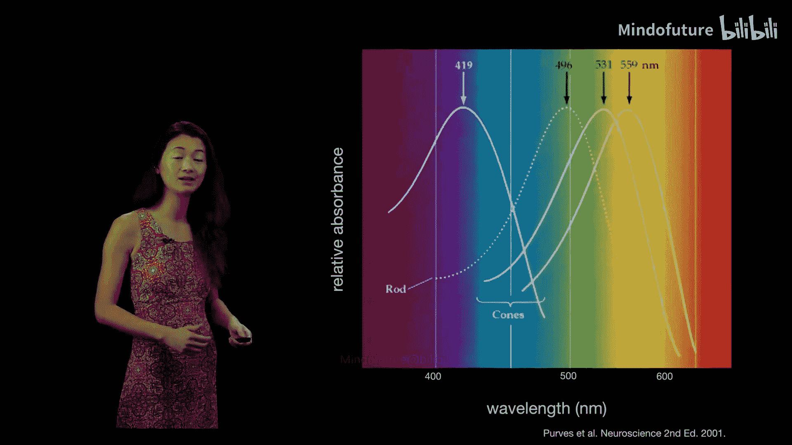

色觉的产生是因为我们拥有几种不同形式的视紫红质分子，它们将吸收光谱移动到略有不同的位置。这导致我们拥有多种不同的吸收光谱，对应不同的视锥细胞光感受器，因为它们表达不同形式的视紫红质。

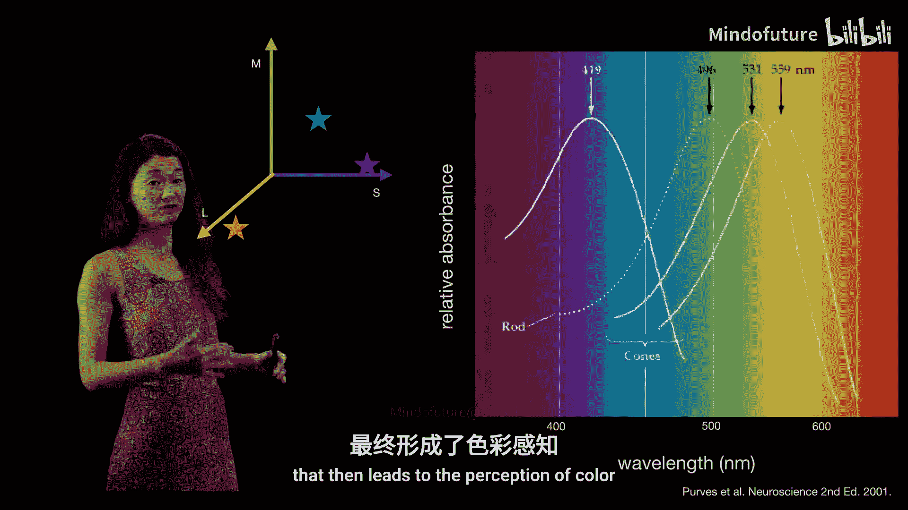

所以，视杆细胞中存在一种视紫红质，就是这里的虚线。我告诉过你们视杆细胞对不同颜色不敏感，但这并不完全准确。我们实际上并非使用视杆细胞来感知不同颜色，因为视杆细胞缺乏不同的信息通道。视杆细胞中的视黄醛分子和视紫红质确实对某些波长的光比其他波长更敏感，它们的峰值在496纳米处发生了偏移。对于我们人类拥有的三种不同类型的视锥细胞，正如你们在此图中看到的，它们的峰值发生了不同程度的偏移。我们大多数人拥有三种类型，有些人只有两种，实际上有些人有四种，但大多数人拥有三种。其中一种我们称之为最短波长类型，因为它在颜色光谱的最短波长部分偏移最大，其峰值在419纳米。然后我们还有另外两种不同的光通道，这两种不同的视锥细胞分别对531纳米和559纳米的光最敏感。

这里我想指出一个常见的误解：不能简单地认为这是“蓝色”光感受器，就称其为“蓝色视锥细胞”，因为它并非只对蓝光敏感。事实上，因为它在蓝色区域有一个峰值，并不意味着它能够区分，例如，我在这里指出的这种蓝色色调和这种紫色色调。因为如果你仔细想想，这是吸收光谱，这意味着这个波长的光将激活该视锥细胞的程度，与这个波长的光子完全相同。这个光感受器本身没有能力区分这个光子和那个光子。它能够区分它们的唯一方式，是因为它激活了另一个光感受器的程度不同。所以，正是通过观察这三种不同颜色通道的相对激活程度，我们才能产生颜色感知。每一个通道本身提供的信息远不足以区分所有不同光谱的光。

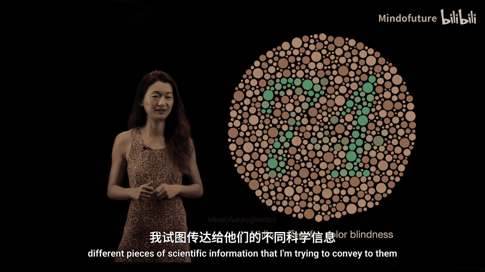

所以，让我们更详细地讨论这一点，我再为你们分解一次。

假设你有三种不同的视锥细胞光感受器，它们对电磁光谱中的三个不同峰值敏感。最终发生的情况是，这三种不同视锥细胞的相对激活程度，为你提供了关于入射光可能是什么的一个信息片段。因此，正是这种光的三维表示，我们可以用来推断导致色觉感知的实际光的波长。

这里发生的情况是，假设你有紫光。紫光会大量激活短波长视锥细胞，较少激活中波长视锥细胞，而完全不激活长波长视锥细胞。因此，它位于这个三维空间中的某个位置，这就是我们知道它是紫色的方式。蓝光，尽管它激活短波长视锥细胞的程度差别不大，但会更多地激活中波长视锥细胞，而完全不激活长波长视锥细胞。这就是我们区分蓝色和紫色的方式。相比之下，例如橙色的光，会大量激活长波长视锥细胞，而对中波长和短波长视锥细胞的激活则少得多。因此，实际上是这三种不同类型视锥细胞的相对激活，导致了颜色的感知。它们本身并不告诉你任何关于颜色的信息，所以这是一个我想强调的重要观点。

好的，我告诉过你们，我们大多数人拥有三种光感受器类型，这使我们能够感知我们在世界上行走、在芳香生活中看到的颜色范围。当然，有些人患有不同类型的色盲。

这意味着，因为你没有三个信息通道，你只有两个，因为你的视锥细胞中只有两种不同类型的光感受器，所以有些颜色是模糊的，你无法区分它们。现在，我旁边的屏幕上有一堆点。如果你在这些点中间看不到一个数字，你可能患有色盲。这被称为石原氏色盲测试图，这张图片中间的点应该形成一个数字。如果你能轻松看到数字，这意味着你拥有正常的三色视觉（对人类而言是正常的）。如果你不明白我在说什么，认为我只是指着一片随机点，你可能需要调查一下自己是否患有某种类型的色盲。这相当常见，事实上，我在制作图表或图形时通常会考虑到这一点。例如，我尽量避免使用像这两种颜色那样容易混淆的颜色，因为相当一部分人口无法区分这些不同的颜色。因此，我们可以使用不同的配色方案，使色盲人士仍然能够区分我试图传达给他们的不同科学信息。

好的，这里有一个相关的问题，这个问题在某种程度上几乎像是一个哲学问题：为什么天空是蓝色的？为什么天空是蓝色的？这实际上有一系列非常有趣的解释，结合了物理学的一些解释，也与我们刚刚学到的关于人类视觉感知的知识有一点关系。

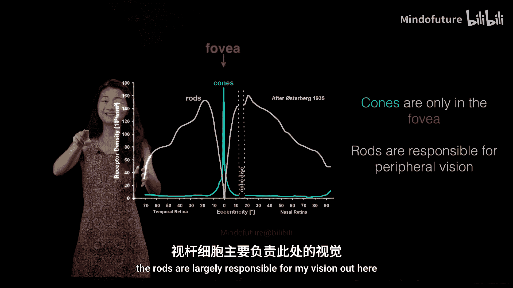

正如你们所知，太阳光不是蓝色的。如果你只看太阳的光谱，它几乎涵盖了整个可见光谱。所以，如果你把所有不同颜色的光加在一起，这种类型的光的感知通常是白色的。那么，为什么当你看着天空时，它看起来不是白色的，而是蓝色的呢？这是我的孩子们曾经问过我的问题，所以我实际上弄明白了原因。这里简单解释一下为什么天空是蓝色的。

首先，我们必须理解一种叫做瑞利散射的现象。大气中充满了气体分子，大部分是氮气和氧气。这些是微小的气体分子。正因为它们如此之小，对于这种尺寸的气体颗粒，当光从太阳照射下来并撞击大气层时，它撞击其中一个颗粒并散射的概率并不是均匀的，与波长无关。较长波长的光不太可能被散射，它们更有可能直接穿过；而较短波长的光则更有可能撞击这些气体分子，并在各个方向上反弹。

让我们思考一下。如果你是一个红光光子，你更有可能直接向下传播。但如果你是一个蓝光或紫光光子，你更有可能在大气中四处反弹，最终向侧面传播。这样做的后果是，因为你站在地球上，通常不会直视太阳（顺便说一下，没人告诉过你不要这样做吗？这不是个好主意。不要直视太阳）。所以，当我们看着天空并感知天空的颜色时，我们大多是在看侧面，我们不是在看太阳，我们是在看被大气反射的太阳光，所以现在光是从侧面来的，而不是从顶部来的。那些光子必须经过相当多的反弹。它们从侧面到达我的眼睛，所以它们一定在大气中反弹了相当多次，然后才开始向侧面传播，并在我坐或站在地球上时击中我的眼睛。由于瑞利散射非常显著，散射的概率实际上与波长的四次方成反比（公式：散射概率 ∝ 1/λ⁴）。因此，这些较短波长的光明显更有可能被散射并向侧面传播。

所以，这就是为什么天空的光谱，天空的感知颜色，更偏向于光谱的蓝、紫、紫色一侧，而不是红和橙色一侧。日落是另一回事，涉及另一种类型的散射（米氏散射），我们改天再谈，如果你愿意的话。但这是正午时发生的情况，不是我们谈论日落的时候。这就是为什么在晴朗无云的天空下，我们大多数人感知它为蓝色。

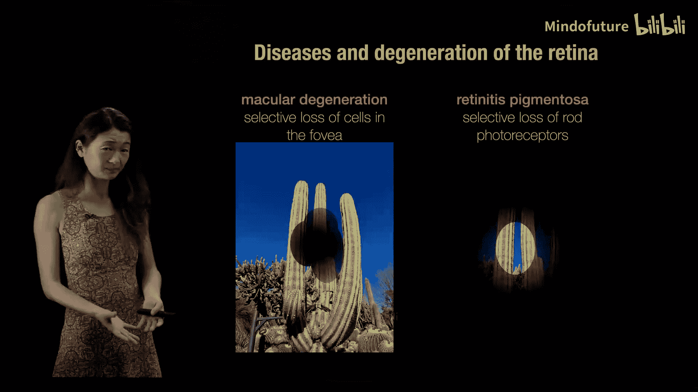

但这个解释实际上并不完整，因为它解释了为什么天空的颜色偏向光谱中较短波长部分，但它没有解释为什么是蓝色而不是紫色。要理解为什么人类感知它为蓝色而不是紫色，我们还必须看看我们视网膜中短波长视锥细胞的吸收光谱。你可以在这里看到，峰值吸收光谱在蓝色区域。我们能够感知较短波长的光，但吸收光谱在这部分急剧下降。所以，实际上，当我们看天空时，接近紫外线的光子比蓝色光子更多，但因为我们的视觉系统实际上在那部分光谱开始退化，我们无法很好地看到紫外线光。因此，我们感知天空是蓝色而不是紫色或紫外线，因为那是我们用于观察天空的最接近的光感受器的吸收光谱峰值。所以，这大致是两个原因，解释了为什么天空看起来是蓝色：因为瑞利散射，以及因为你视网膜中短波长光感受器的吸收光谱。

好的，我们讨论了视锥细胞只存在于黄斑区，而视杆细胞实际上主要负责你的周边视觉。所以，任何超过一度范围的东西——看看这个，一度非常短，如果你只是把手指伸到面前，将两根手指并拢，那大约就是我所有视锥细胞所在的范围。这里周围的一切，我无法用我的视锥细胞看到它们。在我的黄斑区之外。所以，这里的一切主要由我的视杆细胞负责，视杆细胞主要负责我这里的视觉。

这里还有另一个错觉，即能够看到全彩世界的错觉。如果你看这样一张图片，一堆美丽的围巾，你感知到的是一张充满彩色围巾的图片。你在现实世界中行走，你会看到，哦，在我的周边视觉中有绿色的树，有蓝色的天空，那边有个人戴着红色的围巾。你认为你看到了全彩的世界，但事实上，这也是一种错觉。因为你的视网膜看到的是以下情况：你可以看到中间有一个点是全彩的，因为那是你所有视锥细胞所在的地方。你在其他地方没有视锥细胞。你实际看到的、正在行走的世界的其余部分，是单色视觉，仅由你周边视觉中的视杆细胞看到。你没有以这种方式感知世界，并不是因为你的视网膜，而是因为视觉处理系统的其余部分非常擅长填充信息，因为你知道其余部分确实有颜色，你可以通过转动眼球或整个身体来看到那边有东西，当你聚焦于它时，你可以看到它有颜色。所以，当你看不到它时，你相信它有颜色，因为上次我看它时，它确实有颜色。仅仅因为我现在没有盯着它看，我就会感知它确实有颜色。所以，这是神经科学中一个常见的主题：你的大脑并不是真的告诉你外面有什么，它当然也不是告诉你你实际感知到什么。它是以一种对你有用的方式告诉你信息，以便你将来采取行动。因此，你认为这张图片充满颜色，看起来更像这样，这是一种由你的大脑填充的错觉。你视网膜中的硬件看到的是这个，而你填充了其余部分。

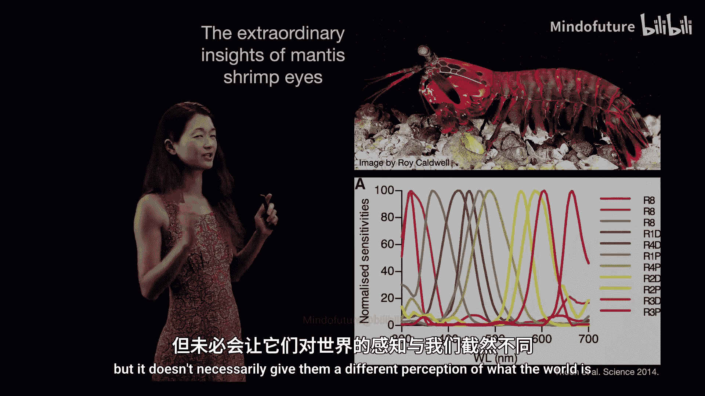

所以，当患有视网膜退行性疾病时，有几种不同类型特别具有破坏性，但从神经科学的角度来看也很有趣，因为它们指出了视网膜中不同类型光感受器之间的二分法。例如，患有黄斑变性的人，其黄斑区的细胞选择性丧失，这意味着你实际上在视觉的正中央有一个盲点或空白点。其余部分实际上还好，你仍然可以看到周边。这张图大致描绘了那种情况可能看起来的样子，尽管正如我在上一张幻灯片中告诉你们的，这里的东西不应该真的是彩色的，因为黄斑区拥有你所有的视锥细胞，所以这里的东西实际上应该是黑白的。黄斑变性是一种相当严重的疾病，因为当你试图聚焦看东西时，你看不到它。几乎相反的情况是，有一种疾病叫做视网膜色素变性，它是视杆细胞的选择性丧失。正如我们所讨论的，视杆细胞主要在周边区域，所以在中间区域，你的黄斑区完全正常，那些视锥细胞完全正常，但你无法很好地看到周边的东西。这些是视网膜中不同光感受器可能出问题的几种情况。

我们可以看到三色视觉，这已经相当令人印象深刻，因为它比二色视觉更好。狗拥有二色视觉，因此它们无法看到像我们一样多的颜色。认为它们只看到单色是一种误解，并非它们看不到任何颜色，只是它们没有能力像我们一样区分那么多颜色。但我们绝不是视觉上最令人印象深刻的生物。在视觉方面最令人印象深刻的生物有很多奇怪的例子，但我认为螳螂虾的眼睛在光感受器通道数量上堪称一绝。它们不是拥有三种，而是拥有12种。它们有12种不同的视紫红质，能看到12种不同的光通道，并且它们的光谱略有不同，正如你在这里看到的，与人类看到的光谱有很大重叠。它们比我们更能看到一点红外线和紫外线，但基本上是重叠的，因为那是太阳光谱的峰值所在，也是地球上大多数动物能够看到的地方。

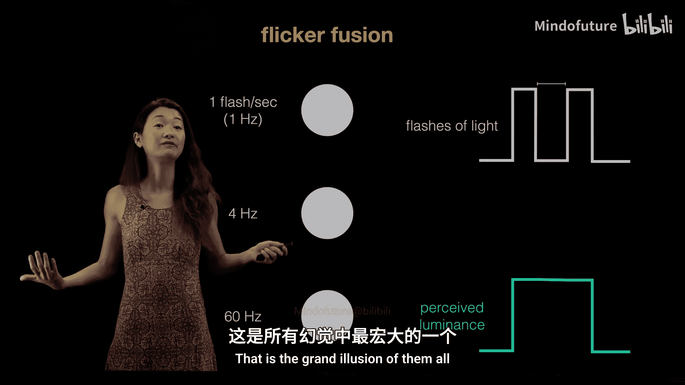

那么，为什么它们有这么多通道？它们真的看到更多颜色吗？根据我们之前的讨论，它们实际上并非如此。因为有了三个信息通道，我们实际上已经能够区分非常多、非常细微的颜色差异。仅仅增加一个通道，并不意味着就能看到更多颜色。它们可能做的是以不同的方式体验这些颜色。我的意思是，我从未和螳螂虾交谈过，所以我真的不知道用12个不同的光通道而不是3个来看东西是什么感觉。目前尚不清楚这对它们实际有什么作用，以及为什么它们拥有如此非凡的不同光感受器阵列，数量远超我们。人们的推测是，这可能使它们在某些区域具有更高的敏锐度，因此它们能够区分波长上更微小的差异，但这并不一定给它们带来与我们不同的世界感知。我还要早些提到，螳螂虾除了拥有12种光感受器外，还能看到偏振光。这是人类眼睛无法辨别的。我无法区分一种偏振光与另一种偏振光。我必须戴上偏光太阳镜才能区分它们。螳螂虾可以用自己的眼睛做到这一点。这是动物王国视觉领域的另一个非凡适应。

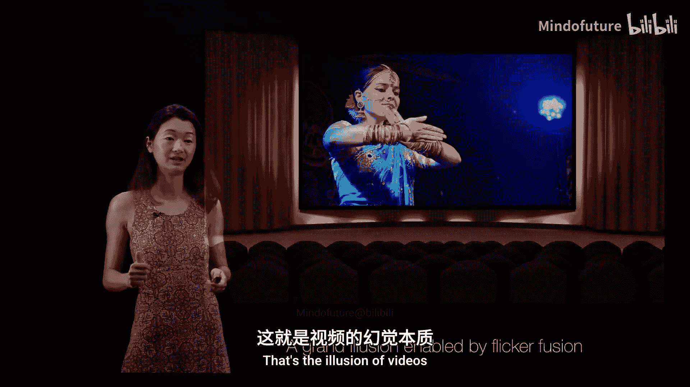

关于人类视觉还有另一件特别有用的事情，你现在正在用它来听我讲话，那就是所谓的闪烁融合。我们主要讨论光和光子时，仿佛这是一个静态的东西，你正在看一幅图像。但正如你所知，当你行走或看电影时，它是动态的，有些东西在变化。所以，当东西闪烁时，有一种叫做闪烁融合的现象。现在这个点正以每秒一次的频率闪烁。每秒闪烁一次，另一种说法是1赫兹，每秒一次，1赫兹是完全相同的意思。在视频中你应该看到的是，你应该感知到这个点以每秒一次的频率闪烁，你可以看到它，你看到它是闪烁的光。如果我闪烁得快一点，现在是每秒4赫兹。我的感知仍然是它在闪烁，我可以看到它闪烁得更快了。如果我们闪烁得更快，达到60赫兹，我不再看到闪烁。它确实在闪烁，我向你保证，但你看不到，因为当东西闪烁得足够快时，你不会将它们感知为单独的闪烁，而是将其感知为连续的感知亮度，仿佛它是一个连续的东西，而不是离散的、间断的东西。这是视觉系统的一个特性。不同的动物有不同的闪烁融合频率。对于我们人类来说，根据你测量的具体方式，通常当你达到大约30赫兹左右，即每秒30次闪烁时，我们开始失去接收单个闪烁的能力，转而将其感知为连续的闪烁或连续亮度。我认为这可能是我们大多数人最常经历的错觉，因为它是视频的基础。我们的大多数显示器刷新率不会比30到60赫兹快太多。电影胶片，取决于格式，你看到的是30或60赫兹。高于这个频率，我们真的无法区分。所以，如果你以大约那个频率播放一系列静止图像，大多数人类的感知是它是连续运动，而不是光的闪烁。例如，当你使用定格摄影时，那是另一个例子，我们为了艺术效果而这样做，看起来你有点能感觉到有间断的单个帧，比那个速度稍慢，所以我们将其感知为发生在现实生活中的艺术效果。在视频中，事物实际上是连续运动的，非常接近于此。由于你视觉系统的闪烁融合率，你无法区分真正的连续与离散但足够快的连续之间的区别。这就是视频的错觉。

所以，我们现在已经讨论了几种不同的方式，说明眼睛和视网膜比我们通过摄像技术所能做到的更优秀、更酷。这由各种不同的解剖学、生理学和神经生理学计算所支撑，这使得我们的眼睛能够感知巨大的亮度差异，并且能够以优于我们通过工程设备所能实现的方式区分许多不同的颜色。

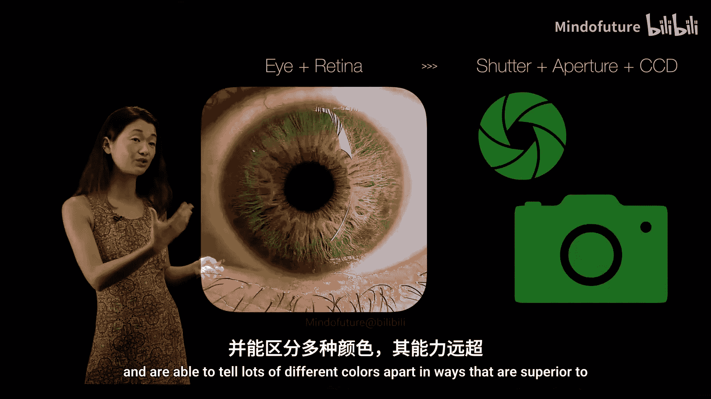

关于色觉，我在这里总结几个关键概念：
*   大多数人类拥有三种类型的视锥细胞光感受器。不同的人可能有色盲，他们只有两种不同类型的光感受器。
*   每种视锥细胞对一定波长范围的光敏感，因为它们拥有略有不同的视紫红质蛋白，这些蛋白以不同的方式改变了顺式或反式视黄醛的吸收光谱。
*   视锥细胞主要分布在视网膜的黄斑区。只有当你直接看某物时，你才真正拥有色觉，在周边视觉中完全没有。
*   这三种视锥细胞的相对激活导致了颜色的感知。每个光感受器本身并非对一种颜色敏感，这就是它的工作原理。它对一个峰值最敏感，但它无法真正区分波长峰值两侧的差异。因此，只有通过比较三种不同光感受器及其相对激活程度，你才能产生颜色感知。
*   最后，人类无法感知快于某个特定阈值的快速光变化。如果你能以快于该频率的速度在显示器、投影仪或智能手机上播放电影，我们会将其感知为连续运动。这就是我们一直在做的事情，因为我们花费大量时间盯着手机，并相信这个宏大的错觉，即事物实际上是连续运动的。

本节课中我们一起学习了关于光感受器、视杆细胞和视锥细胞的知识，也讨论了色觉以及对光的一般感知。在接下来的几讲中，我们将要讨论光感受器之后发生的事情，因为光感受器毕竟只是视觉处理通路中的第一步。光感受器告诉你那里有光，而光的存在如何导致你对视觉的感知，你如何理解世界上实际发生的事情，这将是本系列接下来几讲的重点。