# 019：视觉计算与环路-感受野-稀疏编码假说 👁️🧠

在本节课中，我们将要学习视觉信息是如何从视网膜上大量的光感受器，被整合成我们所感知的真实世界。我们将重点探讨神经元环路如何进行有意义的计算，以及感受野、侧抑制、稀疏编码等核心概念。

---

在上一节中，我们介绍了单个光感受器如何检测光子的分子和神经生物学基础。本节中，我们来看看来自众多光感受器的信息是如何被整合的。

视觉计算和环路是我们首次真正讨论神经元环路，而不仅仅是单个神经元。我们将探讨神经元如何通过动作电位相互连接，从而产生有趣、可解释的结果，并最终形成我们的感知和行为。

我们将以此为契机，讨论神经元连接和通信方式的计算意义。我们将这些经典环路视为“计算乐高积木”，可以用来构建更高层次的感知和行动。

我们之前详细讨论过视网膜。视网膜中有许多不同的细胞类型，但我们只重点介绍了第一种——光感受器。我们讨论了视锥细胞、视杆细胞、不同的视蛋白分子以及相关的生物化学过程。

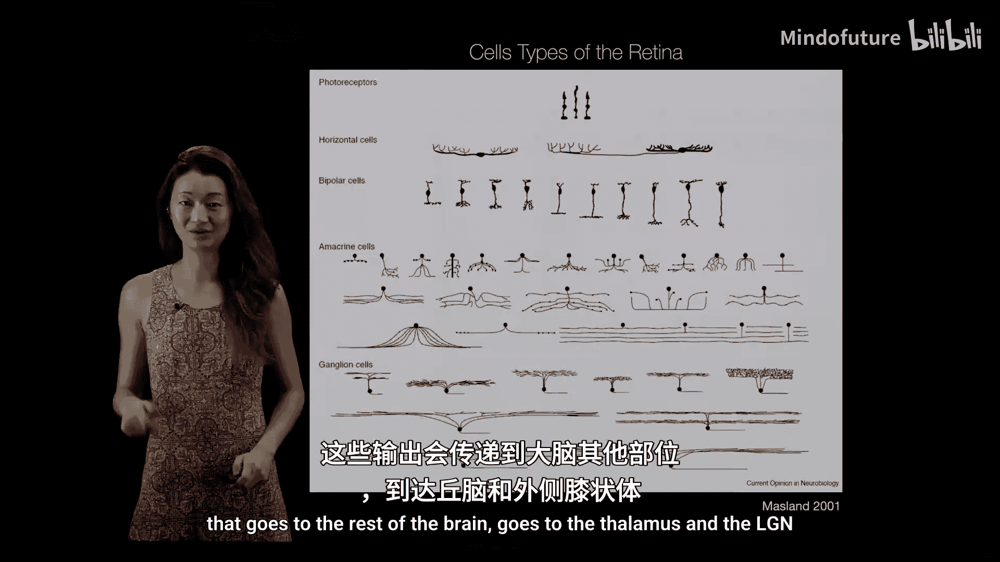

最终，单个光感受器会告诉下一层细胞：“有光来了。”这是通过谷氨酸能突触实现的。光感受器释放谷氨酸，向下一层细胞传递检测到光子的信号。

本节课将更多地关注视网膜中的其他细胞。视网膜不像CCD传感器那样只有一堆像素点，它更像一个“微型大脑”。在信息输出到大脑其他部分（丘脑和外侧膝状体）之前，这里已经发生了大量的处理。

这是之前看过的示意图：光从顶部进入，穿过我们之前忽略的所有结构，最终到达光感受器。

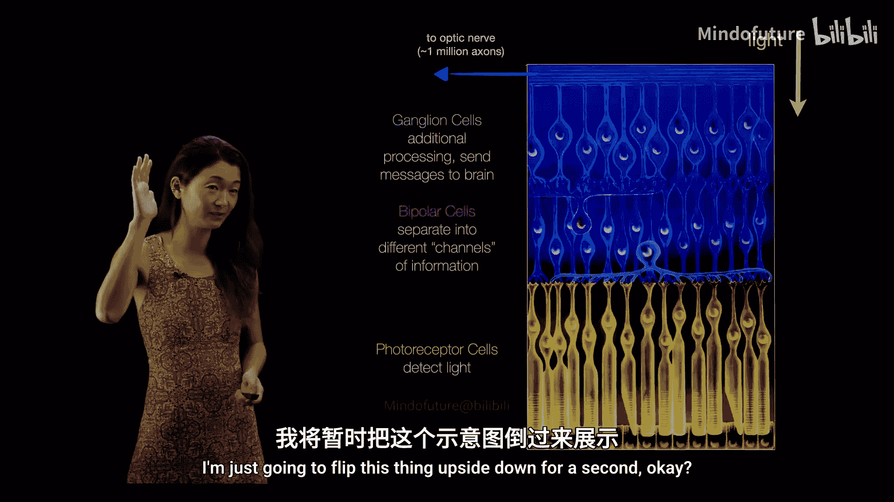

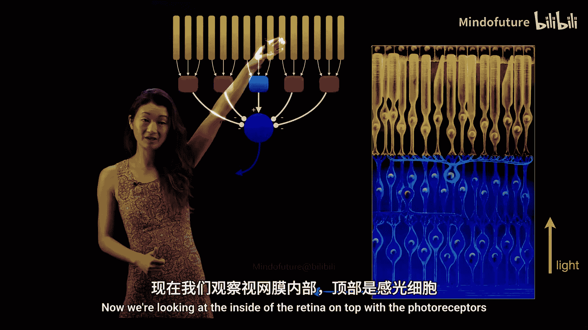

我们将这些不同的细胞类型简化为两类：双极细胞和神经节细胞。视网膜神经节细胞是视网膜唯一的输出细胞，只有它们拥有轴突，能将信息传递到大脑其他部分。因此，视网膜内发生的任何事件，除非能改变视网膜神经节细胞的激活状态，否则都不会被大脑直接感知。

为了便于理解，我们将这个示意图上下翻转。现在，顶部是视网膜内部的光感受器，底部是输出的视网膜神经节细胞。我们用黄色方块代表光感受器，中间层是双极细胞，它们汇聚到下方的视网膜神经节细胞上。

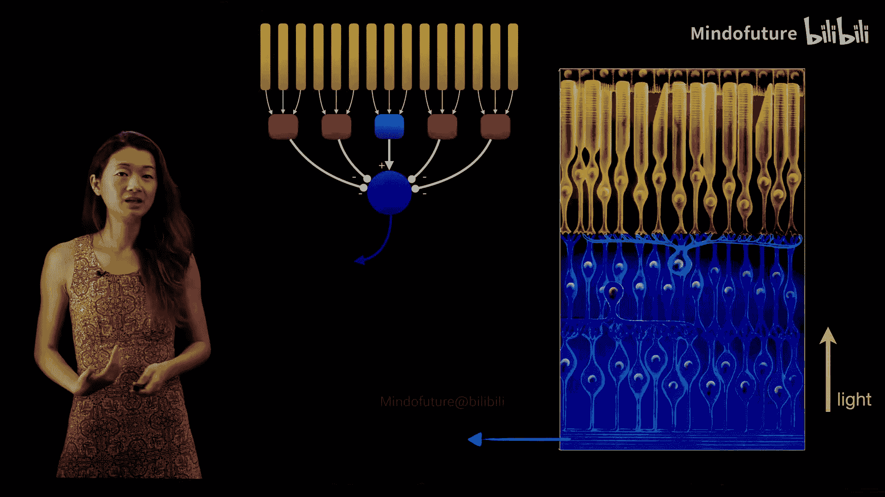

让我们分析这个环路，看看众多光感受器如何汇聚到一个单一的视网膜神经节细胞。我们的大脑无法知道单个光感受器的活动，只能知道视网膜神经节细胞在做什么。

视网膜神经节细胞有几种类型。其中一种是 **“中心-给光”视网膜神经节细胞**。

观察发现，这些神经节细胞并不像像素那样只报告视网膜一小块区域的情况。它们整合了许多不同光感受器的信息，主要对“中心有光、外围相对较暗”的斑点敏感。这不是简单的像素开关，而是检测“中心是否比外围更亮”的对比度计算。

为了实现这种计算，视网膜有一种经典的环路结构（此处做了简化）。存在两种类型的双极细胞：“给光”双极细胞和“撤光”双极细胞。它们使用不同的神经递质，来兴奋或抑制它们后续将要突触连接的视网膜神经节细胞。

“中心-给光”视网膜神经节细胞从光感受器接收激活信号，因此当中心有光时，它更可能被激活。同时，它被一圈“撤光”双极细胞包围。这些外围细胞会转换光的信号：当外围有光时，实际上会对视网膜神经节细胞产生抑制。

因此，如果一个“中心-给光”视网膜神经节细胞的中心连接着“给光”双极细胞，外围连接着一圈“撤光”双极细胞，那么当中心有光、外围黑暗时，这个细胞最活跃。如果整个区域均匀照亮，由于外围光的抑制，它的活跃度反而会降低。

相反，如果我们以相反的方式连接环路：中心是“撤光”双极细胞，外围是一圈“给光”双极细胞，就会得到相反的效果。这个视网膜神经节细胞会在中心黑暗、外围有一圈光时最活跃。这就是 **“中心-撤光”视网膜神经节细胞**。

我们将用一个图表来总结这一切，这个图表在讨论视觉系统乃至其他许多感觉和运动系统时都会反复出现。这就是 **感受野** 的概念。

感受野是我们神经科学家用来描述和总结“最可能激活某个特定神经元的刺激”的方式。它是该神经元的一个属性。我们可以为任何神经元定义感受野，因为它取决于所有照射到其突触前伙伴的光子。

对于这个特定的“中心-给光”视网膜神经节细胞，我们可以用图表概括其感受野：中心有一个激活区（对光兴奋），外围有一个抑制环（对光抑制）。一个“中心亮、外围暗”的小圆点图案，就是能让这个细胞最“开心”、激活程度最高的感受野。刺激模式越偏离这个感受野，该细胞的激活程度就越低。

现在，我再介绍一种细胞类型：**水平细胞**。这是视网膜中的另一种细胞。

水平细胞具有连接大量不同光感受器的特殊属性。它们接收光感受器的输入，并投射到其他光感受器上。具体来说，它们会抑制相邻的光感受器。

为什么要这样做？因为它实际上**增强了对比度**。这种**侧抑制**的环路模式，我们不仅会在后续的视觉系统中反复看到，也会在许多其他感觉和运动系统中看到，因为它是增强对比度的通用模式。

假设这个特定的水平细胞被某个光感受器激活。当这个光感受器接收到大量光时，它会抑制其所有邻居。每个光感受器都有一组这样的水平细胞，使得每个细胞都在抑制其邻居。

这样做的净效应是增加了对比度。它让你对边缘更敏感，而对连续变化或根本不变化的事物不那么敏感。这基本上是所有感觉系统的共同特征。例如，在听觉系统中也会发生这种侧抑制，在时间维度上也是如此。你的大脑通常不试图向你报告实际发生的情况，而常常是一个变化检测器，检测空间或时间上的变化。

因此，当这里有一条暗线，旁边是亮区时，你更可能关注对比度变化的交界处，而不是两侧整体。声音、气味，甚至抽象决策中也是如此。我们看到这种模式：一个决策会抑制其周围的一些选项；或者，当你朝向某个方向时，代表该方向的细胞有时会抑制代表其他方向的细胞。

这种通过侧抑制增强对比度的通用模式，在本课程中首次在光感受器抑制其邻居的背景下出现，目的是增加视觉对比度。我们将在许多其他系统中反复看到这种模式。

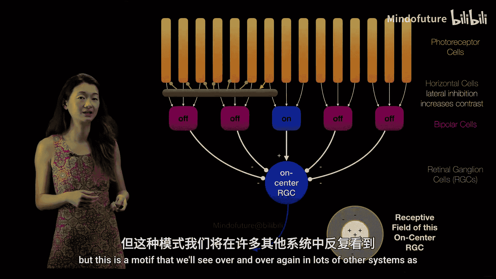

以上是关于视网膜的内容。我们讨论了视网膜的计算，以及其中已经发生的“微型大脑”式的非平凡计算。

接下来，我们将沿着视觉通路继续前进。下一站是丘脑的一部分，称为**外侧膝状体**。在外侧膝状体中，我们同样可以通过计算神经元最敏感的视觉刺激来表征其感受野。

实验神经科学的经典方法是记录LGN神经元的活动。这里，我将时间绘制成光栅图。我进行了一些细胞外记录，将尖锐电极插入LGN，记录一个LGN神经元的放电活动。

现在，我将向它展示各种不同的视觉刺激。开始时，我展示一系列随机生成的视觉刺激。我会展示大量随机刺激，并记录细胞实际放电的时间。

总体来看，这看起来很随机。但我们可以长时间记录，查看细胞每次放电的时刻，然后查看放电前的刺激，问：“是什么让那个细胞在那一次放电？”我们对大量放电重复这个过程，然后取所有放电前刺激的平均值。这是一种计算特定LGN神经元感受野的方法。

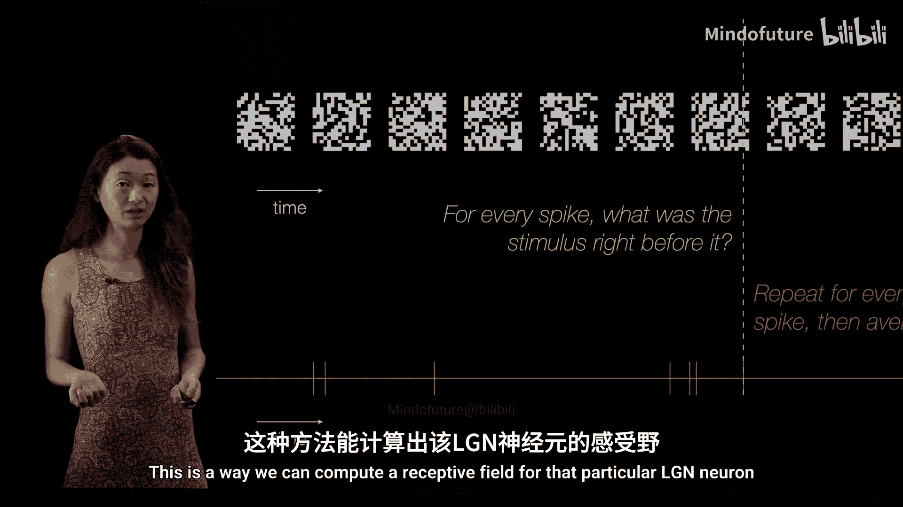

特别是在这个案例中，那个特定LGN视觉神经元的感受野不仅具有空间感受野（还记得视网膜神经节细胞中的“给光”和“撤光”细胞吗？），还具有**时空感受野**。

在它放电之前发生的是：有一个“中心暗、外围亮”的环形光。这看起来像是一个“撤光”神经元，类似于我们之前讨论的视网膜神经节细胞。但如果你在时间上向前或向后看，在放电前12个时间步，什么都没有发生，没有任何相关性。这就是时空感受野的含义。

但在那个环形出现之前，你实际上看到的是激活而不是抑制。所以，当电影序列看起来是这样：什么都没发生，什么都没发生，然后出现一个峰值，接着一个环形出现。正是这种时空视觉激活模式，是这个特定神经元的“快乐区”，是让它放电和产生峰值的刺激。

这是一种通用程序，我们可以通过向视觉神经元闪烁大量不同的光、大量不相关的电影，长时间观察，然后对所有观察到的放电进行平均，来找出和表征其感受野，看看细胞对什么平均刺激有反应。这不仅适用于视觉神经元，也适用于许多其他细胞，如听觉神经元、机械感觉神经元。这种使用随机甚至伪随机刺激，观察是什么引发了细胞放电的程序，有时被称为** spike-triggered average **，用于表征这些感受野。

这是自然发生的正常过程。如果你学过统计学，你可能会想：为什么要使用这些完全随机的白噪声刺激？

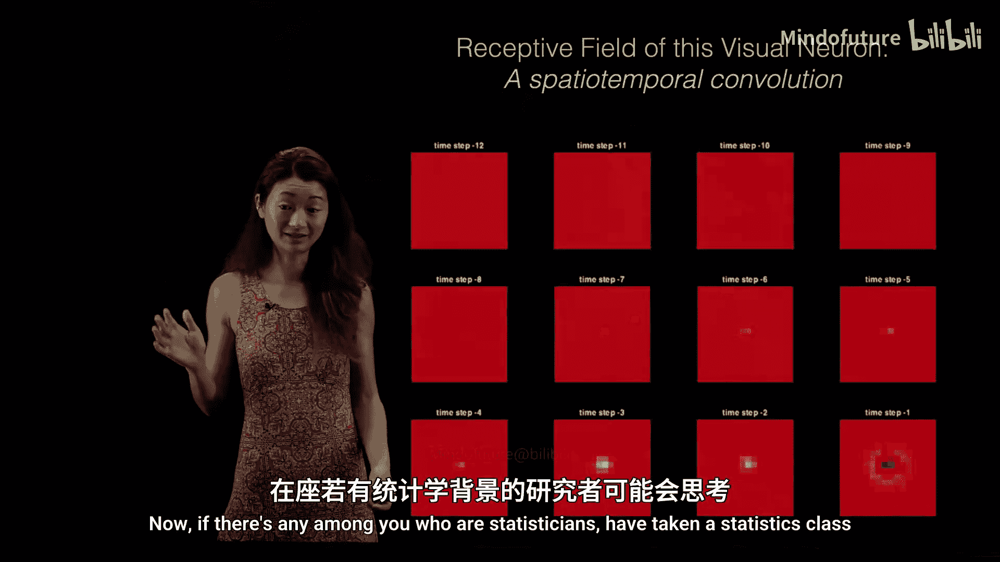

我们这样做是因为，只要刺激输入本身完全不相关（如果是随机白噪声），这个程序就非常有效。如果我们展示的刺激不是随机白噪声，而是相关噪声，甚至是更困难的自然场景，那么在计算这些卷积感受野时，我们就必须做出某些统计假设并进行校正。这是一个非常活跃的研究领域，不同研究者试图找出当输入刺激相关时，如何进行不同的统计校正。

因此，只要刺激不相关，你可以直接做平均。但如果刺激自身相关，我们就必须进行一些校正，才能找出神经元的感受野是什么。

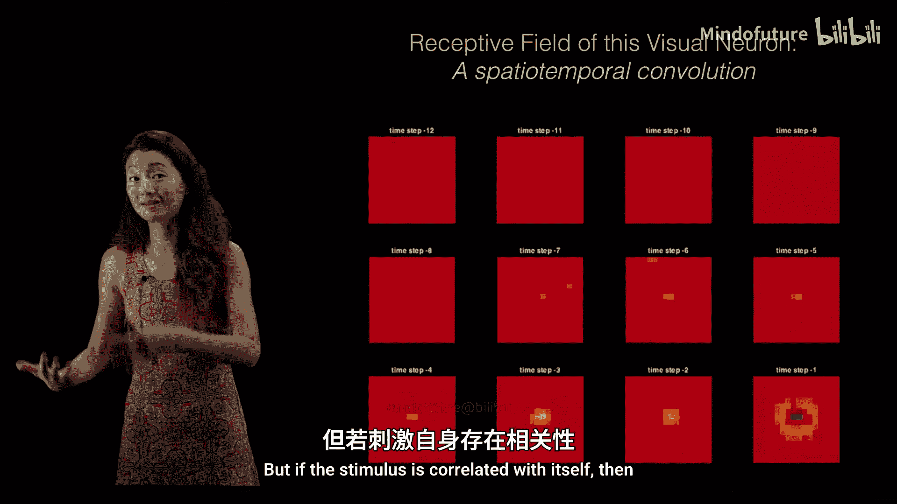
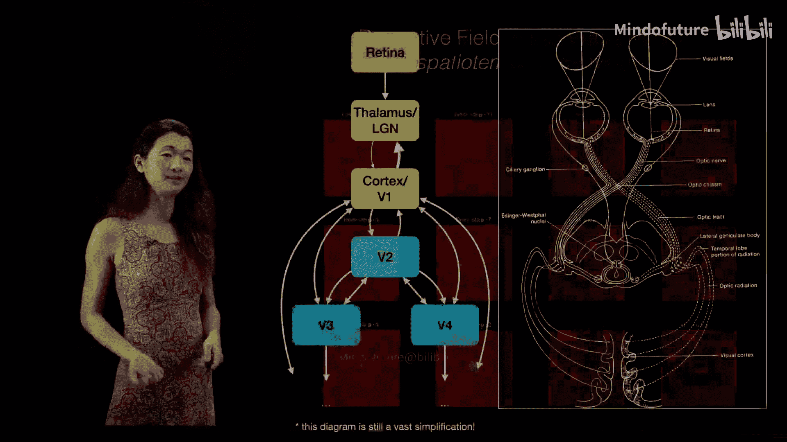

我们讨论了LGN。处理过程的下一步是**V1初级视觉皮层**。

初级视觉皮层位于你后脑勺的最底部，大致在左右中线的最背面。对人类来说，它并不完全在表面，但对于没有沟回的老鼠和啮齿类动物，它仍然在相同的位置（最后面），你可以直接在顶部看到它。我在关于 electrocorticography 记录的讲座中展示过这个。

这是Hubel和Wiesel的经典成果，他们表征了初级视觉皮层中神经元的感受野。我们讨论过视网膜神经节细胞层的“给光/撤光”细胞，讨论过LGN细胞的感受野（它们非常相似），然后信息被传递到视觉处理通路的下一步：V1。

现在我们有了这些对方向敏感的细胞。与那些对光点敏感（一个视网膜神经节细胞对“这是我的光点”敏感，相邻的细胞对另一个光点敏感）的细胞不同，这些V1细胞同样具有局部性，它们喜欢视觉空间的一部分，但它们现在对**有方向的棒状物**敏感，并且喜欢特定方向的运动。

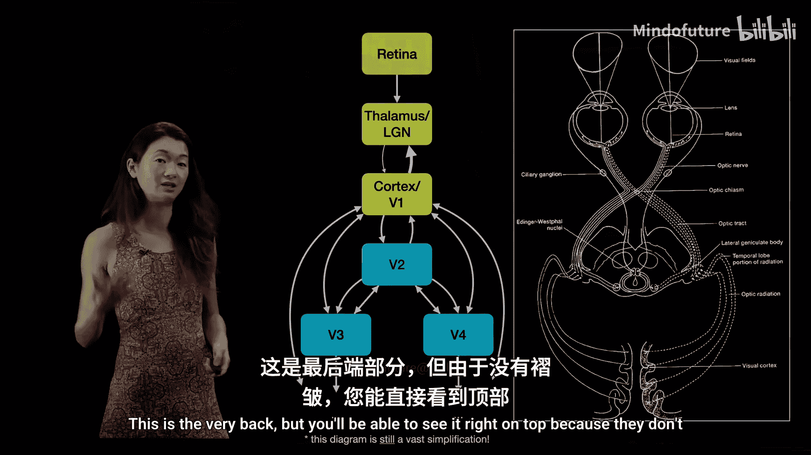

这一切都是使用尖锐电极完成的。这是一个简单的环路水平示意图，直观展示了这可能如何工作。

我们有许多“中心-给光”视网膜神经节细胞平铺在空间上。相邻细胞的感受野中心略有偏移。想象一下：我们取一堆具有相邻感受野的这种细胞，将它们全部连接到LGN，然后让一堆LGN神经元汇聚到一个单一的V1细胞上。

通过这种方式平铺空间，如果有一个棒状物恰好处于那个方向，它将激活所有这些视网膜神经节细胞和LGN细胞，从而使我的V1细胞兴奋。但由于我的连接方式，如果我的棒状物方向相同但位置偏移一点，我将抑制而不是激活我的神经元。同样，如果棒状物重叠于该区域，但角度不完全正确，我的V1细胞也不会“开心”。这会让另一个V1细胞非常“开心”，只是不是这个。类似地，如果刺激的空间频率不对（棒状物不够窄），它实际上会激活整个区域，因为它弥散地激活了所有这些视网膜神经节细胞和LGN细胞，V1细胞也不会“开心”。

所以它非常特异，特异于这个特定角度。

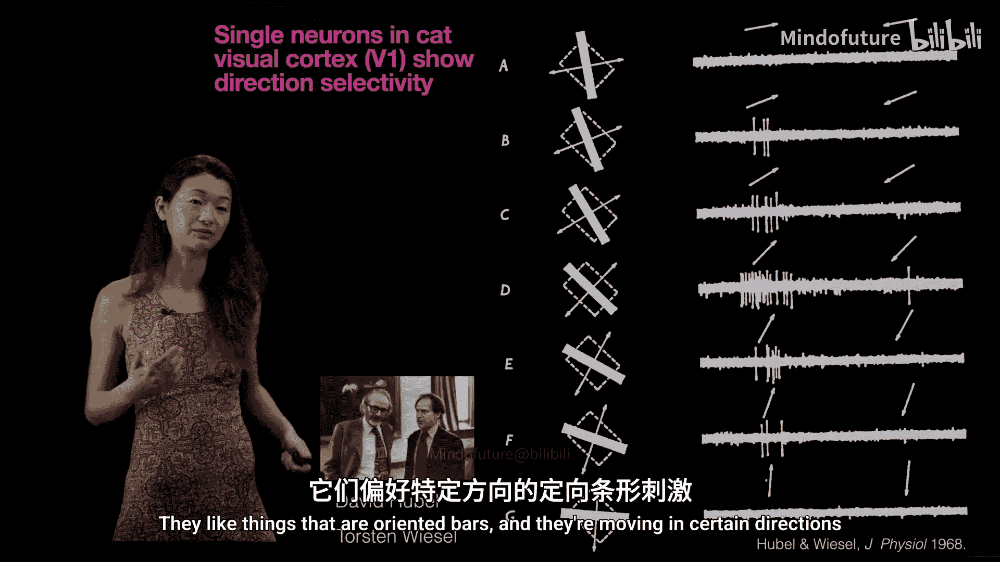

如果它在空间上偏移一点，它不会“开心”；如果偏移某个角度，它也不会“开心”，那会让其他地方的其他V1细胞“开心”，因为我会有另一个V1细胞，它加总的不是这些特定的“给光”感受野，而是可能具有不同角度的感受野。

因此，通过使用视网膜神经节细胞和LGN中这些“给光”感受野的阵列，根据我如何连接它们，我可以实现获得对不同空间部分、不同方向棒状物敏感的V1细胞的目标。

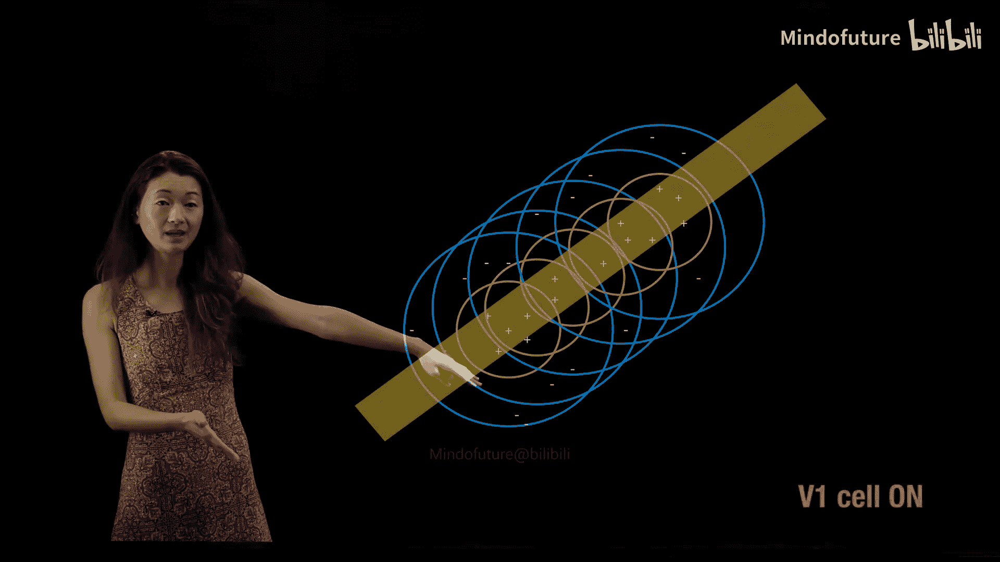

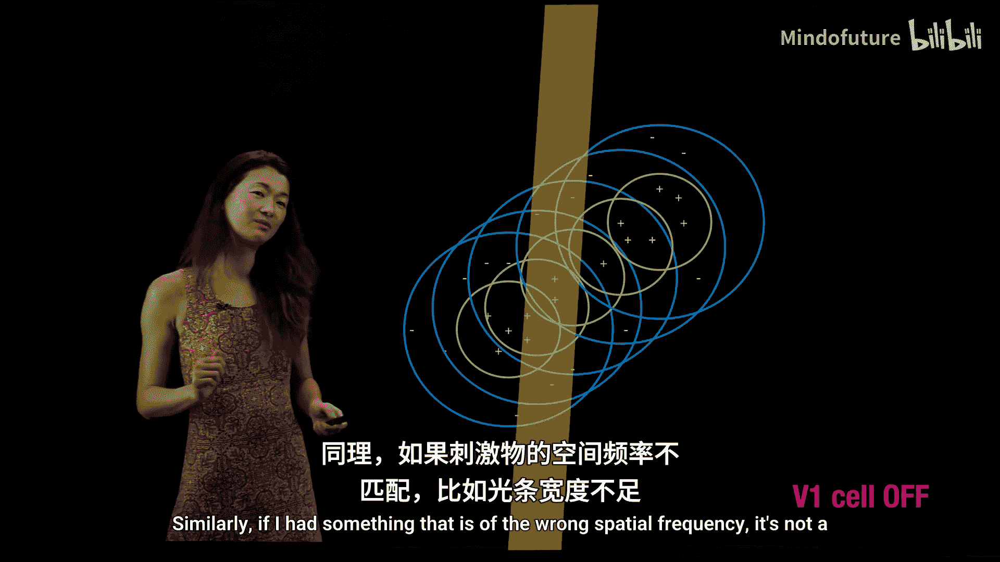

如果你把所有东西放在一起，本质上这就是一个**卷积滤波器**。用数学方式表达：这是一个空间上的卷积滤波器。每一个空间感受野都相当于一个卷积滤波器，因为我们有很多个，它们类似，你只是在空间上移动它们。

当你以这种方式将它们连接起来，并将它们的激活加总到一个V1神经元时，这基本上就是**池化**。我特意使用这些术语，以防让那些思考过人工神经网络，特别是卷积神经网络的人有所联想。

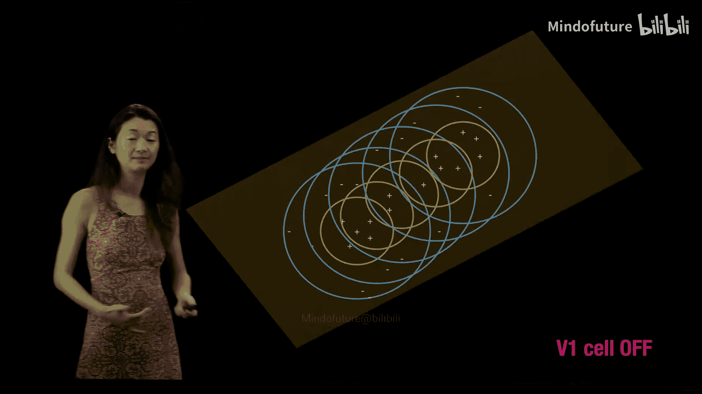

这是一个来自Fukushima及其同事于1980年发表的第一篇真正现代卷积神经网络论文中的“Neocognitron”图。

这并非偶然。这是一个卷积神经网络，而第一个卷积神经网络正是受到了哺乳动物V1系统组织结构的启发。事实上，你甚至能在这个架构中看到：卷积之后是池化。在第一篇Neocognitron论文中，你可以看到这些堆叠在一起的层：S和C。S实际上代表**简单细胞**，即V1中对有方向棒状物敏感的这种细胞类型。C实际上代表**复杂细胞**（我还没介绍，但那是V1中另一种主要的细胞类型，稍微复杂一些）。这个名称表明是简单细胞，但通过以这种方式串联视觉系统中的这些环路，你也可以通过一系列卷积和池化来构建它。

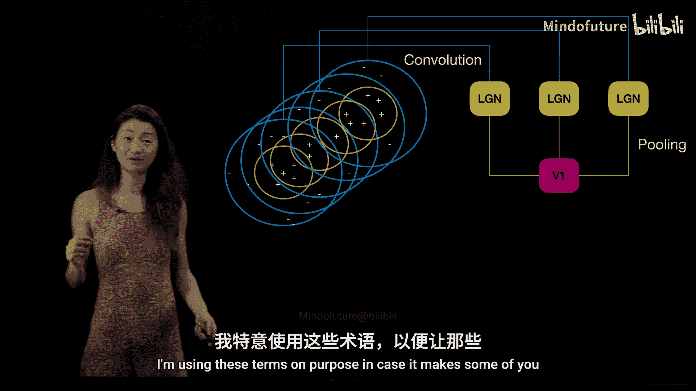

因此，Fukushima及其同事受到了当时我们所知的V1神经生物学组织、结构和环路的启发，构建了这个人工神经网络，最终催生了2012年左右兴起的人工神经网络。这是AlexNet、ImageNet以及所有基于其构建的技术的思想先驱。这个从V1到LGN到视网膜的“卷积后接池化”等思想，确实很酷。

但V1的组织结构不止于此，因为它不仅仅是关于这些有方向的棒状物。有方向的棒状物实际上存在于另一种称为**视网膜拓扑映射**的结构中。

视网膜拓扑映射是指：视网膜上相对接近的区域，也会投射到LGN和V1中相对接近的区域。我们可以在这里看到：如果将中央凹划分为这些象限，我之前说过，所有信息都会交叉，所以你左半边的视野会投射到右半脑，反之亦然。在你的中央凹，这两个光感受器斑块实际上会投射到对侧V1，所以3靠近4，3靠近7。它们会靠得很近。

因此，基本上，视网膜上视觉空间的倒置镜像图会反映在LGN和V1中，以一种倒置的方式。

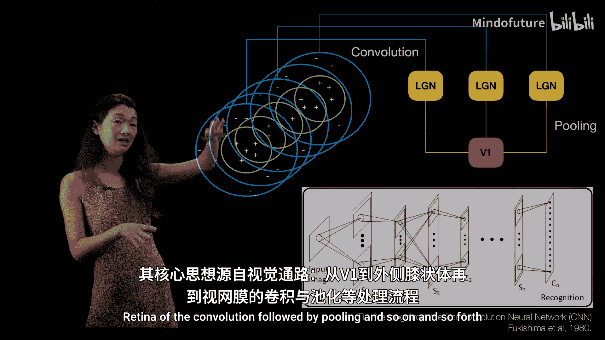

这里我要强调两个概念，为后面几节课做铺垫：这种倒置是我们在所有感觉运动区域常见的一种模式。例如，我左臂的一半由右半脑的运动皮层控制。所以这种倒置我们经常看到。

另一个我们经常看到的是身体与其在大脑中表征之间的映射。这里我们看到的是视网膜上的视觉场景与视觉皮层之间的映射。听觉皮层也是如此：不同音调频率（钢琴键的位置）映射到你的听觉皮层。皮肤上不同触觉感受器斑块也有映射：皮肤上相邻的区域由这些触觉感受器支配，它们也会投射到大脑中相邻的位置，同样也是倒置的。

这些原则我们在许多感觉运动区域都能看到。所以，存在某种映射、它是镜像、但保留了相邻区域相对局部性的通用原则：腿的相邻区域映射到大脑的相邻区域；视野的相邻区域映射到视觉皮层的相邻区域。这是我们共同拥有的特征。

除了相邻细胞覆盖视觉空间中相邻位置外，我们还看到所谓的**方向选择性**。我提到过，V1中不同的细胞对不同方向的棒状物敏感，这形成了美丽的“风车”模式：覆盖空间中相邻位置的相邻细胞，在它们敏感的方向上也彼此相邻。

这种风车模式是我们通常在灵长类（包括人类）中看到的。并非所有哺乳动物都如此，更不用说许多非哺乳动物了。因此，研究这些选择性模式在V1中的进化起源和跨系统发育树的比较模式，以及思考它们如何在发育过程中产生，是另一个迷人的领域。这或许可以单独讲一节课，但现在我只是提一下，不会深入探讨。

关于V1细胞的组织结构已经讲了很多，但我想谈谈为什么我们认为V1细胞以这种方式组织。这是一个“为什么”的问题，在神经科学中回答这个问题总是有点危险，因为我可以告诉你发生了什么（我刚告诉你了），但“为什么”以这种方式组织？它有什么好处？

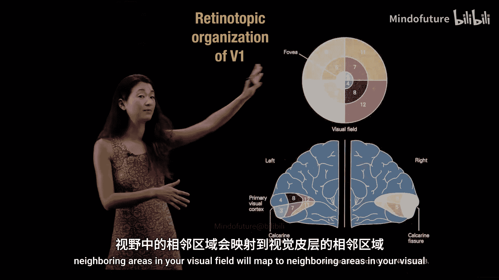

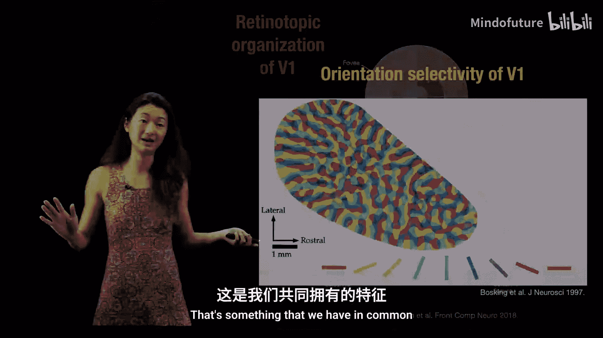

多年来有很多尝试回答这个问题。这是一篇现在已成为经典的论文，由Olshausen和Field提出，他们提出了所谓的**稀疏编码假说**。

其思想如下：你的视觉系统完全不像CCD传感器，不仅仅是一个像素阵列，告诉你一个XY网格上每个部分击中了多少光子。完全不是这样。相反，图像是在一个**功能基**上表示的，它被转换成一种表征，不是基于像素及其激活，而是基于**哪些模式被激活**。这至少在你到达V1时，是视觉系统中发生的情况。

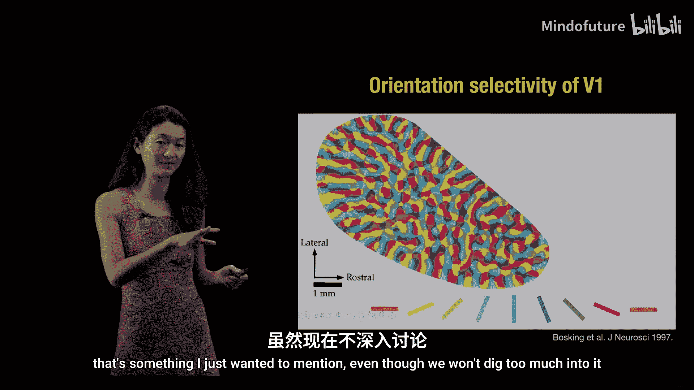

他们建立了以下数学模型：假设对于每个图像（X, Y坐标），比如一个某种大小的方形图像，我可以将这个图像分解为一系列功能基的叠加。公式表示为：

`图像 = Σ (系数_i * 基函数_i)`

其中，那些 `φ` 是基函数，那些 `a` 是系数，即所有基函数的相对激活。

到目前为止，这相当通用。例如，这些基函数也可以是傅里叶模式、小波模式，或者任何你为了方便而选择的基函数。可能是傅里叶变换，可能是主成分模式，可能是各种不同的东西。

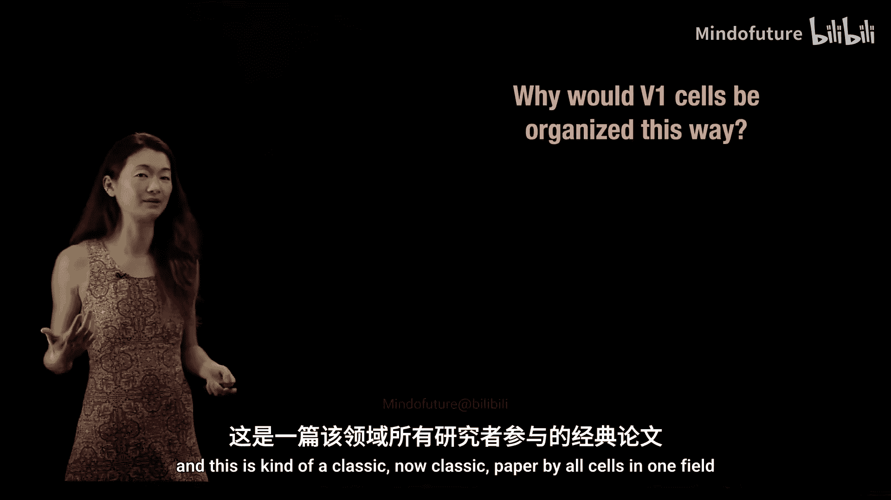

但他们所做的是：他们说，好吧，这是我们想要的分解，但我们不指定这些基函数是什么，我们实际上要**学习**它们是什么。具体来说，我们将通过做出以下假设来尝试学习它们：我们将最小化以下损失函数。

我们将学习一组基函数，使其尽可能**稀疏**。换句话说，我想要一个非常简单的基，这样对于任何我想表示的图片，我希望激活尽可能少的神经元。我不希望所有神经元都活跃来描述这张图片，我希望激活尽可能少的基。

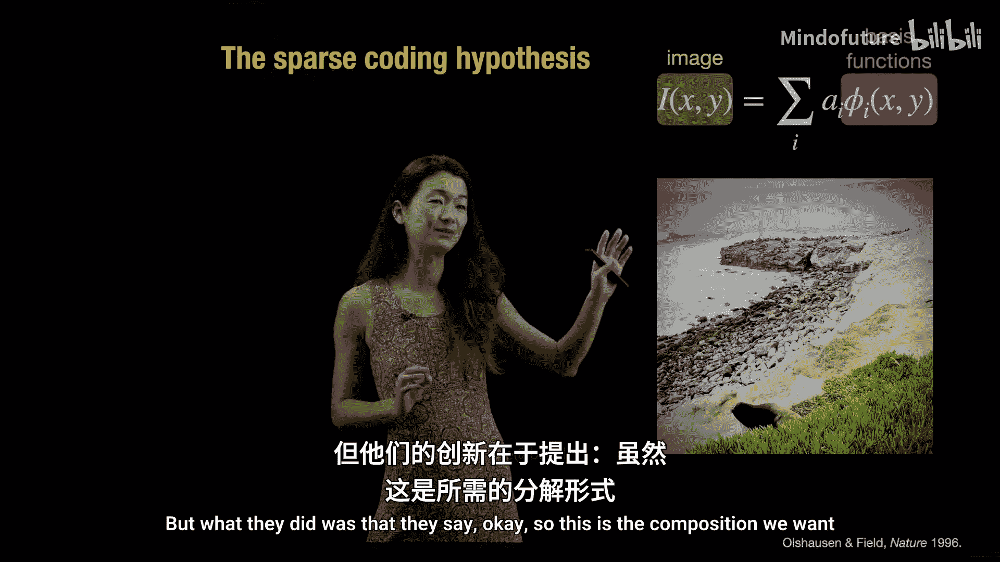

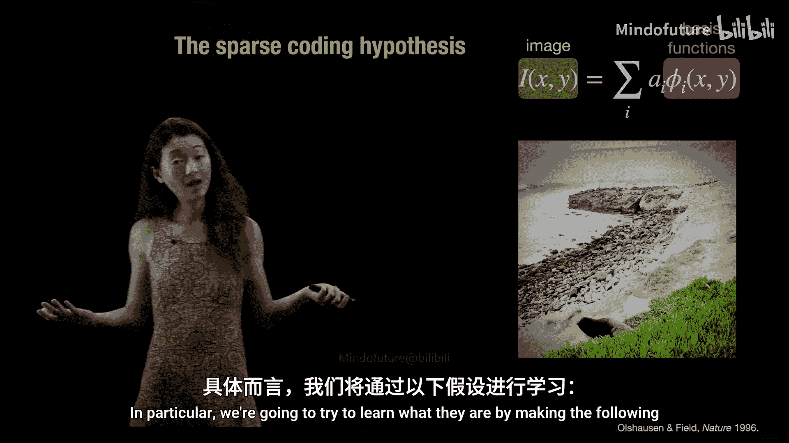

用数学形式写下来，他们（1996年的Olshausen和Field）最小化了以下损失函数。他们首先有一个**重建误差**，当然，基函数必须能够表示图像，不能是无法表示图像的东西。然后他们有一个**促进稀疏性的项**，他们尝试了几种不同的促进稀疏性的方法，这里写出其中一种：所有用于表示基函数和重建图像的系数绝对值之和。

所以这是他们试图最小化的损失函数：你想要小的重建误差，同时也想要小的稀疏性（即系数尽可能多地为0）。到目前为止，一切都好。

现在会发生什么？我要训练一个东西来做这个。我可以在随机图像上训练它，也可以在自然场景图像上训练它。

我们之前稍微讨论过从随机图像计算感受野，以及如果你不想校正统计依赖性，这是一个非常好的主意。这在Olshausen和Field的形式化中也成立。

他们表明，如果你在随机图像上训练，得到的基函数（感受野）基本上只是点状。

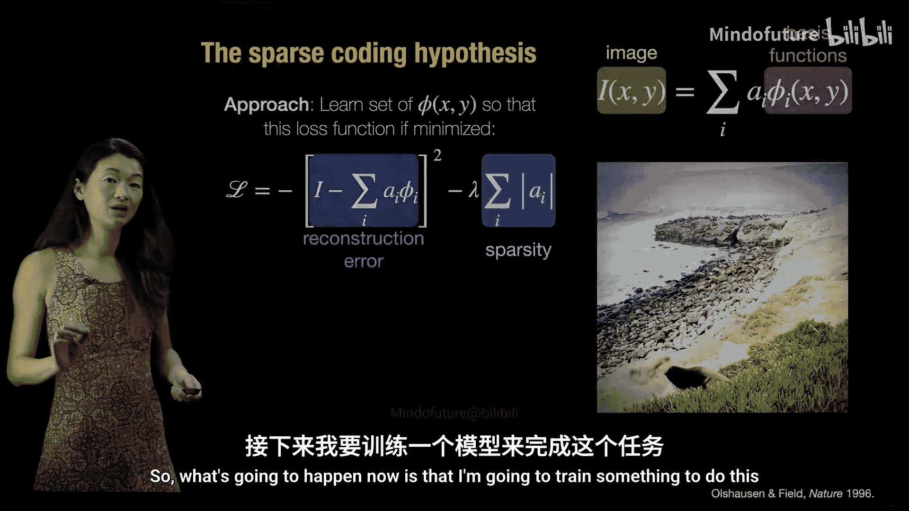

但在一套非常巧妙的逻辑中，他们推理并证明，如果你在**自然图像**上训练这个损失函数（因为我们从未在现实世界中看到那些随机图像，除了人造物），当你走在世界上，你会看到树木、动物、海洋、天空、云朵等。如果你用这些自然图像来训练一个网络以最小化这个损失函数，你会得到一组看起来非常像我们在视觉皮层中实际看到的感受野。

这些感受野是类似Gabor滤波器的有方向棒状物，看起来非常像我们在哺乳动物V1中实际看到的东西。这是一个关于它们为何如此的非常有趣的见解。这是一种通过构建来证明：哺乳动物V1可能试图让每个V1细胞形成一个尽可能稀疏的基。这样，当你在现实世界中行走，看到具有自然图像统计特性的自然图像时，你可以用尽可能少的激活V1细胞来表示这些信息。

这是一个很酷的结果，有很多后续研究。我认为稀疏编码假说不仅是视觉科学，也是整个神经科学中更具影响力的假说之一。我们将在其他感觉运动领域讨论稀疏编码假说。

在神经系统**中尽可能少地激活细胞**这一思想，也是一个你会反复看到的主题，因为细胞是昂贵的。激活和维持神经元是昂贵的，所以如果你能尽可能少地使用它们，这可能是进化过程中被选择的一个优点。

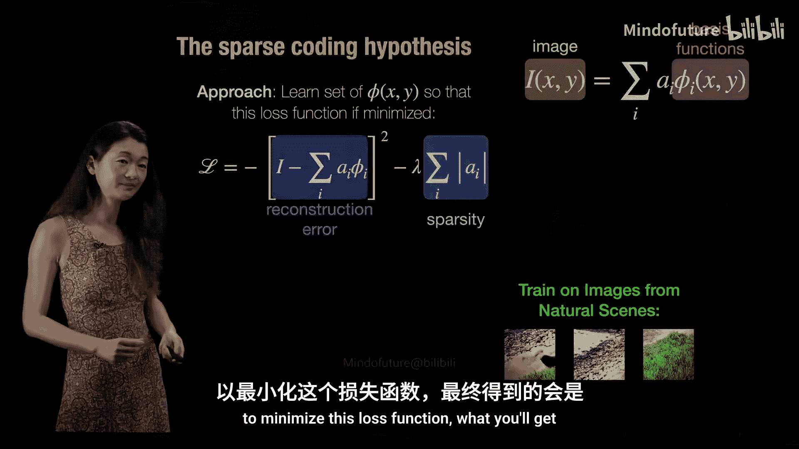

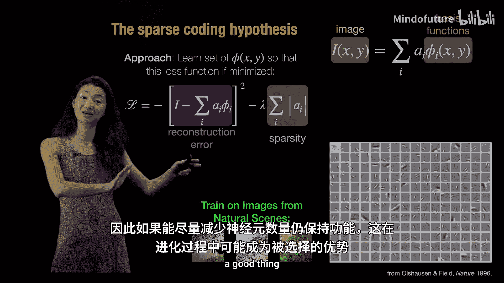

以上是对视觉环路的介绍，其中我也指出了几个不仅对视觉环路，而且对我们在神经生物学中看到其他类型环路也常见的特征。

核心概念是：这些环路不是由相同的细胞构成的，通常有不同的细胞类型，这很重要，因为不同的细胞类型有不同的功能。有些是正的，有些是负的，如果你以正确的方式连接它们，你可以用相当少的部件完成相当复杂的计算。

我们将这些特征称为**感受野**。在处理的每个部分，我们都可以用感受野来概括外部刺激与该细胞内部活动之间的关系。我们讨论了“给光”感受野、“撤光”感受野、有方向棒状感受野等。所以这是一个需要记住的重要术语：这些东西被称为感受野，我们可以计算它们。

视网膜神经节细胞是视网膜的最终输出。大脑其他部分无法直接接收视网膜中其他细胞类型的输出，这就是为什么我们如此关注视网膜神经节细胞。因为如果我们理解它们在做什么，它们如何向大脑其他部分输出，我们至少能了解进入大脑其他部分的信息是什么，因为大脑其他部分没有反馈回视网膜。

视网膜神经节细胞通常被概括为“给光”或“撤光”感受野，取决于它们是喜欢中心光点还是中心黑暗。它们根本不是真正的像素。

这种处理水平，这种绘制小环路图并通过推理我们如何在LGN、V1甚至更高视觉区域计算感受野的方式，我们可以继续做下去。总的趋势是，随着你在视觉处理通路中走得越远，会出现越来越复杂的感受野。

在更高的视觉区域，你会开始看到对运动敏感的东西，还有对面孔敏感的东西。当然，先有棒状物，然后有运动，然后有圆形，然后有面孔，等等。因此，越来越复杂的感受野从简单的部件中涌现出来。毕竟，如果你想对面孔敏感，你可能需要一个三角形检测器来检测眼睛、鼻子和嘴巴之间的三角形，可能需要圆形检测器来检测眼睛。

因此，通过观察感受野，并以复杂程度递增的层次构建它们，并以巧妙的方式连接它们，你可以直观地理解我们如何构建这些更复杂的视觉区域，从而让我们能看到不仅仅是点和线的东西，而是能构建更复杂的东西，比如面孔。

---

本节课中，我们一起学习了视觉信息处理的基本环路。我们从视网膜的“中心-外周”感受野和侧抑制开始，理解了对比度增强的基本原理。接着，我们探讨了如何通过计算 spike-triggered average 来表征LGN神经元的时空感受野。然后，我们看到了V1初级视觉皮层中方向选择性细胞的产生，这类似于人工神经网络中的卷积和池化操作。最后，我们介绍了稀疏编码假说，从计算角度解释了V1细胞感受野的形成原因，即为了用最少的神经元活动高效地表征自然图像。这些核心概念和环路模式，不仅是视觉系统的基础，也广泛存在于其他感觉和运动系统中。