神经科学入门：P21：化学感觉：味觉与嗅觉 👃👅

在本节课中，我们将要学习化学感觉，即味觉与嗅觉。我们将探讨这两种感觉的基本原理、它们之间的区别与联系，并通过一个简单的小实验来理解嗅觉如何极大地影响我们对“味道”的感知。

---

我们接下来的探索之旅将聚焦于味觉与嗅觉。我们将跟随嗅觉的指引，讨论化学感觉的下一步。这一系列讲座非常有趣，不仅因为我个人非常喜欢食物并乐于谈论它，还因为动物探测周围化学环境的能力是一种普遍存在且在进化上至关重要的行为。

例如，如果你是一条海洋中的鱼，你可能会通过探测水中的气味来判断自己来自哪条溪流，并决定返回何处产卵。或者，如果你是一只昆虫，你会在嗅觉环境中飞行，寻找可以进食、享用并产下下一代卵的腐烂水果。作为人类，跟随鼻子寻找下一餐的想法对我们大多数人来说并不陌生。如果闻到香味，我们可能会想过去看看，心里想着“那边在煮什么？那就是我想吃的”。

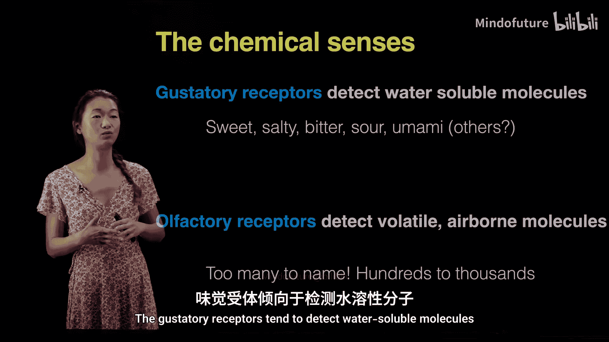

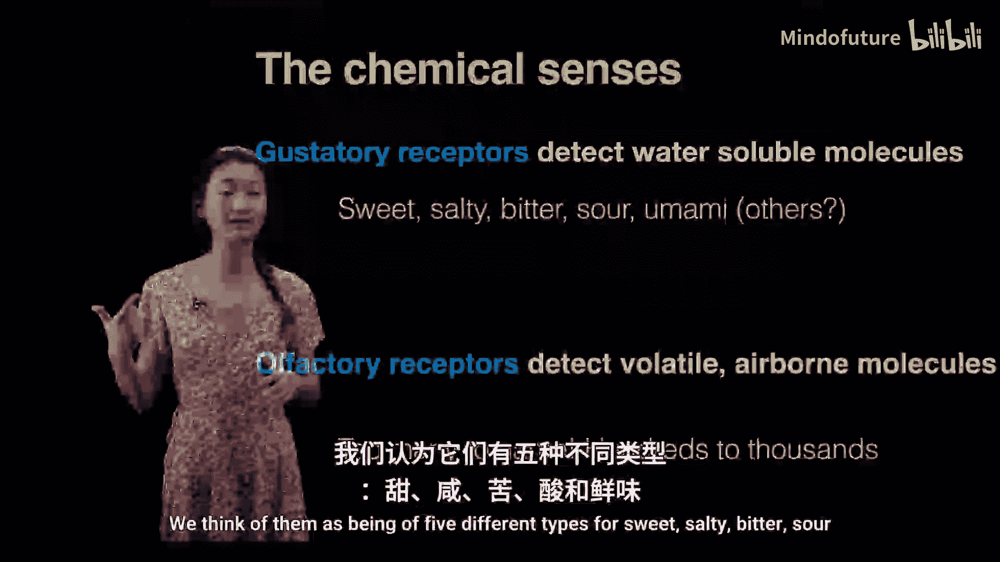

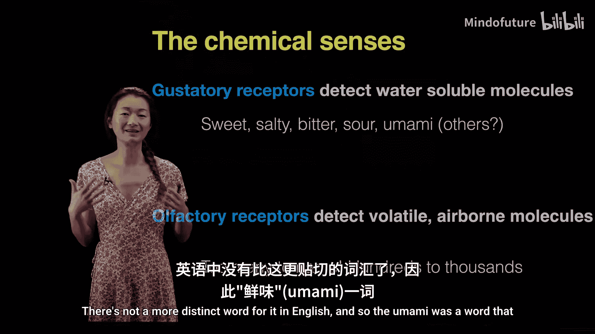

我们的化学感觉通常分为味觉和嗅觉。这里我要指出几点区别，尽管它们并非完全遵循截然不同的规则。

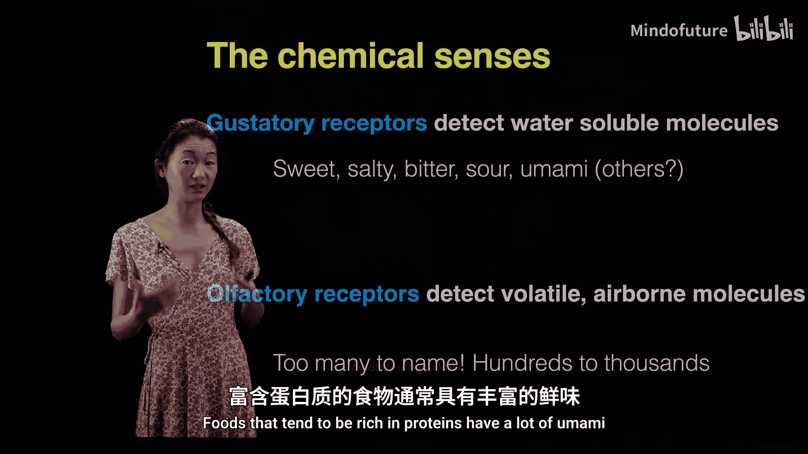

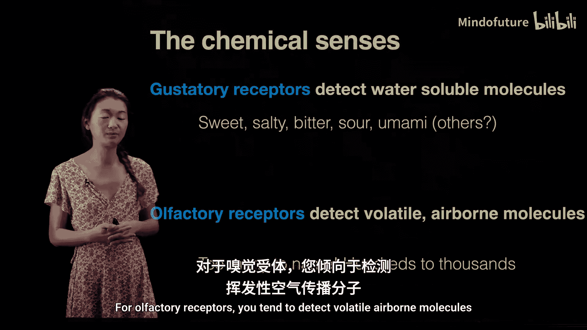

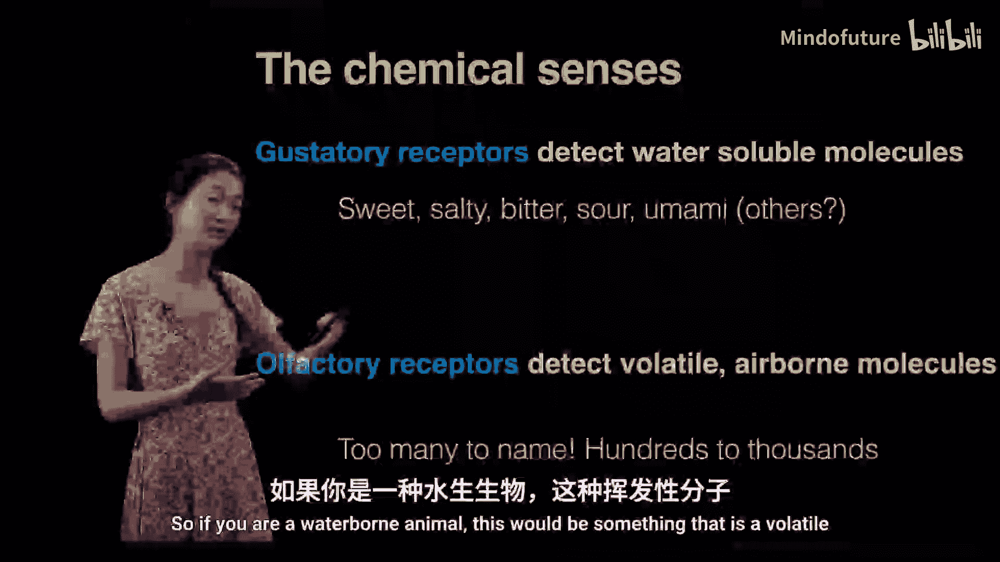

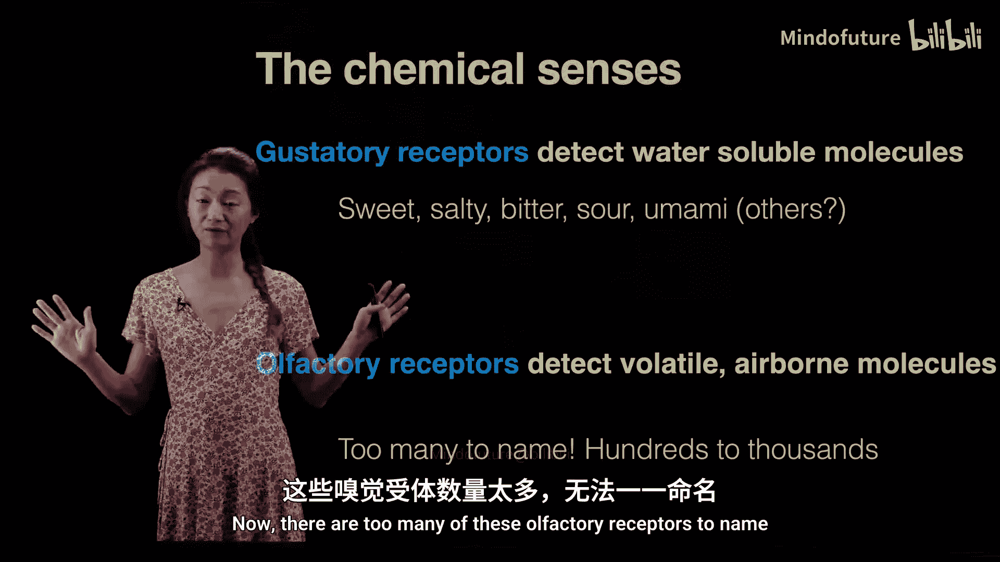

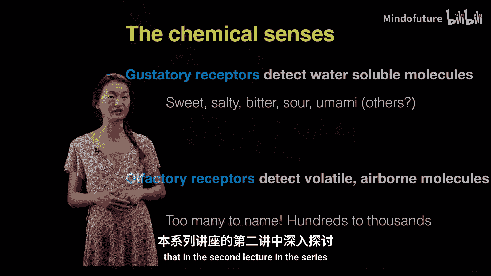

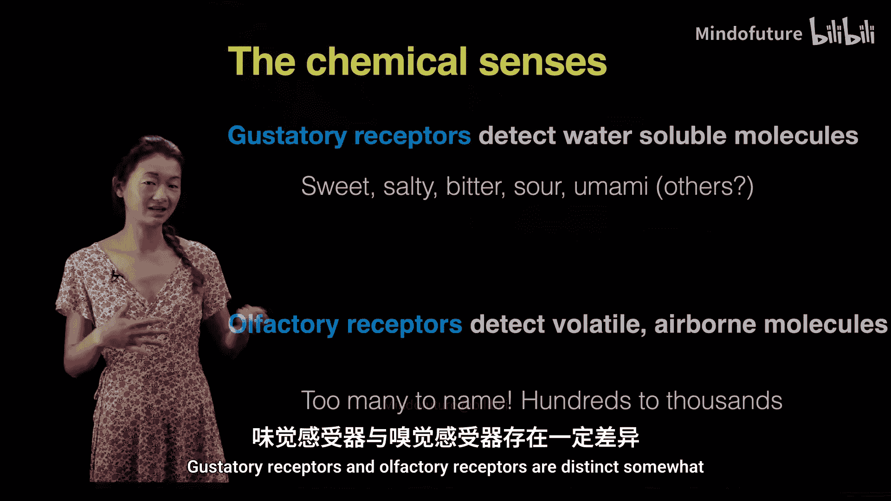

味觉感受器倾向于检测水溶性分子。我们认为它们有五种不同类型，分别对应甜、咸、苦、酸和**鲜味**。鲜味是我们对“鲜香”的感觉。英语中没有更明确的词来描述它，因此“umami”这个词是从日语借用到英语中，用以表示鲜味。富含蛋白质的食物通常具有很多鲜味。

嗅觉感受器则倾向于检测空气中漂浮的挥发性分子。如果你是一种水生动物，这指的就是在海洋中漂浮的挥发性分子。嗅觉感受器的种类多到难以命名。人类有数百种，其他哺乳动物甚至有数千种。这是一套非常复杂的感受器系统，我们将在本系列的第二讲中详细讨论。

因此，味觉感受器和嗅觉感受器是不同的，但它们在解剖结构上也密切相关。例如，两者都位于面部区域，即你的鼻子和嘴巴附近。舌头上有很多味觉感受器，它们也分布在上颚。鼻腔是你通过鼻子吸入空气的地方，那里也分布着许多嗅觉感受器。此外，你的口腔后部有一条通道向上通往鼻子。因此，味觉和嗅觉这两种感觉并非真正分离，在许多不同动物中它们也是不可分割的，我们稍后会看到一些例子。

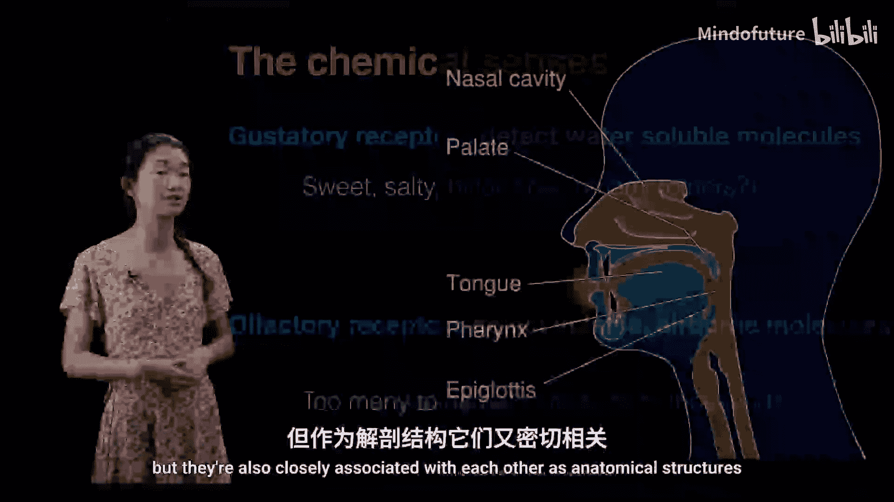

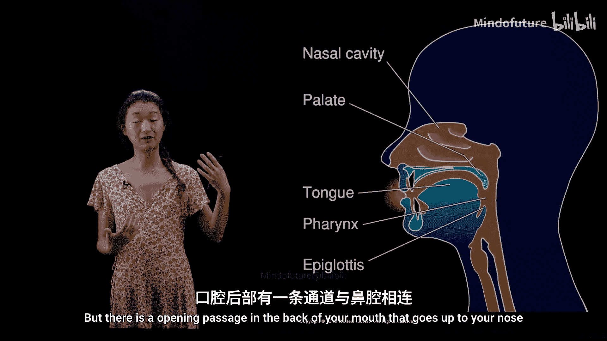

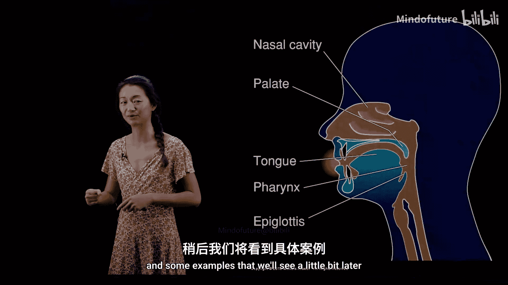

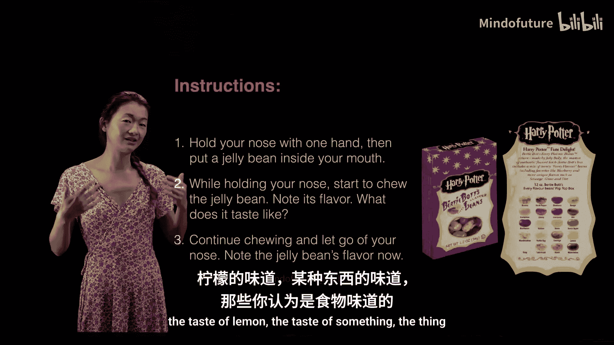

为了说明这一点，我们将以一个演示开始本讲。我鼓励你跟着一起做这个实验。

以下是实验步骤：

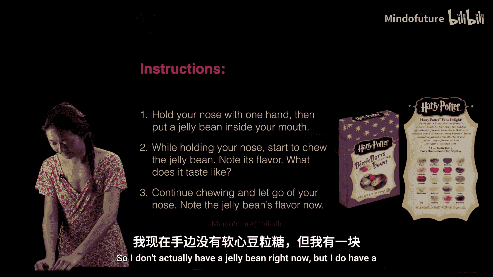

1.  找一颗软糖或某种糖果。
2.  捏住鼻子，防止空气进出，从而阻止嗅觉被激活。
3.  将糖果放入口中咀嚼，注意它尝起来是什么味道。
4.  在继续咀嚼的同时，松开鼻子，注意风味发生的变化。

这个演示旨在说明，当你想到“柠檬的味道”或某种食物的“味道”时，你通常想到的并非其真正的味觉，而是其味觉与嗅觉的结合。为了清晰地证明这一点，我进行了这个实验。我使用了一颗紫罗兰口味的糖果。捏住鼻子，将糖果放入口中。它尝起来像糖。然后松开鼻子，一旦闻到气味，紫罗兰的香味瞬间充满我的鼻腔，糖果尝起来就像紫罗兰糖了。这就是你应该注意到的现象。

根据你选择的软糖口味，效果可能不同。柑橘口味的软糖效果通常很好。紫罗兰糖果效果也很好。但有些口味的软糖，这个演示效果不佳，例如肉桂味或辛辣味的软糖。至于原因，你需要结合本讲以及关于躯体感觉的讲座知识来理解。

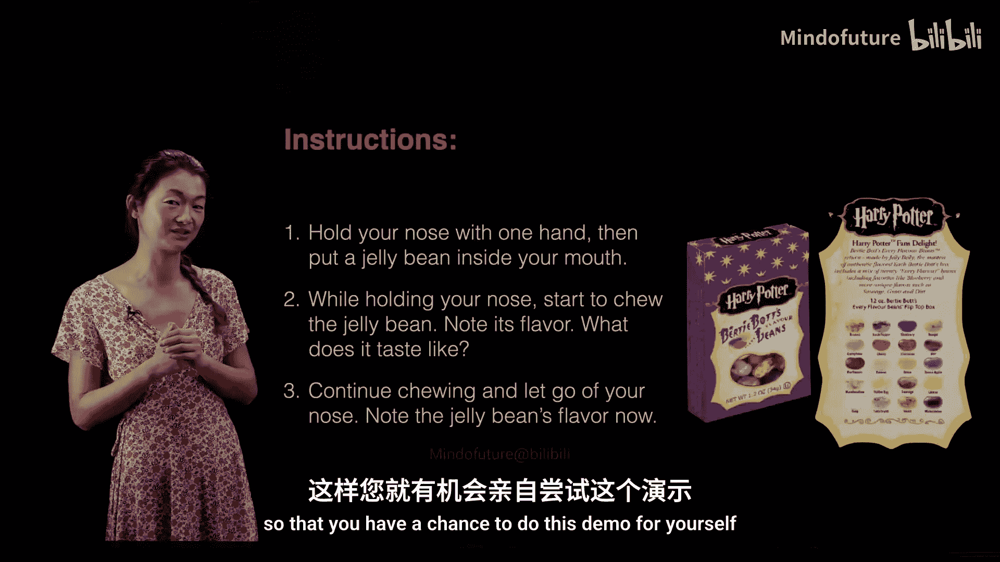

本节课中我们一起学习了化学感觉的概述，区分了味觉与嗅觉的基本原理，并通过一个生动的实验体验了嗅觉对整体风味感知的关键作用。在接下来的视频中，我们将深入探讨味觉感受器和嗅觉感受器的具体工作机制。