# 022：味觉感受的神经生物学 👅

在本节课中，我们将要学习味觉系统。我们将从味觉系统的初级感觉神经元开始，探讨它如何检测不同的化学味觉，以及这些信息如何传递到神经系统的其他部分。

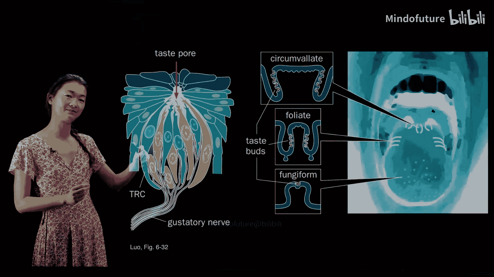

## 味觉感受器与味蕾

味觉感受器位于你的舌头上。如果你放大舌头并在显微镜下观察，会注意到它有许多微小的凸起结构。进一步放大这些凸起结构，你会看到单个的味蕾。每个味蕾内部都有一束细胞，其中包含了所有的味觉感受器细胞。味蕾中间有一个小孔，称为味孔。溶解在化学环境（如你正在吃或喝的东西）中的化学物质可以通过味孔进入，接触到味觉感受器细胞。这些味觉感受器细胞会检测特定的化学物质，并将信息通过舌头的味觉神经传递出去，投射到神经系统的其他部分。

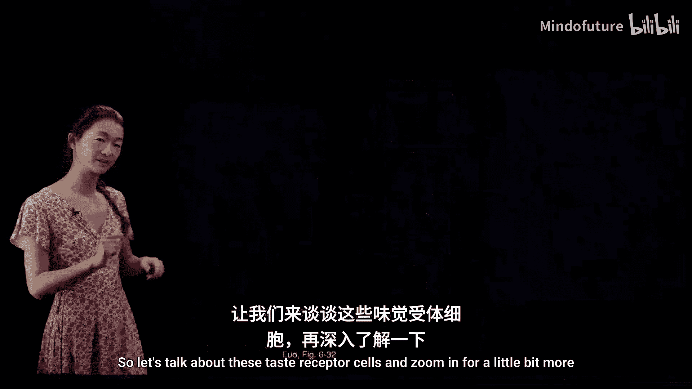

## 味觉感受器细胞的结构

让我们更仔细地观察这些味觉感受器细胞。它们的结构对你来说应该并不陌生，因为这种组织方式——局部的初级感觉神经元投射到某种神经节细胞，再由神经节细胞投射到神经系统的其他部分——与我们之前在视网膜系统中看到的完全一样。味觉系统稍微简单一些，因为中间的细胞层更少。它基本上只在初级感觉神经元和神经节细胞之间传递信息。在视网膜中，我们有光感受器、多种双极细胞、无长突细胞和水平细胞，然后信息才传递到视网膜神经节细胞。因此，视网膜中进行的计算比味觉系统中进行的要复杂得多，但基本思路是相似的，只是更简单一些。

我们有初级味觉感受器细胞。味觉感受器细胞本身没有轴突。它们检测味道（例如糖的甜味或苦味），我们稍后会讨论其分子基础。无论检测到什么，它们都会通过在其底部释放神经递质来激活味觉神经节神经元。这些神经节神经元就像视网膜神经节神经元一样，是唯一将信息投射到神经系统其他部分的细胞。因此，初级味觉感受器本身的信息永远不会直接传递到神经系统，只有通过激活味觉系统中的神经节细胞，信息才能传递出去。

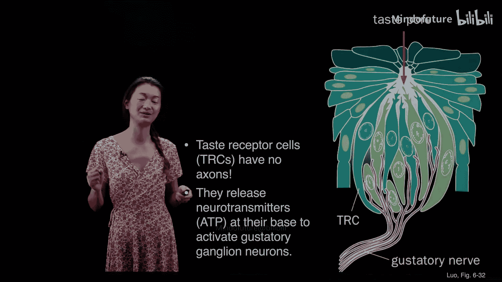

关于这些味觉感受器细胞的一个有趣事实是，它们使用ATP作为神经递质。作为生物学家，我们都知道ATP是细胞使用和传递能量的主要方式。但在这种情况下，味觉感受器细胞实际上使用ATP作为一种神经递质。这是一个有点特别的神经递质选择。但如果你想一想，鲜味感受器实际上是被谷氨酸作为配体激活的。当环境中存在谷氨酸时，它会尝起来很鲜美，因为谷氨酸是一种氨基酸。因此，当你的感受器试图检测环境中的谷氨酸时，你不能使用谷氨酸作为神经递质也就不足为奇了。所以这里它们使用了ATP。

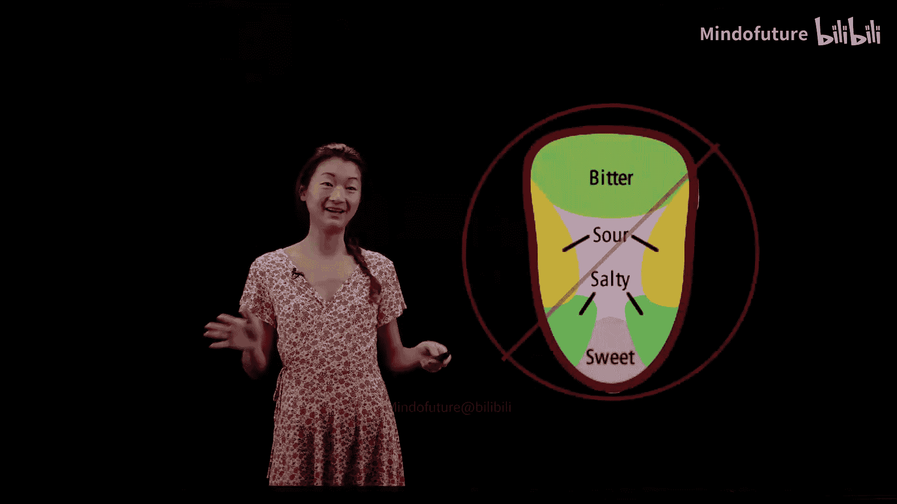

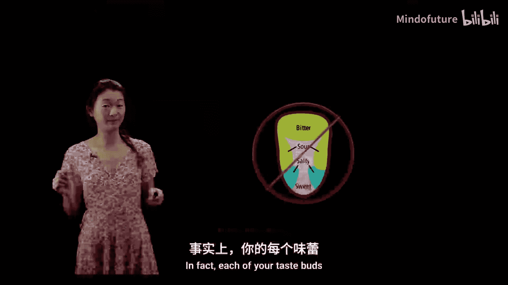

## 味觉分布图：一个误解

我记得在小学时，有一节科学课上，我必须给一张舌头地图涂色，标出负责不同味道的区域。多年来我一直以为这是真的。你可以想象当我第一次得知这完全不正确时有多惊讶。在味觉系统中，事实并非如此。实际上，你的每一个味蕾都包含所有五种化学味觉的感受器。因此，味蕾的定位确实意味着你舌头的不同部位对味道的敏感度不同，但绝对没有证据表明不同类型的味道定位在舌头的不同区域。我知道有些人声称吃某些东西有正确的方法，必须放在嘴里的不同部位，但这可能与质地、气流或其他因素有关，而不是因为味觉感受器在舌头上的定位不同。

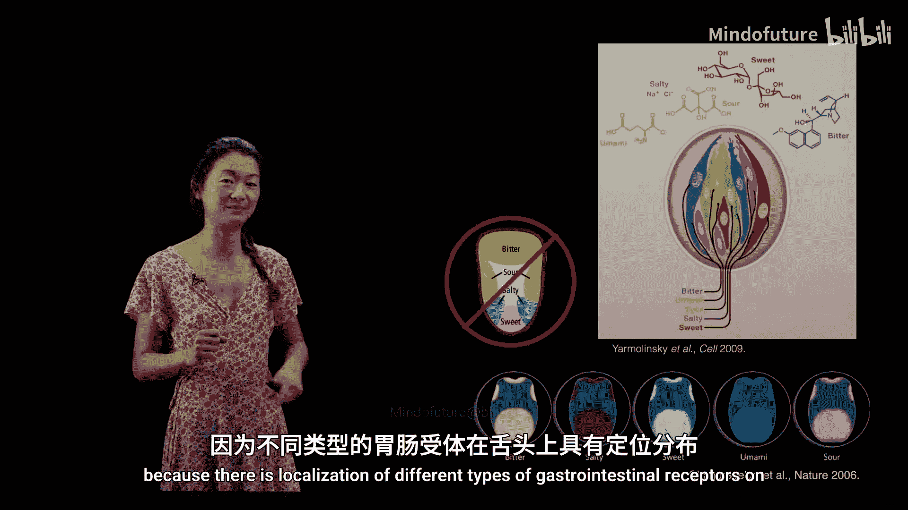

## 味觉感受器的分子机制

现在让我们谈谈味觉感受器是如何工作的。以下是你的味觉感受器，我先展示其中四种，第五种稍后再谈，因为它是一个特例。我们有鲜味、甜味和苦味。这三种感觉都是由G蛋白偶联受体介导的。这并不奇怪，因为GPCRs非常重要。如果你忘了它们是什么，可以回顾我们之前关于代谢型突触后受体的讲座，那是我们第一次介绍GPCRs。我们在视觉讲座中也看到了GPCRs，因为视蛋白（负责在视觉系统中检测光和光子的蛋白质）也是GPCRs。所以它们在这里再次出现并不奇怪，因为我们在神经系统的各个部分以及身体的其他细胞分子生物学中经常看到它们。

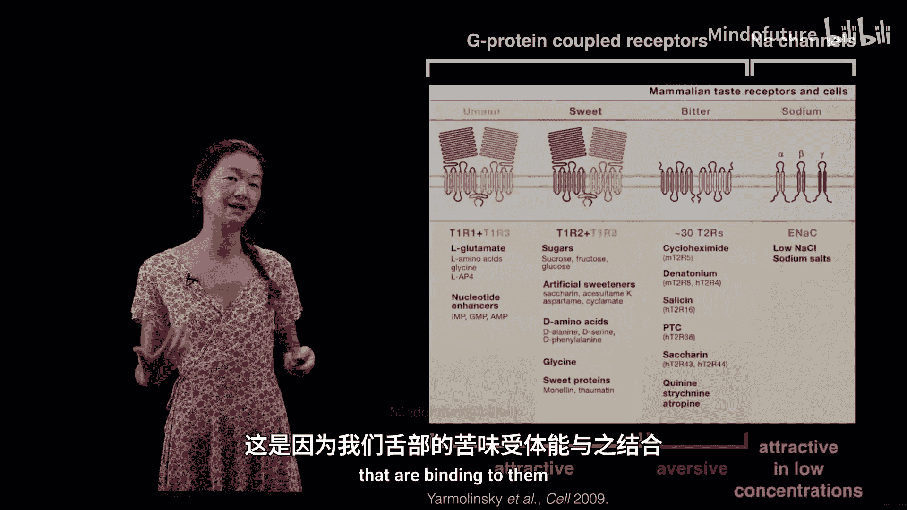

鲜味检测鲜美的味道，甜味检测甜味。这两种通常被认为是吸引性的味觉感受器，因为你通常会寻找味道好的食物，你想要高热量且不会杀死你的东西。另一方面，苦味感受器是GPCRs，通常对你的身体有相反的效果。对大多数哺乳动物来说，它们是厌恶性的。这是因为苦味往往与对身体有毒或有害的物质有关。例如，奎宁、士的宁和阿托品等物质都被感知为苦味，因为我们舌头上有能与它们结合的苦味感受器。

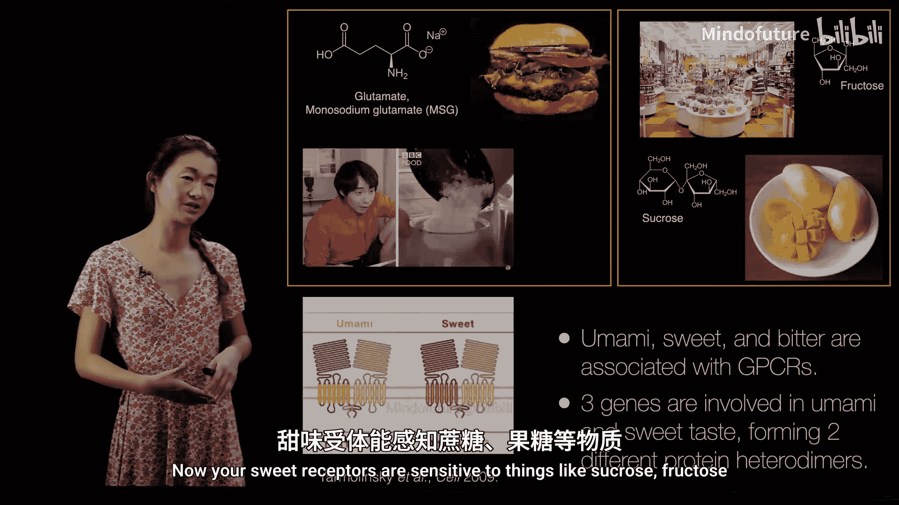

首先，让我们多谈谈鲜味和甜味感受器。它们是GPCRs，实际上有三个基因形成了两种不同的蛋白质异源二聚体，构成了你的鲜味感和甜味感。如前所述，鲜味是富含蛋白质的味道，谷氨酸是一种氨基酸。因此，你可能需要一个对谷氨酸敏感的味觉感受器，包括味精，它能让食物尝起来更鲜美。鲜味感受器是由T1R1和T1R3组成的异源二聚体。如果你将T1R3与T1R2结合在一起，就得到了甜味感受器。所以，这三个基因形成了这两种不同的感受器，它们密切相关，能够相互形成不同的构型，构成了你的鲜味感和甜味感。你的甜味感受器对蔗糖、果糖以及其他几种糖类（如乳糖）敏感。还有一些其他天然存在的分子以及各种人工甜味剂也能与这些甜味感受器结合。

## 一个思想实验：老虎与熊猫

既然我们已经讨论了这两种密切相关的味觉及其背后的基因，我想进行一个思想实验。这里有两只动物：一只老虎和一只熊猫，它们都属于食肉目。问题是，根据你对它们饮食习惯的了解，猜猜哪种味觉感受器在哪只动物身上缺失了？

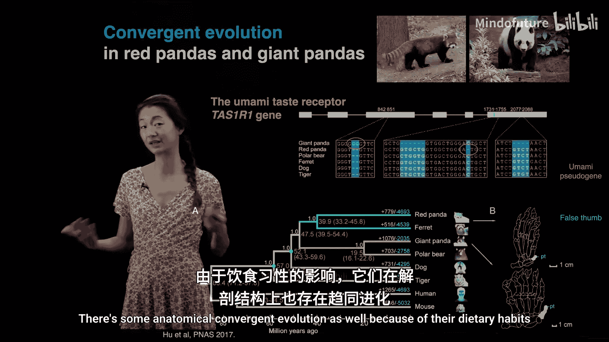

你可以思考一下。老虎是食肉动物，除了肉什么都不吃。所以它们真的没有对甜味的喜好。事实上，如果你查看它们的基因组，你会发现老虎已经失去了甜味感受器基因，它们不再拥有这些基因。另一方面，熊猫虽然是食肉目动物，但已经失去了对肉的喜好，它们是素食者，只吃竹子。因此，它们实际上已经失去了鲜味感受器，不再对鲜味有感觉。它们确实有大量额外的苦味感受器，因为这与它们的饮食习惯有关。

这是一个关于趋同进化的美妙故事。小熊猫和大熊猫在进化上是不同的谱系，但你可以看到，尽管它们彼此没有亲缘关系，却独立进化出了突变，导致它们不再拥有鲜味感受器。在红熊猫和大熊猫中，这些基因都变成了不再活跃的假基因。这是一篇非常棒的论文，因为不仅它们的鲜味感受器有趋同进化，由于饮食习惯，它们在解剖结构上也有趋同进化。这把我们关于感觉神经生物学的知识与不同动物的进化生态位和习性联系在了一起。所以，如果你把这些放在一起看，这一切都说得通。

## 苦味感受器

接下来我们谈谈苦味感受器。如前所述，苦味感受器也是GPCRs。但与鲜味和甜味感受器（一种鲜味感受器和一种甜味感受器）不同，实际上有几十种不同的苦味感受器。这是因为我们的环境中有各种各样的化合物，你可能不想吃它们。如果你吃了什么东西，嚼了两秒钟后觉得“哦，这有点苦”，你还有时间把它吐出来。由于存在多种不同的化合物，我们实际上有多种不同的苦味感受器对它们敏感。然而，与甜味和鲜味不同，对于我如何处理那块尝起来苦的食物来说，知道它是哪种苦味并不重要。因此，这些T2R基因（人类有30个）的检测阈值要低得多。我对苦味的检测阈值比甜味低得多，我可以尝到微量的苦味，这样我就能很快把食物吐出来，以防对我有害。而且，它们还在单个味觉感受器细胞上共表达。这意味着，究竟是哪种感受器被激活并不重要。对于引导我的行为，传递到神经系统其他部分的全部信息就是“有东西尝起来是苦的”。我不知道是哪种苦味，这也不重要，因为我要做的就是把它吐出来。

我们在关于感觉与行动的介绍性讲座中讨论过这一点，并思考了感觉系统的组织方式。因为如果你考虑神经系统的目标——你首先拥有大脑和神经系统的原因——是为了引导你的行为和未来的决策。所以，任何与你作为生物体下一步要做什么无关的信息，往往会被忽略。我们在视觉系统中看到过这一点，当我们讨论视觉系统中的对比度、开细胞和关细胞（如视网膜神经节细胞）以及V1区中对朝向敏感的条形细胞时。它们实际上并不告诉你发生了什么，它们以某种方式过滤现实，因为其余的信息并不重要。对比度增强细胞之所以存在，是因为你希望关注环境中正在变化的东西，而不是实际存在的东西，因为后者信息量太大，你并不关心。我们在苦味感受器中看到了类似的概念。这里基本上存在一种汇聚：究竟是哪种苦味并不重要，重要的是我要怎么做——把食物吐出来。因此，所有这些不同的T2R基因都在同一个味觉感受器细胞中表达，因为这实际上并不重要。

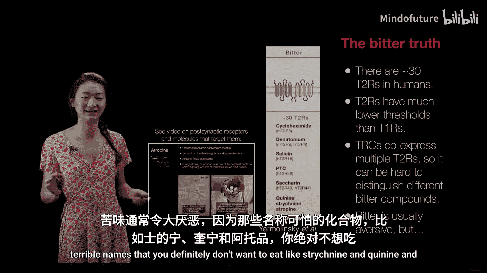

苦味通常是令人厌恶的，因为存在所有这些名字可怕、你绝对不想吃的化合物，如士的宁、奎宁和阿托品。然而，人类作为非常有创造力的生物，实际上已经学会了在有限的背景下非常享受苦味，这是一种习得行为。通常孩子不喜欢苦味食物，但我们可以学会享受吃和喝不同类型的苦味物质。

## 酸味感受器

关于酸味的故事也很吸引人。我们接着讨论鲜味、甜味和苦味之后，来看看酸味。据我们所知，酸味感受器不是GPCR。当我查阅人类和哺乳动物酸味感受的分子基础时，我惊讶地发现，直到2019年，哺乳动物的酸味分子感受器才被最终确定。想想看，我们了解光感受器、触觉传感器多久了？这绝对让我感到惊讶，我们对味觉的了解是我们每天与环境互动的基础，然而我们仍然对它们知之甚少。

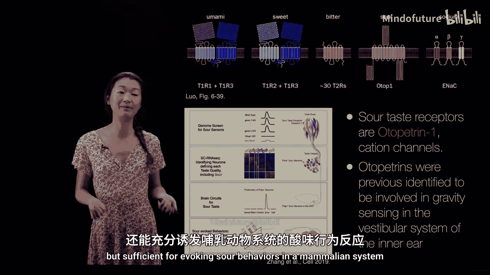

据我所知，根据我能在文献中找到的最新资料，酸味感受器是一类被称为Otopetrins的分子，它们是阳离子通道。这也许并不奇怪。所以这不是GPCR，而实际上是一个阳离子通道。Otopetrins先前被发现在内耳前庭系统中参与重力感应，现在发现它们也在味觉系统的味蕾中表达。有一系列漂亮的实验证明，它们不仅是诱发哺乳动物系统酸味行为所必需的，而且是充分的。我认为这真的很酷。

## 一个味觉“黑客”：神秘果

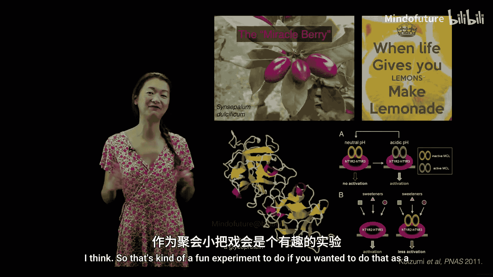

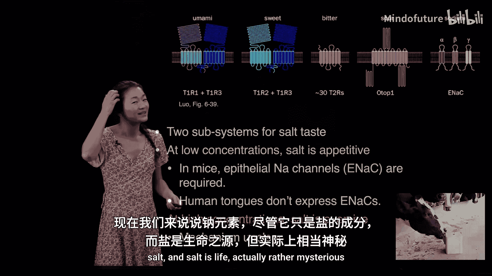

这里有一种可以“黑入”你味觉系统的方法。有一种被称为神秘果的水果，它看起来像一个小小的红色浆果。它内部含有一种名为神秘果蛋白的糖蛋白分子。神秘果蛋白的作用是给你一种味觉错觉，基本上是一种味觉幻觉。如果你咀嚼这种浆果，在接下来的半小时左右，任何通常尝起来酸的东西实际上会变得非常甜。我再说一遍：如果你在咀嚼神秘果后吮吸柠檬，柠檬通常很酸，但尝起来会像你喝过的最好喝的柠檬水。

在分子水平上发生的是，这种神秘果蛋白糖蛋白会与你味蕾中的甜味感受器结合。它结合到那些T1R2/T1R3异源二聚体上。然后在酸的存在下，它会激活甜味感受器。这就是这种糖蛋白的作用。这是一个非常奇特的感官错觉。我认为实际上可以买到这种分子的药丸形式。所以，如果你没有种植神秘果树的朋友，也有可能以药丸形式获得这种分子。如果你想把它作为一个派对把戏，这是一个有趣的实验。

## 咸味感受器

好了，我们讨论了鲜味、甜味、苦味和酸味，现在轮到咸味了。尽管它只是盐，而盐是生命所必需的，但实际上相当神秘。作为神经科学家，我们仍然不清楚味觉系统中咸味感受的根本基础是什么。我们实际上不知道涉及哪些分子。部分原因是这使得问题变得复杂：鲜味和甜味是开胃的，苦味是厌恶的（尽管如上所述，你可以学会喜欢它），酸味更复杂一些，咸味也是如此。

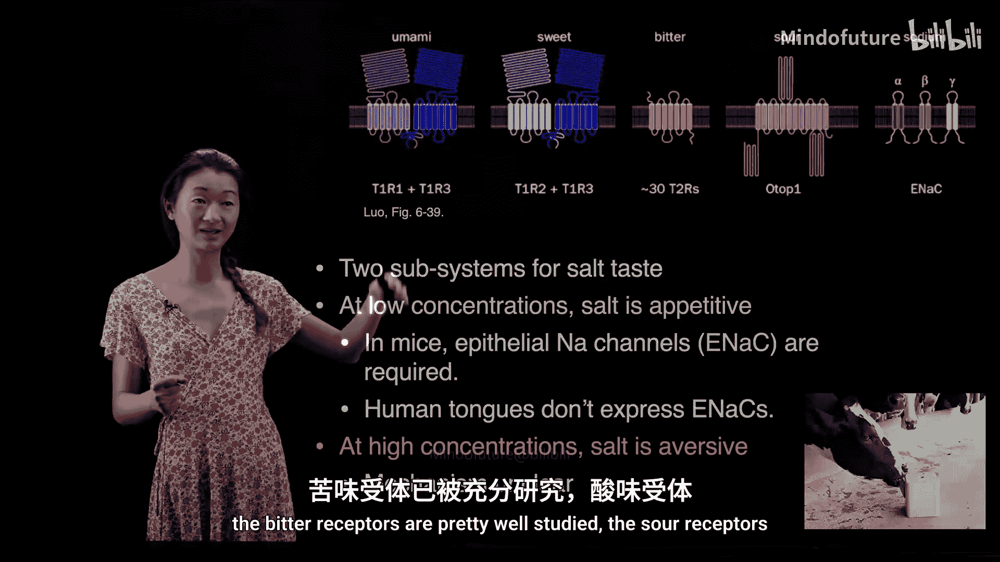

咸味之所以复杂，是因为在低浓度时，盐非常开胃。如果你吃过盐放得不够的食物，味道就不太好；如果加了适量的盐，味道就很棒。但在更高的浓度下，盐就非常令人厌恶。如果你曾在海洋中游泳并呛了海水，那感觉相当糟糕。所以，盐在高浓度下并非明确是积极的。我们确实知道小鼠体内表达一组阳离子通道，即上皮钠通道，它们是小鼠尝到咸味所必需的。然而，我们知道这并不能完全解释一切，因为至少人类的舌头不表达这种蛋白质。所以我们并不真正知道人类发生了什么，以及我们尝到咸味的能力。此外，我们也不知道在高浓度下产生咸味厌恶特性的分子机制是什么：是由相同的通道介导的吗？有不同的通道吗？涉及不同的系统吗？这是在舌头之后发生的计算吗？这些都是神经科学中仍然不清楚、有待解决的问题。

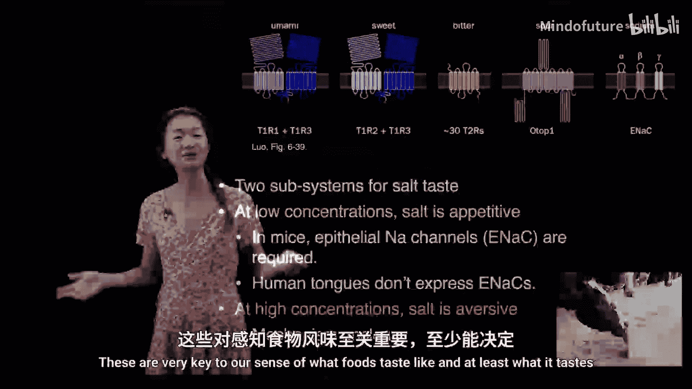

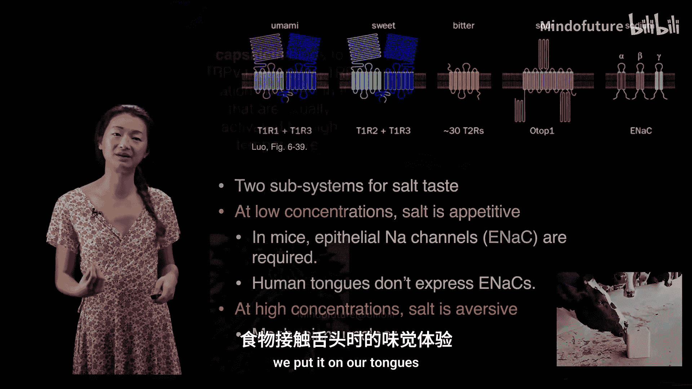

我还要指出，除了这五种不同的味觉感受器，人们还考虑其他类型的味道和可以从口腔和舌头收集的感觉信息，这些不在此列表中，例如水的味道。甚至水的味道也有几篇论文在讨论，人们越来越多地开始研究这些。你可以想象，研究“水尝起来像什么”这样的东西真的很难，但水确实有味道，不仅仅是里面的东西。水的味道真的很难研究。但我在这里至少告诉你我们对鲜味和酸味感受器的了解。鲜味和甜味感受器研究得相当充分，酸味感受器我们刚开始弄清楚，咸味感受器我们还在研究。这些对于我们感知食物味道，至少是当我们把它放在舌头上时的味道，非常关键。

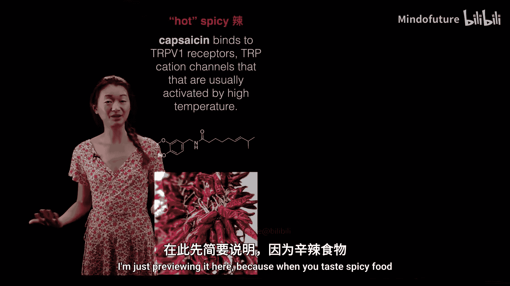

## 辣味：不是味觉，而是体感

我们在食物中真正享受的另一类东西实际上并不作用于味觉感受器。这是我个人喜欢的，比如我喜欢辛辣食物。辣味食物含有一种叫做辣椒素的分子。辣椒素是这类分子中的一种，由不同类型的辣椒产生。辣椒产生辣椒素，辣椒素尝起来辣，我们用“辣”这个词，但它实际上并不作用于任何味觉感受器，它作用于其他东西——一种TRPV通道。TRPV1通道是阳离子通道，实际上遍布你的触觉系统和躯体感觉系统。我们稍后会在躯体感觉讲座中详细讨论，这里先提一下，因为当你品尝辛辣食物时，它并没有作用于任何味觉感受器，而是实际上作用于这种躯体感觉感受器，特别是TRPV1通道，它通常被高温激活。

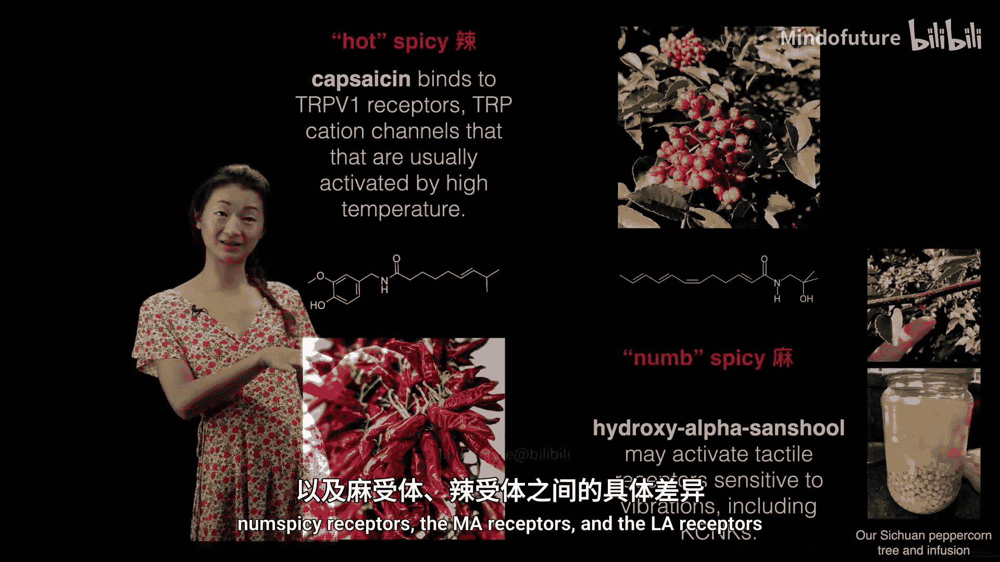

如果你了解中国菜，你还会知道实际上有一个单独的词来形容不是热辣，而是“麻”的感觉，这就是“麻辣”。“麻”的感觉是由一种完全不同的、与辣椒素无关的分子介导的，这种分子看起来一点也不像辣椒素，它是一种被称为羟基山椒素的分子。这种分子不是由辣椒素植物产生的，而是由花椒树产生的。实际上，我以前家前院就有一棵很大的花椒树，我很喜欢它。就像TRPV1通道被辣椒素激活一样，这种分子会激活对振动敏感的触觉传感器。有几篇论文讨论了被“麻”感受器和“辣”感受器激活的传感器之间的分子机制差异。

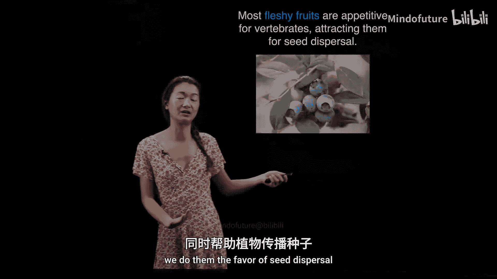

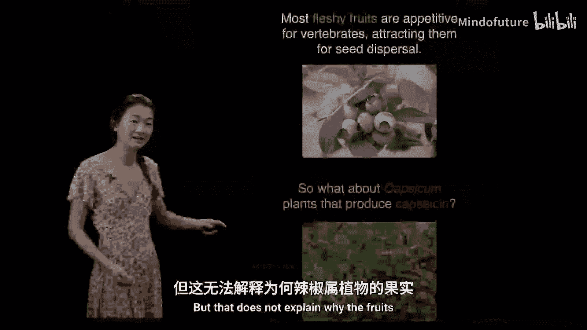

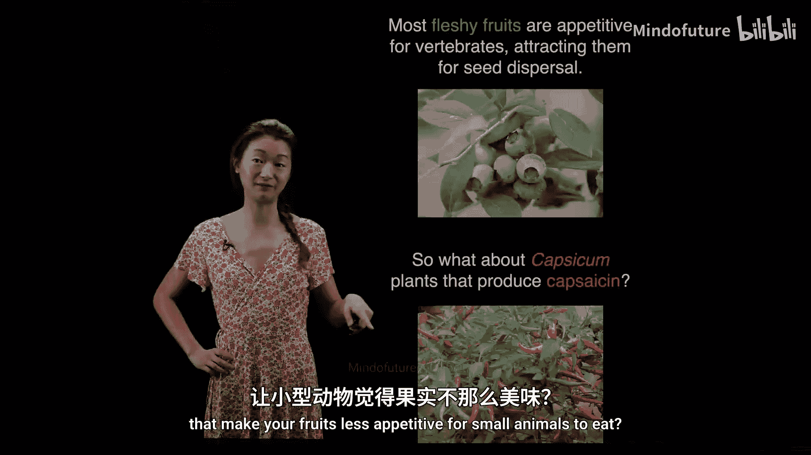

## 辣椒素的进化之谜

你可能会问自己，这是一个有趣的进化问题。动物喜欢吃水果，水果为我们制造不同的美味，因为它们希望我们帮它们传播种子。这就是为什么很多水果会产生果糖，果糖是甜的，我们非常喜欢果糖，我们吃这些水果，并帮它们传播种子。这对大多数水果来说是有道理的，但这并不能解释辣椒属植物的果实为什么会制造辣椒素，因为高浓度的辣椒素实际上是令人厌恶的。同样，作为人类，我们似乎可以学会喜欢任何东西，我们可以学会喜欢疼痛，但这确实是疼痛。对大多数小动物来说，辣椒素是令人厌恶的。那么，作为辣椒属的多肉果实，你为什么要费心制造一些让你的果实对小动物来说不那么开胃的东西呢？

这里有趣的故事与小哺乳动物和鸟类吃水果的方式差异有关。这里有一个实验，他们比较了三种不同类型的动物：仙人掌小鼠、林鼠和矢嘲鸫（一种食果鸟）。他们喂给它们三种不同类型的水果：朴树果、不辣的辣椒和很辣的辣椒。他们发现，小哺乳动物避开很辣的辣椒，但鸟类以相同的浓度吃所有三种。鸟类会像吃蓝莓一样吃辣辣椒，它们真的不在乎，它们都喜欢。而像仙人掌小鼠或林鼠这样的小哺乳动物则主动避开非常辣的辣椒。

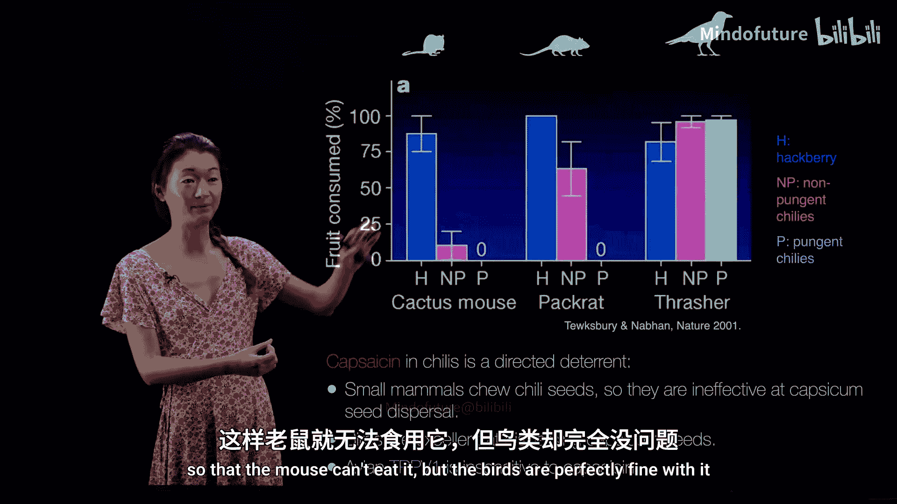

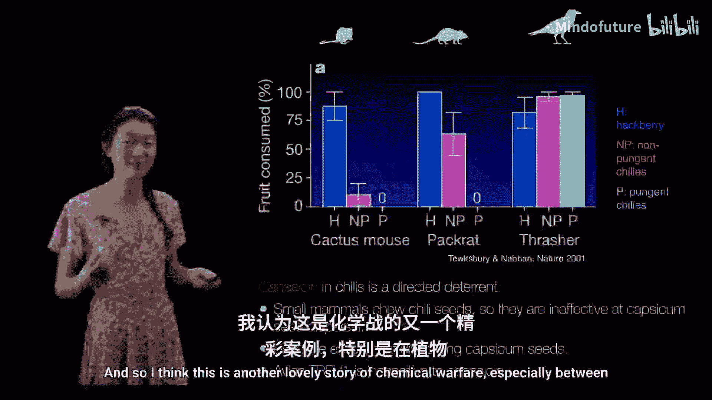

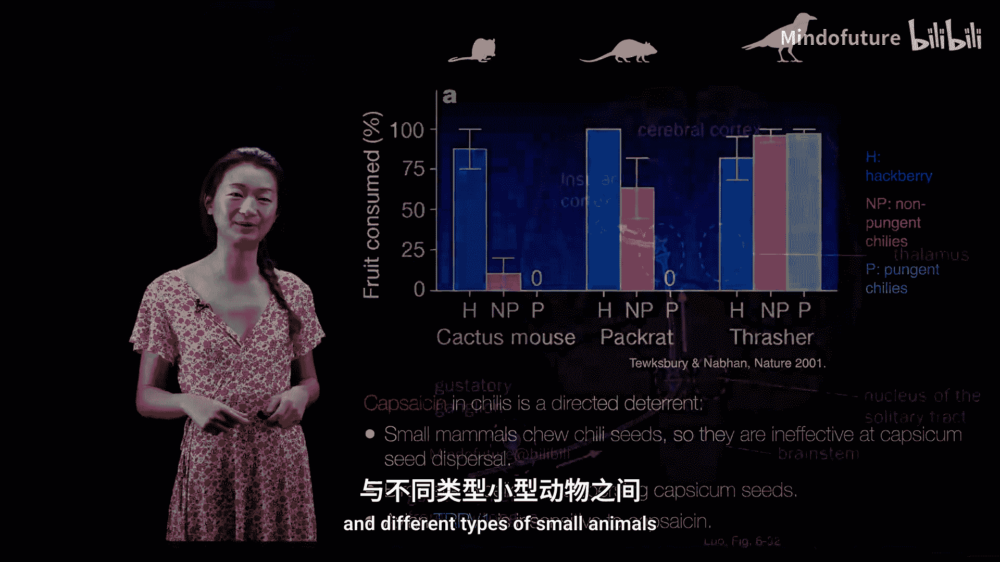

因此，现在认为辣椒素辣椒是一种定向威慑剂。鸟类的TRPV1通道对辣椒素不敏感，鸟类根本尝不出辣味，它们没有相应的感受器。它们的TRPV受体是别的样子，对辣椒素不敏感。辣椒这样做的原因如下：小哺乳动物吃水果时会咀嚼它，我们咀嚼它。对于辣椒属植物来说，当小哺乳动物咀嚼它们的果实并咀嚼种子时，种子在被传播到远处后就不再能够发芽。而鸟类会整个吞下果实，因此鸟类实际上是传播辣椒种子的优秀媒介。所以辣椒进化出了辣椒素作为一种定向威慑剂。它不能完全阻止小哺乳动物吃它们，但可以通过分子水平上定向释放这种辣椒素化合物，使得老鼠不能吃它，而鸟类则完全没问题。我认为这是植物与不同类型小动物之间化学战的又一个美妙故事。

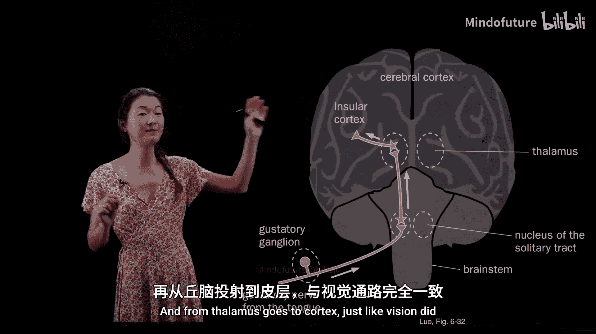

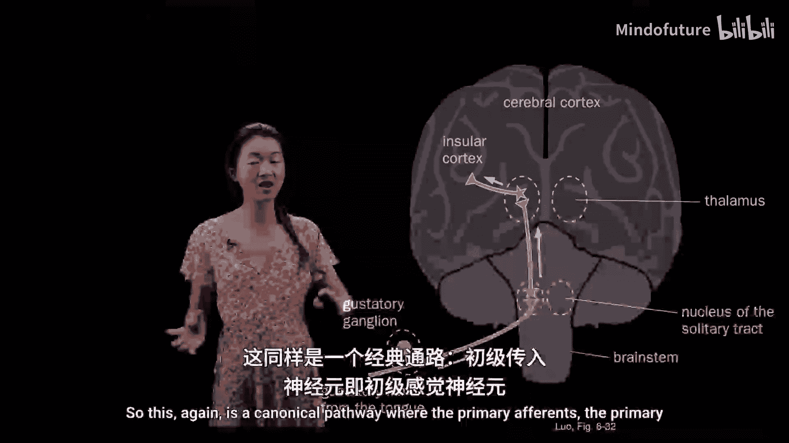

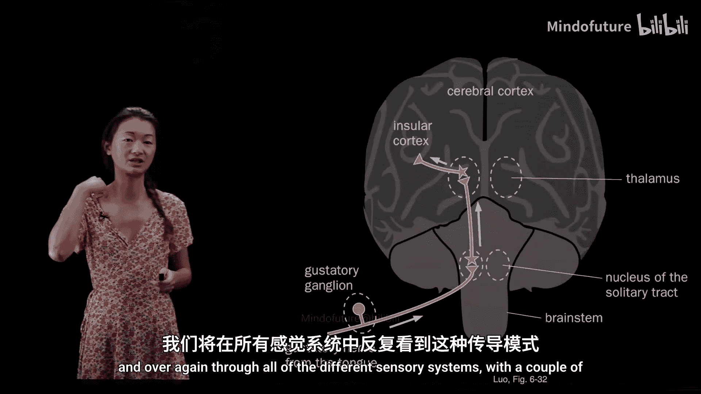

## 味觉通路：从舌头到大脑

我们讨论了味觉感受器和味觉神经节。来自舌头的味觉神经通过孤束核投射到脑干，然后像视觉一样上达丘脑，再从丘脑到皮层。这又是一个典型通路：初级传入神经元（初级感觉神经元）投射到神经节细胞，神经节细胞有时经过一两个中继站到达丘脑，然后从丘脑到皮层的某个部分。我们将在所有不同的感觉系统中反复看到同样的事情，只有少数例外。

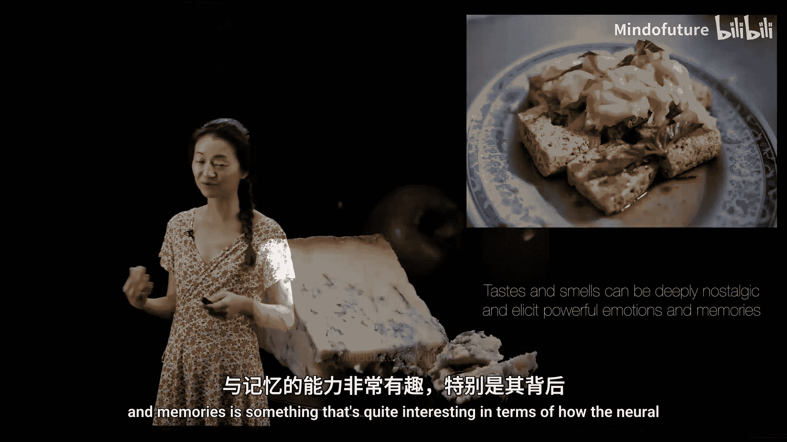

## 味觉、记忆与情感

与视觉不同，食物是很多人都喜欢的东西。比如我真的很喜欢食物，在我的家庭里，我们总是喜欢吃火锅，这对我们来说尤其是在中国新年时是一种传统。像许多其他感觉模式一样，食物具有这种特殊的能力，能够唤起记忆和怀旧之情。对于那些不一定对所有人都有吸引力的食物来说尤其如此。这是一张臭豆腐和一些蓝纹奶酪的图片。我个人碰巧都喜欢它们，但我再次意识到，这种怀旧之情部分是因为我从小就吃这些类型的食物，我学会了喜欢它们，而且它们并不真的那么……嗯，很多人不喜欢这些类型的食物。但对某些人来说，味道和气味有一种特殊的能力，能引起深深的怀旧感。你可能走进别人的厨房，闻到某种汤的味道，突然就被带回到你奶奶的厨房，因为它闻起来就像她会用来做饭的东西。因此，我认为食物、味道和气味能够引发非常强烈的情感和记忆，这种能力在神经通路如何支撑这些强烈情感和记忆方面是相当有趣的。

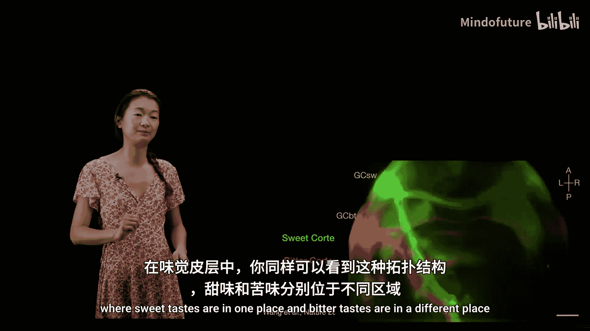

这里有一篇非常有趣的论文，我要重点介绍一下，因为它将味觉系统的感觉能力与我们形成这些非常强大的记忆的能力，以及我们赋予这些不同味道和气味的效价和价值联系在了一起。我告诉过你，味觉信息通过丘脑的不同中继站投射，然后投射到味觉皮层。味觉皮层的组织方式是，有一部分负责甜味，有一部分负责苦味，就像视觉皮层有拓扑图一样，视觉皮层有不同的区域对视觉空间的不同部分做出反应。在味觉皮层，你同样有这种拓扑组织，甜味在一个地方，苦味在另一个不同的地方。你可以看到它们在解剖上是不同的，你可以把它们分开。

## 前沿研究：光遗传学揭示味觉与情感的连接

这篇论文证明，如果你观察味觉皮层接下来投射到哪里，它会投射到一个叫做杏仁核的地方。我以前没有和你们讨论过杏仁核，所以我在这里用一两句话总结一下：杏仁核是你大脑深处的一个结构，是边缘系统的一部分，我们认为它与恐惧、记忆和不同类型的攻击性有关。它是一个与非常原始的感觉相关的大脑区域。他们在这里证明，甜味皮层和苦味皮层实际上也投射到杏仁核的不同部位。

他们使用的实验方法非常有趣，我花点时间给你们介绍一下。他们在这里注射了一种AAV病毒，一种腺相关病毒，它表达Cre重组酶，并且是一种顺行AAV病毒。我来分解一下这些术语：AAV（腺相关病毒）实际上不是腺病毒，它是一种完全不同的病毒，只是有这个名称。它是一种感染神经系统的病毒。如果你把它注射到大脑中，它会被神经元吸收。这种特殊的病毒是顺行AAV，这意味着它会被神经元吸收，并沿着轴突运输的方向运输。在这种情况下，如果你把它注射到味觉皮层，它会进入味觉皮层中的所有细胞。然后，所有这些细胞都会沿着轴突的方向运输这些AAV病毒，而不是反向，这就是顺行的意思。也有逆行病毒，但这种是顺行的。所以它会沿着那些轴突走，到达那些味觉皮层神经元要去的地方，它们会去到它们突触连接的下一个地方。它们可以将病毒一直运输到轴突末端，并“跳跃”到该神经元投射到的下一个神经元作为突触。由于Cre系统，他们设计了这只小鼠，使得Cre在下一个突触后细胞中开启一个红色荧光蛋白（这里是tdTomato）。所以，只有当那个细胞是你注射AAV的细胞的突触后伙伴时，它才会表达红色荧光蛋白。

这是一种病毒追踪技术，是一种非常酷的技术。你注射这种病毒，你设计这只小鼠，使其具有这种特性：只有当它接收到Cre时，tdTomato这种红色荧光蛋白才会被开启。然后，你通过将Cre传递到一个完全不同的大脑区域，只有区域A和区域B之间的投射接收到那个Cre，并导致杏仁核中的细胞发出红光。这就是他们如何证明，如果你将AAV-Cre注射到苦味皮层，它会到达杏仁核的一个部分；如果你将相同的病毒注射到味觉皮层的甜味部分，它会投射到杏仁核的完全不同的部分。这表明，这两种不同的信息通道——苦味和甜味——可能与不同的感觉、不同的效价相关联，与对甜味或苦味刺激的不同反应方式相关联。

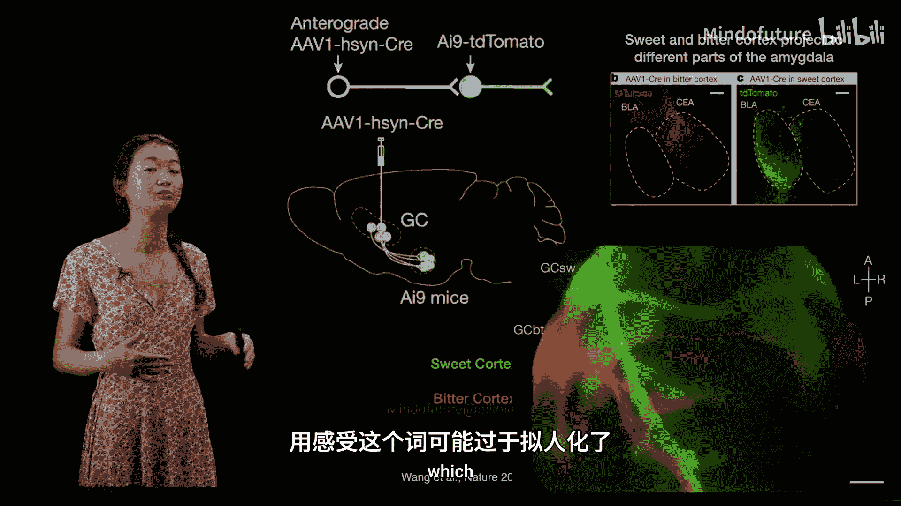

他们进一步通过光遗传学实验证明了这一点。光遗传学是现代神经科学中光学方法的一个主题。如果你想回顾关于现代神经科学中光学方法的视频，有一节课我讨论了光遗传学的基础知识及其工作原理。简而言之，如果我们能把正确的蛋白质放入细胞，我们就可以用光打开或关闭细胞。在这里，我们要做的是，我们将使用一种表达通道视紫红质蛋白的AAV病毒，将其注射到味觉皮层。然后，我们不是将光照射在味觉皮层，而是实际上将光照射在杏仁核上。因此，只有从我注射病毒的地方投射到杏仁核的细胞才会被激活。他们发现，如果他们将病毒注射到甜味皮层，然后在杏仁核照射激光，当小鼠舔水（只是普通的水）时，它会舔得更多。而如果他们将病毒注射到味觉皮层的苦味部分，并在杏仁核照射光，杏仁核中的苦味投射会导致小鼠实际上舔得更少。换句话说，这不是刺激物的身份（水实际上是甜的还是苦的或其他什么），而是你激活了大脑中这个杏仁核边缘系统区域，使得小鼠对相同的刺激做出了不同的行为。

这有点复杂。所以想想这里的逻辑：有一种方式我们识别刺激物的不同部分——嗅觉环境，它是红色的吗？是绿色的吗？我们对它有情感感觉吗？它是苦的吗？是甜的吗？我要怎么做？在这篇论文中，通过使用这种将光遗传学靶向不同神经回路区域的病毒传递的巧妙技术，他们能够厘清这些关于“你如何知道某物是什么”、“你对它的感觉如何（效价）”、“你打算怎么做”的想法。这真的很巧妙。

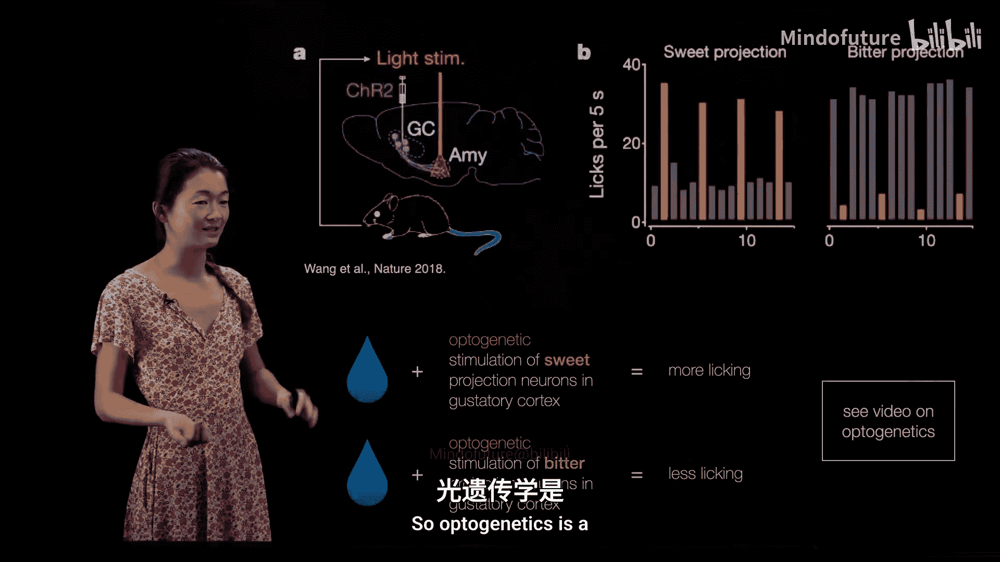

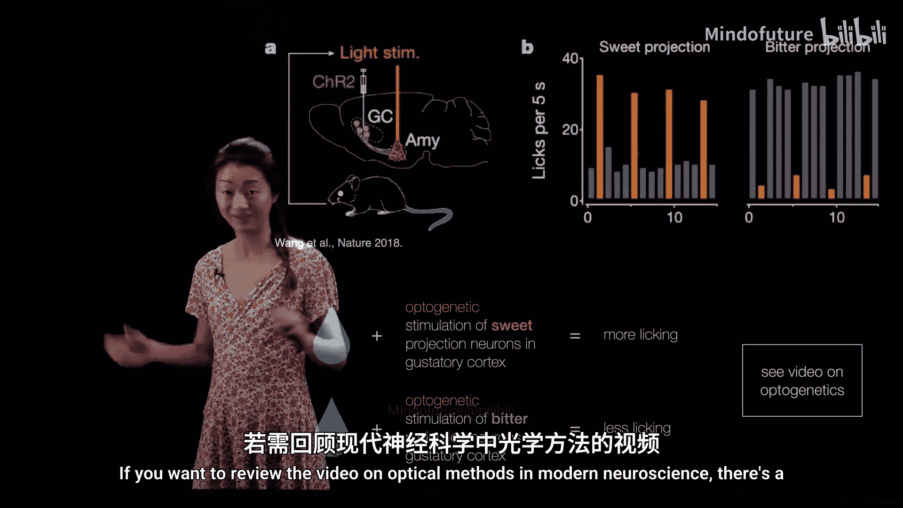

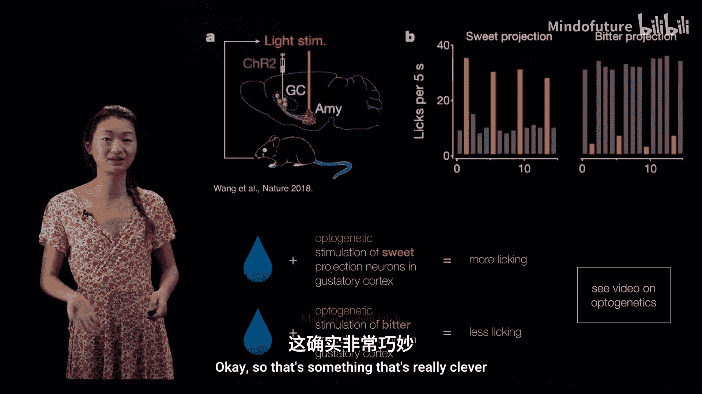

## 总结

好了，理解我们味觉的关键概念。我们走得很远，从非常基础的味觉感受器神经生理学，到使用光遗传学等非常现代的技术来剖析这些复杂的回路，包括我们的恐惧和我们的味觉。

以下是本节课的核心要点总结：

*   **味觉感受器细胞**：存在于味蕾中。它们是混合的，在人类舌头上并不定位分布。
*   **信息传递路径**：味觉感受器细胞本身没有轴突，它们通过释放神经递质激活味觉神经节细胞，就像视网膜中光感受器激活视网膜神经节细胞一样。味觉神经节神经元将信息投射到味觉通路的其他部分，包括经过丘脑再到皮层，并从皮层到其他未知区域。
*   **分子机制**：甜味、鲜味和苦味感受器都是**GPCRs**（G蛋白偶联受体）。希望这对任何人来说都不奇怪，因为下一讲将是关于嗅觉的，你也不会惊讶地听到我们的嗅觉系统中也有GPCRs。
*   **其他味觉**：酸味感受器是**Otopetrin阳离子通道**。咸味感受器的分子基础尚不完全清楚。
*   **辣味**：不是真正的味觉，而是通过激活**TRPV1**等躯体感觉受体（如对热敏感的通道）产生的感觉。
*   **高级处理**：味觉信息最终到达味觉皮层，并进一步投射到杏仁核等与情感和记忆相关的脑区，将味觉感知与行为决策和情感体验联系起来。

本节课中，我们一起学习了味觉系统从外周感受器到中枢处理的完整通路，探讨了不同味觉的分子机制，并通过有趣的进化和前沿研究实例，理解了味觉如何与我们的行为、情感和记忆紧密相连。