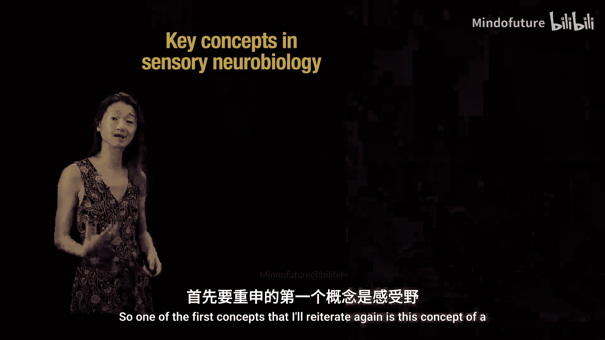
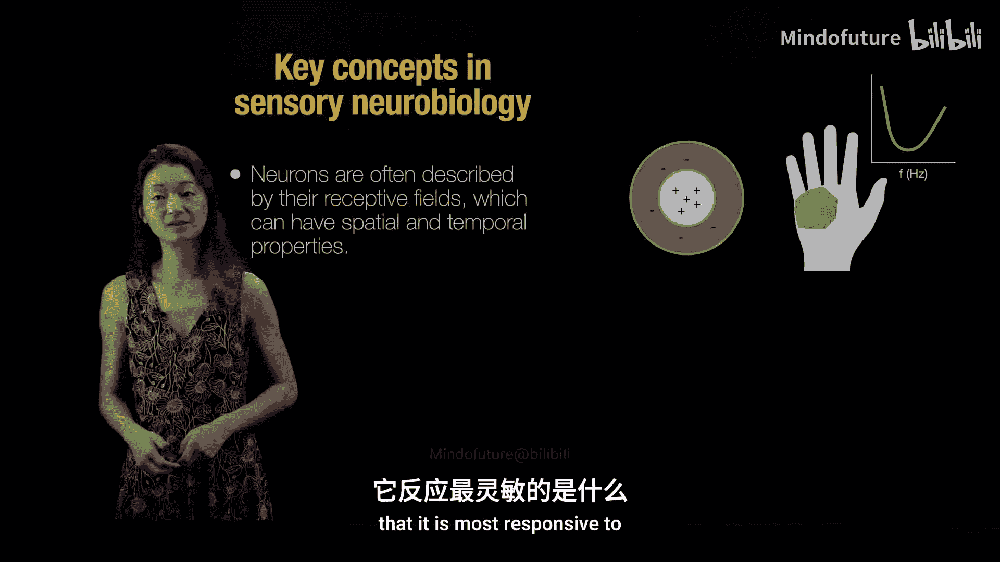
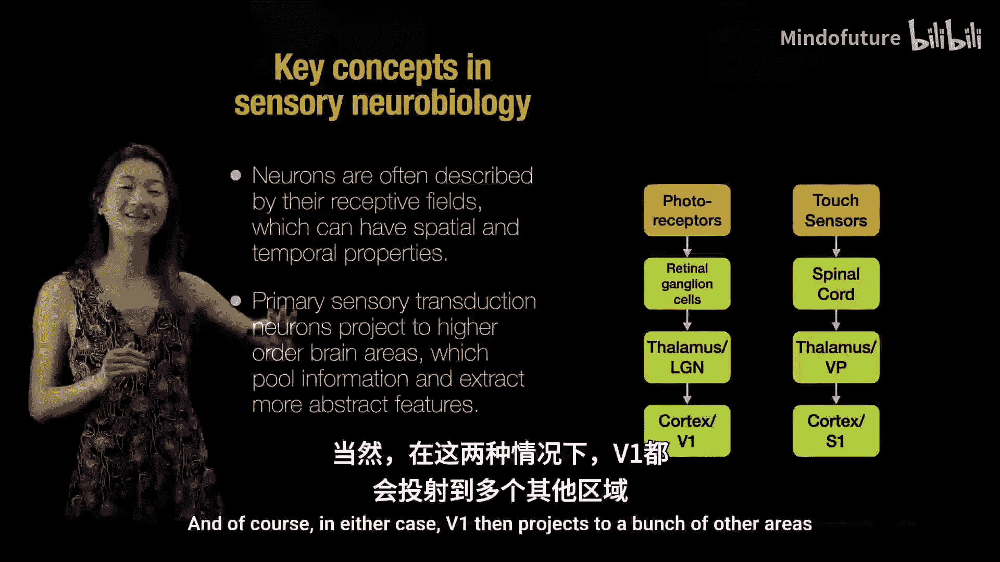
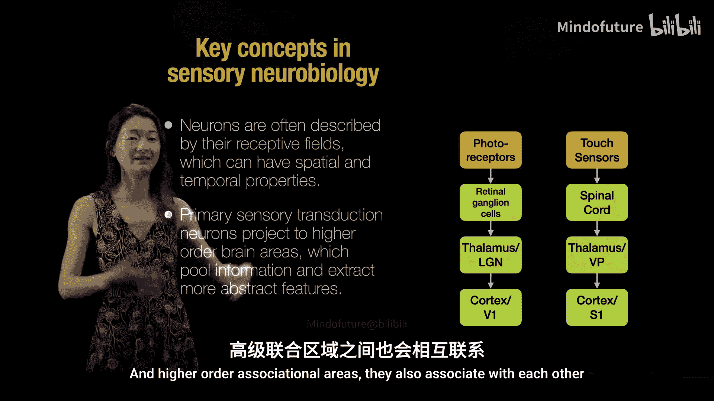
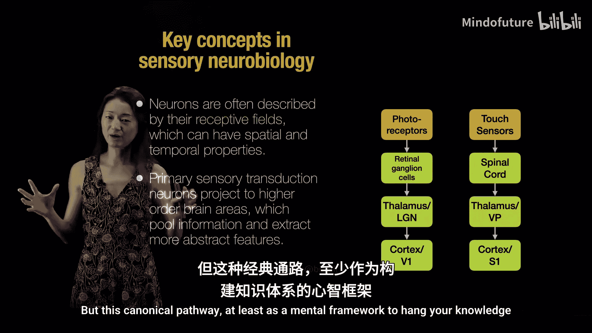
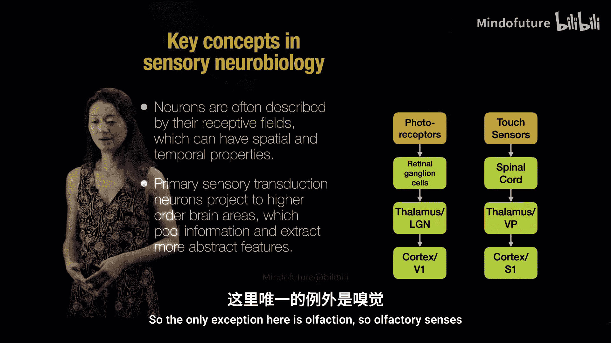
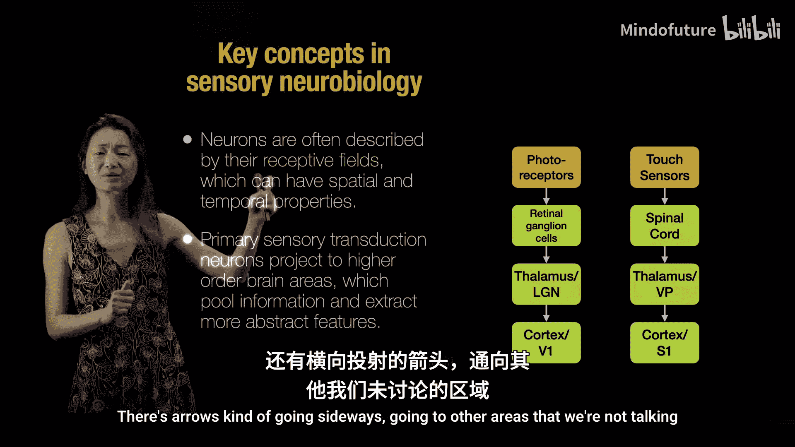
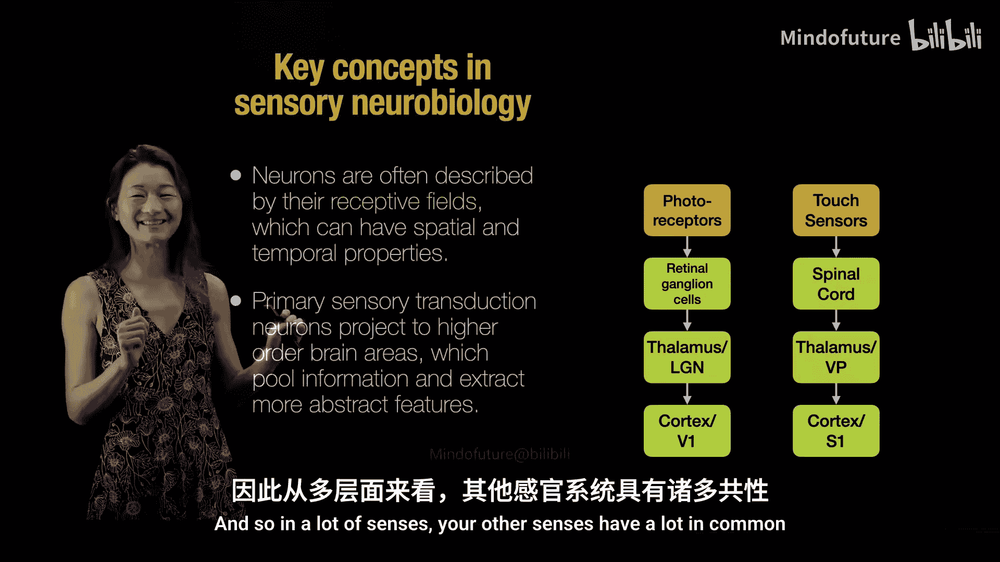
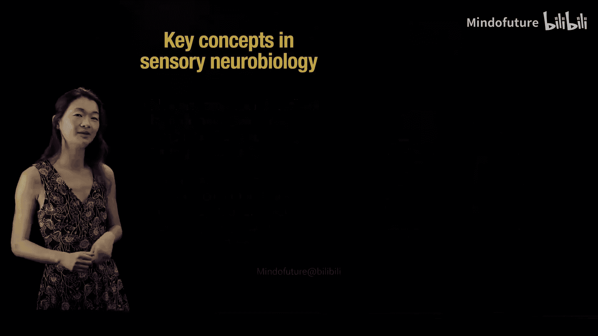
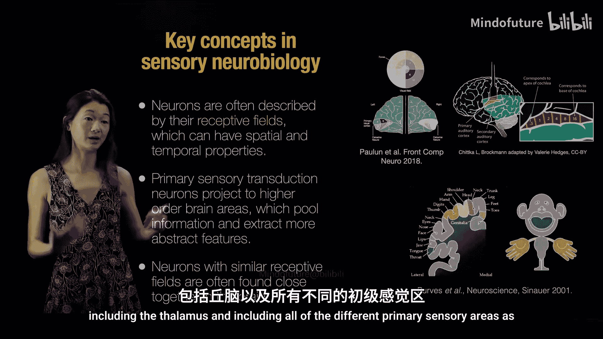

# 026：感觉神经生物学通用概念 🧠

在本节课中，我们将综合之前学到的关于各种不同感觉系统的知识，提炼出一些组织我们如何感知外部世界的神经生物学原理。

## 概述

我们将探讨四个核心概念：**感受野**、**信号转导与处理的经典通路**、**神经元的地理共位**以及**适应与变化**。这些概念是理解不同感觉系统如何工作的通用框架。

## 感受野：神经元的“兴趣区域” 🎯

上一节我们回顾了不同感觉系统的具体机制，本节中我们来看看一个贯穿所有感觉系统的核心概念——感受野。

感受野是一个极其重要的概念，它是神经科学家用来描述感觉细胞类型的工具。其核心思想是，通过**反向关联**的方式，将来自物理世界的**刺激**与最能触发该细胞反应的**刺激最优特征**关联起来。

*   **公式化描述**：一个神经元的感受野，定义了能使其产生反应（如发放动作电位）的**刺激空间、时间或频谱特性**。

例如，对于视觉细胞，我们可以说它的感受野位于视野的某个特定区域，或者对特定波长的光敏感。下图展示了一个视网膜神经节细胞的感受野示例：

这是一个“给光-中心”型视网膜神经节细胞，它最喜欢中心有光点、周围有暗环的刺激模式。这个空间感受野在视网膜上有其特定的位置。

同样，对于手上的触觉感受神经元，其感受野具有空间范围，但这次是映射在手上。下图示意了这种触觉感受野：

只要触摸手上的这个区域，该神经元就会发放动作电位。但它只知道触摸发生在这个区域内，而不知道精确位置。

感受野也可以具有时间特性。例如，某些神经元可能对刺激的特定变化敏感，或者对特定频率的振动敏感。这对于触觉神经元尤其重要，因为指尖划过纹理表面时产生的振动会被转化为振荡频率。

感受野是一种通用语言，不仅用于描述初级感觉神经元，也可用于描述更高级的感觉神经元（如V1或S1区的神经元）。需要指出的是，一个视觉神经元并非只能有视觉感受野。正如我们在“为什么一切无处不在”的讲座中看到的，在皮层中，许多经典初级感觉区的神经元也可能对其他模态的刺激产生反应，即存在**多感觉神经元**。

尽管如此，感受野的概念在感觉神经生物学中反复出现，是我们描述神经元功能、其偏好刺激以及如何最有效地激活它时必须熟悉的语言。

## 经典信号通路：感觉处理的共同蓝图 🛣️

了解了如何描述单个神经元的特性后，我们来看看信息在感觉系统中是如何传递和处理的。第二个关键概念是，不同的感觉通路在信号转导和处理上存在许多共同的**经典通路**。

下图并排展示了视觉通路和躯体感觉（触觉）通路：

尽管大脑中这些区域的细胞完全不同，但信息从感受器传递到负责该感觉的初级皮层区的顺序却非常相似。

以下是这个经典通路的核心步骤：

1.  **初级感觉神经元**：接收外界刺激（如光感受器、触觉感受器）。
2.  **中间神经元/神经节细胞**：进行初步处理（如视网膜内的处理，或脊髓中的传递）。
3.  **丘脑**：感觉信息的中继站。视觉信息到达**外侧膝状体**，触觉信息到达**腹后核**。
4.  **初级感觉皮层**：信息处理的第一个皮层站点。视觉信息到达**V1区**，触觉信息到达**S1区**。

当然，这是一个高度简化的模型。图中未显示大量的反馈连接、侧向连接以及向其他高级脑区的投射。V1和S1之后还会投射到许多其他区域，并进行多感觉整合。但这个经典通路作为一个心智框架，有助于我们理解多种感觉系统的信息流向。

主要的例外是**嗅觉系统**。嗅觉信息不经过丘脑中继，而是从嗅觉感受器直接到嗅球，再直接投射到皮层。此外，嗅皮层不属于具有六层结构的新皮层，而是更古老的三层结构。因此，在其他感觉系统有很多共同点时，嗅觉在几个方面都是例外。

## 拓扑映射：相似神经元的地理聚集 🗺️

信息沿着经典通路传递时，其空间组织也遵循着一定的规律。第三个关键概念是：**具有相似感受野的神经元，在大脑中往往位于相近的地理位置**。

我们在大脑的多个层面都能观察到这种**拓扑映射**现象：

*   **视觉系统**：视野中相邻的区域，会投射到LGN和V1中相邻的区域。
*   **躯体感觉系统**：手臂上相邻的位置，会投射到S1中相邻的位置。
*   **听觉系统**：虽然更抽象，但耳蜗中分解出的相邻频率成分，会投射到听觉皮层中相邻的区域，形成**音调拓扑**。

其普遍特征是：在初级感觉皮层，具有相似感受野（无论是在物理空间还是概念空间，如频率）的神经元彼此靠近。这种空间邻近性一直延续到更高级的脑区，包括丘脑和各初级感觉区。下图示意了这种映射关系：

## 适应与变化：神经系统关注动态信号 🔄

最后，我们要强调一个普遍存在于所有感觉区域的概念：**适应与变化**。

神经元的反应倾向于**适应**持续发生的刺激，它们通常对**变化**做出反应，而不是对绝对值做出反应。让我再强调一遍：如果你走进一个气味很浓的房间，无论香臭，你很快会适应并不再注意到它。

这种适应不仅发生在初级嗅觉神经元，也发生在更高级的脑区。这是一个普遍概念：

*   **光适应**：当你走到室外，眼睛会迅速适应明亮环境（这包括瞳孔缩放等生理适应，也包括神经反应层面的适应）。
*   **触觉适应**：你手上的许多触觉感受器只在触摸或松开某物的瞬间发放信号，而在持续按压时保持静默。

从动物生存的角度看，神经系统更关心**变化的事物**，而不是保持不变的事物。因为当环境恒定时，你无需关注或采取行动；但当突然发生变化时（如悬崖边缘、突如其来的巨响），你就必须集中注意力。恒定的巨响会被适应，而突发的响声则会立刻引起警觉。

## 总结

本节课中，我们一起学习了整合不同感觉神经生物学知识的四个通用概念：

1.  **感受野**：描述神经元对刺激特征偏好的通用语言。
2.  **经典信号通路**：不同感觉系统共享的信息处理层级结构（嗅觉除外）。
3.  **拓扑映射**：相似功能的神经元在大脑中的地理聚集。
4.  **适应与变化**：神经系统优先处理动态信号而非静态恒量。

希望你能理解，这些概念并非特定于某个感觉系统，而是可以适配和应用到我们讨论过的所有感觉系统中（当然，生物学总有例外）。从神经生物学入门的角度看，这些是理解感觉神经生物学时需要牢记的良好概念框架。