# 028：运动启动、自主运动与帕金森深部脑刺激疗法 🧠

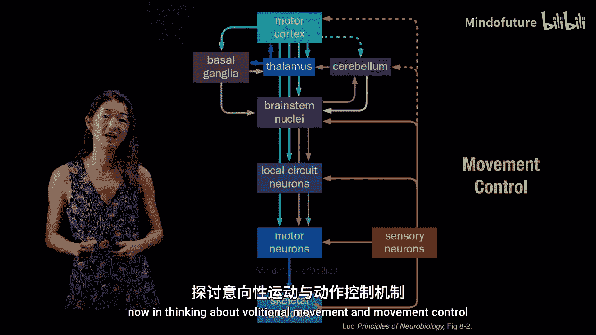

在本节课中，我们将要学习自主运动的启动与控制。我们将探讨大脑如何从简单的肌肉控制，上升到有计划的、目标导向的复杂运动。这涉及到大脑中多个层级的结构，包括小脑、基底神经节和大脑皮层。

## 从无意识到自主运动

上一节我们介绍了肌肉如何工作，以及运动神经元如何组织以产生“无意识”的运动，例如走路时无需思考每一步。本节中我们来看看，我们如何使用相同的肌肉和肢体，通过执行**自主运动**来进行完全不同的控制。

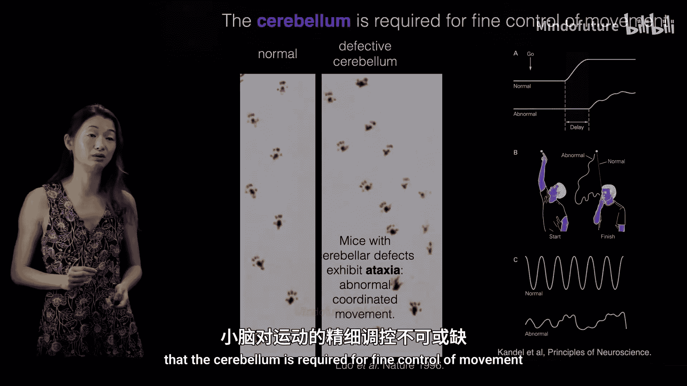

例如，跑向足球时你可能不会思考腿部动作，但当你准备射门时，就必须有意识地计划如何调动每一块腿部肌肉来完成特定动作，以实现进球目标。尽管控制的是相同的肌肉和运动神经元，但如何**启动**和**有目的地控制**运动，需要更高层级的控制机制，这超出了脊髓和局部神经回路的范畴。

## 小脑：精细运动的协调者 🧩

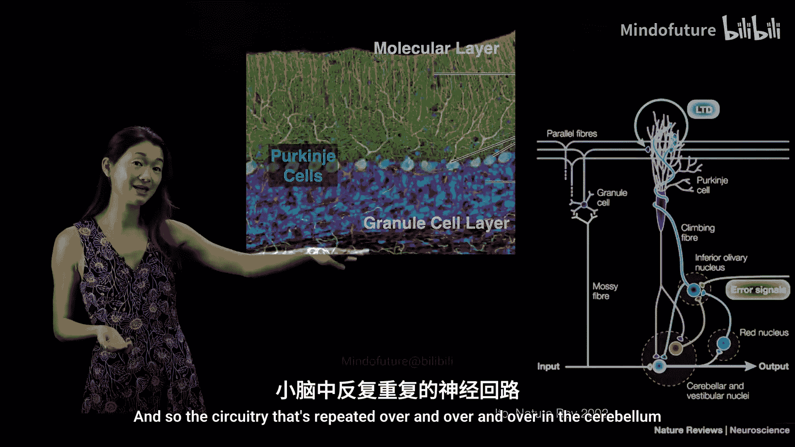

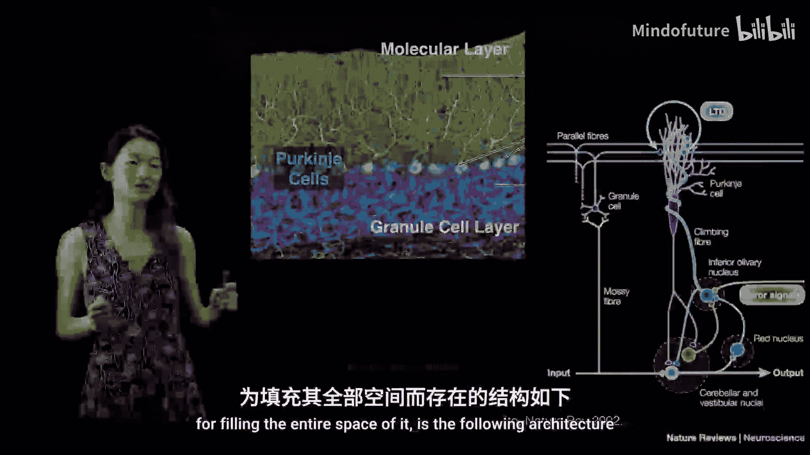

在思考自主运动时，我们首先要关注的区域是**小脑**。小脑位于大脑后部下方，结构精巧。我们知道它很重要，因为小脑缺陷会导致运动协调异常，即**共济失调**。

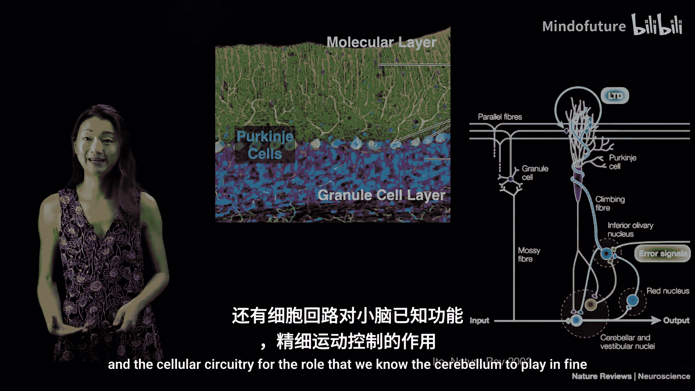

以下是证明小脑对精细运动控制至关重要的证据：
*   **动物实验**：小脑缺陷的小鼠无法保持均匀、交替的左右爪行走模式，步态混乱，足印模糊。
*   **人类症状**：小脑异常的个体无法执行平滑的指向运动。他们的运动启动延迟，轨迹不协调，呈迂回路径，无法遵循平滑轨迹。

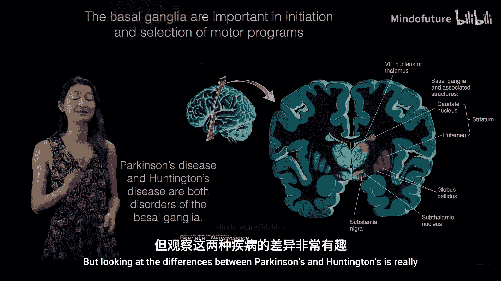

小脑的细胞回路高度规则。其主要细胞类型是**浦肯野细胞**，拥有巨大的树突分支。小脑的重复性层状结构是其特征。

小脑的输入通过苔状纤维和爬行纤维到达浦肯野细胞。特别是来自下橄榄核的**爬行纤维**，能非常可靠地抑制浦肯野细胞的活动。目前有大量理论研究小脑如何通过这种精细回路进行**运动学习**，这超出了本讲座的范围，但这是一个非常活跃的研究领域。

## 基底神经节：运动程序的启动与选择 ⚙️

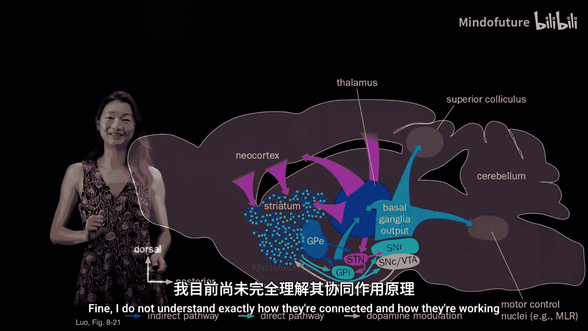

接下来我们讨论**基底神经节**。它位于大脑更深层，对于运动程序的**启动和选择**至关重要。

基底神经节包含多个具有不同功能的亚区，结构复杂，并非简单的重复模块。帕金森病和亨廷顿病这两种运动障碍都与基底神经节功能异常有关，对比它们能帮助我们理解其工作机制。

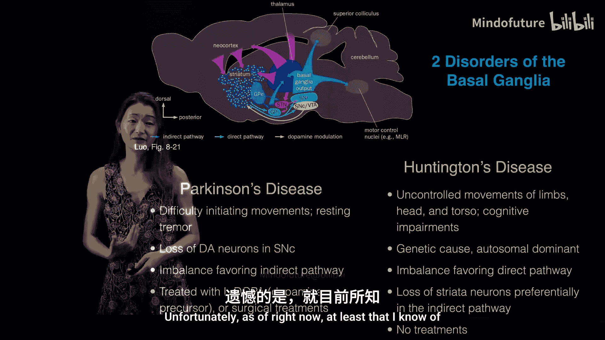

基底神经节接收大脑皮层的输入，并通过**直接通路**和**间接通路**输出。这两条通路受到多巴胺的调节作用相反：一条被多巴胺正调控，另一条被负调控。

*   **多巴胺的双重角色**：我们之前在多巴胺与奖赏、成瘾的课程中讨论过它。在运动控制中，多巴胺同样关键。如何统一这两种角色是一个前沿问题。
*   **帕金森病**：与黑质致密部**多巴胺神经元丧失**有关。症状包括运动启动困难、静止性震颤。这导致间接通路活动相对增强。
*   **亨廷顿病**：一种遗传性疾病，纹状体神经元丧失，导致直接通路活动相对增强。症状包括肢体和躯干的不自主运动以及认知障碍。

目前，亨廷顿病尚无已知的有效治疗方法。

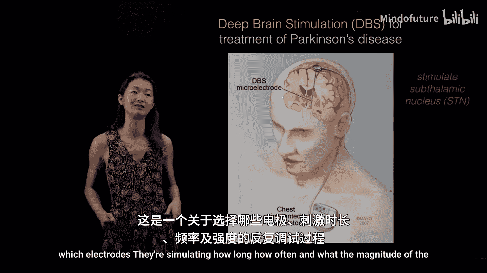

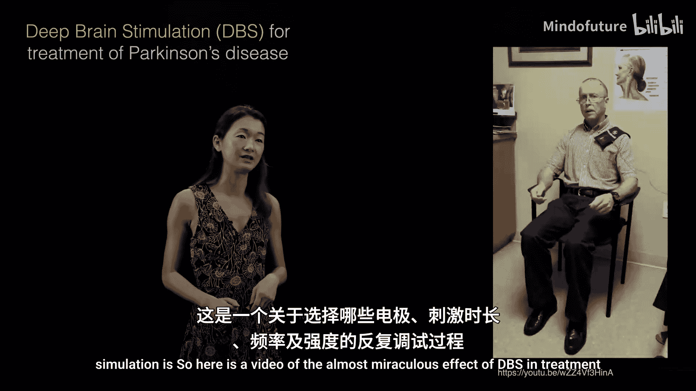

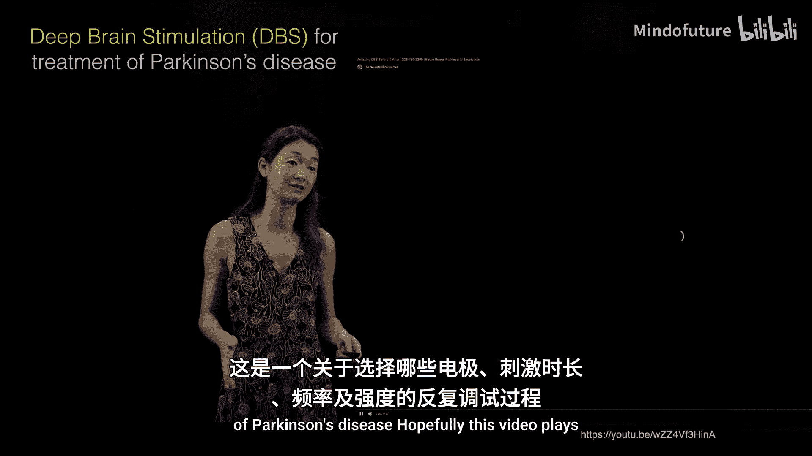

## 帕金森病的深部脑刺激疗法 💡

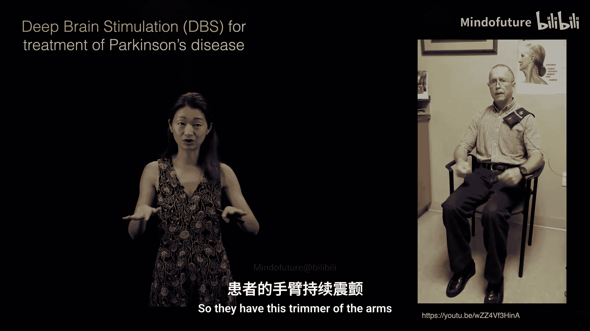

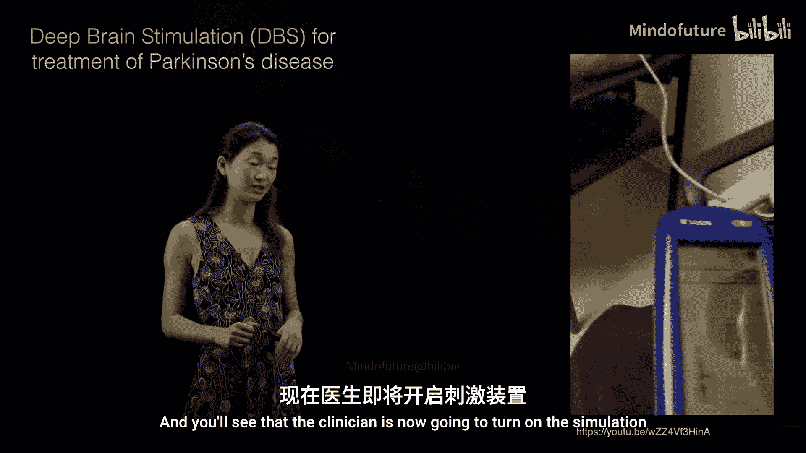

对于帕金森病的症状，除了使用多巴胺前体**左旋多巴**进行药物治疗外，一种非常成功的疗法是**深部脑刺激**。

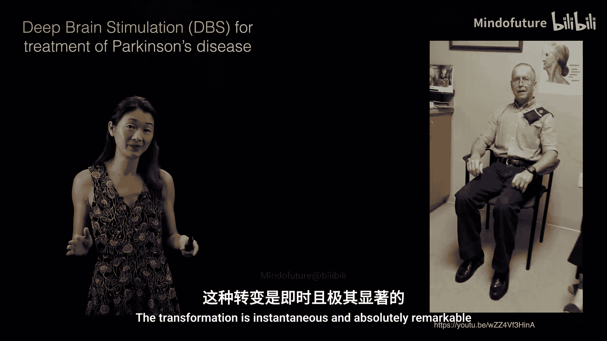

DBS通过手术将微电极植入基底神经节的特定深部区域。电极通过导线连接到植入胸部的脉冲发生器（类似心脏起搏器）。医生通过编程控制电刺激的参数（如频率、强度）。患者有时可以通过外部设备调节刺激开关。

DBS治疗帕金森病震颤的效果几乎是立竿见影的。在临床视频中，当医生开启刺激器后，患者的震颤几乎瞬间停止，并且能够重新控制手臂和清晰说话。尽管其确切作用机制尚不完全清楚（我们不确定电流具体影响了哪些细胞），但它在缓解帕金森病症状方面的有效性已得到充分证实。DBS也被尝试用于治疗其他精神类疾病。

## 大脑皮层：策略与规划层 🗺️

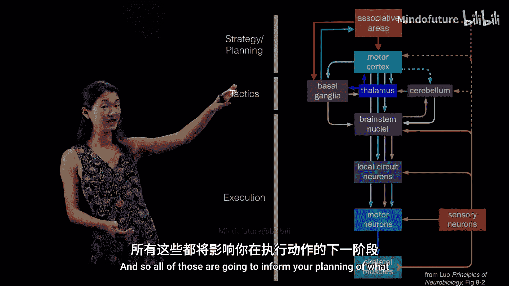

现在，让我们上升到运动控制的最高层级——策略与规划层，这主要涉及**大脑皮层**。

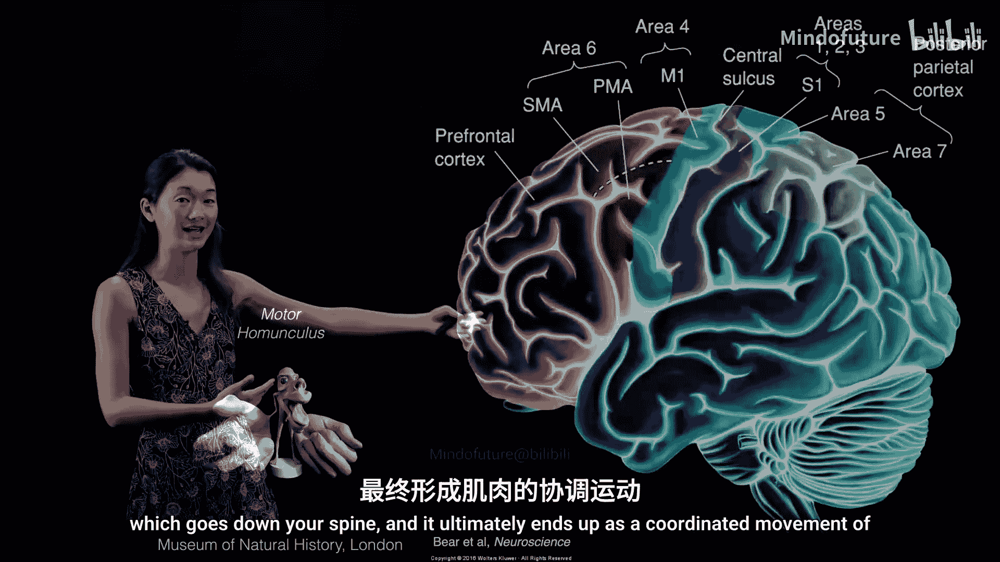

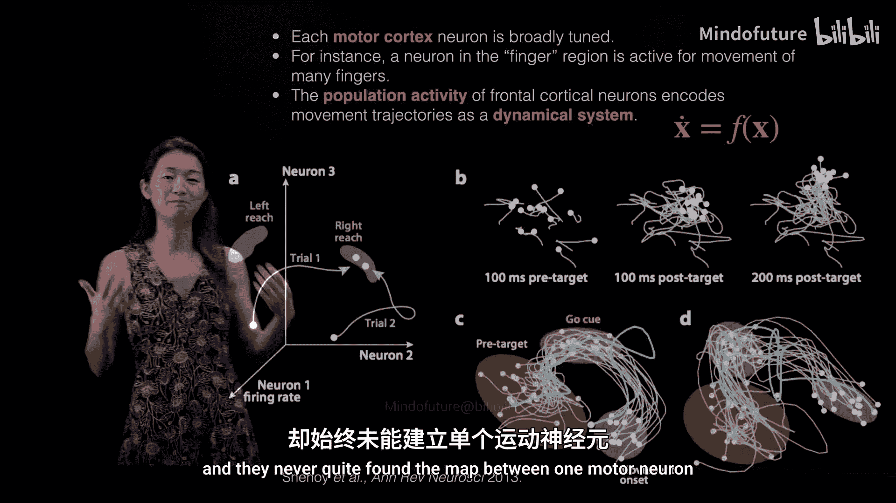

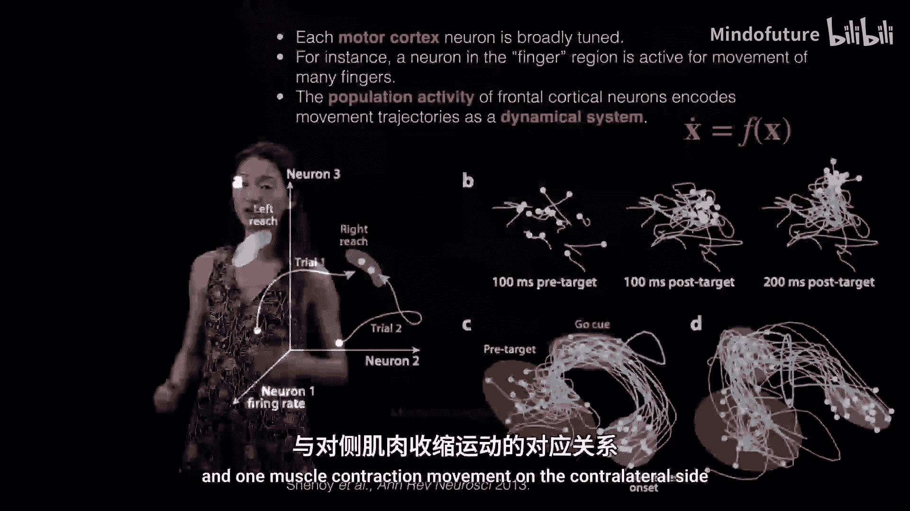

我们可以用一个山地自行车下坡的类比来理解：路上的小颠簸来得太快，你需要依靠脊髓和感觉反馈快速执行应对（执行层）。但当你看到前方5秒处有一块大岩石时，你就需要提前规划路线（策略层）。这种规划依赖于较慢的感觉模态（如视觉），它让你能预见未来，整合多感官信息（视觉、本体感觉），并基于经验（了解自己和自行车的能力）做出决策。

在大脑中，中央沟后的**初级体感皮层**处理感觉信息，其前的**初级运动皮层**则与运动执行相关。更靠前的**前运动皮层**、**前额叶皮层**等高级联合区负责运动的规划和决策。这些区域决定行动后，将指令下传到丘脑、基底神经节和小脑，再经脑干、脊髓，最终形成协调的肌肉运动。

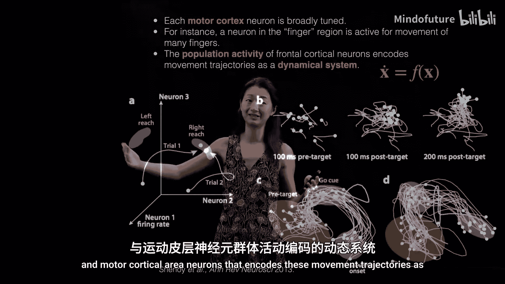

关于运动皮层的一个重要观点是：**不存在单个神经元控制单块肌肉或简单运动的“运动感受野”**。运动的计划信息编码在**运动皮层神经元的群体活动**中。这类似于我们之前讲过的**群体编码**原理。解码这个神经元群体的动态活动，可以预测动物下一步的运动轨迹。我们思考的是目标（“去拿那个杯子”），而不是具体的肌肉收缩，后者被委托给了运动通路的执行阶段。

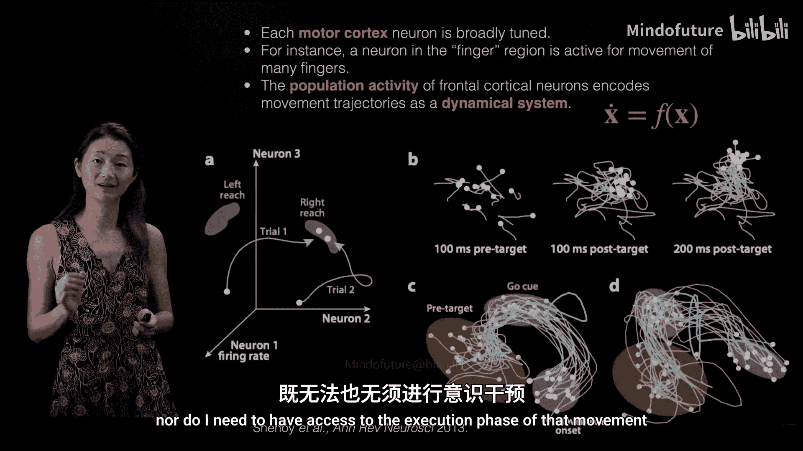

## 总结与核心主题 🎯

本节课中我们一起学习了自主运动的神经控制通路。回顾整个感觉-运动系统的内容，我们可以总结出三个贯穿始终的核心主题：

1.  **反馈无处不在**：反馈循环对于理解神经系统功能至关重要。它存在于动物与环境之间，也存在于神经系统的各个尺度——从本体感觉神经元到运动神经元，从局部脊髓回路到高级皮层，无处不在。忽略反馈就无法理解系统整体。
2.  **层级结构**：感觉和运动系统都具有清晰的层级结构。低层级（如脊髓）负责快速、自动化的执行，时延短，通常无意识介入。高层级（如皮层）负责较慢的、需要深思熟虑的规划和决策，它向低层级发出指令，但将具体执行细节委托下去。
3.  **多感官整合**：真实世界的行为需要**多感官整合**。各种感觉信息（视觉、听觉、本体感觉等）很快就在神经系统内混合、相互调制，形成对世界的完整感知，并在此基础上做出行动决策。这种整合通过高层级系统间的反馈连接实现。

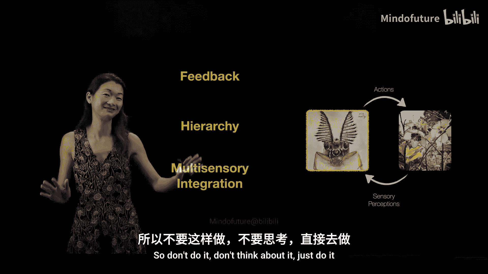

这三个主题相互关联，共同构成了我们与世界交互的复杂神经基础。最后，请记住一个实用建议：下次下楼梯时，不要试图思考具体是哪块肌肉在动、按什么顺序动——就像我第一次学习肌肉控制时尝试的那样，这几乎让我摔倒。有些事情，交给你的神经系统自动执行就好。