神经科学入门：P29：导航与寻路之道 🧭

在本节课中，我们将深入探讨导航的神经科学原理。导航是动物的核心能力之一，因为我们需要在这个广阔的世界中移动，所以必须知道自己身处何处，以及如何到达下一个想去的地方。

寻路的艺术有时简单，有时复杂。例如，假设将你放在一座城市中，你看到的是这样的景象。给你一点时间观察。许多人可能已经认出，这是纽约曼哈顿市中心。纽约市恰好是那种街道呈网格状布局的城市，街道名称也很有规律，比如第一大道、第二大道，或者A街、B街。因此，如果你知道自己的位置和目的地的交叉路口，就可以在网格上规划一条路径，从当前位置前往目的地。只要身处网格状城市，这相对简单。

当然，许多城市并非网格布局。假设将你放在一座看起来更像这样的城市中。给你一点时间。许多人可能意识到，这实际上是伦敦。伦敦是一座古老的城市，早期的城市规划者并未打算将街道设计成网格状。因此，在纽约市确定位置与在伦敦确定位置，作为导航问题的挑战性有天壤之别。

让我们把问题拉近一点。无论你现在身处何处，可能在家、在学校，或者正在用手机在通勤途中观看。假设就在你当前的位置，想象一下，你如何知道从那里去你最喜欢的餐厅？想象一下那条路径。好的，请开始想象。

以下是几种可能解决这个导航任务的不同方法：

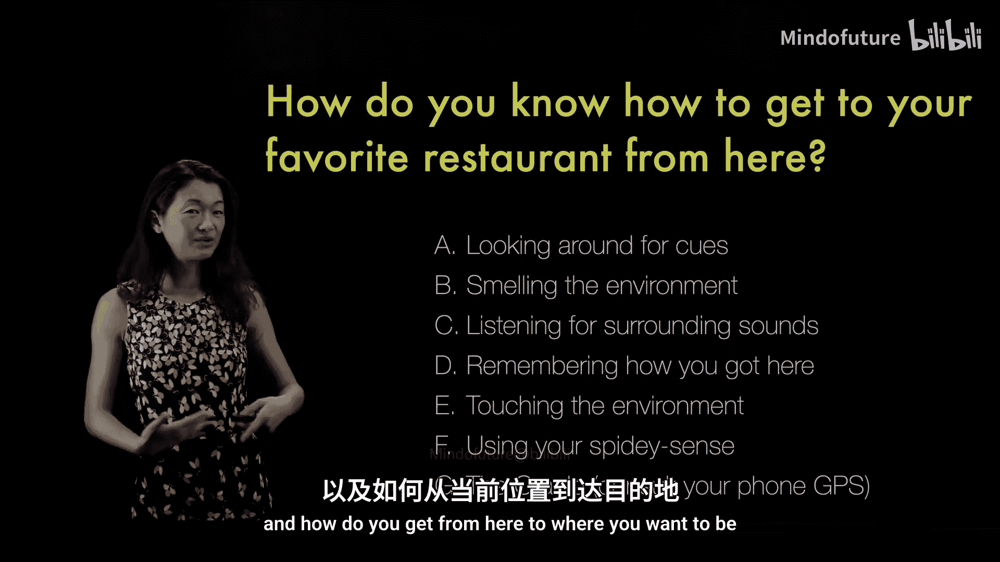

*   **视觉线索**：你可以环顾四周寻找线索，可能会说：“哦，我在某某街，我知道餐厅在另一条街，我知道它们之间的相对关系。”这样你就知道该往哪里走了。
*   **嗅觉线索**：这个策略包括嗅闻环境。你可能知道你最喜欢的餐厅闻起来是什么味道，因此可以跟着气味走。如果距离很远，这可能不太有效；但如果就在同一条街区附近，可能会更有效一些。
*   **听觉线索**：我们也可以利用听觉。你可能知道你的餐厅位于城市中非常繁华的区域，附近恰好有一个火车站。因此，你可能会留意火车站的声音和周围的嘈杂声，作为判断是否接近目的地的线索。
*   **路径记忆**：这是一个非常有趣的方法，即记住你是如何到达当前位置的。很可能，你过去已经不止一次走过从当前位置到餐厅的路径。所以，你可以回忆起上次是如何到达那里的，这实际上并不需要主动使用任何感官线索来定位，你只是在回忆过去的路径。
*   **触觉线索**：如果你想更有创意，也可以利用环境中的触觉感知。这在非常黑暗的场景中可能有用，例如在黑暗的走廊中导航。也许这家餐厅没有灯光，你可以利用你的“间谍感官”摸索着前进。
*   **外部工具**：像我们许多生活在智能手机普及的现代环境中的人一样，你也可以求助于“神谕”——即咨询手机上的GPS，来找出如何从当前位置导航到餐厅。

除了最后一种（F），以上所有方法都是相对有效的定位和寻路方式。在这个场景中，目标是找到你最喜欢的餐厅。我想说明的重点是，我们可以利用所有这些线索，这使得研究变得非常复杂。

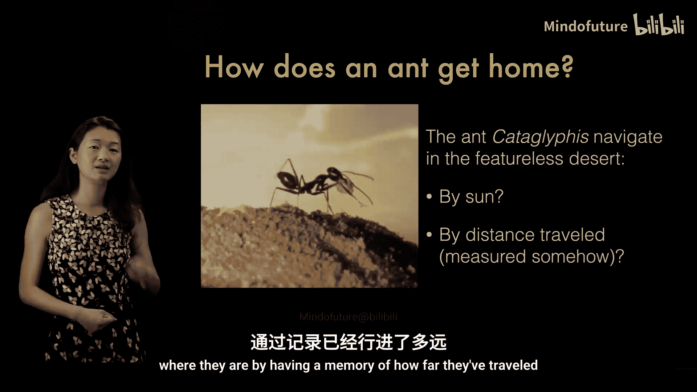

接下来，我将展示一个相对迷人的研究案例，其中在蚂蚁身上对此进行了调查。这是一种特定的沙漠蚂蚁。它实际上生活在这样一个缺乏特征、炎热的沙漠中，那里没有树木，没有草地，是一片平坦的景观。因此，当这只蚂蚁试图解决“如何回家”这个问题时，它没有太多线索可用。它四处觅食寻找食物，一旦找到食物，就需要回家返回巢穴。问题是，在这个感官线索极其贫乏的环境中（我们上一页讨论的许多感官线索对它并不适用），这只特殊的蚂蚁是如何做到的？

关于蚂蚁如何导航，有几种假设。首先，虽然仍有太阳，但太阳的位置会随着一天中的时间和季节而变化。另一个假设是通过测量它们已经走了多远。目前尚不清楚它们如何做到这一点，但至少似乎合理的是，它们可能通过记住自己走了多远来记住是如何到达当前位置的。

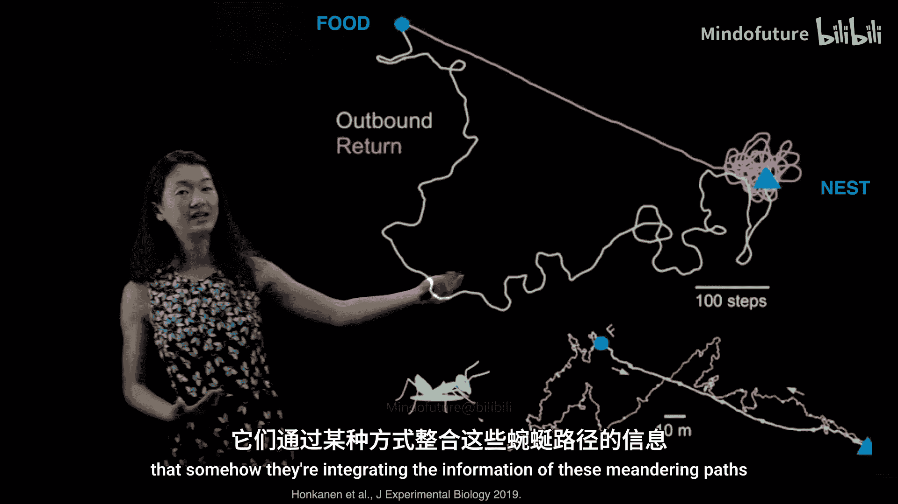

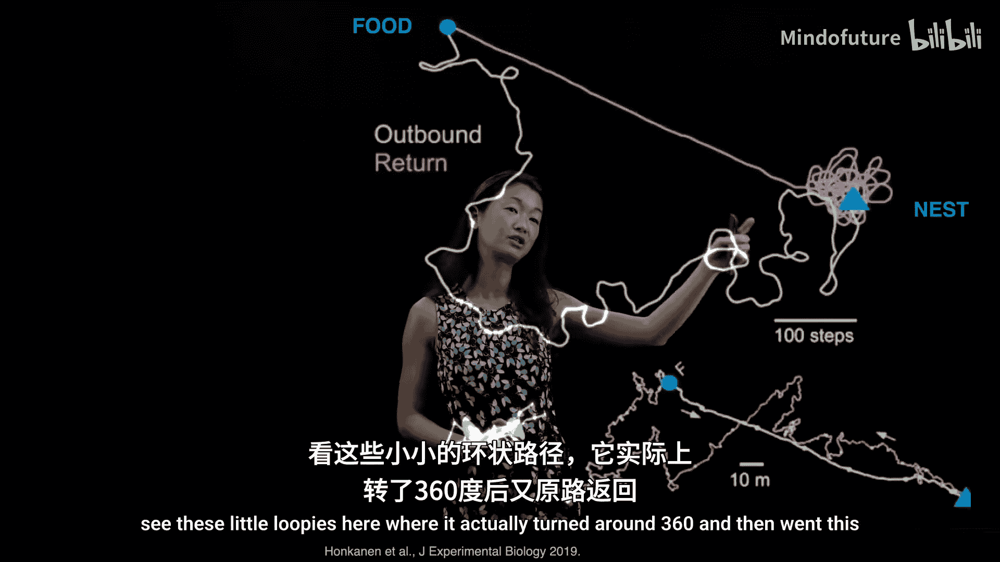

以下是观察到的数据情况。我将为你分解这张图。研究人员追踪了一只蚂蚁在相当长距离上的路径。下面的这个刻度条代表100步。所以，100步对于蚂蚁来说已经相当远了。在出发觅食时，蚂蚁从蓝色三角形标记的巢穴开始，它会四处游荡，因为基本上是在寻找食物。最终，它绕了几圈，找到了食物。一旦找到食物，它就想把食物带回巢穴。我们观察到的是，它并没有沿着原路返回。记住，这是一片平坦、缺乏特征的沙漠，除了移动的太阳，没有任何视觉线索；也没有气味线索，因为气味线索可能只存在于它刚刚走过的路径上。相反，它直接沿着直线返回巢穴。我们可以反复观察到蚂蚁的这种行为。

一种推测它们如何做到这一点的方法是，它们以某种方式整合了这些蜿蜒路径的信息，包括这里的小回环（它实际上转了360度，然后又朝这个方向走）。它似乎以某种方式整合了关于它所有时间指向何处的信息。它似乎记得巢穴在哪个方向。有些人类在这方面比其他人更擅长。它也知道自己离巢穴有多远，因为你可以看到，一旦它开始返回巢穴，不仅方向正确，而且当接近巢穴时（记住，巢穴是不可见的），它实际上会绕圈寻找一会儿，因为它认为巢穴入口大概在这附近，感觉已经很近了。所以蚂蚁会绕圈寻找，直到真正找到巢穴入口。因此，你可以看到，它通过围绕巢穴区域绕圈，知道自己离巢穴有多远。

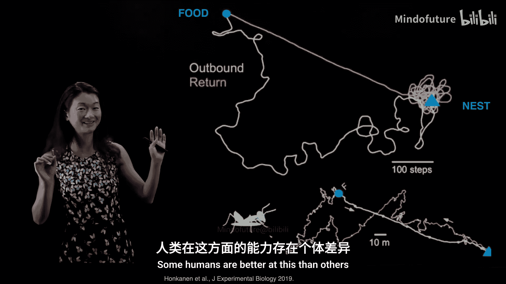

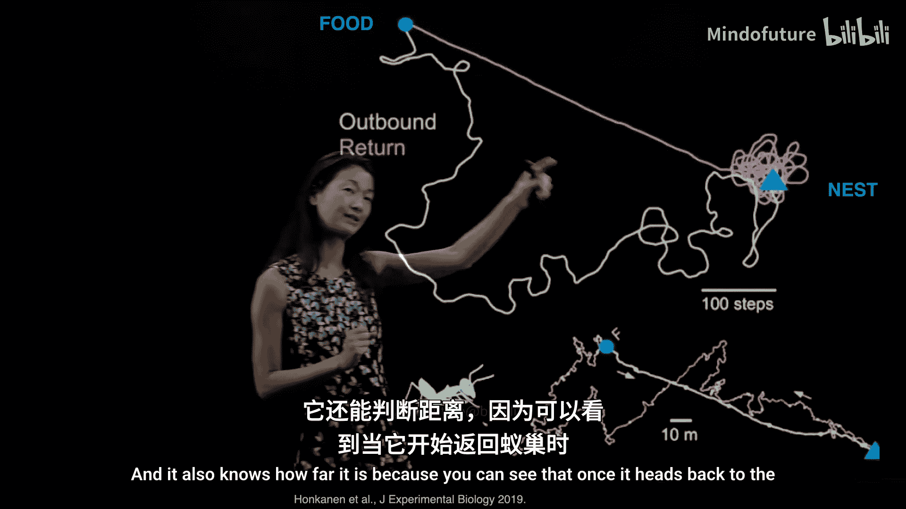

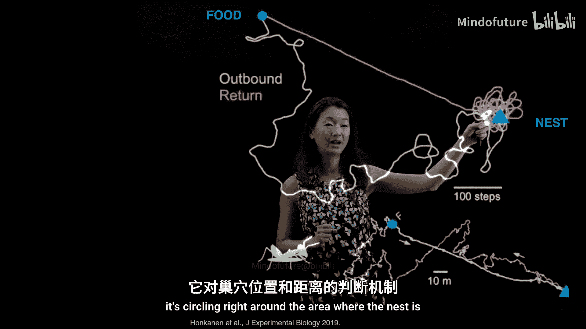

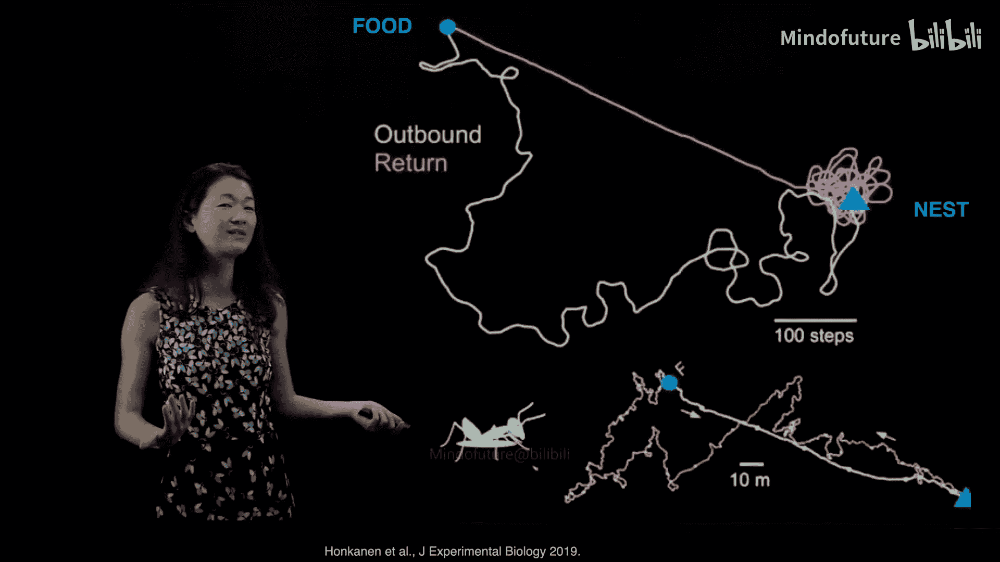

问题是，它是如何做到这一点的？它是如何跟踪某些信息的？它是在跟踪太阳吗？是在数步数吗？还是在整合某些信息？我们如何知道呢？

在一个非常巧妙的实验中，情况是这样的。这就是著名的蚂蚁“里程计”实验。研究人员让这些表现出非凡行为的蚂蚁进行了以下操作。他们取正常的蚂蚁腿，看起来像那样，有几节。然后，他们截短了蚂蚁的腿。于是得到了较短的残肢和稍长一点的残肢。现在，这两种残肢都比正常的腿短。所以蚂蚁的腿比正常长度短。在你担心之前，需要说明这在野外昆虫中其实是相对常见的情况，尤其是在炎热的沙漠沙地中。我不是说它们感觉不到疼痛，它们确实有痛觉感受器，但这种截肢操作在自然界中，如果你看到一只野生的蚂蚁在爬行，看到它缺少部分肢体甚至整条腿，并不罕见。

接下来是真正酷的部分。研究人员不仅人为地缩短了蚂蚁的腿，还加长了它们的腿。他们是这样做的：取一个类似带硬毛刷的工具，从刷子上取下这些硬毛，制作了微型的蚂蚁“高跷”，然后将这些刷子毛粘在蚂蚁的腿上，从而人为地加长了它们的腿。现在我们有了两种操作：正常的蚂蚁，以及我们可以比较的，腿比预期短的蚂蚁和腿比预期长的蚂蚁。

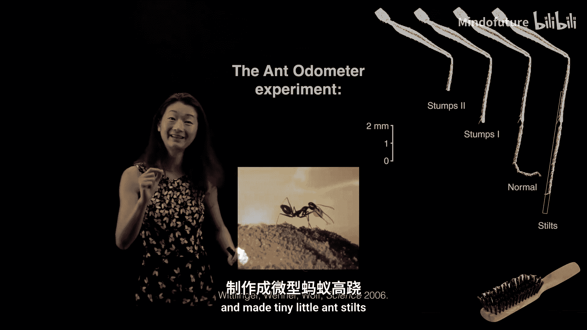

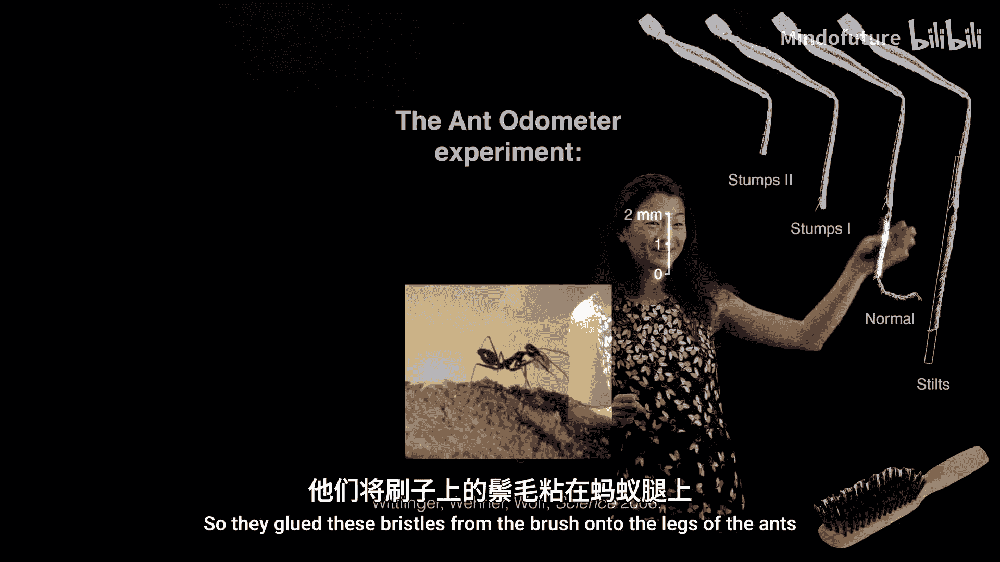

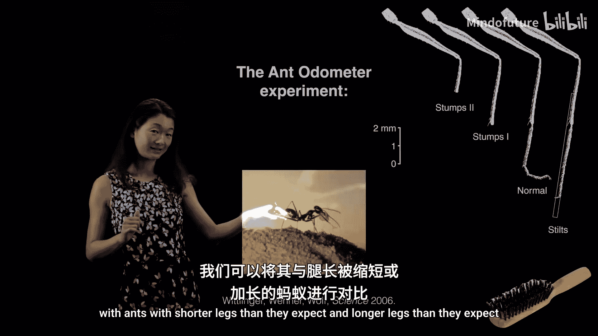

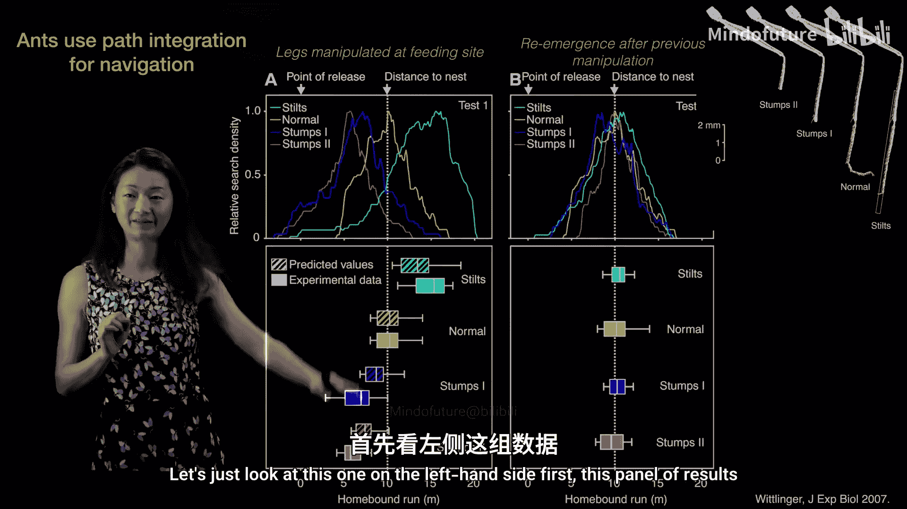

以下是研究发现。让我们稍微看一下数据，这张图有点复杂，我将向你展示结果并分解它。首先看左侧的这组结果。研究人员在巢穴释放蚂蚁，让它们四处游荡（大概它们一直在脑中整合信息），直到在喂食点找到食物。然后在喂食点进行操作。在蚂蚁找到喂食点后，他们要么截短蚂蚁的腿（使其更短），要么给蚂蚁的腿粘上“高跷”使其变长，然后在喂食点释放它们，观察它们的行为。蚂蚁试图回家。

对于未受操作的蚂蚁（这里是黄线），你可以看到平均而言，蚂蚁直接返回巢穴。这里回家的距离大约是10米，所以它直接回到了应该去的地方，并在那里找到了巢穴。如果蚂蚁的腿被截短了，你会看到蚂蚁未能到达巢穴的位置，它们在离巢穴更近的地方（大约5米处）停下来，并在那里寻找。在一个绝对惊人的结果中，腿被加长（像踩高跷一样）的蚂蚁完全超出了巢穴，它们走得太远了，反而在离喂食点大约15米的地方寻找巢穴。所有这些结果综合起来，确实描绘了一幅图景：蚂蚁在某种程度上是通过数步数来判断距离的。

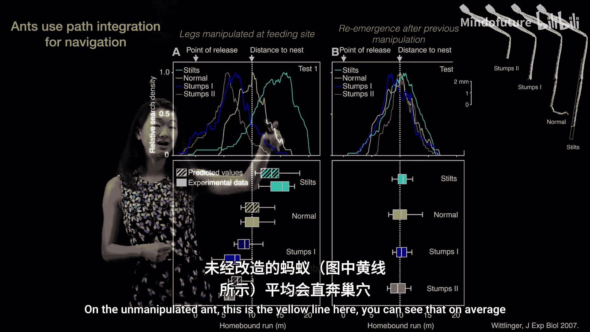

然而，这并不能解释它们如何知道前进的方向。因为请记住，在返回巢穴时有两件事在发生：它确切地知道该朝哪个方向前进，也知道该走多远。这个“数步数”的观察结果只解释了它们如何知道该走多远，并没有解释它们如何知道该朝哪个方向前进。对于这个问题的答案，我请你继续关注后续的视频，我们将回到这一点，探讨我们认为像蚂蚁这样的昆虫是如何知道该朝哪个方向前进，以及如何知道直接返回巢穴而不是朝不同方向游荡的。

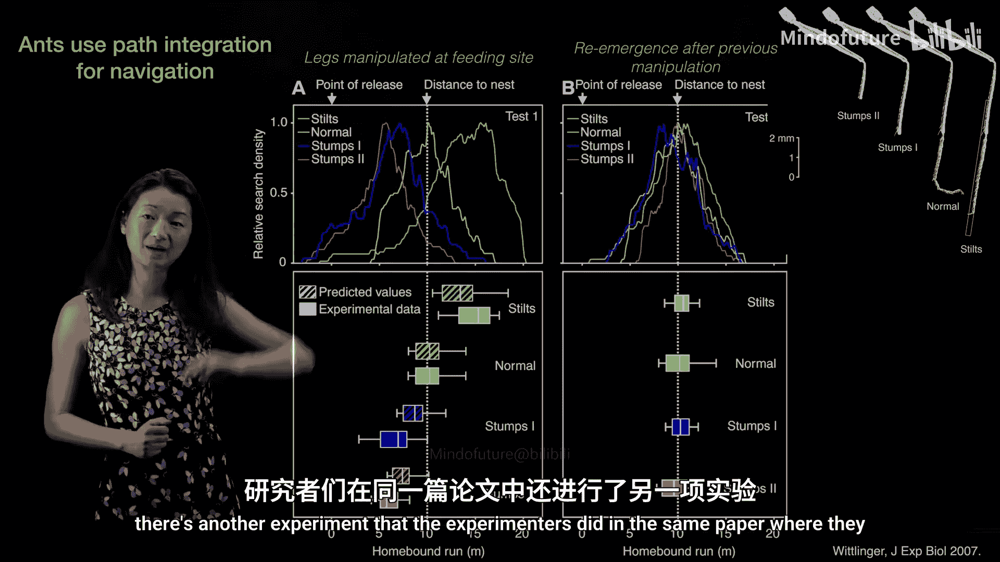

我将继续讨论这张图，谈谈同一篇论文中研究人员做的另一个实验。他们观察到，在之前的操作之后，当蚂蚁重新适应后，所有四组蚂蚁现在都能在返巢过程中返回巢穴。因此，它们已经学会了（或适应了）自己腿的长度，并能够再次以它们本应和预期的方式执行任务。

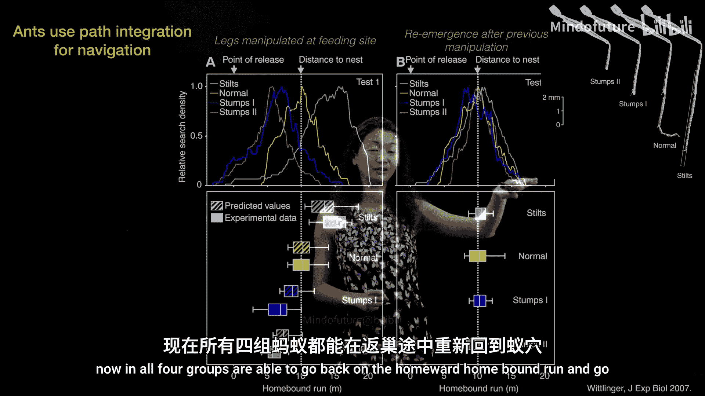

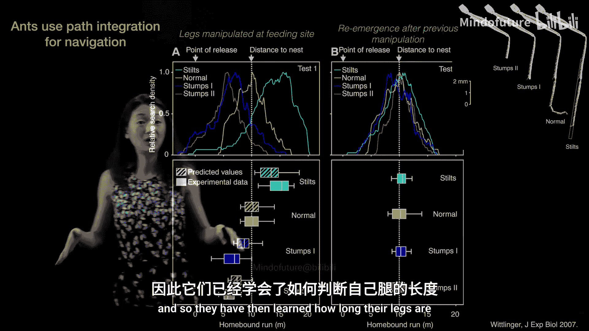

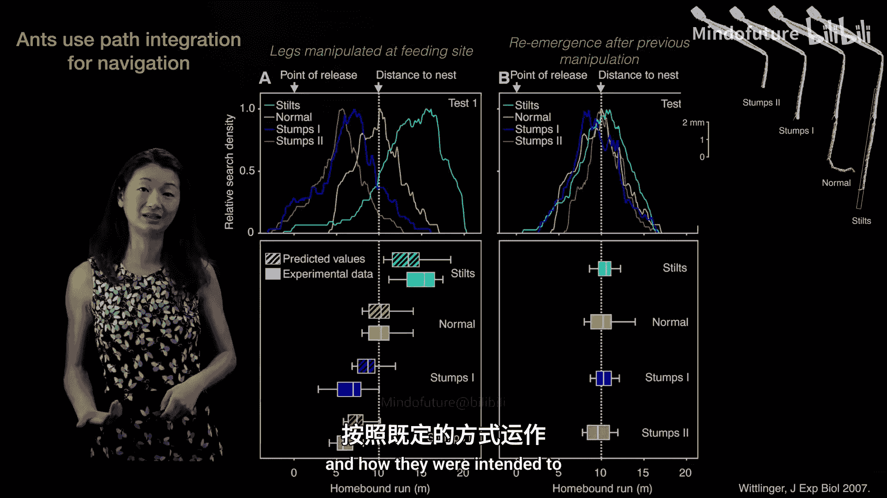

因此，关于寻路的艺术，在接下来的几个视频中，我们将深入探讨支撑寻路艺术的神经科学和神经生物学系统。但我希望到目前为止，通过结合内省（思考我们如何到达想去的地方）以及观察这个蚂蚁“高跷”实验，你已经了解到，寻路确实需要整合多种感觉模态。这不是一个仅靠视觉就能完成的感觉任务（例如蚂蚁几乎没有视觉），也不能仅靠记忆完成（因为记忆并不完全准确）。它涉及决策，当然，由于你是在外部世界中移动和控制身体，它还需要运动控制。当你改变一些运动控制（比如让你的腿变得比应有的长）时，就会对你寻路的能力产生影响。

所以，导航是一个真正有趣的话题，不仅因为它很重要，而且因为它为我们提供了一个绝佳的机会，来综合我们关于其他感觉系统和运动系统的知识，服务于一项对动物及其生存至关重要的任务。从动物的角度来看，这是神经系统真正需要完成的事情。这些寻路能力，如果没有整个神经系统的整合效应，是不可能实现的。在接下来的几个视频中，我们将深入探讨这在各种不同动物中是如何具体运作的，希望你继续加入我们。

**本节课总结**
在本节课中，我们一起学习了导航的神经科学基础。我们探讨了动物（包括人类）在复杂环境中定位和寻路时可能依赖的多种感官线索，如视觉、嗅觉、听觉、记忆和触觉。通过分析著名的沙漠蚂蚁“里程计”实验，我们了解到导航是一个需要整合多种感觉信息、记忆、决策和运动控制的复杂过程。实验表明，蚂蚁可能通过“数步数”来估算距离，但方向感知的机制仍有待探索。这凸显了导航行为是神经系统多系统协同工作的结果，对动物的生存至关重要。