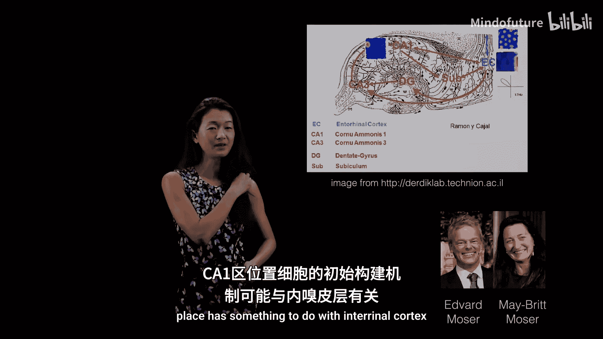
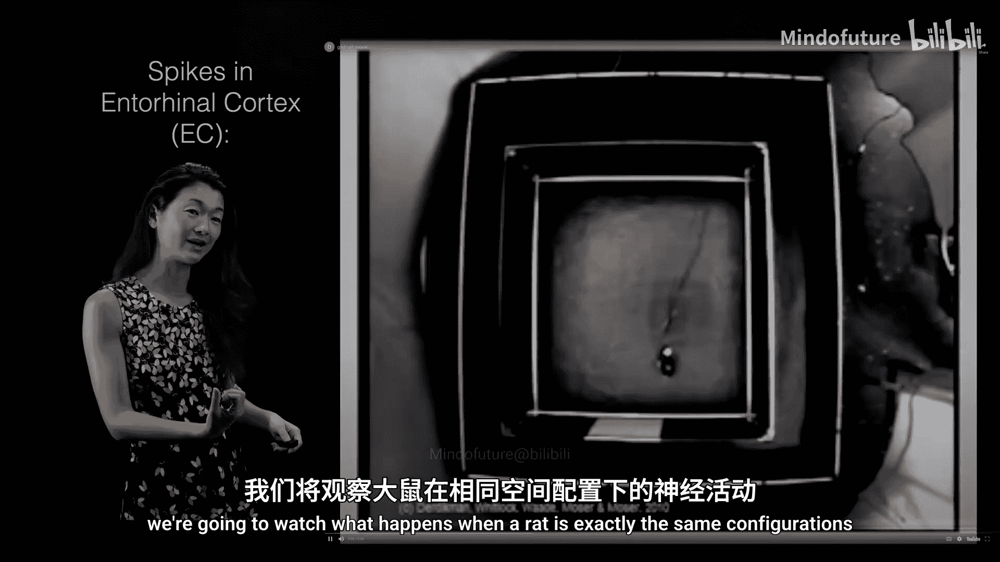
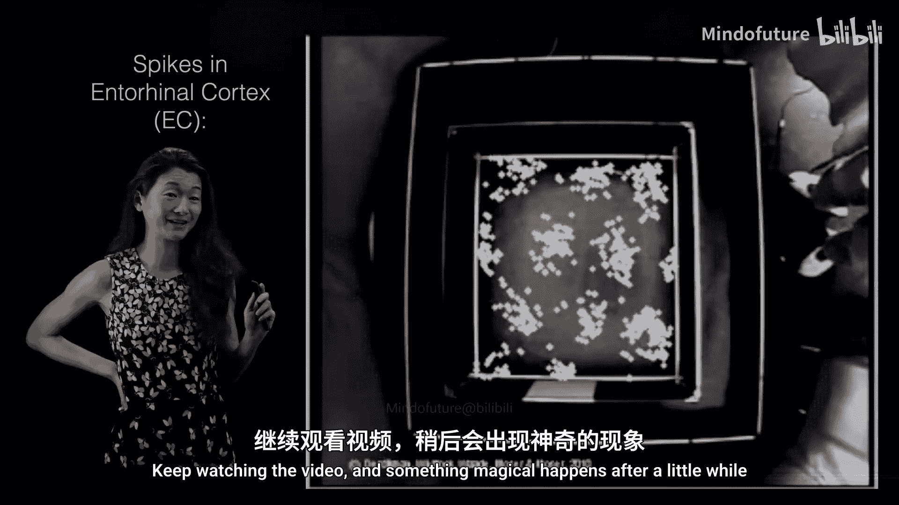
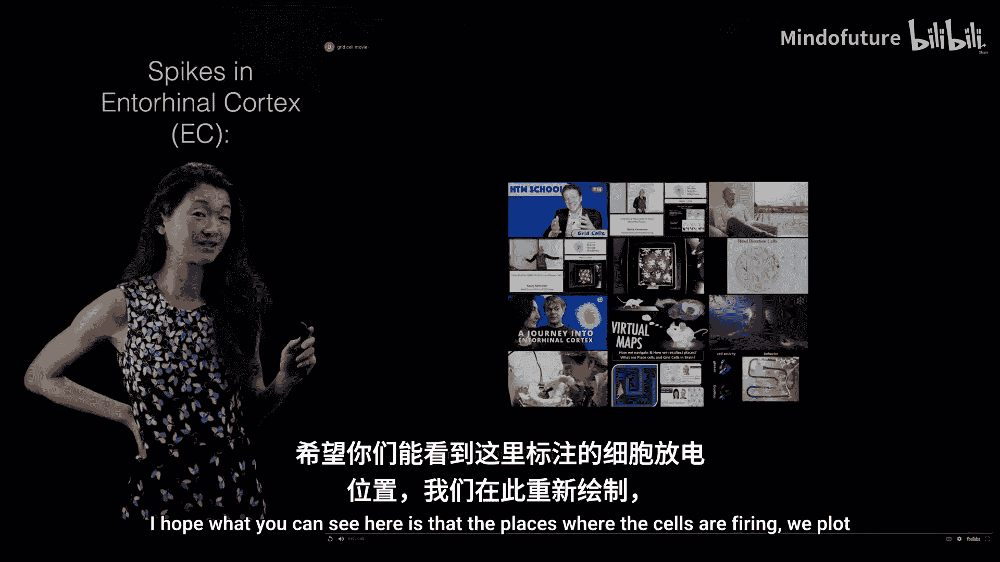
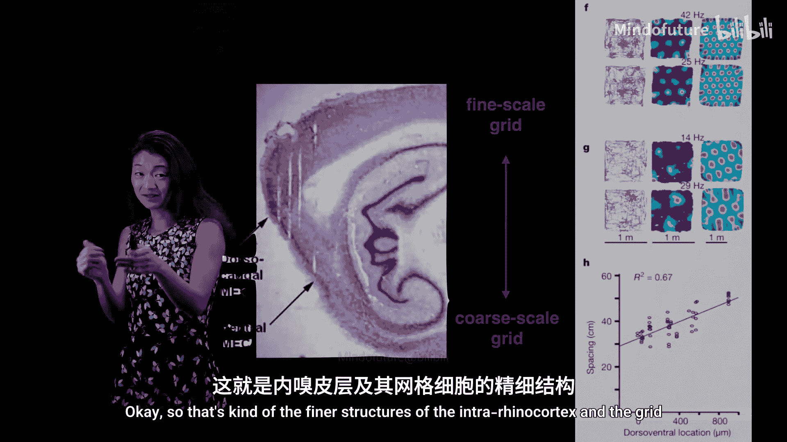
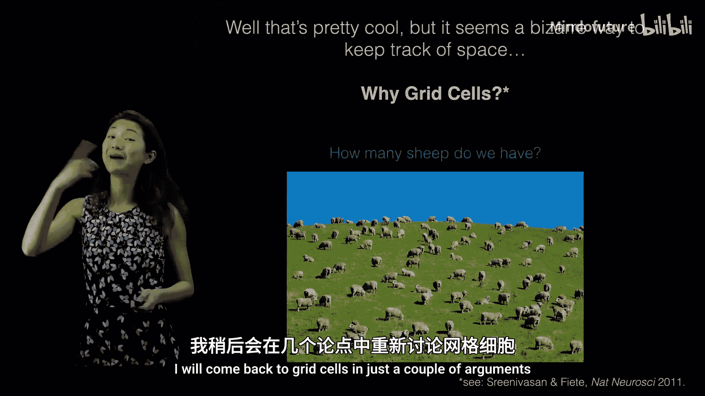
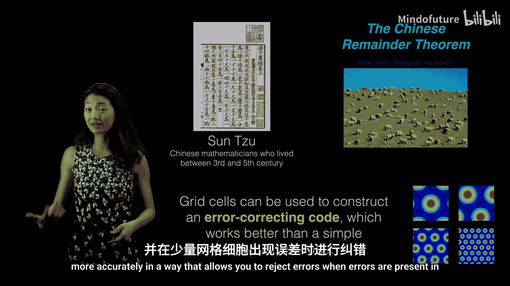
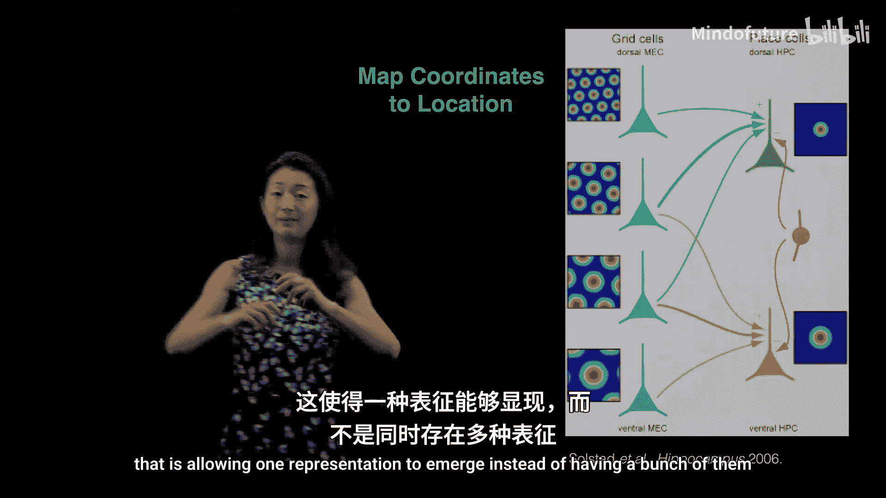

# 031：内嗅皮层网格细胞 🧠

在本节课中，我们将学习大脑如何构建空间位置感。我们将从海马体中的位置细胞出发，探索其信息来源，并重点介绍内嗅皮层中的网格细胞。这些细胞以一种独特的网格模式放电，共同构成了一个精确且具有容错能力的空间导航系统。

## 从位置细胞到网格细胞

上一节我们介绍了海马体中的位置细胞，它代表了动物在空间环境中的具体位置。但我们留下了一个问题：位置细胞是如何形成的？大脑是如何知道动物在空间中的位置的？本节我们将尝试揭开这个谜团，通过讨论内嗅皮层的网格细胞来解答这个问题。

这个故事始于爱德华·莫泽和迈-布里特·莫泽的开创性工作。他们在观察到海马体CA1区存在位置细胞后，开始追踪这些信息的来源。海马体位于大脑皮层层级的高层，并不直接接收来自感官的原始信息。因此，莫泽夫妇通过研究向海马体投射信息的脑区来寻找答案。

以下是海马体及其主要输入来源的示意图：

如图所示，其中一个向海马体投射信息的区域是内嗅皮层。内嗅皮层向齿状回投射，齿状回又向CA3区投射。同时，内嗅皮层也直接向CA3和CA1区投射。莫泽夫妇进行了一系列实验，系统地损毁或切除每个向海马体提供输入的小皮层区域，然后观察位置细胞何时消失。

当他们损毁了内嗅皮层后，位置细胞的活动变得模糊并最终消失。由此他们推断，CA1区位置细胞的构建方式与内嗅皮层有关。于是，他们与同事一起开始记录内嗅皮层的神经活动。

## 网格细胞的发现

现在播放一段视频。视频中，一只老鼠在一个盒子里跑动。实验者在盒子右侧撒下巧克力碎屑。这次，电极不是放在海马体CA1区，而是放在了这只老鼠的内嗅皮层。

每当内嗅皮层的一个神经元放电时，屏幕上就会出现一个点。视频加速播放，以便我们观察老鼠的行为和神经元放电模式。

起初，放电点似乎遍布整个盒子，没有任何规律，看起来毫无意义。但继续观看，神奇的事情发生了。

我希望你能看到，细胞放电的位置开始呈现出清晰的模式。

我将放电点重新绘制在这里。所有出现尖峰信号（红色斑点）的位置形成了一个网格。不仅如此，这是一个**六边形网格**，类似于自然界中球体堆积或蜂巢的结构。

因此，这些细胞被称为“网格细胞”，因为它们在网格顶点放电。每当老鼠位于这些三角形交叉的顶点时，该细胞就会放电。所以，当你知道这个特定的内嗅皮层网格细胞在放电时，你只知道老鼠一定位于这些顶点之一，但无法确定是哪一个。

## 网格细胞的组织特性

此外，如果你从内嗅皮层的不同部位进行记录，会发现这些网格持续存在，但大小不同。在大鼠内嗅皮层从背侧到腹侧的轴线上，我们观察到网格具有不同的空间频率（即网格间距不同）。

在内嗅皮层的一端，网格非常小，顶点间距很近。随着你向另一端移动，网格的六边形结构保持不变，但网格点之间的间距变得越来越大。

下图展示了这一数据：

如图所示，作为背腹侧位置的函数，随着沿背腹侧轴线向下移动，网格的间距变得越来越大，从精细尺度网格到粗糙尺度网格。这在此处得到了演示，因为存在多种具有不同间距的网格细胞。

内嗅皮层网格组织的另一个非常酷的特点是，位置相邻的细胞往往具有相似的空间频率（间距），但空间相位略有不同。因此，你可能是一个间距约为这么大的网格细胞，而你旁边的细胞可能具有完全相同的间距，但网格方向旋转了一点。

这就是内嗅皮层及其网格细胞的精细结构。迈-布里特·莫泽在她最喜欢的、为诺贝尔颁奖典礼设计的连衣裙上，穿了一件网格细胞图案的裙子，由设计师马修·哈伯设计。实际上，你可以在马修·哈伯的网站上购买到受此诺贝尔颁奖典礼网格细胞设计启发的各种版本纺织品。

## 为什么需要网格细胞？

所有这些都很酷，但它实际上引出了另一个问题。我们知道有位置细胞，这很有道理，因为你想知道自己在空间中的位置。我们有这些网格细胞，并且我们知道网格细胞以某种方式产生了位置细胞。但为什么要这样做？为什么是这些网格？这是一种非常奇特的追踪空间位置的方式。

为什么不是一个具有坐标系的网格系统？也许那样会更简单，但网格细胞确实存在，至少在我们记录的大鼠等哺乳动物中，大自然选择了这种方式。那么，为什么是网格细胞？

以下是一组非常直观、有助于建立理解的论证，关于我们为什么拥有这些网格细胞。我最初是从同事埃拉·菲特那里听到这个故事的，他发表了相关论文并做了如下类比。这个类比与我们如何数羊有关。这听起来可能毫无道理，但请稍等，我会解释为什么我们数羊的方式与我们追踪空间位置的方式（即网格细胞）有关。

首先，我们回顾一下“余数”的概念。这可能是你在小学毕业后就再也没见过的东西。假设你有8个乐高迷你人仔，想分给6个朋友。这意味着每人分得1个，还剩下2个。你无法把它们切成两半。用数学方程表达就是：`8 ÷ 6 = 1 余 2`。

用更正式的数学语言写作：`8 mod 6 = 2`。换句话说，8除以6，余数是2。如果是`9 mod 6`，结果等于3，因为余数是3，依此类推。

让我们做以下练习。假设我给出以下信息：我有一个数字`N`，你不知道`N`是多少。但我知道：
*   `N mod 5 = 2` （N除以5余2）
*   `N mod 7 = 1` （N除以7余1）
*   `N mod 11 = 0` （N除以11余0）

满足所有这三个条件的最小`N`是多少？如果你按照余数的定义进行推算，你会发现满足这组方程的最小`N`是**22**。这不是唯一的答案，但它是满足这系列余数方程的最小答案。

这种计数方法也被称为**中国剩余定理**。它被归功于许多不同的数学家，并以中国命名，因为最早的记载之一来自中国数学家孙子。有一个迷人的故事（不知真假），讲述了牧羊人如何用这种方法数羊。

因为如果你有两只羊，你可以直接数“1， 2”。如果你有10只羊，数到10完全没问题。但如果你有很多羊，你想知道有多少只，出去数的时候很容易在数到几百时出错。中国剩余定理提供了一种无需数到很大数字就能知道羊群数量的方法。

算法如下：与其让一个人出去数羊，不如派出几个不同的人，让他们都去数羊。但我不让他们数总共有多少只，而是让他们数**余数**。我会让一个人出去数除以7的余数。他会数1,2,3,4,5,6,7, 1,2,3,4,5,6,7……一直循环数完所有羊，然后回来告诉我余数是4。下一个人出去数除以11的余数，以此类推。

通过派出多个以互质数为模进行计数的人，他们回来报告余数，我们就可以推断出牧场上实际有多少只羊。换句话说，这是一种利用**群体编码**来追踪大数字的方法。“群体”就是你派出去用余数数羊的人数。但这是一种**纠错编码**。

它具有这样的特性：如果一个人带回来的余数与其他所有人的数字不符，你就知道他们可能数错了，但其他人是对的，因为他们的余数是相互一致和协调的。

## 网格细胞作为群体编码

网格细胞的类比解释了为什么我们需要这些不同大小的奇特网格来追踪空间位置：它可以用来构建不仅是一个简单的群体编码，而且是一个**具有纠错能力的群体编码**。通过了解网格细胞群体的放电情况，我们可以推断动物实际所在的位置，这种方式能够纠正错误，并且不允许任何单一模态的错误传播，最终导致错误的位置估计。

简单的群体编码我们已经见过很多次了：
*   在视觉系统中，我们讨论过三种光感受器的群体编码，你必须知道每个光感受器的活动群体才能确定光的实际波长。
*   在嗅觉系统中，我们讨论过群体编码，因为有数百个受体，它们都对多种气味有反应，所以你必须知道它们如何放电的群体情况，才能知道环境中存在哪些气味。
*   在关于运动控制的讲座中，我们也讨论过运动皮层M1中的群体编码，因为那是每个M1中的单个神经元并不直接对应可解释的东西（不是一个神经元对应一块肌肉，甚至不是一个神经元对应一个关节），真正代表伸手动作的动态轨迹或动物接下来要执行的一组运动学任务的，似乎是M1中所有细胞的动态群体活动。

因此，我们已经见过群体编码的例子。内嗅皮层中网格细胞的这种群体编码是另一个例子，它具有一个有趣的特性，即可能与我们如何使用中国剩余定理来更准确地数羊有关，这种方式允许你在少数网格细胞出现错误时拒绝这些错误。

## 从网格到位置

那么，这具体是如何工作的呢？以下是一个卡通示意图：

大鼠内嗅皮层中的这些网格细胞，背侧的间距较近，腹侧的间距较远。这里的类比是，这些就是我们用来计算余数的“模数”。就像“数到7，告诉我余数”、“数到11，告诉我余数”、“数到19，告诉我余数”等等。

通过将它们结合起来，并在它们向背侧海马皮层的投射中，我们可以形成位置细胞。我们可以推断，如果所有这些细胞同时活跃，那么老鼠一定位于所有这些不同网格细胞放电位置重合的某个地方。同样，如果你将不同的网格细胞群体活动相加，就可以推断老鼠实际上在另一个地方。

我要指出这个示意图的另一个特征，这是我们反复看到的一个主题。我在感觉系统的背景下告诉过你，但也向你预告过，**侧抑制**是我们在许多神经回路中看到的非常常见的主题。你在这个示意图中也能看到：位置细胞之间存在侧抑制。位置细胞会相互抑制。因此，如果多个位置野都处于活跃状态，而其中一个变得稍微更活跃，它们实际上会抑制其他位置野，从而让一个位置野作为“赢家”突显出来——“我在这里，不在那里”。通过这种方式，位置野形成了对动物实际所在位置的一致表征，而不是让一堆不同的想法同时活跃。

这是导航系统和追踪动物位置方式中的一个主题，它使用了侧抑制的思想，就像在感觉系统中用来就气味是什么或光来自哪里达成共识、增加对比度、形成对现实世界发生事件的表征一样，这种方式允许一个表征突显出来，而不是让多个可能性相当的表征并存。

## 记忆宫殿

这里还有一个非常酷的联系，那就是“记忆宫殿”的概念。这是记忆专家常用的一种技巧。例如，有一些比赛，你会拿到一副洗乱的、完全随机的52张扑克牌，你只能看一次牌的排序（比如黑桃7、红心2等等），然后必须仅凭一次观看就记住确切的顺序。

人们通常采用的一种记忆这种任意信息的方法是“记忆宫殿”技巧。他们首先将每张牌与一个地点或一组物体关联起来。例如，他们会说红心A是一个祖父钟。所以当他们看到红心A这张牌时，他们不会试图记住“红心A”，而是试图记住“祖父钟”，同时想象自己正走过一条虚构的走廊。下一张牌可能是梅花2，而梅花2实际上是一个绿色的花瓶。那么他们接下来会想象在这个虚拟走廊里看到一个绿色的花瓶。这样，他们就会说“祖父钟，绿色花瓶”，这告诉了他们牌的排序。

这种方法可能非常有效，因为你大脑中的记忆运作方式非常擅长记忆地点。你的大脑中似乎有所有这些系统，它们进化出了知道你在空间中的位置以及你刚刚看到了什么的能力。拥有这种空间记忆能力是动物非常擅长的，因为这是一个关键的生存特征。一个不知道自己在哪里、要去哪里的动物可能活不了多久。所以，这对记忆系统来说是一件非常重要的事情，必须变得非常擅长。

因此，利用你的大脑已经擅长的系统来做一些有点人为的事情（比如，人类并没有进化到需要记忆一副扑克牌），是一种非常好的记忆方法。这实际上是“搭便车”，利用导航和记忆的机制来执行像记忆一副扑克牌这样的技巧。

## 总结

本节课中，我们一起学习了大脑空间导航系统的关键组成部分。我们从海马体的位置细胞出发，追踪其信息来源，发现了内嗅皮层中放电模式呈六边形网格的**网格细胞**。这些网格细胞具有不同的间距（空间频率）和相位，构成了一个**群体编码**系统。

我们探讨了这种网格结构可能的功能优势，即通过类似于**中国剩余定理**的原理，构建一个**具有容错能力**的空间表征系统。多个不同尺度的网格信息整合，并通过**侧抑制**机制竞争，最终在海马体形成明确单一的**位置细胞**表征。

最后，我们看到了这一空间记忆系统的高级应用——**记忆宫殿**技巧，它巧妙地利用了大脑固有的、强大的空间位置记忆能力。这揭示了大脑如何将用于生存的基本导航系统，转化为支持复杂认知功能（如记忆）的通用机制。