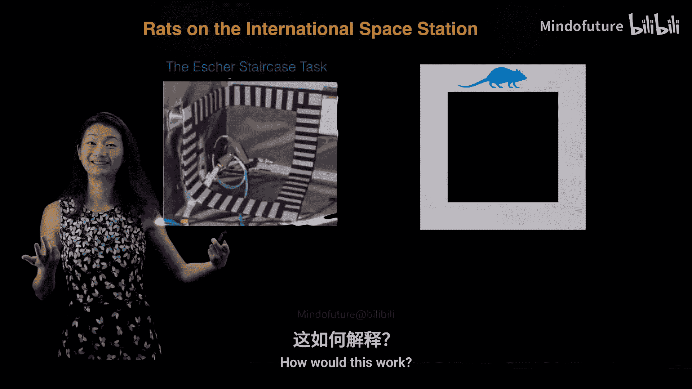
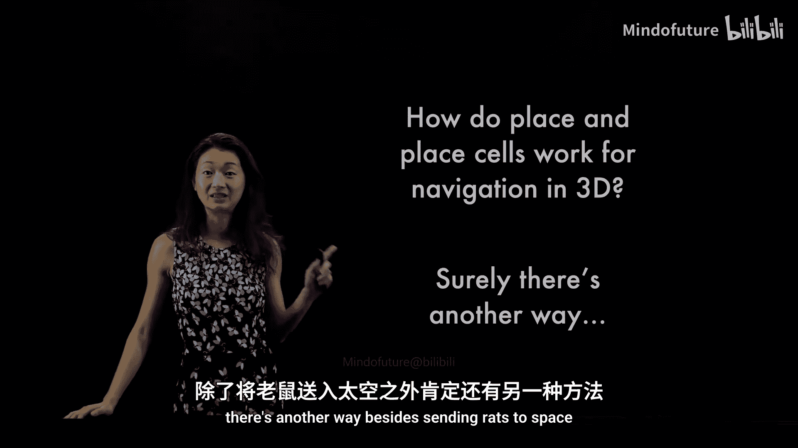
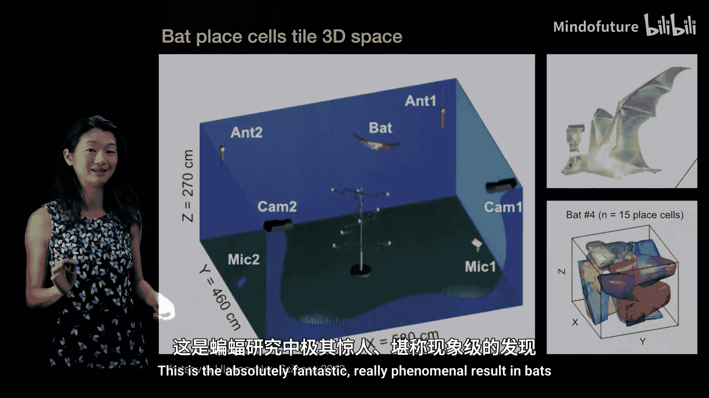
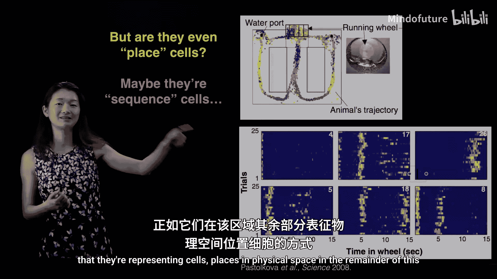
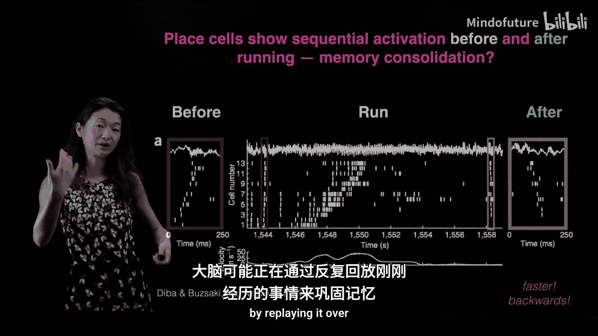
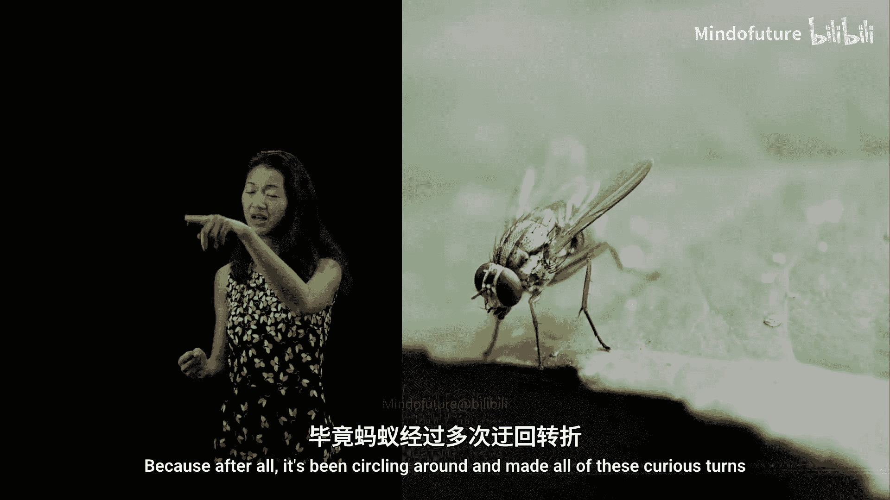
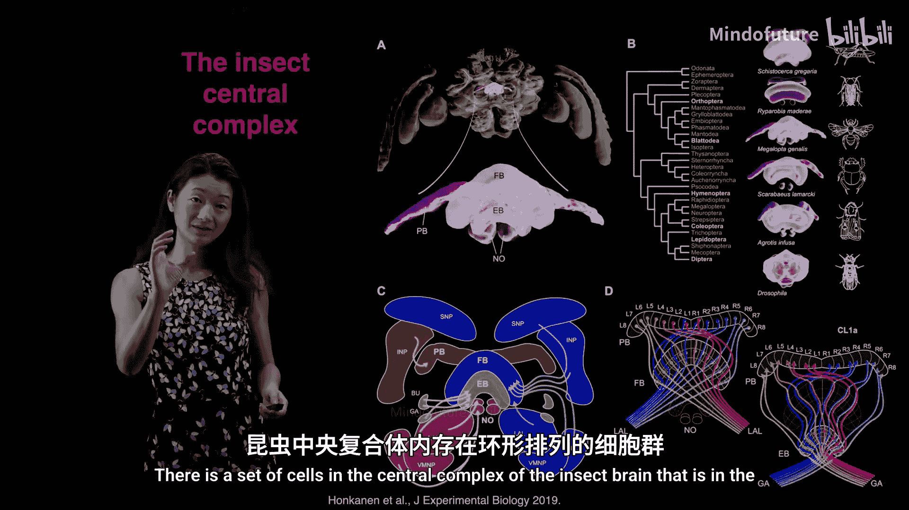
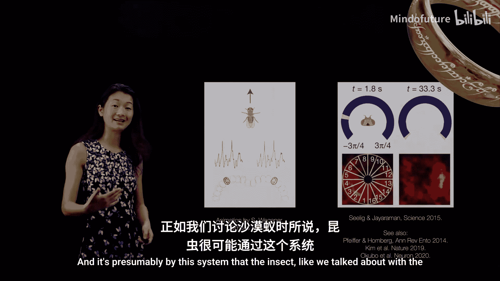
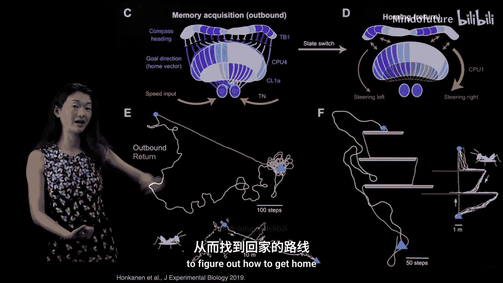

# 032：啮齿类之外的记忆与导航

在本节课中，我们将探讨导航系统在非啮齿类动物中的表现，以及这些发现如何深化我们对记忆和空间认知的理解。我们将看到，从蝙蝠到猴子，再到昆虫，不同的生物体演化出了独特而巧妙的导航策略。

## 三维空间中的导航挑战

上一节我们介绍了大鼠海马体的位置细胞和内嗅皮层的网格细胞。本节中，我们来看看这些导航系统在三维空间中如何工作。

动物在三维空间中导航是常态，但经典的实验（如大鼠在平面迷宫中奔跑）无法回答这个问题。一个极具创意的设想是将大鼠送上国际空间站，在微重力环境下研究其导航系统。

实验的逻辑基于一个几何问题：在二维平面上，连续四次90度右转会回到原点。但在一个类似“埃舍尔阶梯”的三维结构中，可能只需三次右转就能回到原点。问题是，大鼠的位置细胞系统会如何处理这种“三维环路”信息？在空间站的微重力环境中，重力线索被消除，这为研究纯粹的空间认知提供了机会。

这个实验虽然成功获批并执行，但过程充满挑战。数据部分丢失，且大鼠在空间站中更喜欢漂浮，而非在设计的迷宫中奔跑，导致最终成果有限。下图展示了在空间站中记录到的大鼠CA1区位置细胞活动，这是为数不多的直接数据。

## 蝙蝠：天生的三维导航者

既然送大鼠上太空如此困难，科学家们转而研究天生擅长三维导航的哺乳动物：蝙蝠。

蝙蝠的海马体解剖结构与大鼠惊人地相似。随着无线记录技术的出现，对飞行中蝙蝠的研究成为可能。在一个大型飞行场内，研究人员记录了蝙蝠海马体CA1区神经元的活动。

以下是研究发现：
*   蝙蝠的CA1区神经元同样具有位置野，这些位置野在三维空间中形成镶嵌，就像大鼠的位置细胞在二维空间中那样。
*   这意味着位置细胞编码空间位置的功能，并不局限于二维平面或特定运动模式（如奔跑）。
*   研究也证实，蝙蝠的内嗅皮层同样存在网格细胞。

下图展示了蝙蝠在三维飞行场中，其位置细胞活动如何覆盖空间。

## 猴子：从物理空间到视觉空间的网格

接下来，我们看看在灵长类动物中的发现。在猴子身上记录自由活动时的网格细胞更具挑战性。

一个巧妙的实验转换了思路：不让猴子在物理空间中奔跑，而是让它用眼睛浏览一个视觉场景。研究人员追踪猴子眼睛的注视点，并记录其内嗅皮层神经元的活动。

分析显示：
*   当猴子的注视点在视觉场景中“移动”时，某些神经元的激活模式形成了规则的网格状图形。
*   这种网格与大鼠在物理空间中奔跑时内嗅皮层的网格细胞活动模式高度相似。

这一发现强烈暗示，网格细胞编码的可能是一种更通用的“认知空间”或“关系空间”，而不仅仅是物理导航。它们可能用于组织任何有序的经验序列。

## 位置细胞还是序列细胞？

上述发现引出一个根本问题：海马体的“位置细胞”编码的究竟是绝对位置，还是事件或行动的序列？

一个在大鼠身上进行的精妙实验探讨了这个问题。大鼠在一个“8”字形迷宫中奔跑，但在中央通道的顶端，它必须在一个跑轮上原地奔跑一段时间才能继续前进。

实验的关键在于：
*   在跑轮上时，大鼠的物理位置没有改变。
*   然而，研究人员发现，一些CA1区神经元的活动专门对应大鼠在跑轮上度过的“时间”或“虚拟位置”。
*   这些神经元的活动，与编码迷宫其他物理位置的神经元一样，形成了有序的“序列”。

因此，所谓的“位置细胞”可能本质上是“序列细胞”，它们编码的是在特定情境下（无论是穿越空间还是执行任务）经历的事件序列。另一个实验进一步证明，这种序列甚至可以由声音频率的变化来驱动，CA1区神经元能编码在预期声音序列中的“位置”。

下图展示了在“8”字形迷宫实验中，位置细胞（或序列细胞）的活动模式。

## 记忆的巩固：离线重放

现在，让我们将导航与记忆联系起来。我们已知海马体对记忆形成至关重要。导航中的序列编码如何与记忆功能结合？

关键线索来自于“离线重放”现象。当大鼠在迷宫中奔跑时，一系列位置细胞按特定顺序激活，对应其经过的路径。

惊人的发现是：
*   在奔跑**之前**的休息期，以及奔跑**之后**的休息期（如睡眠），**同一批**位置细胞会以**相同的顺序**再次被激活。
*   奔跑后的重放有时会以**更快的速度**进行，甚至出现**反向序列**（从终点回溯到起点）。

这就像大脑在“预演”即将执行的路线，并在事后“回顾”和“巩固”刚刚经历的事件序列。这种离线重放被认为是记忆巩固的核心机制之一，它将短期经验转化为长期记忆。

下图示意了在奔跑期、奔跑前预演期和奔跑后重放期，位置细胞序列激活的模式。

## 昆虫的导航中枢：中央复合体

最后，我们回到课程最初提到的昆虫导航。沙漠蚁如何知道回巢的方向？

昆虫大脑中有一个高度保守的结构叫**中央复合体**。它整合视觉、嗅觉、触觉、风向等多感官信息，形成一个统一的指向性表征。

其核心机制是一个**环状吸引子网络**：
*   这个神经网络环上的活动位置，对应昆虫头部所指的方向。
*   当昆虫转弯时，环上的活动位置会相应移动，从而持续追踪自身的方向变化。
*   结合对步数的计量（距离信息），昆虫就能在找到食物后，计算出返回巢穴的直线方向和距离。

尽管昆虫与哺乳动物的大脑结构天差地别，但它们都演化出了用于整合路径、指向目标的精密系统。这体现了不同物种面对相同生存问题（导航）时，在功能上的趋同演化。

下图展示了昆虫中央复合体的环状结构及其方向编码功能。

## 总结

本节课中，我们一起学习了导航系统在多种动物中的体现及其与记忆的深刻联系。

我们了解到：
1.  **三维导航**：蝙蝠研究证实，位置细胞和网格细胞的基本原理可扩展到三维空间。
2.  **认知空间**：猴子的实验表明，网格细胞可能编码抽象的“关系空间”（如视觉场景），超越了物理导航。
3.  **序列编码**：海马体神经元本质上是“序列细胞”，编码事件、行动或感官输入的序列，而不仅仅是物理位置。
4.  **记忆巩固**：通过“离线重放”机制，大脑在休息时重复激活行为相关的神经序列，这对记忆巩固至关重要。
5.  **趋同演化**：昆虫利用中央复合体的环状网络来整合信息并计算方向，这与哺乳动物的导航系统在功能上异曲同工。

这些研究共同揭示，导航与记忆共享着相同的神经基质。大脑用于记录空间位置的系统，很可能也是我们组织人生经历、形成情景记忆的基础。对多样大脑的研究，不断丰富着我们对这一核心认知功能的理解。