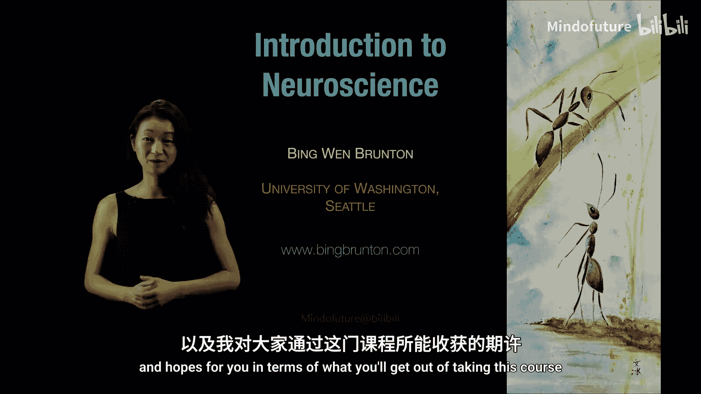
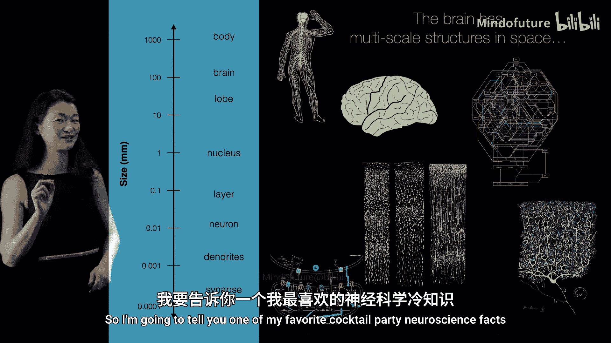
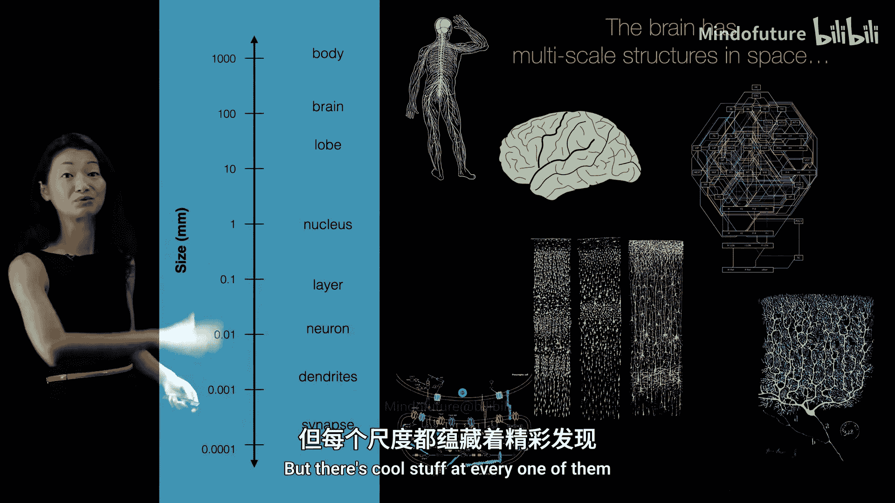
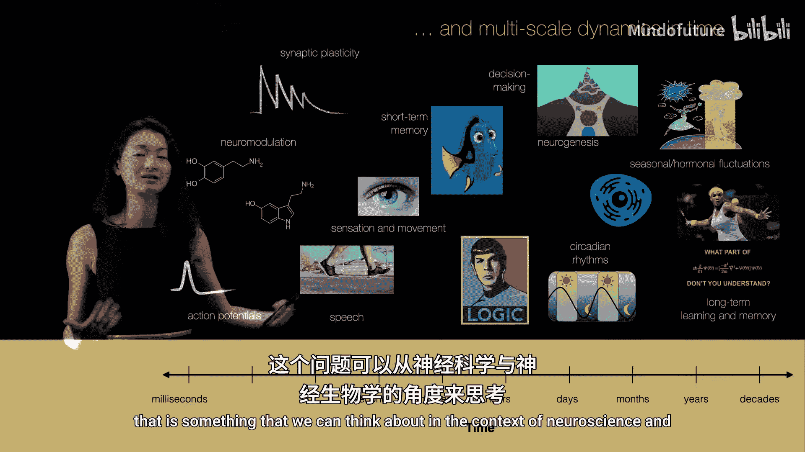
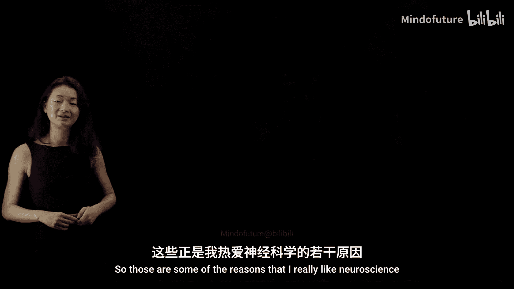
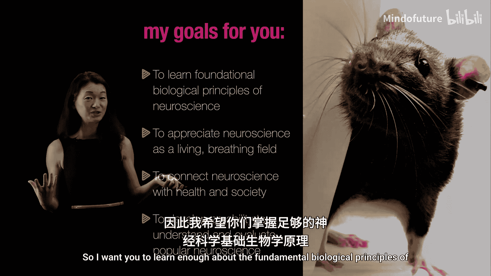
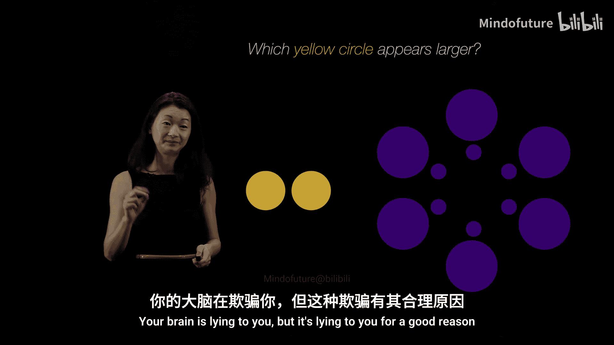
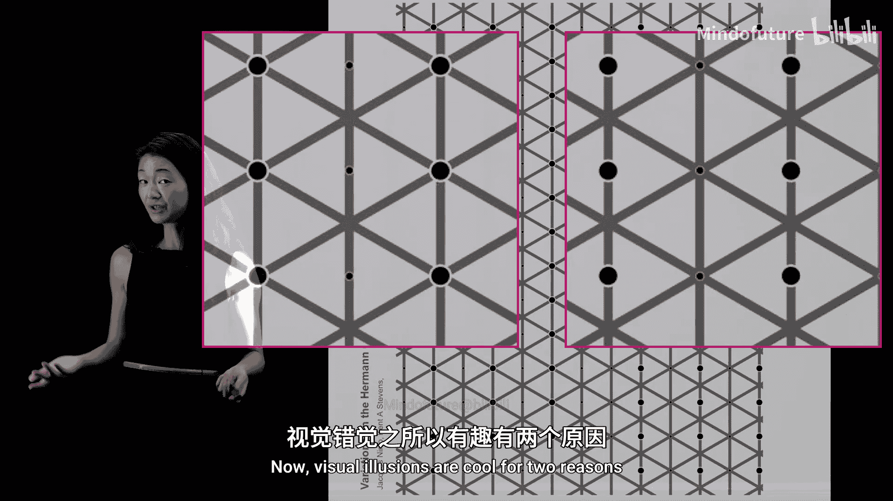
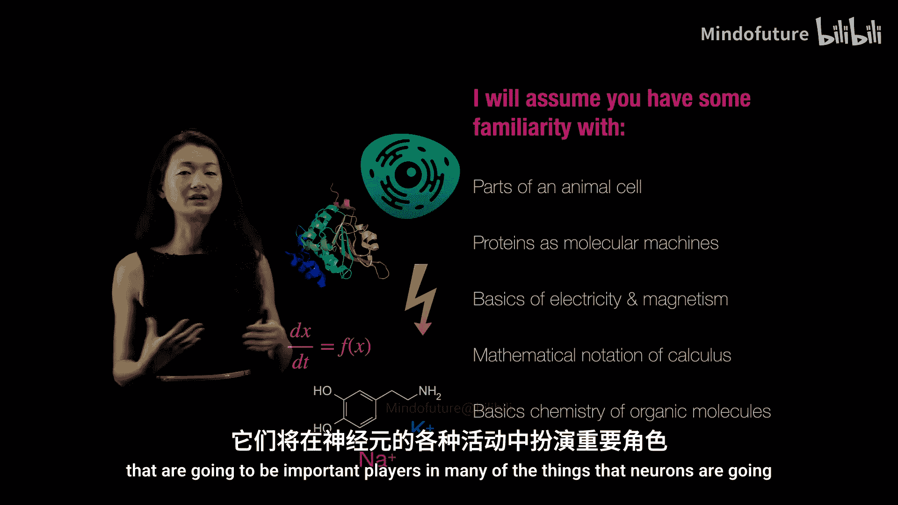

# 【华盛顿大学】神经科学入门 ｜ Introduction To Neuroscience ｜ Bing Wen Brunton p01 P01_神经科学导论__概述与目标 -BV1i3qWBXEDH_p1-

Let's talk about brains Hi my name is Bing Brenton and I'm a neuroscientist at the University of Washington in Seattle In this video I'm going to introduce to you the next series of videos it's a comprise a university level course on introduction to neuroscience This is a course that I've taught several times at University of Washington and so I'm going to talk to you about the topics that we're gonna to cover as well as my expectations and hopes for you in terms of what you'll get out of taking this course Now I love teaching this course this is one my favorite things to do and introducing neuroscience to people who are not yet neuroscientists maybe some of you will be inspired to become neuroscientists and the reason I love talking about it so much is because neuroscience is such an interdisciplinary field that I get to talk not only about biology。

 but about how neuroscience connects with almost everything else that you can think of and this includes a lot of different sciences we have connections to physics to chemistry to psychology as well as connections to engineering applications to health as well as to your sense of self and philosophy and legal ramification。

😊。

Of what we know about fundamentals of neurobiology。 But before we get into all of that。

 I wanted to talk first about my brain and your brain， because after all， this is where we all start。

 right We're using our brains to understand each other right now。 So the mammalian brain。

 the human brain，Looks something like this there's a picture of it on the bottom here and you can look at it and you can kind of compare it to some of the other mammalian brains that are in the animals that are in the world around us and what I'm going to tell you is that some mammalian brains a lot in common with other type mammalian brains but there's also some key differences as well in particular the human brain weighs about one and a half kilograms and it has 86 billion neuronsish now what does this actually mean right is so these are just numbers here what does this actually mean what I want you to do is take your two fists。

Make two fists and put them together。 go ahead and do it yourself。 If you look then at your hands。

 put together as two fists。 this is going to be approximately the size of your brain stuffed inside your skull。

 Now I don't know about you， the first time I did it very first time I did this。

 I was surprised at how small it is。 Maybe I have a big head。

 I don't really know Who knows what that means I also notice some of you are gonna to have larger hands and others don't take it too seriously。

 this is only approximately how big your brain is Now we know the brain is really important for a lot of different reasons。

 and one of the reasons is because even though for an adult human。

 the brain weighs approximately 2% of your body mass at rest。

 it occupies approximately 20% of your metabolic costs。 So about 20% of the calories。

 you're burning at any particular moment when you're not doing anything。

 this is not true if you're running a marathon is devoted to just keeping the brain alive and functioning and ready to do the next thing that is getting ready to do。

 So that's one indication of how important it is。 Now a few more things about the brain that I think are really interesting just I like thinking about size skills and then times。

The brain has this wrinklely bits on the outside。 We'll have a later video talking about exactly what those are and why they're there。

 The short version of the story is that that's what you're looking at is's a very outer layer of the brain called the cortex it's kind of like a helmet in is on the outside and it's wrinkly because it's actually a twodimensional sheet approximately that's quite a bit larger than what you can stuff inside your skull if you took it out。

 you took the cortex out shook it out and ironed it。

 you get a sheet that is well you know it's actually approximately the size of a towel small hand towel like this one so if you kind imagine wrinkling it up stuffing the inside your head I don't actually doing this。

 that's approximately how large your cortex is。I told you the cortex is also a two dimensional sheet。

 so what does that mean Well， it's actually remarkably thin。

 I have something like like a credit card so if you take any credit card，And look at it。

 You can see how thin it is。 That's approximately 2 millimeters。

 So the entire cortex is about that thin。 And in fact。

 the size of a regular credit card is about the size of your primary visual cortex。

 if you imagine taking one of these credit cards folding and happen and stuffening in the back of your brain。

 that is the size of your primary visual cortex。 So those are kind of cool things that I like to telling people the first time I introduces them to brains。

 But anatomy is only a very small part of our understanding of neuroscience and neurobiology。

So as a neuroscientist， I happen to be a type of neuroscientist called computational neuroscientist and what that means is that I really like thinking about mathematical models and different ways that we can analyze data from both brain and behavior and so rather than giving you a syllabus first what I'm going to tell you first is my perspective why I'm a neuroscientist how it is that I feel like this is a really interesting thing that's going to occupy not only the rest of my career。

 but hopefully the careers of lots of other people in the world as well so from my perspective。

 one of the coolest things about neuroscience is that the brain has multiscale structures in space now I'm going break that down and tell you what I mean by that phrase what we're looking at here on the vertical axis is what's called a logarithmic accessing size and so every tick mark is 10 times larger as we go up so right here is a millimeter we have thousands of a millimeter and then we have a meter up here So the reason that the brain is cool。

 one of the reasons brain。

Is cool is because it has really cool， interesting structures that are worth studying at every single scale the description The smallest thing that we sometimes think about in neuroscience is the size of a synapse so the cells of your brain are called neurons and neurons talk to each other at these junctions called synapses the human brain has 86 billion neurons on average every neuron in your brain makes 1000 to 10000 synapses with other neurons and so there's a ton of these things inside your brain right now where're only looking at one of them Now despite having lots and lots of them and you see these are really tiny structures they're in fact extraordinarily complicated and very。

 very cool。 there's gonna to be a video all about the synapse later on it is so cool that you think about the infrastructure that goes into running and keeping alive and functioning one of these synapses it has the complexity of a small city we have things like roads we have garbage collection we have power plants we have recycling implant even this is very green here and that is only one。

😊，Synapse among all of the synapses that go into running your brain and your nervous system。

 And of course， that's not all because every neuron you maybe see pictures of neurons。

 like a couple of drawings of the ones over there。 neurons are also cool because they actually have non-trivial geometry。

 They're not blobs like generic eukaryotic cells and you might have learned about when you first learned about cells in grade school。

 They're very much not spherical and in fact， they're so not spherical that they have these beautiful dendritic and axonic arborizations that very much look like the way that trees reach into the sky and their root systems reach into the ground。

Those are just individual neurons and neurons。 talk to each other and form networks of neurons that get larger and larger and larger。

 And so a lot of things that we talk about in systems neuroscience are how all of those networks are coordinated。

 how do they work together and give rise to what we think of as thoughts and memory and our sense of identity。

 And of course， your nervous system at some point has to run the rest of your body。

 So you're not just the brain in the jar thinking by yourself。 You also have to run a body。

 And so your central nervous system， your brain and your spine innervates the rest of your body。

 which is on the order of a meter。 And so that includes summarizing sensations from all over your body。

 as well as controlling the muscles and other your internal organs and running all of those different structures by the nervous impulses of your nervous system。

 So I'm going to tell you， one of my favorite cocktail party neuroscience facts。

 The next time you find yourself as a fancy cocktail party。 you can share this with your friends。

 The brain is really cool。 And these neurons have really interesting shapes。 and then they really。😊。

Long and thin sometimes what takes the cake is that you have a neuron that is super thin and very。

 very long。 and it's so long that it's practically as small as you are。 In particular。

 it is a sensory neuron called the dorsal root ganglion cell。

 and there's one that's in the very last segment of your spinal column。

 kind of where your tailbone is in the very back of your spine。

 One end of this neuron innervates the tip of your toe。

 So it carries sensory information from your tippy toe Big toe The other end of the cell goes all the way up to your brain stem to the very back of where your head meets your neck。

 In other words， if you think about this neuron， it goes all the way from your toe。

To your head and it's practically as tall as you are， I think that's super cool。

What makes it cooler is that this cell is not something that's very much unique to humans。 in fact。

 presumably all vertebrates have it。 So if you're a giraffe， there is a same cell。

 the dorsory a ganglion cell that goes from its toe all the way up to the base of its neck。

 Try to imagine this for a whale。 Try to imagine this for extinct dinosaurs。

Now the field of paleourscience is fascinating and you can kind of imagine how difficult it would be to study。

 but if the nervous system of these extinct dinosaurs are the same that it is for all vertebrates that exist in our life right now。

 then presumably that this dinosaur had one of these neurons as well。

 and so that probably takes the record for the longest cell that has likely existed in the history of life。

😊。

So I'm now told you about how the brain has multistr structures in space and how that's super cool and interesting。

 you can spend a lifetime working at any single one of the size scales。

 but there's cool stuff at every one of them。

But there's more because not only does the brain have multiscale structures in space。

 it also has multiscale dynamics in time。 Now， as a computational neuroscientist。

 I love dynamical systems。 I love writing models that changing time。

 and this is one of the things that was actually drew me to neuroscience into the study of neurobiology in the first place。

 the fact that we can write down these really beautiful equations that not only describe dynamics and any single timescale。

 but actually allow us the ability to tie them together to describe multiscale dynamics in time。

 Once again， just like on the previous plot， we have a logarithmic plot， this time it's in time。

 So every tick mark is's actually 10 times longer on the very far end， we have a millisecond。

 which is usually the timescale on which the smallest timescale to which three systems neuroscience talk about because it is about the length of an action potential。

 The action potential is going to be get the topic of a whole series of videos for the first section of this video course and you'll learn all about it。

 the basic point is that the action potential is the fundamental unit of communication for the。😊。

ically active neuron and the actual potential is characteristic shape occupies approximately one millisecond。

 Now， of course， as we go longer and longer and longer。

 there's cool things happening at every scale of description in time we have things like neuromodulation and synaptic plasticity the fact that these synapses。

 how neurons talk to each other are able to change rapidly as well as slowly throughout your day throughout your week and in order to produce speech in order to move my arms and produce sensation and movement requires coordination of dynamics of neurons on the order of tens of milliseconds the seconds we then have things occupy a little bit longer in time like shortterm memory and long-term memory your brain and your nervous system just like many other parts of your body are prone to having cyclic variations that are circadian rhythms。

 seasonal rhythms， hormonal rhythms。😊，In thinking about neurogenesis， the fact that in your lifetime。

 you actually do produce some numbers of neurons that get incorporated into your nervous systems。

 You're not stuck with just the ones that you were born with and of course we can talk about longterm learning and memory。

 both procedural memory as well as memory of things that you know such as the fundamentals of neurobiology that you're going to be learning about。

 a human lives or on the order of decades and so I feel like I'm kind of the same person I was when when I was 10 years old。

 there' some continuity there but in reality， I don't share a lot of cells and proteins in common with that person and so how it is that we have these long-term memories and learn things over time。

 that is something that we can think about in the context of neuroscience and neurobiology as well。

 So those are some of the reasons that I really like neuroscience and if you wanted to come in this adventure with me I'm going to tell you about the topics that we're going to talk about I'm gonna start slow and talk about the fundamentals of neurophysiology of a single neurons。

A single cell of the brain and nervous system。Brains occupy a really cool space because it fundamentally communicates with each other by using electricity。

 So we're going to be talking about in a series of first videos， electrical properties of a neuron。

 how it is we generate an action potential， how the action potential propagates and how the action potential translates to communication among different neurons through different types of synopses。

 and so this part is going to be approximately 10 videos。😊。

The second part we're going to go a little bit longer in time and also larger in size scales kind of moving up and to the right in those axes that we had before。

 thinking about the organization of the nervous system。

 both the central as well as peripheral system we're going to talk about all of the different sensory systems vision or faction for example as well as some unusual ones like your sense of time and of course nothing really happens without movements we're going to talk about the neuroscience of movement as well as motor control。

 how does your motor neurons activate and excite and animate your body。

In the third part of our itinerary is going to be a bunch of additional topics and to be frank。

 these are just topics that I really like and I can't help myself so I'm going to tell you about them。

 they are topics that usually reach a little bit farther beyond the scope of a traditional introduction to neuroscience course and they are things like neuroscience of behavior。

 not only human behavior but behavior of diverse animal including vertebrate and invertebrate insect species。

 we're going to be talking about topics like mental health and addiction and how these impact our sense of self and how that ties together with society and community and the legal system。

 and then we're also going to be going towards connections between neuroscience and technology by looking at things like neuroscience and artificial intelligence。

 the history of how these fields have evolved together into doing things like the different different artificial neural networks that are able to generate speech and generate images that all of you have seen all over the internet and we're also going to be talking about topics for example。

 like。Comp interfacing， how it is that we can build machines that interact with our brains。

 both for rehabilitation， augmentation as well as。Other applications and each of these parts is going to be approximately10ish videos。

 and the whole thing is supposed to be a quarter long course at the University of Washington。

 and so it's going to be approximately 30 hours worth of videos broken up into small sections。So。

My goal is for you。In this course are in the following first it is university level course on introductiontrouction neuroscience。

 and so I hope that you will learn the fundamental biological principles of neuroscience。

 I hope to give you enough intellectual scaffolding so that you can hang knowledge that you learn later on onto the fundamentals of how neurons work。

 how neurosystems work and so all of the additional topics will be added on top of that fundamental layer of principles of neuroscience。

😊，Next， I want you to appreciate neuroscience as a living breathing field rather than having telling you how things are and this is just the way things work。

 you know I'm memorizing a bunch of terms in different pathways。

 frankly speaking I can't memorize them either so I don't really want you to what I would rather you come away from the course with is an appreciation of when we discovered something in neuroscience。

 what was the state of the field at the time， what were the leading ideas on hypotheses of how that particular thing worked。

 what were the technologies， and so what was the process of discovery of finding that thing out as well as who were the very human scientists where a very human flss who discovered those things。

A corollary of that is that one of my favorite things to do as a neuroscientist is thinking about future technologies。

 this is actually what I do in my research life。 I think about not only what can we do right now。

 but what is inevitably going to be possible in the next5，10。

30 years and to appreciate that neuroscience is going to grow by leaps and bounds over that time fming ways that perhaps none of us can really appreciate and anticipate but we can kind of think about it and think about okay so if we can record not only from one single neuron a time。

 but hundreds of thousands of them， what will we do with all of that data what can we do if we don't only are able to monitor animal behavior in a single animal in a single lab in a small box but we can actually see what it does out in the wild world and so appreciate a neuroscience and the process of discovery as well as the people who are players is one of the things that is my goal for you and hopefully that's something you'll see throughout the course in all of the topics we'll cover。

Third thing that I have a goal for you is to be able to connect neuroscience with health and society。

 The brain is an organ， just like every other organ in your body and so just like every other organ in your body。

 if this is a course on the liver or the kidney we would most certainly talk about pathologies and diseases of the liver and the kidneys so just like that we're also going to be talking about neurological disease but unlike those other diseases。

 the brain is in a way that is not true of your liver tied to my sense of self and identity and so when there are things that change with my brain that very much changes my connection not only with myself but with a way that I interact with people around me with my community and my relationship with my community and with with my local environment and so thinking about the implications of that is one of my goals in throughout the course and I hope to especially highlight this in the context of mental illness and drug addiction because throughout the last。

Of decades， our growing appreciation for the fundamental biological basis of mental illness。

 as well as drug addiction has very much changed the discourse of how people relate to themselves。

 as well as relate to their loved ones and other people around them in a social as well as legal sense。

At the same time I recognize that hopefully I will inspire some of you to become career research scientists in neuroscience。

 but I recognize that that's probably not the case for the majority of you who might find yourself watching these videos。

 and so if this is the last course on neuroscience that you take in your life。

 what you're about to be bombarded with for the rest of your life is a bunch of news coming out claiming to be the latest and the greatest advances in neuroscience。

 especially neuroscience and help you're going to see articles claiming things now some of these are going to be genuine advances。

 really exciting things that are inevitably going to come out in the next several decades。

 but some of them are going to be BS， so I want you to learn enough about the fundamental biological principles of neuroscience that you can call BS when you see it for the rest of your life。

Okay so our first lesson starts right now， you all know that you can see with your eyes right so but your eyes。

 you kind of sometimes people think of it as a camera so you can kind of you take a picture or your camera。

 you can take a picture of your eyes kind of is the same thing right well。😊。

You might know that it is in fact， not so what you see with your eyes is not at all what it is in reality。

 In other words， what you think you see is oftentimes not at all what is in the physical reality because you don't actually see with your eyes you see with your brain。

It is nowhere easier to demonstrate this than with visual illusions and so when I'm not teaching this course I'm actually constantly on the lookout for really cool visual illusions。

 I saved them， like oh I' got to show my students about this later so I'm going to show you a couple of my favorite ones right now demonstrating this observation that we don't see with our eyes our eyes are not cameras and we see with our brains instead okay so the first one is a really simple one there's two yellow dots on the screen I'm going to ask you the question which one appears larger。

😊，Hopefully， what you can tell for yourself is that the one on the right that's surrounded by the relatively smaller purple circles appears larger。

It will not surprise you because I've already told you this is a visual illusion that those two circles are in fact exactly the same size。

 because if they're surrounded by larger circles or surrounded by smaller circles。

 there is a relative perception that one of them is larger than the other one。

 even though it is not at all what is happening in reality。 your brain is lying to you。

 but it's lying to you for a good reason。

The second one， this one is kind of a recent one that I saw on social media。

 and I kind of totally broke my brain at the time。 I sent it to all my friends and broke their brains。

 So it kind of mad at me。 One of them was actually mad at me because it made them kind of nauseous。

 Okay， so in this grid of dots， what you're seeing is that there's two different sides of this picture。

 you'll see a bunch of intersecting gray lines。 And there's black dots on the left side。

 as well as the right side of this image。 What you'll see is that there's a bunch of black dots that you can see on the right side of the image。

 And they stay there。 right。😊，I'm telling you， I'm just going to tell you have to believe me now the left side has exactly the same number of black dots as the right side。

But when you look at them and you look away， they disappear， it is almost impossible for me。

 hopefully this works on your screen， even if it's a small phone screen。

 you can see that the black dots disappear when I look at it， so I'm looking right now。

 I'm looking up here， I can see a couple of black dots， the ones down here have gone away。

 once I look down， I can kind of see the ones down here， I can't see the ones up there anymore。

RightIt makes absolutely no sense how it is that these dots just disappear on you but they don't disappear on the right hand side。

 If you don't believe me， I'm gonna zoom in on the right hand side here is the gray grid with the black dots and over here is the same gray grid with the black dots as you'll see the only difference here is that the black dots on the left side of the screen are at the intersections of those gray grids and on the right hand side of the screen they are not。

 And so that's kind of a clue of why it is that one side the dots disappear you can't even see them if you look away a little bit and the right hand side they stay put and you can kind of see how many there are in this grid。

Now visual illusions are cool for two reasons。 One is that humans are extraordinarily visual creatures。

 And so demonstrating that you see with your brain and not with your eyes is really easy to do and kind of fun and charming to do when you do with visual illusions。

 but of course these illusions are not it's nothing intrinsically visual about the fact that you can hack your brain by tricking it to think that something is there that it's not And so if we were in a haptic universe。

 I can show you the following illusion， but right now you just kind to take my word for it that there's these illusions that exist in other sensory modalities besides visual ones。

 So here's one example of what's called a somatoensy or tactile illusion So works the following away if you take your arm you take your forearm region and what you can do is take something like a real robot arm or something。

 and then tap in rapid succession in the one spot tap tap tap tap tap and then I'm going to do the same thing by tapping at a second spot tap tap tap tap tap tap that's it I'm going to tap one place Lo A and a different place。

 Lo B。 Now the。

The perception of what's happening here is not a series of tops at A and a series top at B。

 The Percept is going to be a series of taps that walk from location A。😊。

To location B in rapid succession。As if there were a small rabbit that is running on your arm。

 that is why this is called a cutaneous rabbit illusion Now this illusion is pretty robust。

 but it does vary depending on exactly what locations you tap。

 for example this works on a patch of skin like your forear but it does not work in your fingerts because you actually have a ton of touch receptors on your fingertips you can actually resolve that there's two locations that are being tapped okay probably works on your calf on your leg too。

😊，And you have to be able to tap at the right frequency and with the right latency between location A and location B。

 otherwise seccutaneous rapidbbit illusion breaks so that's the illusion。

 there's tons and tons more of them I can talk about this forever and I be tempted to but we're not going to right now because this is just lesson a and I hope I convince you with a couple of examples that we don't in fact see with our eyes we see with our brains and our brains are building such a way to represent information from the external world not to just represent them I am not a camera I'm not interested in the reality what I'm actually seeing right now I'm interested in looking at the aspects of the visual scene and the sensory tactile physics seeing the auditory scene。

 all of these different scenes in such a way that's relevant for me as a person and as a living thing to survive in the world that's why we see with our brains and not with our eyes。

So to go on this adventure with me， like I said， this is a university level course and so I will assume some basic familiarity with a couple of topics now if these are things that you are totally familiar with that's awesome if you're not familiar with every single one of these topics it's actually totally okay you can come with me anyway and if it inspires you to go back and review some of these topics that's something that you can very much do in the middle of the series of videos and so because neuroscience is such an interdisciplinary field we're going to be drawing a little bit of concepts from a lot of different fields and so here's a list of the things that I will assume that you have heard of and have some familiarity with in the realm of biology。

 I will assume that you know about the parts of an animal cell that you care out exc cell that it has a nucleus where the genome。

 the DNA lives that is surrounded by a lipid membrane that is hydrophobic and separates the internal environment of the cell from the external environment in the cell I will assume that you have heard about the fact that there are proteins。

in these cells that are expressed from the genome， and that these proteins are molecular machines that do all the work。

 the really cool work that we do in all of these animal cells， because after all。

 in order to understand the neuron， we have to understand neurons as a cell as a cell of your body。

 just like every other cell。Because I already talked about how neurons are electrical cells。

 we're going to be drawing on a little bit of basic terminology and concepts from electricity and magnetism from physics。

 so relatively basic things like what is a current， what is a conductance， what is Ohm's law。

 things of that nature。The mathematical prereqs are not too rigorous。

 I don't expect you to actually know calculus or differential equations。

 but I am going to use some notations from calculus and differential equations。

 so for example if you see something like the following DxTt equals f of x you should probably have heard of this concept at some point where DxTT means a derivative of x with respect to T and oftentimes I'm going to be using T as a proxy for time so this is a time derivative of x I don't expect you to be able to solve these equations。

 but I will be using this as a representation of ideas to connect them with electricity and magnetism as well as to proteins as molecular machines。

😊，And of course， the basic communication of neurons involved not only electricity。

 but also organic molecules， so I'll be assuming some basic knowledge of chemistry and organic molecules。

 so for example， there's ions like sodium and potassium are ions。

 they' are electrically charged and aqueously soluble。

 and there's going to be a lot of organic molecules that are going to be important players in many of the things that neurons are going to do。

Okay， so here's the itinerary。 If you choose to go on this adventure with me。

 I hope to see you for the next series of videos。 I'm really excited to get started。

 I hope to see you and because I'm a professor and I'm a pedantic neuroscientist。

 I will have to say that I hope to see you is something that people say on YouTube。

 but I fully recognize that you might see me， but I'm not actually going to see you。

 but I am excited during the next series of videos and I hope that you find them as interesting as I have found the exercise of teaching them。

 thanks。😊。