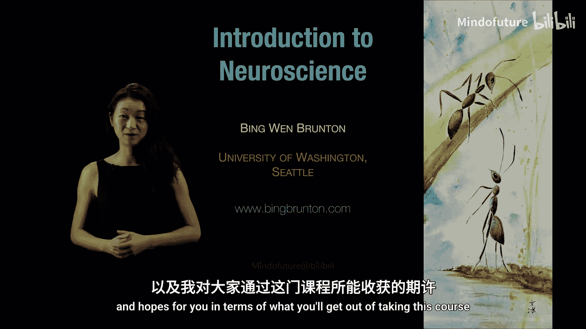
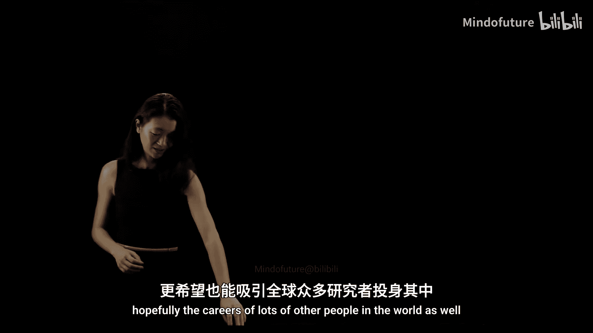
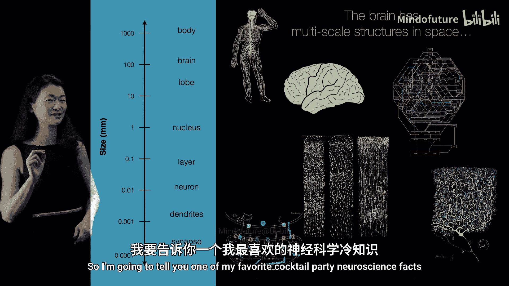
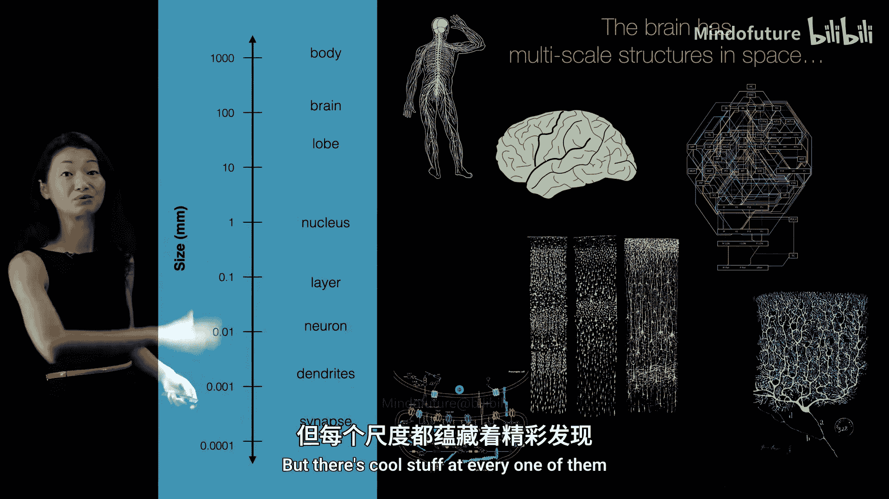
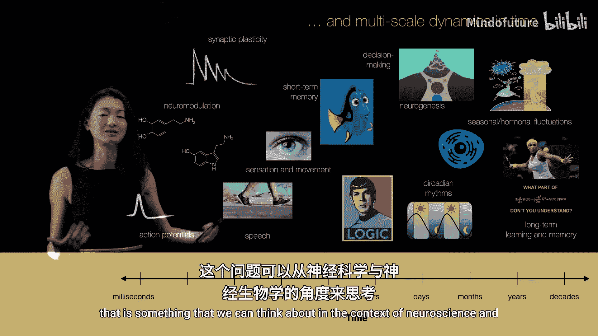
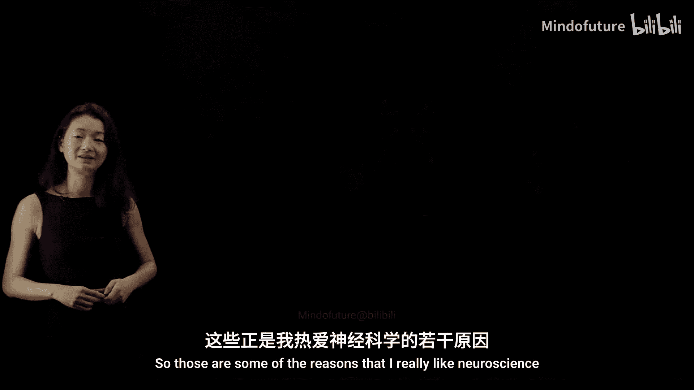
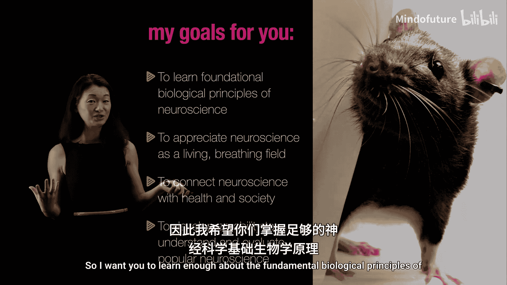
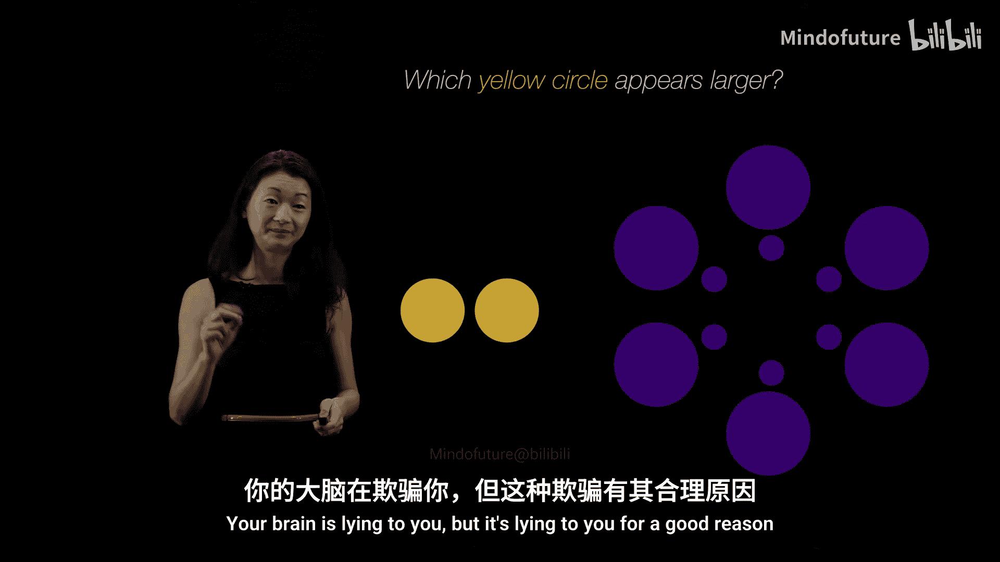
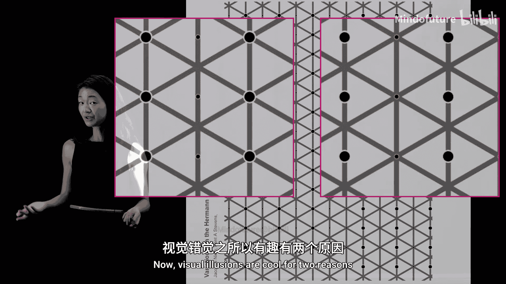
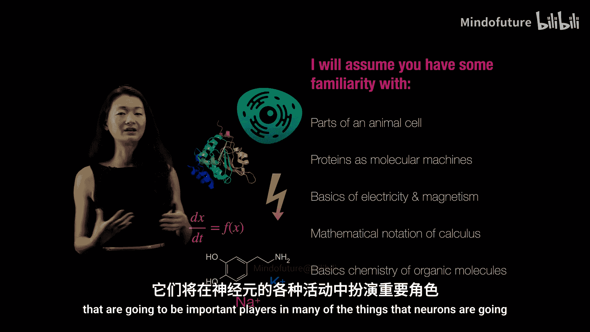

# 神经科学入门：P01：概述与目标 🧠

在本节课中，我们将一起开启神经科学的学习之旅。课程由华盛顿大学的Bing Wen Brunton教授主讲，旨在介绍神经科学的核心概念、多尺度结构以及这门学科与我们生活的广泛联系。我们将从大脑的基本认识开始，逐步探索神经元的工作原理、神经系统的组织方式，以及神经科学在技术、健康和社会中的应用。

---

## 为什么研究大脑？🤔

上一节我们介绍了课程的整体目标，本节中我们来看看为什么大脑如此值得研究。

我的名字是Bing Wen Brunton，我是西雅图华盛顿大学的一名神经科学家。本系列视频构成了一门大学级别的神经科学导论课程。这门课我在华盛顿大学讲授过多次，我将介绍我们将要涵盖的主题，以及我对你们学完这门课程的期望。

我热爱教授这门课程，这是我最喜欢做的事情之一。向尚未成为神经科学家的人们介绍神经科学，或许你们中的一些人会受到启发而投身于此。我如此热衷于谈论它，是因为神经科学是一个高度跨学科的领域。我不仅谈论生物学，还要探讨神经科学如何与你能想到的几乎所有其他领域相联系。

这包括许多不同的科学领域：它与物理学、化学、心理学有联系，也与工程应用、健康相关，还涉及到你的自我意识、哲学以及法律影响。

但在深入所有这些之前，我想先谈谈我的大脑和你的大脑。毕竟，这是我们所有人认知的起点。我们此刻正在用我们的大脑来相互理解。

哺乳动物的大脑，人类的大脑，看起来像这样。你可以看看它，并将其与我们周围世界其他哺乳动物的大脑进行比较。我要告诉你的是，某些哺乳动物的大脑与其他类型哺乳动物的大脑有很多共同点，但也存在一些关键差异。

具体来说，人类大脑重约1.5公斤，拥有大约860亿个神经元。但这到底意味着什么？这些只是数字。我想让你做的是：握起两个拳头，然后把它们放在一起。如果你看着你合在一起的两个拳头，这大致就是你塞在头骨里的大脑的大小。

我第一次这么做时，很惊讶它竟然这么小。也许我的头比较大。你们中有些人手会大一些，有些人则小一些，别太当真，这只是大脑的大致大小。

我们知道大脑非常重要，原因有很多。其中一个原因是，尽管成人大脑的重量仅占体重的约2%，但在静息状态下，它却消耗了约20%的代谢能量。也就是说，在你什么都不做的任何特定时刻，你燃烧的卡路里中约有20%是专门用于维持大脑存活、运作并为下一步行动做好准备。这从一个侧面表明了大脑的重要性。

关于大脑，我认为还有几点非常有趣，我喜欢思考尺寸、比例和时间。

大脑外部有这些褶皱的部分。我们后续会有视频专门讨论这些是什么以及它们为什么存在。简而言之，你看到的是大脑最外层，称为**皮层**。它有点像戴在外面的头盔，之所以起皱，是因为它实际上是一个近似二维的薄片，如果把它取出来、展开并熨平，其面积会比能塞进头骨里的大得多。你会得到一张大约像小毛巾那么大的薄片。想象一下把它揉皱塞进你的脑袋里，你的皮层大致就是那么大。

我提到皮层也是一个二维薄片，这意味着它实际上非常薄。它大约像一张信用卡那么薄，只有2毫米左右。事实上，一张普通信用卡的大小，大约就是你初级视觉皮层的大小。想象一下把这样一张信用卡折叠起来塞进你大脑的后部，那就是你初级视觉皮层的大小。这些都是我第一次向人们介绍大脑时喜欢讲的酷事。

但解剖学只是我们理解神经科学和神经生物学的一小部分。

作为一名神经科学家，我恰好是一种被称为**计算神经科学家**的类型。这意味着我非常喜欢思考数学模型以及分析大脑和行为数据的不同方法。因此，与其先给出教学大纲，我首先要告诉你我的观点：我为什么成为一名神经科学家，以及为什么我认为这是一个非常有趣的领域，它不仅将占据我职业生涯的剩余时间，也有望成为世界上许多其他人职业生涯的一部分。

从我的角度来看，神经科学最酷的事情之一在于，大脑在空间上具有**多尺度结构**。现在我来分解一下这个短语的含义。

我们在这里的纵轴上看到的是所谓的**对数尺寸标度**，每个刻度标记代表向上增加10倍。这里是一毫米，我们有千分之一毫米，然后上面是一米。

大脑之所以酷，原因之一在于，它在每一个尺度上都有值得研究的、非常酷且有趣的结构描述。我们在神经科学中有时会思考的最小尺度是**突触**的大小。

你大脑的细胞被称为**神经元**，神经元在这些称为**突触**的连接处相互交流。人类大脑平均有860亿个神经元，而你大脑中的每个神经元会与其他神经元形成1000到10000个突触。所以，此时此刻你的大脑里有海量的突触，而我们在这里只看到了其中一个。

尽管突触数量巨大，而且它们是非常微小的结构，但它们实际上异常复杂且非常酷。后续会有一个专门关于突触的视频。思考维持一个突触存活和运作所需的基础设施，其复杂性堪比一座小城市：我们有类似道路的结构、垃圾收集系统、发电厂，甚至还有回收工厂，这里非常环保。而这仅仅是运行你大脑和神经系统的所有突触中的一个。

当然，这还不是全部，因为每个神经元，你可能看过神经元的图片，比如那边的几张图。神经元也很酷，因为它们实际上具有非平凡的几何形状。它们不像你第一次在小学学习细胞时了解到的普通真核细胞那样是团块。它们绝对不是球形的，事实上，它们如此非球形，以至于拥有这些美丽的树突和轴突分支，看起来非常像树木伸向天空的枝干和深入地面的根系。

这些只是单个神经元。神经元相互交流，形成越来越大的神经元网络。因此，我们在系统神经科学中讨论的很多内容，都是关于所有这些网络如何协调，它们如何共同工作，从而产生我们认为是思想、记忆和自我意识的东西。

当然，你的神经系统在某个时刻必须控制你身体的其余部分。你不仅仅是一个在罐子里独自思考的大脑，你还必须运行一个身体。因此，你的中枢神经系统，即你的大脑和脊髓，支配着你身体的其余部分，其尺度大约是一米。这包括汇总来自全身的感觉，以及控制肌肉和其他内脏器官，并通过神经系统的神经冲动来运行所有这些不同的结构。

我要告诉你一个我最喜欢的鸡尾酒会神经科学趣闻。下次你参加一个高级鸡尾酒会时，可以和你的朋友们分享这个。

大脑真的很酷。这些神经元有非常有趣的形状，而且它们有时真的很长很细。最令人惊叹的是，你有一个神经元，它超级细，非常非常长，长到几乎和你一样高。具体来说，它是一种感觉神经元，叫做**背根神经节细胞**。

在你的脊柱最末段，大约是你尾骨所在、脊柱最后面的地方，有一个这样的神经元。这个神经元的一端支配着你脚趾的尖端，因此它承载着来自你大脚趾尖的感觉信息。这个细胞的另一端则一直向上延伸到你的脑干，也就是你头部与颈部相接的最底部。换句话说，如果你思考这个神经元，它从你的脚趾一直延伸到你的头部，几乎和你一样高。我认为这超级酷。

更酷的是，这种细胞并非人类独有。事实上，很可能所有脊椎动物都有它。所以，如果你是一头长颈鹿，也有同样的背根神经节细胞，从它的脚趾一直延伸到它脖子的基部。试着想象一下鲸鱼身上的这种细胞。试着想象一下已灭绝的恐龙身上的这种细胞。

古神经科学领域非常迷人，你可以想象研究它有多困难。但如果这些已灭绝恐龙的神经系统与现存所有脊椎动物的相同，那么很可能这种恐龙也有这样一个神经元。因此，它很可能创下了生命史上存在过的最长细胞的记录。

---

## 大脑的多尺度时空特性 ⏳

上一节我们探讨了大脑在空间上的多尺度结构，本节中我们来看看它在时间上的多尺度动态。

我刚刚讲述了大脑在空间上具有多尺度结构，这非常酷且有趣，你可以在任何一个尺寸尺度上花费一生的时间去研究，但每个尺度上都有酷炫的东西。

但还有更多，因为大脑不仅在空间上具有多尺度结构，在时间上也具有**多尺度动态**。作为一名计算神经科学家，我热爱动力系统，我喜欢编写随时间变化的模型，这实际上是当初吸引我进入神经科学和神经生物学研究的原因之一。我们可以写下这些非常优美的方程，它们不仅能描述任何单一时间尺度上的动态，还能让我们有能力将它们联系起来，描述时间上的多尺度动态。

和之前的图一样，我们这里有一个对数坐标图，但这次是在时间上。每个刻度标记代表时间长度增加10倍。在最远端，我们有**毫秒**，这通常是系统神经科学讨论的最小时间尺度，因为它大约是一个**动作电位**的持续时间。

动作电位将是本视频课程第一部分整个系列视频的主题，你将全面了解它。基本要点是，动作电位是电活性神经元进行通信的基本单位，动作电位的特征形状大约持续一毫秒。

当然，随着时间尺度越来越长，在每一个描述尺度上都有酷炫的事情发生。我们有诸如**神经调节**和**突触可塑性**之类的东西，即这些神经元相互交流的突触能够在你的一天、一周中快速或缓慢地改变。为了产生言语、活动手臂、产生感觉和运动，需要协调神经元在数十毫秒到秒级别时间尺度上的动态。

然后，我们有占据稍长时间的东西，比如**短期记忆**和**长期记忆**。你的大脑和神经系统，就像你身体的其他许多部分一样，容易受到**昼夜节律**、**季节节律**、**激素节律**等周期性变化的影响。

在思考**神经发生**时，事实上，在你的一生中，你确实会产生一些神经元，它们会被整合到你的神经系统中。你并非只有出生时的那一套神经元。当然，我们也可以讨论长期学习和记忆，包括程序性记忆以及你所知道的事情的记忆，比如你将要学习的神经生物学基础知识。

人类的寿命大约在数十年。我感觉我和10岁时的我是同一个人，那里有一些连续性，但实际上，我和那个人并没有共享很多细胞和蛋白质。那么，我们如何拥有这些长期记忆并随时间学习事物，这也是我们可以在神经科学和神经生物学的背景下思考的问题。

---

## 课程路线图与学习目标 🗺️

以上是我如此喜欢神经科学的一些原因。如果你想和我一起踏上这段冒险之旅，我将告诉你我们将要讨论的主题。

我会从基础开始，慢慢讲解单个神经元，即大脑和神经系统的一个单细胞的神经生理学基础。大脑占据了一个非常酷的空间，因为它从根本上是通过使用电来相互通信的。因此，在最初的一系列视频中，我们将讨论神经元的电学特性：我们如何产生动作电位，动作电位如何传播，以及动作电位如何通过不同类型的突触转化为不同神经元之间的通信。这部分大约有10个视频。

第二部分，我们将在时间上看得更长一些，在尺寸尺度上也更大一些，有点像在我们之前那些坐标轴上向右上方移动。我们将思考神经系统的组织方式，包括中枢和周围系统。我们将讨论所有不同的感觉系统，例如视觉、嗅觉，以及一些不寻常的系统，比如你的时间感。当然，没有运动，一切都不会发生，我们将讨论运动的神经科学以及运动控制：你的运动神经元如何激活、兴奋并驱动你的身体。

我们旅程的第三部分将是一系列额外的主题。坦率地说，这些都是我真正喜欢的主题，我忍不住要告诉你们。这些主题通常略微超出了传统神经科学导论课程的范围，它们包括诸如行为神经科学（不仅是人类行为，还包括脊椎动物和无脊椎动物昆虫物种的多样化行为）、心理健康和成瘾等主题，以及这些如何影响我们的自我意识，如何与社会、社区和法律体系联系在一起。

然后，我们还将探讨神经科学与技术之间的联系，通过观察诸如神经科学与人工智能、这些领域如何共同发展以完成像生成语音和图像的不同人工神经网络（你们都在互联网上见过）这样的事情。我们还将讨论例如**脑机接口**这样的主题：我们如何建造与大脑互动的机器，用于康复、增强以及其他应用。

每个部分大约有10个左右的视频。整个课程设计为华盛顿大学一个季度的课程，因此总共大约有30小时的视频内容，被分解成小章节。

---

我对你们在本课程中的目标如下：

首先，这是一门大学级别的神经科学导论课程，因此我希望你们能学习神经科学的基本生物学原理。我希望为你们提供足够的知识框架，以便你们能够将后来学到的知识挂在神经元如何工作、神经系统如何工作的基础之上。所有额外的主题都将建立在这一神经科学基本原理层之上。

其次，我希望你们能将神经科学视为一个鲜活、不断发展的领域，而不是仅仅由我告诉你们事情是怎样的、事情就是如此运作的。坦率地说，我也记不住一大堆术语和不同的通路，我真的不要求你们去记。我更希望你们学完这门课程后，能够欣赏到：当我们发现神经科学中的某个事物时，当时的领域状态是怎样的，关于那个特定事物如何运作的主要思想和假设是什么，当时的技术是什么，以及发现那个事物的过程是怎样的，还有那些发现这些事物的、非常人性化的科学家们是谁。

由此带来的一个推论是，作为一名神经科学家，我最喜欢做的事情之一就是思考未来的技术。这实际上是我研究生活中的一部分。我思考的不仅是我们现在能做什么，还有在未来5年、10年、30年必然可能实现什么。要认识到神经科学将在那段时间里突飞猛进，其方式也许我们中没有人能够真正完全理解和预测，但我们可以思考一下：如果我们不仅能一次记录一个神经元，而是能记录成千上万个，我们将如何处理所有这些数据？如果我们不仅能监测单个动物在实验室小盒子里的行为，还能实际看到它在野外世界中的行为，我们能做什么？因此，欣赏神经科学、发现过程以及参与其中的人们，是我对你们的目标之一，希望你们能在整个课程和我们涵盖的所有主题中看到这一点。

我对你们的第三个目标是能够将神经科学与健康和社会联系起来。大脑是一个器官，就像你身体里的其他每一个器官一样。因此，就像关于肝脏或肾脏的课程一样，我们当然会谈论肝脏和肾脏的病理和疾病。同样，我们也将讨论神经系统疾病。但与其他疾病不同的是，大脑以一种你的肝脏所不具备的方式，与我的自我意识和身份认同紧密相连。因此，当我的大脑发生变化时，这会极大地改变我不仅与自己的联系，也改变了我与周围人、我的社区互动的方式，以及我与社区和当地环境的关系。思考其中的含义是我在整个课程中的目标之一，我特别希望在精神疾病和药物成瘾的背景下强调这一点。因为在过去的几十年里，我们对精神疾病和药物成瘾的根本生物学基础的认识不断增长，这极大地改变了人们如何对待自己，以及如何在社会和法律意义上与所爱的人及周围其他人相处的讨论方式。

同时，我认识到，我可能会激励你们中的一些人成为神经科学领域的职业研究科学家，但我也认识到，对于大多数观看这些视频的人来说，情况可能并非如此。因此，如果这是你一生中学习的最后一门神经科学课程，那么在余生中，你将不断被声称是神经科学最新、最伟大进展的新闻所轰炸，尤其是关于神经科学与健康的新闻。你会看到文章声称各种事情。其中一些将是真正的进步，是未来几十年必然会出现、真正令人兴奋的事情。但其中一些将是胡说八道。所以，我希望你们学习足够的神经科学基本生物学原理，以便在余生中看到胡说八道时能够识别出来。

---

## 视觉错觉：我们是用大脑“看” 👁️

好了，我们的第一课现在开始。你们都知道你们能用眼睛看东西，对吧？但眼睛，人们有时把它想象成相机，所以你可以用相机拍照，你的眼睛在某种程度上是同样的东西，对吧？

你可能知道，事实上并非如此。你用眼睛看到的，完全不是现实中的样子。换句话说，你认为你看到的，常常完全不是物理现实中的样子，因为你实际上不是用眼睛看，你是用大脑看。

没有什么比**视觉错觉**更容易证明这一点了。当我不教这门课时，我实际上一直在寻找非常酷的视觉错觉。我会保存它们，想着“哦，我以后一定要给我的学生看看这个”。所以我现在就给你们展示几个我最喜欢的，来证明我们不是用眼睛看，我们的眼睛不是相机，我们是用大脑看。

第一个是一个非常简单的例子。屏幕上有两个黄点。我要问你一个问题：哪一个看起来更大？

希望你自己能看出来，那个被相对较小的紫色圆圈包围的右边的点看起来更大。因为我刚才已经告诉过你这是视觉错觉，所以这两个圆点实际上完全一样大，这不会让你感到惊讶。因为当一个点被更大的圆圈包围或被更小的圆圈包围时，会产生一种相对感知，认为其中一个比另一个大，尽管现实中根本不是这样。你的大脑在欺骗你，但它是出于一个好的理由在欺骗你。

第二个，这是最近我在社交媒体上看到的一个，当时它完全让我大脑宕机了。我把它发给了所有朋友，也让他们的大脑宕机了。他们中有人甚至因此有点生我的气，因为这让他们有点恶心。

在这个点阵网格中，你看到的是这张图片的两个不同部分。你会看到一堆相交的灰线。在图像的左侧和右侧都有黑点。你会看到在图像的右侧有一堆黑点，它们一直待在那里，对吧？

我现在告诉你，你必须相信我：左侧的黑点数量和右侧完全一样。但当你看着它们，然后移开视线时，它们就消失了。这对我来说几乎是不可能的（希望这在你的屏幕上也能奏效，即使是小手机屏幕）。你现在可以看到，当我看着它时，黑点消失了。我现在正看着这里，我能看到几个黑点，下面的那些已经不见了。一旦我往下看，我就能看到下面的一些，但我再也看不到上面的那些了。

这完全说不通，这些点怎么就凭空消失了？但它们在右侧却不会消失。如果你不相信我，我来放大右侧。这里是带有黑点的灰色网格，而这边是同样带有黑点的灰色网格。你会看到，唯一的区别是，屏幕左侧的黑点位于那些灰色网格的交点处，而屏幕右侧的黑点则不在交点上。这暗示了为什么一侧的点在你稍微移开视线时就消失了，而右侧的点却固定不动，你大致能数出这个网格里有多少个。

视觉错觉很酷，原因有二。一是人类是视觉能力极强的生物。因此，通过视觉错觉来证明你是用大脑看而不是用眼睛看，真的很容易做到，而且当你这么做时，既有趣又迷人。

当然，这些错觉本身并没有内在的视觉特性，表明你可以通过欺骗大脑让它认为存在不存在的东西来“黑”进你的大脑。所以，如果我们处在一个触觉宇宙中，我可以向你展示下面的错觉，但现在你只能姑且相信，除了视觉之外，其他感觉模态也存在这样的错觉。

这里有一个被称为**体感错觉**或**触觉错觉**的例子。它的运作方式如下：如果你拿起你的手臂，取前臂区域，你可以用类似机器人手臂的东西，在一个点上快速连续地敲击：哒、哒、哒、哒、哒。然后我将在第二个点做同样的事情：哒、哒、哒、哒、哒。就是这样，我在位置A敲击，在另一个位置B敲击。

在这里发生的感知，并不是在A点的一系列敲击和在B点的一系列敲击。感知将是一系列敲击从位置A“走”到了位置B，就好像有一只小兔子在你的手臂上奔跑一样。这就是为什么这被称为** cutaneous rabbit illusion**（皮肤兔错觉）。

这个错觉相当可靠，但它会根据你敲击的确切位置而变化。例如，这在你前臂这样的皮肤区域有效，但在你的指尖无效，因为你的指尖实际上有大量的触觉感受器，你实际上能分辨出有两个位置在被敲击。在你的小腿上可能也有效。

你必须以正确的频率和在位置A与B之间正确的延迟进行敲击，否则皮肤兔错觉就会失效。这就是这个错觉。还有成吨成吨的其他错觉，我可以永远讲下去，我确实很想讲，但我们现在不讲了，因为这只是第一课。我希望通过几个例子说服你们，我们实际上不是用眼睛看，而是用大脑看。我们的大脑以某种方式构建起来，以表征外部世界的信息，而不仅仅是为了表征它们。我不是相机，我对此刻看到的现实本身不感兴趣，我感兴趣的是观察视觉场景、触觉物理场景、听觉场景等所有这些不同场景中与我作为一个人、一个生物在世界中生存相关的方面。这就是为什么我们用大脑看，而不是用眼睛看。

---

## 预备知识与课程安排 📚

要和我一起踏上这段冒险之旅，正如我所说，这是一门大学级别的课程，因此我将假设你们对一些主题有基本的了解。如果这些内容你都完全熟悉，那太棒了。如果你对其中某些主题不熟悉，其实也完全没关系，你仍然可以跟我一起学。如果这激励你回去复习其中一些主题，你完全可以在视频系列中间进行。

因为神经科学是一个高度跨学科的领域，我们将从许多不同领域汲取一些概念。以下是我将假定你听说过并有一定了解的内容列表：

在生物学领域，我将假定你知道动物细胞的组成部分：一个典型的真核细胞有一个细胞核，基因组（DNA）位于其中；细胞核被一层疏水的脂质膜包围，它将细胞的内部环境与外部环境隔离开来。我将假定你听说过，这些细胞中有从基因组表达出来的**蛋白质**，这些蛋白质是完成所有酷炫工作的分子机器，毕竟，为了理解神经元，我们必须将神经元视为你身体的一个细胞，就像其他所有细胞一样。

因为我之前已经谈到神经元是电学细胞，我们将从物理学的电磁学中汲取一些基本术语和概念，比如什么是**电流**、什么是**电导**、什么是**欧姆定律**等等。

数学方面的先决条件并不太严格，我不指望你真正懂微积分或微分方程，但我会使用一些微积分和微分方程的符号。例如，如果你看到像 `dx/dt = f(x)` 这样的东西，你应该在某个时候听说过这个概念，其中 `dx/dt` 表示 `x` 对 `t` 的导数，我经常用 `t` 代表时间，所以这是 `x` 的时间导数。我不指望你能解这些方程，但我会用它们作为思想的表征，将其与电磁学以及作为分子机器的蛋白质联系起来。

当然，神经元的基本通信不仅涉及电学，还涉及有机分子，因此我将假定一些化学和有机分子的基础知识。例如，像钠和钾这样的**离子**，它们是带电的且可溶于水。还有许多有机分子将成为神经元要做的许多事情中的重要参与者。

---

好了，这就是我们的路线图。如果你选择和我一起踏上这段冒险之旅，我希望在接下来的系列视频中见到你。我真的很兴奋能开始，我希望见到你。因为我是教授，也是一位严谨的神经科学家，我不得不说“我希望见到你”是人们在YouTube上常说的一句话，但我完全认识到，你可能会看到我，但我实际上不会看到你。但我对接下来的一系列视频感到兴奋，我希望你们能发现它们和我教授它们的过程一样有趣。

谢谢。