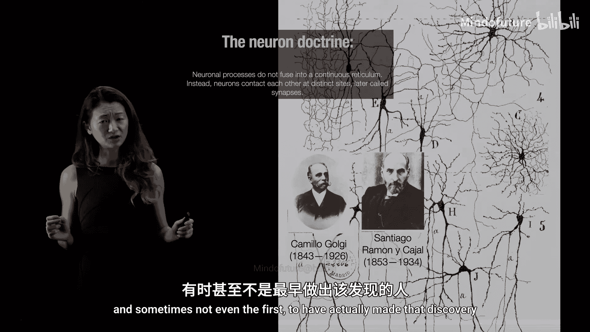
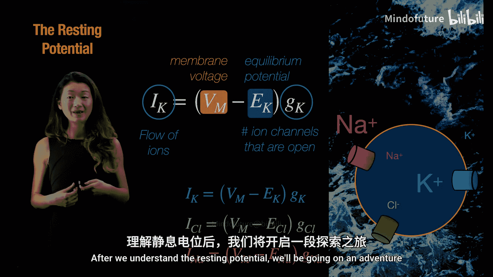
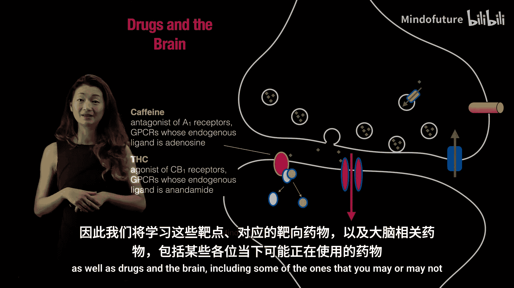

# 【华盛顿大学】神经科学入门 ｜ Introduction To Neuroscience ｜ Bing Wen Brunton p02 P02_动物电现象-神经元学说 -BV1i3qWBXEDH_p2-

Let's talk about the brain。 Hi， my name is Bing Brenton and I'm a neuroscientist at the University of Washington in Seattle。

 I'm delighted to be here today to give you an introduction to the next series of videos。

 so we're going to be talking about the fundamentals of neuroscience and neurobiology Now when we're talking about neurobiology。

 Oftentimes you think of newspaper articles about the latest advances in neuroscience and is often accompanied by a picture like the one that's next to me right now。

 where the brain is bathed in electricity as if they were showered and lightning or something like that。

 Now， why is the brain always depicted like this。 It turns out that this actually has some foundations in neurobiology and it's because for the brain to function electricity is the fundamental language of the brain。

 So in trying to understand the fundamentals of neuroscience。

 we're going to start by thinking about the connections between neurobiology and electricity。😊。

So let's say that you find yourself in a lovely location like the following one where you're at the beach Now how do you even know where you are It turns out that electricity is a fundamental way in which your brain represents information。

 sensory information that we get from the external world For example the fact that the sky is blue and then the ocean is this lovely shade of turquoise you know that because the light。

 the photons of those respective wavelengths hit the photoreceptors in your eye which translates that information into electricity you might hear that the waves are crashing onto the beach sounds similarly goes into your ears and is translated by auditory cells into the language of electricity you might be walking around and feeling the grittiness of the sand in between your toes The only reason you know that is because it touch receptors in your toes are translating those forces into the language of electricity Similarlyly those are just sensory perceptioncepts actions are also mediated by electricity。

If you decide to go for a dip， you might be using your electrical commands for motor neurons to command the muscles in your body to go walk towards the ocean and then dip your foot in。

 so electricity is such a fundamental concept here。

 and we have to understand it by starting really small and understanding what it is that electrical activity has to do with each individual neuron of the brain。

So the things that we're going to cover in this course are a series of questions and the questions are rather basic to begin with。

 but we're going to dig a little deeper and try to get a mechanistic understanding of how each of these questions actually function from a cellular and molecular perspective so first we're going to be talking about neurons。

 what's a neuron and what's so special about it and not just because it's special to me。

 hopefully by the end of this course maybe they'll be special to you as well。

And neuronsur are special， lots of different reasons。

 but one of the reasons is that it uses electrical activity as a way of passing information。

 but how is there electricity in the brain in the first place。

 I thought we were talking about biology and not electricity so the same electrical activity that is used to power whatever electronic device you're on right now to watch this video is in fact the same fundamental electricity that is at work inside your body so that you can actually take in this into information and process it so what is the fundamental reason that their electricity in the brain that's one of the first things that we're going to be to get into in the first part of the lecture。

After we figure out how there is electricity in the brain。

 we're going to figure out how it is that this electrical activity changes when something is changing in the environment of the neuron。

 so figuring out how it is that neurons respond to change is really important because that's actually how it is that we experience the world we don't experience static things we experience things that change okay so we're going to be talking about how neurons。

 individual neurons respond to change， whether those changes come from the external environment in the physical world or from some other neuron that it might be talking to。

And finally， we're going to be talking about how neurons even talk to each other in the first place。

 So I told you before that there's 86 billion neurons inside your brain and more of them that are throughout your body to animate your entire body and enable you to do all the things that you do in your daily lives and so these neurons are not alone they work very much together and there's a lot of emergent properties of them so we're going to start slow by building up from one neuron to two neurons and try to figure out all the different ways that neurons can communicate with each other。

 what are the fundamental units of a communication where information goes from one end of the neuron to another one and then how does it convey that information the next one。

 So the interesting thing about all of these questions that we're about to answer in the next 10 videos for so is that if you understand enough about the molecular and cellular mechanisms of each of these questions where you'll quickly realize is that every single one of those answers is also a target for drugs here I'm using where drugs kind of。

In an all encompassing sense to mean there's a variety of medicinal drugs that target a lot of these systems。

 these are also targets of recreational drugs， they're targets of toxins。

 they are also targets of research drugs that we use to allow us to interrogate the system and he's apart different aspects that might be confounding each other and working that reality。

And so to answer these questions， we're going to be talking about the basics of neuroscience。

 however neuroscience is intrinsically an interdisciplinary field and so what I'm going to be assuming in the course of the next couple of lectures is that you already have some familiaramity with and approximately a beginning university level of the following topics。

 I expect you to know something about the parts of a cell。

 you probably should have heard about what a nucleus is with a cell membrane is。

 the cell membrane is made up of lipid biolayers， things of that complexity similarly I will expect that you know the process by which the genome and genes are made into instructions for constructing proteins and that these proteins are molecular machines that carry out all the work that goes on in an animal cell and also other cells but we're talking about animal cells here so that's word biology for physics I will assume that you have some familiaramity with the basics of electricity。

ismYou should have heard about things like voltage， current。

 resistance conductance and have heard about things like Om's law， for example。

I'm not going to be doing a lot of complex derivations。

 but I will be using some notations from calculus and differential equations。

 I don't expect you to have to solve any equations。

 but you might be familiar with the terminology like here where DXTT denotes the derivative of respect to T here usually means time。

In terms of chemistry， I will assume that you know something about the basics of ions charged particles。

 usually in the aqueia solution because that's where life is and also the basics of organic molecules using notation like the following one where I'm implying that every single one of those vertices has a carbon at that location Now if you are not totally comfortable with all of these topics it's totally okay I will try to go slow and hopefully we can use neuroscience and your curiosity about learning how the brain works as an excuse to go back and learn more about these other topics at these other fields of science that may maybe something that you'd be interested in doing so of course at any point。

 feel free to pause and figure out that look up something that you may have learned in the past or may not have learned yet and feel free to do that at your leisure so we're about to dive in and I just wanted to say one word about electricity as a fundamental unit of communication in the brain I kind of told you。

As a fact like this is just what it is and it is true， but like all things in science。

 we didn't always know this is true。 but we have known electricity had something to do with the way that animals moved for a long time and the shocking history actually goes pretty far back to what it was called animal electricity Now this happened in the 17 and 1800s around the same time the foundations of electricity and magnetism had been described。

 in fact， by some of the same scientists who were doing these experiments like Galvani and Volta Galvani after whom Galvanism was named and Volta after whom the va was named So the same scientists were doing experiments and they were doing experiments with animals and so heres a really charming one that they did to demonstrate that animal electricity is the same electricity as other electricity that they were dealing with at the time So the experiment is a following step1 you get a dead frog put your dead frog on the table and you hook up lightning rod with wires and then hook up。

Those wires， one side to one end of a frog muscle and ground it to the other side of the frog muscle okay next you sit there and you wait for the lightnings to strike and if it does。

 you'll realize that as the lightning strikes the dead frog actually flexes that muscle it moves right in other words a dead frog is animated by lightning。

Okay。Sounds somewhat obvious to us now， but back then this was revolutionary。

 the fact that you can actually unify our understanding of biology and movement。

With the same electricity whose laws are being described at the same time in terms of studies of batteries and wires and capacitors of all of the following。

 and this was such a revolutionary idea at the time that it really inspired the popular imagination and like all things that inspired popular imagination。

 it becomes fiction， so this idea that lightning can reanimated at frog directly inspired Mary Shelley's writing of Frankenstein。

 where Frankenstein's monster was similarly like at frog waiting for that strike of lightning to be reanimated。

So we've come a long way since the 1700s in terms of our knowledge of basic neuroscience。

 so I'm skipping a lot of history here and going instead to what we now consider the first thing that happened in the history of modern neuroscience。

 which was the observations that the brain is in fact made up of neurons and these neurons are separate entities that are not fu with each other but they talk to each other。

 so that's what the neuron doctrine says， which again sounds obvious to us now right。

 of course the brain that's made up of neurons just like your livers made of neurons。

 your lungs are made up of neurons because you know。😊。

Animals are made of neurons， but animals are made out of cells。 but this was not obvious at the time。

 in part because the brain is so complicated and so convoluted that it was really hard to tell whether or not the processes of the brain。

 the various tendrils of the cells that we saw in the brain were actually separate or not So you can kind of imagine if you cook a bowl of noodles can be spaghetti some of the kind of noodles and you drain it in the collenander and so it's dry afterwards。

 you look at it and it's a gigantic mass it could be really hard to tell just by looking at it。

 whether or not you have separate pieces of noodles or it is， in fact。

 one gigantic noodle that's all tangled up together because you can't really the ends。

 So that was the problem of neuroscience back at the beginning of the 1900s people were debating this for a long time。

 and two of the biggest proponents and either side of the debate or two influential scientists gulji and Santiago raman and ecahal Now gulji maintained that the brain is actually made up of neurons that were actually connected to each other。

 what's called。😊，The continual re theory of the brain。

 whereas Santiago Ihal turned out to be correct， which is that neurons do not fuse with each other and they are distinct from each other and they only talk to each other at sites which later became synapses so we're going to have a series of lectures on the synapses a little bit later。

😊，This was revolutionary at the time because it allowed us to study the cells of the brain。

 just like we study every other cell in every other organ in the body using a lot of the same tools and approaches in terms of the scientific method。

 Now the way the lovely story， the way that Romaniikahal ended up being able to do this was by doing very careful microscopy and these lovely hand drawn pictures of neurons like the ones that you see here because neurons。

 unlike a lot of other cells are not loular， they have a lot of geometry and they have a lot of shape and the shape is actually quite lovely。

 And so Romanmaniikahal drew a lot of these pictures Now if you're a nerd like me。

 you actually own several pieces， not just one several pieces of clothing that have these pictures on them I really like dressing as a neuroscientists if I want a nerd out about it。

 But in order to do this， Romaniikahal actually use what's called a golgi stain。

 which is a type of staining that golji invented to support his theory the magic of golgi stain。😊。

I instead of staining all the cells， it only stains magically and unexplably a very small fraction of the cells。

 and so you can actually see individual cells separately from the rest of the neuro pillll in a way that makes it possible to see that they are in fact。

 distinct cells that are not the same as every other cell around them and so in that way。

 Gg and Kahal got a lot of the credit in early days of establishing the foundations of neuroscience as a scientific biological discipline just like every other discipline。

 just like we study every other organ Now in a really interesting twist of history。

 it often turns out to be the case that the people who get the most credit and are remembered for discovery are not the only and sometimes not even the first to have actually made that discovery。

 the same is true here so in a lesser known part of this story there was a Norwegian scientist whose name is Fririch Nson。

 who use the same。😊。

Goge saying。To make similar drawings and published on the neuron doctrine articulating exactly the same theory。

 Ramon Icahal later received credit for Everyone knows Kahal's name and sees these pictures。

 almost nobody knows who Nanen is and part of it is because Ramon Icahal went on a world tour telling everyone about his theory and made sure he got credit for it whereas Nanen。

 after he published his scientific work in his early days as a scientist kind of moved on with his life he was later known as a very famous Arctic explorer and a diplomat and humanitarian。

 In fact， he received the Nobel Peace Prize for his humanitarian work in what's called the Nanen passport he was really active in politics and advocated for individuals who were displaced during what war one and didn't have a place to call home where they couldn't really get a passport at either their place of birth or the place in which to reside and so they ended up with called the Nanen passport for people who didn't have a passport otherwise in this passport ended up being recognized by lots and lots of countries as a valid form of identification and trial。

And so if you want to know more about the history of the neurondo。

 I recommend the article that's down there where the DOI is linking to the article and I'll link the article in the descriptions below。

In neurourscience， as in lots of other scientific fields。

 I really like digging into stories like this one where we think about not only what we know。

 but how we came to know it， who the actors were that were part of that story。

 and I especially like knowing about parts of the story that are not part of the official story。

 things that maybe people kind of forgotten or just was too complicated to think about but scientists are people too。

 and so there are stories like these that will highlight throughout the next set of lectures。😊。

So the neuron doctrine brought us pretty far。Surprisingly。

 a lot of progress has been made in the last 100 years in terms of our understanding of exactly how electricity is the fundamental language of the brain so we're going to start in this first set of lectures and I'm just going to give you a preview of some of the things that we'll be learning about in this set of the first set of lectures The first where going to talk about before we talk about what neurons actually do we're going to be talking about the the resting potential what it is neurons do when nothing is happening at all。

 how does it maintain an electrical potential at all the short story is that it's maintained by charged particles like ions and in particular the most important species of ions we care about here are sodium。

 potassium and to stem chloride after we understand the resting potential we'll be going on an adventure and talking about the action potential so nothing rests for long。

 there's always an action site after we understand resting we're going to do the action potential and this is the fundamental unit of communication how it is that neurons are able to go vast。

😊。

The vast distances between your toe and the base of your brain， really long distance。After that。

 we'll be talking about how neurons talk to each other by thinking about the various types of synapses。

 synapsse being the word that we call how it is that one neuron communicates to another one。

 we'll be talking about the different steps of how information passes between one neuron and the next one and by thinking about the synapse we now have a lot of different molecular knowledge at our disposal and like I said before all of these sites are going to be targeted for drugs。

 and so we'll be learning about all of those sites， different drugs are target them。

 as well as drugs and the brain， including some of the ones that you may or may not be on right now。

Okay， so that's the plan， we're going to be talking about the electric life of a neurons。

 this is going to be a grand adventure， and I'm really excited to get started with you。

