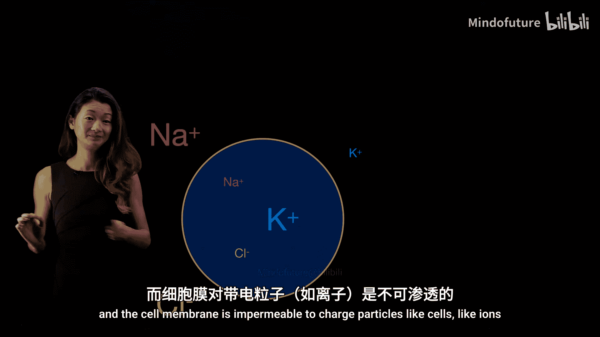
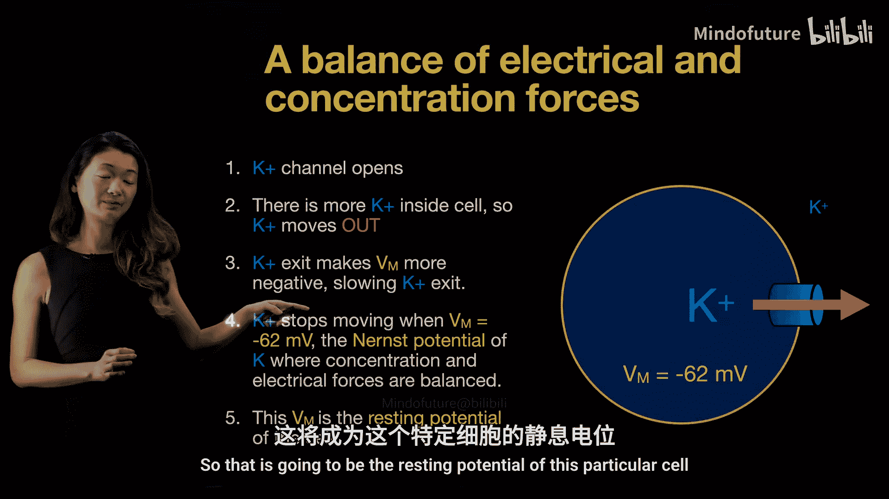
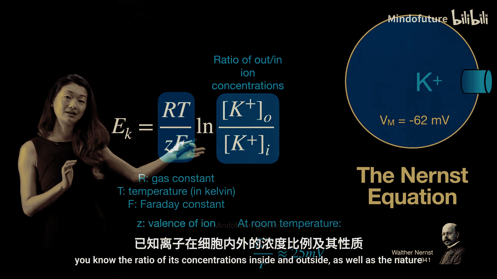
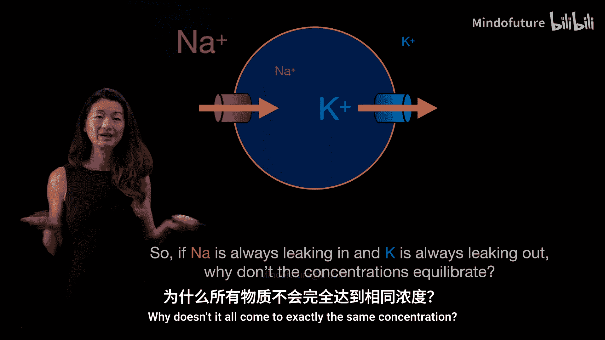
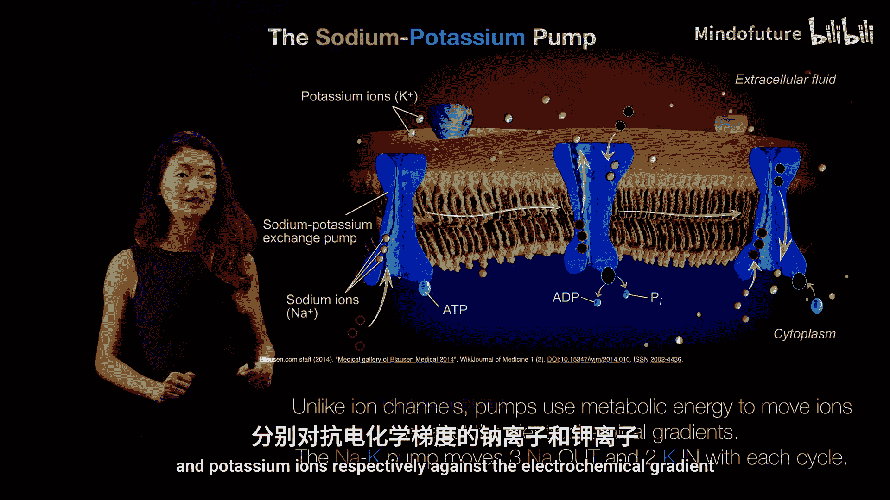
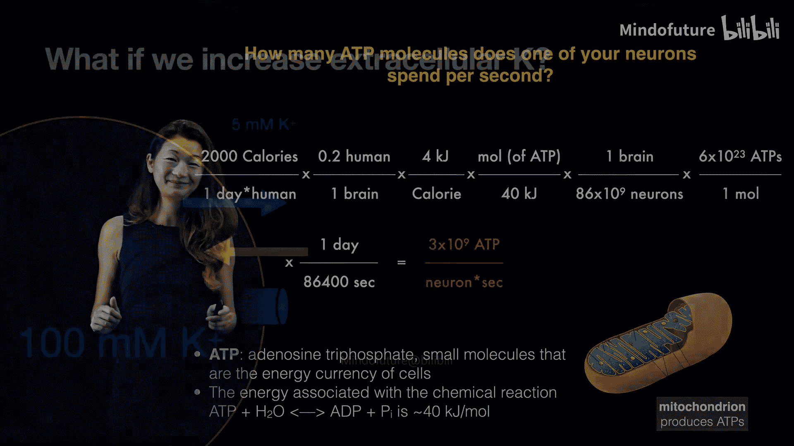
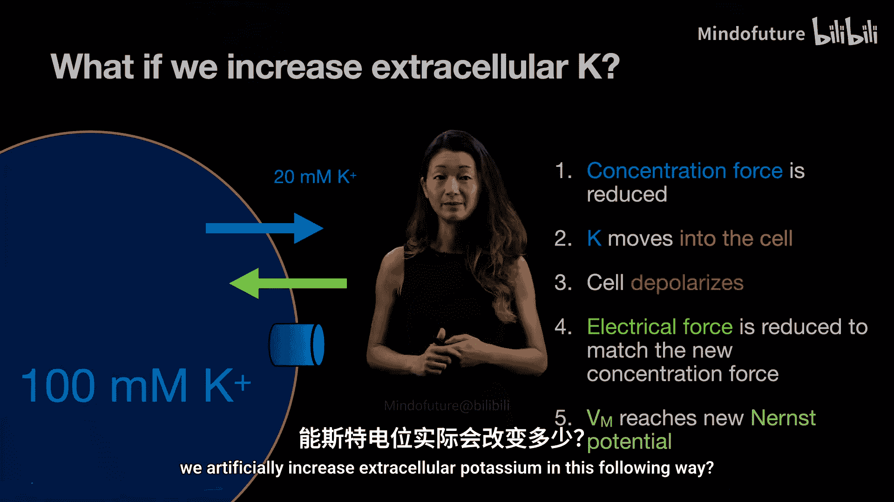
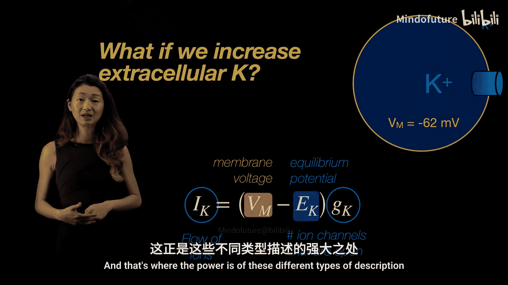
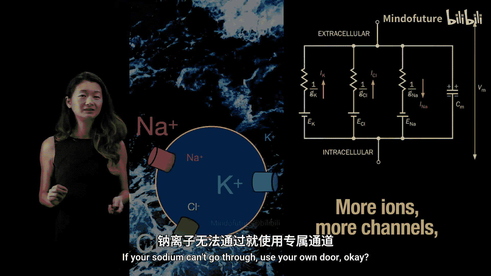
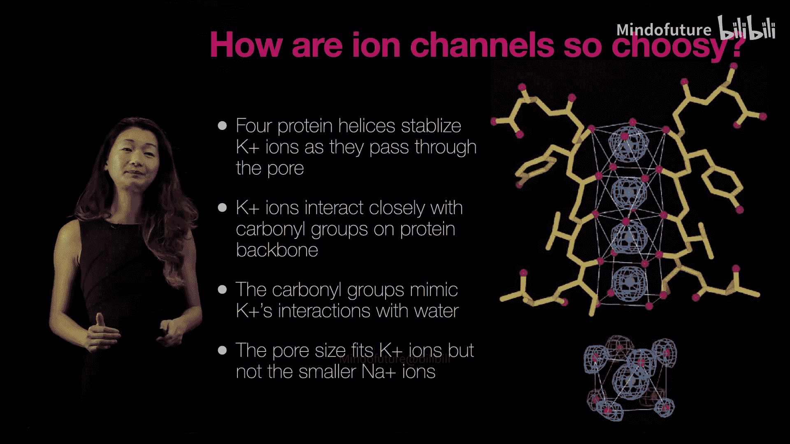

# 【华盛顿大学】神经科学入门 ｜ Introduction To Neuroscience ｜ Bing Wen Brunton p03 P03_神经元为何带电-能斯特电位-神经元静息电位 -BV1i3qWBXEDH_p3-

Welcome back to introduction to neuroscience where we're going to get started at the beginning。

 this is the Abcs of neuroscience and we're going to be talking about the neuron and why it is a neurons have an electric charge this is also known as the resting potential so we'll be building up our knowledge of why neurons have an electric charge from the very beginning by thinking about a cell in general so in the beginning there was a cell and the cell was just a spherical blob nothing too complicated so far now the fundamental purpose of having a cell is to define the difference between it inside and an outside the fact that there is a lipid membrane allows the cell to control an environment and curate what is inside itself cell in a way that is separate from what's outside itself a bit of terminology here every time we talk about things that are inside the cell we're going to be calling that intracellular intratro for in and everything that's outside of the cell including a lot of other stuff that's out there we're going to be calling extracellular extra being outside。

So the cell is just like every other cell， it' you know it could be a procarotic cell。

 it could be a liver cell， it could be an invertebrate cell， it could be any other kind of cell。

 but we are interested here in talking about neurons and so a neuron like likex some other cells curate an internal environment that is different from the outside an environment in the following particular way it is able to maintain a concentration of charged particles and ions in a way that is different than what's on the outside of the cell in particular here in the part of the lecture we're going to start really simple by focusing on only a couple of distinct ions we're going to be talking about potassium of which there's a lot inside the cell and less outside the cell。

Sooddium and chloride of which there is a lot outside the cell and a lot less of it inside the cell now this difference is really important because it establishes a reason for these ions to try to go to where there's less of themselves if they could。

 but of course they can't， because there's a cell membrane and the cell membrane is impermeable to charge particles like cells。

Like ions。Now there's a p mnemonic here that I like to use to remember which one is which it's always confused sometimes the way I remember it is that cells evolved in the ocean and the ocean is full of salt water like sodium chloride and so the extracellular environment is like the ocean has lots of sodium and chloride and then the inside of the cell is the opposite has less sodium and chloride and it has a lot more potassium instead so that's a little mnemonic that I like to use sometimes remember the ocean back to basics so the resting potential。

 we're going to explain in the following way First we're going to talk about the neurons have a steady resting potential of approximately negative 60 to negative 80 millivvolts Now if you think about it in terms of batteries。

 this is actually a really large voltage that we can measure。

 this is literally what you would measure if you were able to stick to two ends of electrodes one inside the cell and one outside the cell and you read a little volt me。

 this is what you would read negative 60 negative 80 millivvolts Now this is a large。

Because it's almost a10th of a vat。 and if you scaled it up to the size of something like a battery like the one that I have in my clicker right here。

 that would be a 300，000volt battery。 So this is quite a bit of charge as being maintained across the plasma membrane across the lipid bilayer membrane。

 that is a similar membrane。Additionally， most neurons are highly permeable to potassium at rest Now I told you before that cell membranes are impermeable to ions and that's true The trick here is that the reason the cells do this is because they actually are then able to express proteins and then control which ions that they want to be perme to permeable to at what times So one observation we can make is that most neurons are actually pretty permeable to potassium at rest because they express a specialized ion channels that are selective for potassium and allow potassium to pass in and out as they will so basically it's like like a door in the plasma membrane that's only open to potassium potassium come in and out as they wish it doesn't matter which way that the doors don't dictate which way they go but they only allow potassium to pass through when the cell is at rest we'll talk about active later this is at rest Now all of this is true these are just facts that are true that I'm telling you but how does this even make sense？

We're going to be talking about in the next couple of slides about why it is that this is actually true and how this makes sense in the context of what we know about electricity and ion potentials。

But a little bit of terminology first， so the membrane potential I'm going to be denoting as V subM for voltage of the membranes。

 so anytime you see v subM that is the current potential of the membrane。

 there is a resting potential， which is just what the membrane potential is when nothing else particularly is happening。

 I'm calling that resting potential， if you hear me say resting potential that means the membrane potential at rest。

 that's the resting potential。Now， the resting potential tends to be a little bit negative like we talked about when it becomes more positive。

I'm going to call that depolarizing because it is becoming closer to zero and less polar。

If it becomes more negative， I'm going to be calling that hyperpolarizing because it's becoming more polarized because it's going to be farther away from rest of memory potential of zero so this is just a bit of terminology I wanted to do this up front so that we can all be clear on what do these words mean you can say a lot of different things in different ways and so I think in neuroscience it's important to just get the lingo down up front I'm going be using these terms and I'm going to be using them interchangeably so increasing potential resting potential membrane potential depolarizing potential。

 these are all words that I might say in the course of talking about the foundations of how neurons are electrical cells。

Okay， so let's think about the resting potential first by I told you that the cell at rest is very permeable to potassium。

 so let's make a vast simplification for now and just for just let's ignore the other ions just for a little bit and just focus on potassium because it's much easier if we just think of what one ion instead of a bunch of them okay so I have a cell。

And I have a bunch of potassium on the inside and a little less potassium on the outside and I have a bunch of those little barrel shaped things which are my little symbol for potassium ions。

 places or potassium can go in and out if they want to right now if you remember from chemistry when you have a lot of something on one side and less of it on the other side and doors for the thing to go through what's going to happen is that the potassium is going to want to leave the cell there's a concentration gradient and there's a reason for the potassium to leave the cell so that it can balance the concentration on the inside of the outside of the cell so the first thing that happens is as the potassium channels open the potassium is going to want to leave the cell so there's a net outward movement of the potassium going outside of the cell now that's fine if all you're talking about are regular solutes that are in solution but we're talking about ionic species here because potassium。

Is a positively charged ion and when positively charged ions leave the cell。

 it actually makes the membrane voltage more negative。

So positive ions leaving the cell means there's more positive on the outside。

 which means that the inside ends up being more negative。

 so as the membrane potential becomes more negative。

 there is a balancing electrical force where the positively charged ions on the outside are drawn towards the more negative membrane potential on the inside。

I'm going to say that again， there is a balance of electrical and concentration forces here where the concentration force makes the potassium want to leave。

 but as it leaves， the member potential becomes more negative。

 which makes potassium want to come back in。These two forces are going to eventually balance。

And the point at which it stops moving when there's no net movement when the electrical forces and the concentration forces are exactly balanced is called the nerve potential of potassium。

This N's potential is super important。Because it tells us the point at which there is no more net movement of potassium in or outside of the cell。

 despite the fact that all the doors are still wide open now。

 of course stochasticically because of thermodynamics。

 there's going to be a couple of ions that go in and out anyway。

 but the point here is that there's no more net movement and therefore no more changes in the electro potential in the memory potential of the cell in my simple scenario where all I care about is potassium。

Now one more thing I'm going to point out the nurse potential here is a voltage it is basically a target voltage if this is all that's happening。

 if all we have is a cell and potassium and some ion channels that are permeable potassium then the nurse potential is the voltage at which everything will come into an equilibrium because we have now balance the electrical and the concentration forces。

 everything's in balance and nothing's going to move any farther。So。

That is going to be the resting potential of this particular cell。

 that's what's going to happen here。

So what's going to happen next is that we're going to be digging a little bit more into exactly how this N potential is going to be computed I told you intuitively that it's this place where electrical forces and concentration forces come to a balance and so the way that we express this mathematically is by the following equation if you wanted to actually compute what the nurse potential of any particular ion is here's the equation that you you would use to do so it's called the Ns equation and so the equilibrium potential of a particular species of ions so here we're talking about K for potassium is equivalently called the nurse potential or the equilibrium potential so here I'm denoting is e sub K E for equilibrium so this is the equilibrium potential of potassium the factors that go into it are the following we have a ratio of the inside versus the outside concentrations of potassium so I'm literally going to take the outside concentration of the potassium and divided by the inside concentration。

of potassium to get the ratio if in versus out of that particular ion noticeice here that technically I don't actually need to know what are the concentrations on the inside of the outside I just want to know their ratio right it doesn't matter if it's10 moles versus mo10 mos out versus one mole in or 10 millimmolars out versus1 millmolar in as long as the ratio is the same this equation is going to give me the same nerves potential。

 the same equilibrium potential。After we take the natural log of that。

 we're going to then multiply it by the following constant where R t R is the gas constant and temp T is a temperature in Kelvin and F is the fairday constant。

 Now you'll notice that these are things that are fairly standard in the standard physiological scenario。

 So if you are at room temperature or body temperature for reasonably for reasonably temperature animal。

 R T and F are not going to be changing。 So in fact。

 we can make the approximation that at room temperature where you might be doing a reasonable experiment。

 sometimes we heat up if you're doing a kind of a warmer animal。

 sometimes you heat it up but at room temperature， Rt over f is approximately 25 millivolts。

 and so we can use that almost as if it's a constant because in most scenarios。

 it's not really changing all that much。 Now it's R t over F and then also to divide by Z Z here is the valence of the ion So for potassium it is a positive ion of。

ge1 so valence z would plus1 similarly for sodium z be plus1 flow chlorine because it's a negative one charged ion。

 valence would be negative one in this particular case so Z does change depending on which ion you are looking at so here we have a formula for computing the nursed potential of any ion as long as you know the ratio of its concentrations inside and outside as well as the nature of the ion what the valence of the ion is。

In a slightly more complicated scenario， realistically we actually have more than one type of ion。

 we have potassium and sodium， and this is an example of some plausible scenarios of what might be the concentrations in a normal animal cell in terms of the outside concentrations as well as the inside concentrations if you crunch through the N potential equation。

 you'll come upon the nurse potential for each of these ions and you'll realize that because of the opposition of the respective concentrations inside and outside of the cell the nurse potential potassium is very negative。

 it's approximately negative 80 millivolts， whereas the nurse potential potassium is quite positive it's about plus 60 millivolts so these are kind of opposites at this point now。

All things being equal， you might think that sodium might want to rush into the cell。

 and potassium might want to rush out of the cell。So how does this happen。

 how does this even make sense if sodium is always leaking in and potassium is always leaking out why don't the concentrations just equilibrate。

 why does it all come to exactly the same concentration so the answer to this question has to do with the sodium potassium pump now this is the way that the cell tries to maintain equilibrium now if you are a neuron the fact that you have this resting potential that is not zero where not everything is the same everywhere else where there's a difference between your inside intracellular environment and the outside extracellular in environment is something you want to maintain because you're maintaining readiness it is only that maintained negative potential are you as a neuron ready to respond for the world you you wake up in the running with a smile and your like okay bring it I remember ready for whatever this is how a cell as a neuron is ready by maintaining that difference between the inside and the outside and so it's really important for the cell to maintain。

High concentration of potassium on the inside。 and to get all the sodium out。 It needs to get out。

 All right， now， this is such an important process that the pump。

 the protein that is responsible for maintaining this concentration gradient is one of the primary。😊。

Reasons why your brain consumes so much energy。 So your brain。

 despite being weighing only approximately 2% of your body mass。

 consumes something like 20% of the calories in your body at rest。

 This is not true when you're running or doing something really physically rigorous。

 but if you're just sitting there and not really moving a lot。

20% of your calories that are being consumed every minute is going to your brain。

 So this pump is the reason why This pump， unlike ion channels， which are just doors that are open。

 ions can come in they can come out， whatever they want to do。 It's totally cool。

 The pumps are significantly more bossy。 they are actively using energy in the form of ATP。

To pump ions against the concentration gradient against the electrochemical gradient in this particular case。

 we have a sodium potassium pump that is super active in every single neuron maintaining those ionic concentration potentials。

 where for every time its cycles，Three sodium ions。

Are pumped against the electrochemicalical gradient out of the cell， and then in a second stroke。

Two potassium ions are pumped inside and every time that happens， one ATP is hydrolyzed into ADP。

 and we have a net expenditure of energy and pumping of sodium and potassium ions respectively against the electrochemical gradientdiant。

This is so expensive that we can actually use this as a way of estimating how many ATP molecules as your neurons spend per second。

 just doing this right even if it's not doing much， it's ready to respond even when you're sleeping。

 you're ready to respond when there's a siryroid that goes off and you have to respond immediately or something like that even if you're just sitting there you might be ready for somebody to tap in your shoulder and you have to turn around and respond to whatever that is your nervous systems job part of its job is maintaining readiness and so it expends an exorbitant amount of ATP molecules just being ready。

 So let's do a fun little order of magnitude computation about how many ATP molecules are approximately are spent by a single one of disease neurons per second so I'm going to do with the following way I'm going to say that we're going to start with the following general prescription of a normal adult humanum or something like 2000 calories per day start there close it's same order of magnitude it's not going to be 10 times smaller than this and it's not。

be1 times more than that for the vast majority of us so going to start converting we're going to converting the calories per day humans。

 and we're going to convert it into 20% of those calories goes into running your brain。

And we're going to convert calories into te kilolojoules into moles of ATP We then multiply by avogodro's number to get the number of oh that's not that's the number of neurons in your brains or making the approximation here that you have approximately 86 billion neurons in your brain okay then we multiply by avogojoro's number to get the number of ATPs in a mole。

 everything cancels out so far we then make the conversion of days。

 the number of seconds to come upon the order of magnitude of about a billion ATP molecules are spent by every single one of your neurons。

 every second of you just sitting there on the couch ro Netflix not doing much that is a lot of energy just to sit there being ready for something else to happen。

So this is also the nurse potential， a really interesting way of being able to do some intuitive exercises in terms of what might be happening if something about the passive environment inside inside and outside of the cell starts to change So I told you before that there's a lot of potassium in the inside and much less on the outside。

 what if we artificially and even temporarily increased the extracellular potassium concentration So for example。

 in an experimental context this might be I have a neuron that I dissect it out of a cockroach and I put it in a dish and I'm going to bathe into a solution that has a lot more potassium。

 the extracellular space then the physiological conditions actually are in the animal so what if we just did that what would happen so if we reason through this。

 what's going to happen in a hand wavaving way is that the concentration force is going to be reduced so there's more on the outside。

 which means that the。😊，gradient the forces pushing the potassium ions out is going to be less。

 and so it's going to be reduced concentration forces。Therefore。

 potassium is going to start moving back into the cell because there's going to be a lower concentration force。

The cell then depolarizes because we have positive ions moving into the cell。

 making the membrane potential more positive， and another way of saying the membrane potential being more positive is that it's depolarizing。

And what's going to happen is that the electrical forces is then reduced and we come to a new equilibrium that matches the concentration force。

 and that's what's going to happen as the membrane potential reaches the new nurse potential which we can compute quantitatively by taking the ratio of the inside and the outside potassium concentrations。

 so I'll leave that to you as an exercise to actually crunch the numbers if you plug in these numbers when you have 20 millmos of potassium on the outside instead of5 millmos。

 how much does a nurse potential actually change when we artificially increase extracellular potassium in this following way。

So there's another interesting thought experiment that we can do。

 I told you already that all of these resting potentials are maintained by resting potassium ion channels that are open most of the time even though the cell is not doing anything now these resting ion channels。

 even though they seem like they're not doing anything。

 they're actually kind of important because it turns out things kind of go wrong if there's not enough resting ion potential because these are what's maintaining the resting potential of the cell so for example。

 you might reason that cells now have a reduceability to maintain the resting potential because the resting potential is predicated on the assumption that all of these potassium doors are open and the potassium come in and out as they want and reach an equilibrium。

The other thing that's going to happen is the cells might become abnormally excitable because it's not able to return to this normal resting state like a normally would right if it got excited。

 it wouldn't really be able to come back as quickly as it really should be able to as it normally would in a different cell if there were enough resting ion channels so this seems like a slightly silly scenario until you realize that they're actually goats that have this condition this is what's called the fainting goats with congenital miotonia and in this type of disease。

 these goats have not enough resting ion channels， which means that when they become excited when they become startled they tense up their muscles and contract and they can't relax them and because they can't relax their muscles and they're stuck in this1 state they totally fall over like that picture there it's actually kind of adorable once you realize that they're only down for 10 or 15 seconds and they get back up as though nothing happened they run around they're totally happy again this is a kind of a charming way of describing not enough resting ion channel。

In the congenital miotonia but fainting goats is a much more lovely way of naming this condition。

 it's so lovely that it's actually the name of a local gelato shop that we have here in Seattle。

 they have two locations and they make cool they have a really cool decor and they have good gelato and so if you're in the neighborhood go check them out the fainting goat gelato I'm really not getting commissioned from them not getting pad like the gelato。

😊。

So。What's going to happen next is that we're going to then expand on this description of the Nst equation so far we've mostly talked about potassium and we've talked a little bit about sodium but kind of separately。

 so we're going to start integrating this knowledge into a holistic view of the resting potential and trying to build up levels of realism by adding in things that are actually happening in the real cell without getting too complicated。

 at least not quite yet。So what's going to happen here is that remember we're talking about。

 we're caring about the ratio of the inside and the outside ion concentrations。

And we also care about this constant here， okay， so this is a reminder we just did this。

And what we can do is think about the scenario of what if we had more types of ions okay so what if instead of just having potassium ions and the relative concentrations in and out of potassium ions。

 what if we also had sodium ions， we could have other ions too right you can have calcium。

 you can have chlorine you can have all kinds of ions that are in here so let's just think about what would happen okay so intuitively you might think that if you had more types of ions。

 the right thing to do here would be to instead of thinking about the relative concentrations。

 the ratio of concentrations of just one type of ion。

 maybe you would want to be taking a weighted average of the concentrations of the ions。

I'm going to say that one more time here we have an equation that is the logarithm of just。

The ratio of this one type of ion， if you had more than one type of ion。

 you might want to take the weighted ratio of how much that ion is able to flow in and out of the cell。

 so for example， if you had sodium as well as potassium。

 you can have a similar ratio for sodium sodium out divided by sodium and you have a different ratio。

 you have a ratio of potassium ratio for sodium as we saw earlier。

 the relative ratios of these ions inside and out of the cell can be quite different。

And what you can then do is take an average of them。If the cell is equally permeable to both ions。

 if it is equally all the doors are open， if it's equally permeable， to sodium and potassium。

 you would just take the average of the two。If it is more permeable to potassium and less permeable to sodium。

 you might intuitively want to take a weighted average where the ratio of the potassium is weighted more heavily than the ratio of the sodium。

so if it's like a 5050， you just average them of 70，30 or something like that。 you might be like。

 okay，70% important is potassium，30% important as sodium。

 so that's the intuitive hand weaavy explanation of what to do if we have more types of ions。

 And in fact， that is exactly what we are going to do by writing down instead of the N equation we're going to be writing down the Goldman Hokin cats otherwise known as the GHK equation。

 Now this equation， don't be afraid of notation， we're going to break this down because it's exactly what I said intuitively earlier。

 instead of having just one ionic species like an Ns potential。

 we're going to be computing the equilibrium potential of the membrane E for equilibrium and for membrane。

 equilibrium equilibrium potential of the membrane。 Rt over F is exactly the same as before。

 logarithm， exactly the same as before。 But now instead of having one ratio of outside versus in。😊。

We're going to be doing a weighted sum of all of the ions here。So let's break this down。

 So we've mostly been talking about ca so far， let's just ignore the ans， which talk about the cats。

 the positively charged ions okay so the positively charged ions for every single ion。

 we're going to do subscripts J right j is every type of ion so J equals1 might be sodium J equals 2 might be potassium。

 we're going to take this ratio of the outside versus the inside and we're going to weigh it by the permeability to that ionic species。

How permanville is it？And then we're going to add， this is the summation sign。

 we're going to add the weighted permeability by the ratio of the other ions。

 and as many as there are， we're just going to weigh them together。

 we're going to take a weighted sum of all of them。😊，Cat ions are positively charged。

Anions are negatively charged， and so the net effect on the membrane potential of a positive ion moving in and a negative ion moving in is just going to be the opposite。

 and so for ans， we're going to do exactly the same thing except it's going to be in divided by out instead of out。

 divided by in because they have opposite effects on the membrane potential。

Now all of this is kind of assuming that theons and anons all have a valence of one so this is totally fine for theic species that we have over there。

 sodium chloride and potassium if you had something that has a plus two charge like calcium magnesium。

 there's a slight modification we would have to make to this inoricated it to work。

 but you can kind of intuit that I wanted to keep it not even more complicated in terms of mathematicalthematicnotation。

 so this is what we would do to figure out what the equilibrium potential of a cell is if there were more than one ionic species with different permeability at rest to get to the resting potential。

So next we're going to do something really fun， which is think about what happens when things are moving around。

 we're going to take this intuition of ions moving in and out of the cell。

 kind of this handwaavy intuitive explanation and put it on a more firmer mathematical。

 physical grounding by thinking about Ohm's law Now Ohm's law is something that you may have come across if you had done a little bit of study of physics of electricity and magnetism because it's one of these really foundational things that tied together a lot of different quantities in electricity and magnetism in particular it ties together voltage。

😊，Wwhichch we talked about already， current I， that's a new one okay and resistance， which is R。

 and we know that these three quantities are related by the equation V equals IR。

 the voltage is given as the product of current and resistance we know this to be true and this is going to be true in the cell in the same way that it is true in electronic device or breadward or something that you build out of wires with batteries that are macroscopic in in a physics lab or in electrical engineering lab。

 So Ohms law， we're going to break this apart， and I'm going to break down what Ohm's law means for us in the context of ions moving in and out of a neuron in terms of the passive potential and what happens to this when it happens to the cell when it's slightly perturbed from rest。

 So we're going to rearrange this equation a tiny bit where's just going to take I'm going to leave ion on one side and bring R to the other side and so。

Instead of V equals IR， we have I equals V divided by R。

Next I'm going to just do a little a tiny bit of sight of hand where instead of having resistance。

 I'm going to talk about the inverse of resistance。

 I'm going to talk about one over resistance also known as conductance。

 I'm going to denote this by the letter G so anytime you see small letter G that actually means conductance。

😊，Okay， now conductance in the context of ions moving in and out of the cell。

Is a little bit different than what conductance means when you're studying in terms of wires。

 so for example， we know that a copper wire has more conductance than a tin wire。

 it's a better conductor of electricity it's also a better conductor of heat but anyway so conductance in the context of Os law for wires just means how easily electricity passes through that material for something like a normal piece of plastic conductance will be very low basically an insulator doesn't really conduct electricity at all right so that's what it means in terms of wires and electricitys。

But here， instead of talking about electricity passing through a wire。

 we're talking about ions going in and out of the cell。

Because the only way for that ion to go in and out of the cell is through that membrane pour。

 that protein that is an ion channel， conductance in this particular case is directly proportional to the number of ion channels through which that ion can pass more ion channels。

 higher conductance， that's really all it is here so that's the interpretation of Ohm's law where V is something proportional to the membrane voltage。

I is current and again current here instead of being flow of electrons in a wire or electronic device we're talking about flow of ions in and out of the cell。

 so I here is actually flow of ions in and out of the cell。

 so the flow of ions in and out of the cell is going to be proportional product of the voltage。

 some kind of voltage driving force and the conductance。

 the number of open ion channels through which that ion can pass that's what we're expressing here in this version of the Om cell interpreted in the lens of neuroscience and the electrical properties of the neuron。

We're going take this equation， and we're going just work with it for a little bit further。

 We're going move some stuff around and you see how far we can get as we do。 This is what happens。

 Okay， so we have this equation。 and what's going to happen next is we are going to consider what happens in the case of the potassium ion。

 So here I'm going to write I sub K because it's the current that's associated with a movement of potassium ions in particular。

 again， we're just talking about potassium for now。 there's other。

 there's other there's other ions being moved around。 So there's other currents right now。

 we're just talking about potassium。 So the movement of potassium in and out of the cells associated with a current。

 and the magnitude of that current is going to be proportional to the following term。😊，G times V。

 okay G， like I said before， is quite literally the number of ions that can the ion channels that are open。

This V term here takes a little bit more explanation， so I'm going to break this down for a little。

 but V is not actually just the membrane voltage。 V is kind of like the electrical voltage force that's associated。

 how much something wants to go to somewhere else so here it's the difference between the membrane voltage。

 wherever it is， whatever the current membrane voltage is， and the difference between that。

And the equilibrium learns potential of that ion。Okay。And G sub K is the conductance of a potassium。

 which since the only way potassium can go anywhere in of the cell is through ion channels。

 it is also the number of ion channels that are open so those are all the ingredients this of this equation。

 Let's think about that for a second to make sure this makes sense to us so the flow of ions tells me it's a net flow of ions right net flow of ions is going to be proportional to v sub n minus e sub K times G sub K。

 So let's see if this makes sense if this drives with our intuition we think should be happening here。

 G sub K is the number of ion channels that are open。If G sub k were0。

 like there's just no ion channels open， then this quantity is zero。

 doesn't matter what the other stuff is， I is going to be zero because there's no ion channels open。

 does that make sense？Okay， but does right if there's no ion channels open， nobody's going anywhere。

 So the flow of ions is going to be zero so far so good right now let's look at this other term here。

 What if V subM， the membrane voltage is exactly the same as the N potential potassium。

 So we're already there， We're already at the target equilibrium potential， this quantity， right。

 this subtraction will give us also0。😊，Which means that flow of ions。Is once again zero。

 This also makes sense because as we talked about earlier。

 the N potential is kind of the target equilibrium potential right And if you're already at the equilibrium potential where the electrical chemical forces are already at balance。

 then there should be no net flow of ions anywhere。 So once again。

 this drives of the we learned before， where we can reason through how this equation makes sense in the context of what we think we know about the physiology of the cell。

 as well as what it means for the cell to be at in equilibrium nurse potential。Okay。

 so we're going to take this equation here and make the following observation。

 it turns out that this equation is exactly how we would express everything we just talked about。😊。

In terms of an RC circuit that you would actually build in either a physics or electrical engineering lab on a breadboard。

 this is known as the RC circuit because it's super well studied， it has resistor a capacitor。

 so this exact equation that we just built up is the same equation that describes a resting potential of the cell with potassium and it's the same equation that describes this circuit right here。

 exact same thing they equivalent。I'm going to say that a couple of different ways。

 so if you were trying to study the resting potential of the neuron from the perspective of potassium。

 you may as well think about it with the analogy that is acting exactly like that circuit that we can draw over there where extracellular is in the outside and intracellulars on the inside。

 the voltage is the voltage between the inside and the outside。

 we can totally measure that if there were macroscopic and it something on the little circuit that you built in a Brentboard。

And it has two parallel paths where the right hand path is the capacitance。

And that corresponds to the capacitance of the membrane， C subM capacitance of the membrane。

 where there's negative charge on the inside and positive charge on the outside。

 therefore V subM is going to be negative because it's negatively charged overall。

And the other parallel path is how the ions can pass through the inside and the outside of the cell。

 where there's going to be a conductance。That's actually resistor there's a resistor whose magnitude is1 over G remember G is1 over R so R is also1 over g right that's that correspond G corresponds the number of ion channels that are open and then we have an equilibrium potential there corresponding to the corresponding potassium E sub K so this and the picture I drew earlier of the cell and that RC circuit are just different ways of thinking about exactly the same system and we can go back and forth but using each description as necessary to reason through the scientific findings that we're trying to explain and so I'm putting this up there not to be extra confusing and not because you need to be able to understand every single way of doing it but rather because in neuroscience。

 a lot of what we're doing is drawing analogies with other disciplines。

 other cognitive and physical and computational disciplines because it's a really good way for us to draw connections between how。

We think the brain works and what we think we understand about how other systems work and so it's not important for every single person to be equally comfortable with every single description of it。

 maybe you really like the equations but you don't like the diagram that's totally fine maybe you really like the Bretboard diagram because you understand that from another class you took but you don't really understand the N potential equations and all the stuff about all the stuff about concentration gradienting because you just don't know chemistry that well that's totally fine too maybe you just like the mathematical description of it because you understand mathematics and you don't really care for the electrical engineering diagrams that's totally fine。

 I'm going show you a lot of different ways to understand the same thing in order to draw connections and if at least one of those connections connects with you then I'm pretty happy and I feel like I've done my job here。

😊，So that's the RC equivalent of the flow of ions。And we can once again use the same equations to get to a more quantitative understanding of what happens if we increase extracellular potassium so earlier on in the previous section of the lecture。

 we talked about what happens if we increase extracellular potassium instead of a handwavy way by thinking about the direction which things would move okay now armed with this equation I wanted to actually work through the numbers and quantitatively think about what might happen if we increase extracellular potassium。

 what would happen to each of these terms so we're trying to get to what happens to the flow of ions。

We know something about menb voltage， does that change if we change extracellular potassium。

 what about the equilibrium potential， does that change if we change extracellular potassium。

 does it change the number of ion channels that are open in this scenario。

 work through each of those exercises in your head and try to come to an understanding of a quantitative understanding of what happens if we increase extracellular potassium and by how much what if it actually exceeds the extracellular potassium at some point。

 what happens then this equation gives us the ability to make those predictions not only handwavy and intuitive but also quantitative as well。

 and that's where the power is of these different types of description。

So when we have more ions， we also have more channels and we can make an equivalent description where we can expand on our RC circuit by putting in more parallel pathways one each for each of the ion species now they're independent parallel pathways in this model because they're actually independent I told you earlier the potassium channels are just permeable to potassium if your sodium can't go through use your own door and so if you do it that way that what we can see is that we can then just write down exactly the same equations like we write down for potassium and we can write them down one each for each ion because they're independent they actually have nothing to do with each other except they're tied together by the current membrane voltage so we can do more ions by adding more channels if there's different types of channels we can write more equations for how they affect the conductance。

There's different if there's different ions， if there's more ions than the three that we've done here。

 we can just add more equations and to have a more complete description of what's happening relating using OhMMS's law。

😊，Current voltage and conductance。So I told you already that the reason we can write these equations independently is because we have these completely independent parallel pathways where the sodium channels are permeable only to sodium。

 you can't come through of your potassium potassium has its own channel and it's not permeable to sodium。

 So molecularly from a protein level。 How is it that these ion channels are so choosy。

 How do they do that。 That seems really difficult right because I can kind of see how you might get you know you can have a negative ion can't pass through a door for positive ion。

 but sodium potassium they're both positive ions of charge past one。

 How is an ion channel as a protein machine possibly able to be so choosy So this is a really fun story。

 And I'm going share it with you and at least conceptual terms。 So ion channels are awesome proteins。

 I mean they kind of all awesome proteins but anyway， ion channels are awesome proteins。

 They're ttraomers， which means that they have four subunits and where there is。😊。

Sled on the extracellular membrane， they form this helix where there's a hole in the middle and the hole in the middle is where the ion is actually going to pass through。

So as you remember from chemistry， ions are positively charged and so they're stable and aqueous solution。

 they're stable in the water solution on the outside and they're stable with a watery solution on the inside。

 they can't pass through the lipid bilay because it's hydrophobic。

 and that's the job of the ion channels to form a friendly environment through which the ions can actually pass where it's advantageous for it to pass through to go from the inside or the outside or the outside to the inside。

 either way， okay these ion channels are not selective for direction。

 they're selective for ionic species。

So to dig into it a little bit further， if you look in the actual pore area of zoom into just the part of the protein through which the ions will actually go。

 what you'll see is that those four protein helices have carbonyl groups in the functional groups of the amino acids that are lining the edges of that pore and those carbonyl groups mimic the interaction of potassium ions with water。

 and so that's how it makes it possible for potassium to pass through the otherwise hydrophobic environment of the lipid migraine。

The poor size of potassium。Is。Designed so that it perfectly fits and stabilizes the ionic structure of a potassium。

 but not the smaller sodium ions。So even though they have the same charge。

 the sodium ions are actually too small to go through this pore because when it goes through the pore。

 it doesn't interact with all of the four sides of the helices equally。

 So it's actually not happy going through the po。 you can kind of imagine the other way being a little bit easier。

 right， So if you had a sodium channel that stabilize the sodium ions。

 The potassium ions might are just a little too big to go through。

 So that kind of makes sense that you might be able to build something like that。

 But it's interesting thinking about how the po for the sodium channels for the potassium ions are actually too big。

 And the smaller， positively charged ions are unable to go through。

 So that's the mechanism that ion channels are able to choose。

 I'll clarify once again that these are channels。They're selective for ions。

 but not for direction when they're open， they're just open。

 a potassium m ionion can equally well use the same ion ionic channel to go from the outside to in or from the inside to out the directionality is entirely determined by the electrochemical gradient just like we talked about in the nurse potential。

 the ion channel simply is the conductance right it's the equivalent in the conductance term。

 it's open， which means that flow can happen， it does not determine the direction of the flow unlike the potassium sodium APA's pump we were talking about earlier。

 which because it's pumping everything against the electrochemical gradient has a very distinct dimensionality。

 a directionality， it only pumpsing one direction and it does not pump the other way。

Okay， so as a summary of the section of the lecture。

 here the key concepts that I talked about to understand the resting potential of the neuron。

The first topic is that neurons have an electrical charge between the inside and the outside in a way that is similar to but different from electrical charge works in physics or electrical engineering here。

 the charge is because of a difference in the concentration of small molecules that happen to be charged ions。

 we talked a lot about sodium and potassium as examples where there's differences in concentration and their relative concentration is the reason why there is a net electrical charge between the inside and the outside of a neuron。

Next we talked about how this membrane potential is called the membrane potential。

 this electrical charge is called the membrane potential， and every time you see a big V。

 that means voltage and subM， little M means membrane。

 so V subN every time you see that it means membrane potential。😊。

So the balance of electrical and chemical forces determines the rest potential of the neuron quantitatively speaking。

 where those two forces， they're always going to be pushing and pulling against each other。

 sometimes one is pushing ions out， the other one is pushing ions in， but they always balance out。

 and the point at which they balance is the resty potential of the neuron for all of the net species。

To determine the point at which they balance， we use the Ns equation or the slightly more complicated goldman。

Goldman Hochkin Catts equation， which relates the Earth equationasion。

 and it allows us to compute quantitatively in terms of units of voltage。

 what is the equilibrium potential， either for one type of ion or for a mixture of ions that are of different permeability。

😊，We then talked about Ohm's law as a way of allowing us to determine the flow of ions in and out of the cell we can intuit what happens when the nu equation by saying things should be coming in or coming out。

 Ohm's law allows us to determine how much the ion's going in and out of the cell。

And then the resting potential， because it's so important for the readiness of the neuron to respond to whatever it is that we wanted to respond to。

 actively pump sodium potassium channels against the respective concentration gradients to maintain what is known as the resting potential。

 and this is one of the primary reasons your brain is such a metabolicically active and expensive organ to maintain。

These are the key concepts and I hope to see you for the next lecture where we're going to talk about something significantly more exciting。

 which is what happens when things are not just resting。

