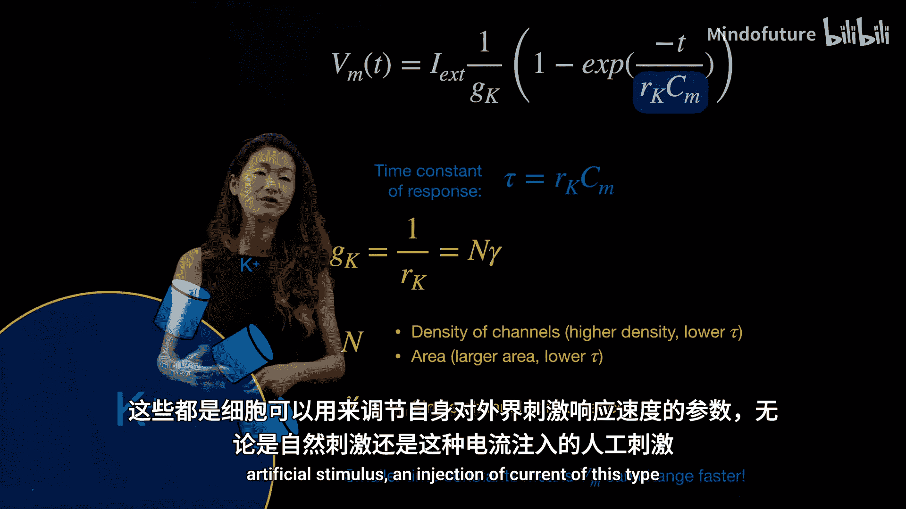
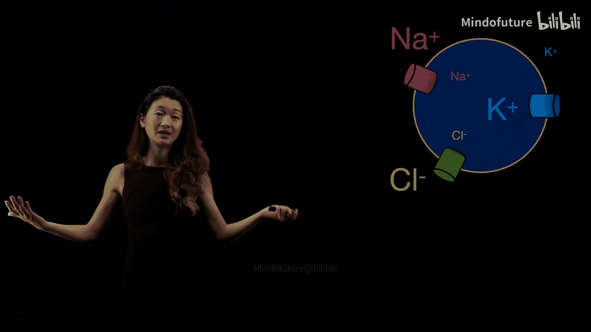
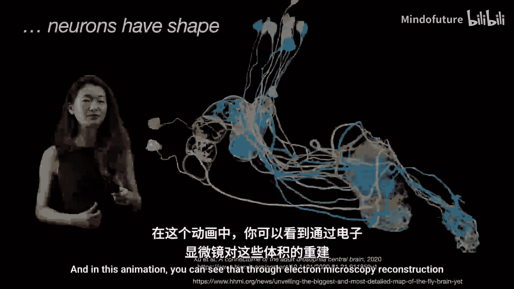
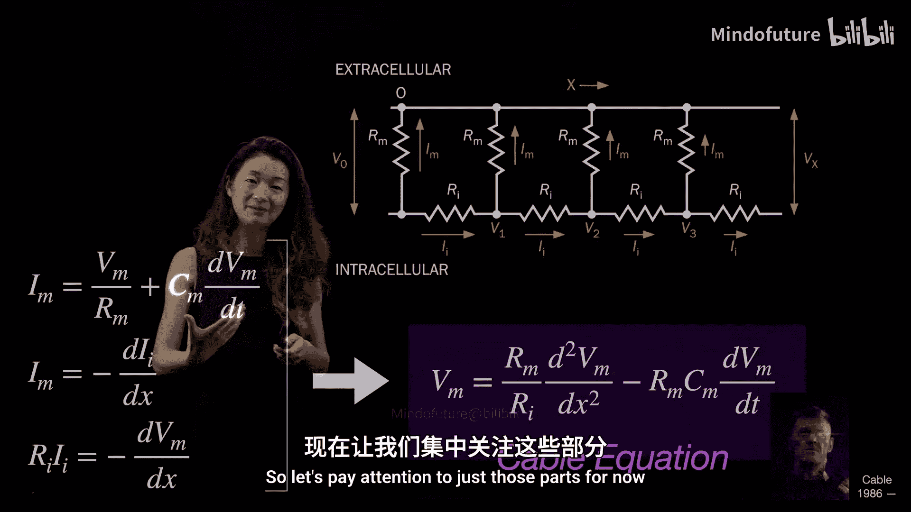
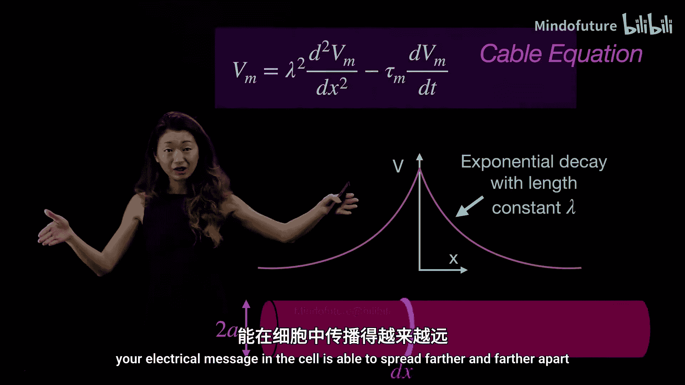

# 【华盛顿大学】神经科学入门 ｜ Introduction To Neuroscience ｜ Bing Wen Brunton p04 P04_神经元主动特性-电流响应-轴突传导的电缆方程 -BV1i3qWBXEDH_p4-

In this video of introduction to neuroscience， we just finished going through the passive properties to neurons what happens when things are at rest and I told you that the reason that this neuron maintains such readiness is that it's ready to any moment for something to happen and so this is a really exciting lecture because it's the first one we're going to start thinking about what happens when something changes when something is happening to this neuron and after all the things that might happen to neuron are all the things that we care about。

 like what happens if you see something you didn't expect to see。

 what if you hear something that you didn't expect to hear。

 what if you feel touched that you weren't expecting to feel how do you not fall over and respond appropriately to whatever it is that you're supposed to be responding to so the active properties of neuron are starting from the same place that we started from last time where we learned about the Ohm's law and how there is an RC circuit equivalent of this particular equation that describes how ions are maintain。

in and flow from the inside and the outside of the cell。

 and this maintain is this maintenance of the resting potential is the electrical basis of the resting potential and how the cells are ready when something does change。

 What we're going to do now is going to take the same equation。

And we are going to look at what happens when we then artificially inject a little bit of current into the circuit。

 so we're going to be thinking about this I'm gonna to explain it a couple of different ways。

 one way of thinking about it is that in terms of the circuit diagram we're going to be artificially injecting a current so what does that mean it means I'm going to add a second clamp between the inside of the outside。

 I'm going to shock the heck out of it like the equivalent of taking a key and sicken into the wall socket。

 that kind of shock that's a current okay that's a kind of current I'm talking about when I'm saying injecting current。

 it's not a syringe could be a syringe because syringees are metal。

 but anyway it's kind of like if you took a key and second into the wall socket don't do it just an analogy here so when you are injecting current into a cell the question is if you inject a current like in a square way like the following when you inject some current you turn it on and you turn it off what actually happens quantitatively speaking to the membrane voltage of the cell how does it respond。

To this injection of current Now as an analogy that's perhaps a little less contrived than my sticking the wall socket analogy。

 this current could also equally well be some kind of naturalistic sensory stimulus like a flash of light that hits your photoreceptors right that effectively gets translated into an injection of current into your photoreceptor cells so what happens to the voltage in that scenario so we're going to derive that from ohm's law following up from last lecture where we derived how ohm's law follows from the nurse potential so let's do it we have ohms law here but as you'll notice there's a couple of extra terms because things are slightly more complicated but just a little bit so just bear it with me here's what's gonna to happen here。

We're going to write the membrane current， the total net current going through the membrane IS subR。

 and it necessarily has to be the sum of the current going through each of these parallel pathways so there's two pathways here。

 there's a resisted pathway and a capacitive pathway and so we're going to count the current that's going through the resisted pathway as ISP R。

That follows the same ohms lot that we had before where it's the conductance times V right so far so good。

 we're also then going to count the current that's going to go through the capacitive pathway and because we're injecting current across the intracellular and the extracellular terminals。

 and we're injecting current through a capacitor。The current is going to be determined by C subm。

 the capacitance of the membrane times DVDDT， the rate of change of the membrane potential。Okay。

The faster it changes， multiply by capacitance。 the more current is going to be passing through the capacitor pathway。

 This is the property of capacitors when we pass current across a capacitor。

 So this comes directly from theory that we have derived from electricity and magnetism。

 and it applies equally well here， excepting instead of a normal capacitor。

 our capacitor now is a lipid by is a lipid bylay， but it acts as a capacitor in this case。

 So once we've written the equation that way。Those of you who may like differential equations as much as I do may make the following observation that this equation。

 despite all the subscripts and all the different stuff that's going on is's actually a relatively standard differential equation of the following form where we have DxTt equals a x plus B so x here is the unknown which is voltage right so it appears one time here in its native form。

And it appears one more time here in its derivative， everything else is a constant because I know G。

And I know C and I injected the current so I know what I external is。

That's the inject current on the other side here， so I know everything except V。

 and I can express V as a function of DVDT。😊，Okay so I know how to solve equations of this particular kind so I can just write down the equation from my knowledge of differential equations and how to solve equations of this kind I can write down the solution a voltage and how it changes as a function of time in this particular form Now don't be intimidated by the form of the equation because we can actually break it down piece by piece and figure out what's actually happening here What's happening here is that everything outside the parentheesis is actually a relative constant we have I my injected current which I know and G which is the conduct to the cell。

 it's just the number of ion channels that are open so that's is good this parts taken care of。

And then we have one minus an exponential to the power of negative t divided by some other constants。

I know how a function of that form can be。Tron。It is exponent of that particular kind。

 it's going to be something that goes up exponentially and then stops after a little while。

In particular， the rate at which it goes up， the curvness of this curve。

 how much the voltage potential responds to the injection of the current。

Is going to be proportional to what's called the time constant here because it's the term that negative t is divided by the time constant of the response is going to be the product of the resistance of the cell。

And the capacitance of the membrane。And that's a constant。

 we don't actually have to know what they are because we can measure it and for most neurons tau is going to be something like  one to 100 milliseconds。

 and that's going to be how quickly the cell can possibly respond to an injection of current the injection of current is nearly instantaneous to tell it's going to take the cell depending on the particular cell we're talking about about one to 10 to 100 milliseconds to respond to that change。

 how it's going to go up。The amount to which it goes up is going to be proportional to magnitude to the current because that's the first term up here。

Right。After the curtain is turned off， the cell is going to go back down to whatever it was before。

And it's going to be an exponential curve of the opposite direction where it goes back down。

 In other words， we are going to see in response to injection of current some kind of exponential depolarization because they're injecting positive current So it's going to depolarize the cell and it's going to follow this shape after the injected current is taken away。

 there's going to be an exponential deep hyperpolarization in the opposite direction where the cell goes back to something like the resting we can derive all of these quantities and the exact magnitude of exactly what the membrane potential is going to do by computing a function of that form using constants that we can either measure or infer from what we know about the cellular properties。

 my neuron。Using this equation， we can then also reason through that the smaller time constants mean that v subM can change faster。

 it means things can change faster， it means that I'm more responsive。

 it means that when something changes， I am ready to change my memory potential really。

 really quickly rather than really really slowly okay and so this tau is then once again a function。

😊，Right？Of the density of the channels， how many of there are per square area。

 the area that we're talking about， like literally how large is the cell that we're talking about in the local area that's responding to this change and then also gamma a single channel conductance Now the single channel conductance is probably going to be a biophysical property of that particular ion channel type I can pick different ones。

 they might have different conductances but I'm stuck with the same one。

 the gamma' is not really going to change but I can change the density of these channels and I could change that by choosing to express more protein or less protein so these are some of the knobs that I as a cell might have the ability to change by changing protein expression and I can also change protein expression by saying I'm going to express this type of ion channel that has a large single channel conductions rather than this other one that has a smaller one stuff like that these are all knobs that cells can change in order to change and tune how quickly it's able to respond to an external stimulus either a natural stimulus or。

Official stimulus and injection of current of this type。

And we can use these equations then to then once again answer the same question we had before of what happens if there are not enough resting ion channels。

 What you can see here is that if there's not enough resting ion channels that means the conductance is going to be different。

 the G is going to be different。Pay attention to where G comes into that equation does it change how quickly the cell respond to external changes or does it change the magnitude of the response okay answer that question for yourself by looking at an equation and try to figure out just reason through it okay what are the physiological consequences of there not being enough resting ion channels what does that mean which term changes and then where does that term actually appear in my equation and reason through what's going to happen if you're in a scenario where artificially through some kind of pathology or some other type of manipulation you don't have enough resting ion channels so that's a question I'm going to leave you to answer？

I'm going to move on and then talk about the fact that every single thing we have said so far in this part of the lecture and the previous one are under the approximation that my neuron is a sphere in the limit of a spherical cell everything I said has been true so far but we know that one of the crazy cool things about neurons is that they're definitely not spheres one of the really cool things about them in fact there's so much not spheres that they are the opposite of spheres they are super long and thin and theyre entire job in many cases is to get information quickly from one end of the body to a different end of the body this is really important if you happen to have neurons that have shape this is why they have shape this is why they're not spherical blobs this is a particularly lovely example of neurons not having spherical shape from the connectome this is an anatomical reconstruction of many if not most of the neurons in the adult Drroophilid flycentral brain and in this animation。

😊。

You can see that through electro microscopy reconstruction of these volume。

 scientists have reconstructed all of these neurons。

 including all the different ways in which they reach far beyond their cell bodies that are very much not well approximated as spheres。

 This is a wonderful thing， but it also makes it really complicated because everything we've done so far has to do with things changing in time but not in space it's true for spheres。

 but what happens if you don't have spheres and spheres are good for lots of things but not good in the scenario where you're in eagle and your hunting let's say that you are a neuron that's in the eye。

 and you spot a rabbit Now you have to change the exact pitch of your wing muscles and tail muscles and maybe some of the ways in which you're pitching your feathers to dive down really quickly and get that rabbit for runs away。

 It is really important that the information from the eye gets the tail as quickly as possible so that you can score dinner。

Spheres are not very good at doing that。 In fact， spheres are not very good at doing that。

 and what we need are wires in the same way that an airplane might have a wire from the cockpit where the pilot lives to the tail where you might have to pitch it in order to either go up or down when you're landing or taking off same thing happens here。

 So neurons are the biological equivalent of wires that convey information often very quickly and often over large distances approximately as large as the animal is。

 and it does so by having a couple of different compartments where the cell body lives somewhere in the cell in the animal and there is a long process is known as the axon that is the output of the cell。

 that is when the cell is going to pass information from whatever it's gathered to wherever is tried to go and this long thin region。

Is called the axon and so we're going to talk a little bit about the approximation of the neuron。

 not as a sphere， but as a cylinder， a long thin cylinder。

 what happens if we consider that the cell is actually cylindr cooling shape and might be really long rather than spherical。

This is the point at which we've talked a little bit about changes in time。

Right we talked about how voltage changes in time， so in calculus speak that'll be dDDT this is the first time we're talking about changing in space I'm just going to dis your little more terminology here to make sure we're comfortable。

In terms of a cylinder， we're talking about the length of the cylinder。

 and so I'm going to instead of using T for time， I'm going to use x for this axial direction of the cylinder。

 so anytime we're talking about change in space， how voltage changes in space。

 we're actually going to call that DVDDX to differentiate it from DVDT。So。Similarly。

 there's a version of an equivalent circuit diagram that we can draw just like the RC equivalent before。

 where here we're actually considering space because now currents instead of being able to just go between inside and outside。

 so here that's I subM the membrane current currents can also flow along the axial direction of my cylinder and that's I sub I I for intracellular。

 so currents can flow inside the cell and currents can flow through the membrane through channels so it can go up and down。

I sub M， and it can also go on the inside of the cell in the axial direction， I sub I。

 And we can kind of chop up the cell， the cylinder of the cell into a little segments， load the Ts。

 Okay and draw this little diagram as it repeats。On and on and on in the left side and the odd side。

 Sos not worry about the ends for now，s let's just only care about the middle of the cylindrical piece of neuron for now。

 okay。So if we do that what we can do is write down instead of ohm's law。

 we can write down what's called the cable equation and the cable equation is going to look a little bit more complicated than ohm's law because it happens to be a partial differential equation it's called a partial differential equation because it has termmininate that has DVDT the change of voltage in time and the square vDx squared which is change in space。

 a second derivative of the the second spatial derivative and so the voltage is going to be a function of all of those things once again for those of you who love differential equations。

 feel free to dig into this there's less written in the subject。

 lots of really cool models those of you who may not care about the details of this cable equation we're just going to tease it apart a little bit and once again we're going to be looking at the parts of the equation where they're constants that we don't and there's things that change so let's pay attention to just those parts for now we're going to look at the cable equation and we can see。

That it's separable in the following way， there is a set of terms that have to do with how things change in space and a set of terms that have to do with how things change in time and they're actually separate。

 which is great right they're not all mixed up together， it could have been worse so。

The things that have to change in space is the second spatial derivative and we're going to lump everything else that's a constant into this lambda square parameter and this lambmbda square parameter is what's called the length constant of the propagation it tells you about how much the voltage propagates in space。

 how much it spreads right if something is happening in the middle your neighbors are' going to hear about it right it's like if you're living on a block is how quickly rumors spreads from neighbor to neighbor neighbor is everyone whispers to each other if whip for the really fast the length constant is going to be larger。

 if you don't whisper very fast and it's going to be a little more localized so the length constant of the propagation lambda squared is going to be the ratio between R subM。

 the resistance of the membrane。Divided by a I， the resistance of the intracellular space。

 the intracellular space is a salty solution， so it's definitely conductive。

 but it's not infinitely conductive， and so it's the relative ratio of how conductive the membrane is versus how conductive the intracellular salty water space is。

Now here I'm using the notation that big R means bulk properties and little R means small patchy properties。

 a patches the property per square area okay so if we express it this way。

 you'll see a really interesting relationship start to emerge here because the membrane the membrane resistance is going to be the resistance of each patch of it divided by2 pi a where a is the radius of this cable remember now instead of having a sphere that are completely symmetrical we have a cell that is cylindrical。

 this is a cylinder can have different radii it could be bigger it could be smaller similarly the axial resistance of of the cylinder is also inversely proportional to a but there's an a square term in the denominator instead of just an a term the denominator if we do the division and cancel things out what you'll see is that the length constant。

😊，Pligation happens to be proportional to a。In other words， the larger the cylinder。

 the voltage spreads farther。We're going to plot that a different way the other way of pictorial way of saying what I'm saying is that if there's a voltage in the middle。

 it's going to spread in space， your neighbors going to hear about it because those ions are going to flow to the left and right。

The larger the diameter of the cylinder， the larger the diameter of the neuron。

 the larger the diameter of the axon， the more it's going to spread。

This is important because having a larger axon is actually a really valid strategy if you wanted your message to go farther。

Faster。Okay。But as in all things， there is a tradeoff， it is not without cost。

 maintaining a larger diameter of your axon of your cell also means that you actually have to pay for it metabolically。

 you have to grow it， you have to maintain it， you have to feed it， you have to give it ATP。

 you have to do all the things that you have to do to keep a larger cell alive and the tradeoff there is that you get an axon that is larger in diameter which has a larger exponential decay length constant lambda。

 so that your message， your electrical message in the cell is able to spread farther and farther apart。

So。These are the active properties of neurons， we've talked about how things change in time as well as how they change in space by reasoning through these physical analogies and looking at the equations that govern them that we all know and love from physics。

 and so to summarize the basics that we talked about our neurons responding to injected current by changing its membrane voltage。

 it changes so in exponential way with either exponential depolarization or hyperpolarization in time。

 we then talked about how the density of ion channels it determine how quickly neurons can respond to change。

We talked then about the electrical property spreading in space。

 this is governed by the cable equation， and the cable equation makes a prediction about how the diameter of the axon in the cylindrical approximation determines the fastness and extent to which membrane potentials can spread。

😊，In the next section of the video， we're going to talk about a little we're going to layer on a little more activity。

 a little more excitability into the properties that neuro're on and finally get to the point where we have the thing that you're all here for。

 which is the action potential， that's next。